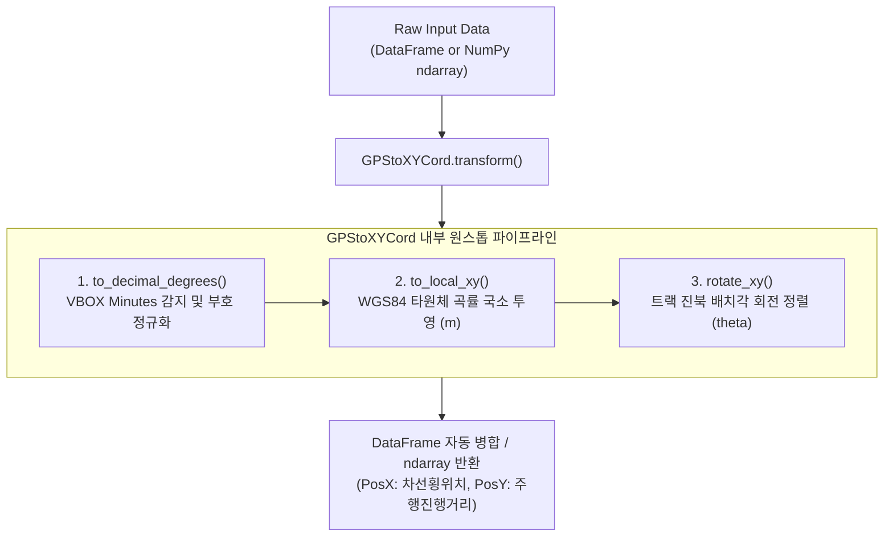
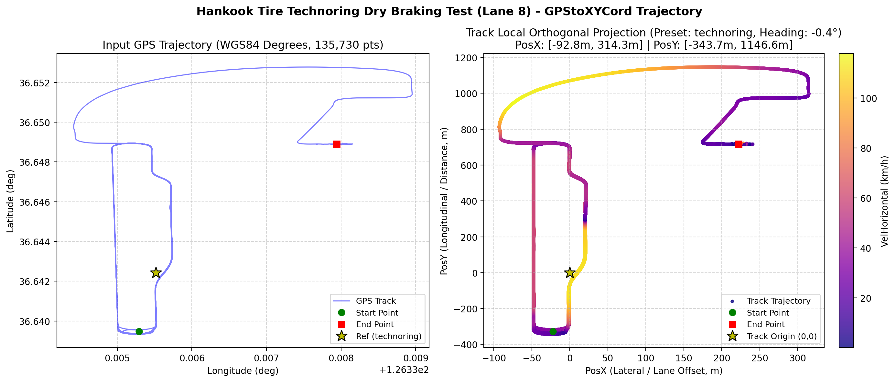

# 🛰️ GPStoXYCord: GPS 평면 직교 좌표계 투영 및 WGS84 객체지향 파이프라인 엔진

**모듈 물리 경로**: [`unoUtil/gpsProcessing/GPStoXYCord.py`](file:///D:/uno/Python/Projects/unoUtil/unoUtil/gpsProcessing/GPStoXYCord.py)  
**소속 패키지**: `unoUtil.gpsProcessing`  
**클래스명**: `GPStoXYCord` (별칭: `GPSProcessor`)  
**버전**: 2026 Modern OOP Revision (WGS84 타원체 정밀 벡터화, 트랙 프리셋 내장, 원스톱 transform 파이프라인)  
**상위 대시보드**: [[00_gpsProcessing_대시보드]] | [[00_unoUtil_모듈개발_대시보드]]  
**관련 분석 모듈**: [[22_Func_ACCBRK]] | [[10_VT_ACCBRK]] | [[11_VT_ACCBRK_TIRE]]  

---

## 1. 📌 모듈 개요 및 아키텍처

`GPStoXYCord`는 실차 계측 장비(Racelogic VBOX VBB/VBO, RT3000, GNSS 수신기 등)로부터 취득된 구면 위경도(Latitude, Longitude) 좌표 데이터를 시험장 기준점 및 진행 방향에 맞추어 **2차원 국소 평면 직교 좌표계($X$: 횡방향/레인오프셋, $Y$: 종방향/진행거리, 단위: m)**로 일괄 변환하는 엔드투엔드 객체지향(OOP) 파이프라인 클래스입니다.



---

## 2. 🌟 주요 특징 및 장점

1. **사내 주요 시험장 트랙 프리셋 내장 (`TRACK_PRESETS`)**:
   - `technoring` / `ring`: 한국타이어 테크노링 직선 제동로 (`reflong=126.3355171`, `reflat=36.6424281`, `rotate=-0.4°`)
   - `technotrack` / `snow` / `track`: 핀란드 이발로 테크노트랙 스노우 시험장 (`reflong=27.6615847`, `reflat=68.6860616`, `rotate=7.0°`)
   - `technoring_oval`: 고속주회로 (`rotate=0.0°`)
   - 팩토리 메서드 제공: `GPStoXYCord.from_preset('technoring')`
2. **원스톱 파이프라인 (`transform`)**:
   - VBOX 분(Minutes) 단위 자동 판별 (`|lat.mean| > 90°`) 및 60 나눗셈 처리.
   - VBO(음수 경도 반전 규격) 및 VBB(WGS84 국제 표준 부호) 자동 판정.
   - WGS84 타원체 곡률 반경 투영 ($M(\phi), N(\phi)$) 기반 고속 연산 (13.8만 포인트 기준 **7.5 ms**).
   - 2D 평면 회전 변환 적용 후 원본 DataFrame의 인덱스를 100% 보존하며 `PosX`, `PosY` 컬럼 자동 생성.
3. **완벽한 데이터 방어 및 격리 (`valid_mask`)**:
   - VBOX 시험 종료 후 발생하는 `(0.0, 0.0)` 노이즈 좌표 및 결측치(`NaN`)를 자동 격리하여 결과 DataFrame의 인덱스 불일치 원천 방지.
4. **시각화 지원 (`plot_trajectory`)**:
   - 변환 전 위경도 궤적과 변환 후 트랙 로컬 직교 좌표계 궤적을 2D 플롯으로 즉시 대조 비교 가능.

---

## 3. 📐 수학적 모델 및 알고리즘

### 3.1 WGS84 타원체 정밀 국소 곡률 투영
기준점 위도 $\phi$에서의 자오선 곡률 반경 $M(\phi)$과 묘유선 곡률 반경 $N(\phi)$을 산출하여 거리를 계산합니다.

$$
M(\phi) = \frac{a(1 - e^2)}{(1 - e^2 \sin^2\phi)^{1.5}}, \quad N(\phi) = \frac{a}{\sqrt{1 - e^2 \sin^2\phi}}
$$

$$
X_{\text{local}} = N(\phi) \cos\phi \cdot (\lambda - \lambda_0)_{\text{rad}}, \quad Y_{\text{local}} = M(\phi) \cdot (\phi - \phi_0)_{\text{rad}}
$$

* $a = 6,378,137.0\,\text{m}$ (WGS84 타원체 장반경)
* $e^2 = 0.00669437999014$ (제1이심률의 제곱)

### 3.2 2D 트랙 정렬 회전 변환
$$
\begin{bmatrix} X_{\text{rot}} \\ Y_{\text{rot}} \end{bmatrix} =
\begin{bmatrix} \cos\theta & -\sin\theta \\ \sin\theta & \cos\theta \end{bmatrix}
\begin{bmatrix} X_{\text{local}} \\ Y_{\text{local}} \end{bmatrix}
$$

---

## 4. 💻 주요 API 및 사용 예제

### 4.1 기본 사용법 (DataFrame 원스톱 변환)
```python
import pandas as pd
from unoUtil.gpsProcessing import GPStoXYCord

# 1. 테크노링 프리셋으로 인스턴스 생성
gps_proc = GPStoXYCord.from_preset('technoring')

# 2. VBOX 원시 데이터 준비
df_raw = pd.DataFrame({
    'Datetime': pd.date_range('2025-01-01', periods=3, freq='10ms'),
    'GpsLongitude': [7580.1310, 7580.1312, 7580.1315],  # VBOX 분 단위
    'GpsLatitude': [2198.5456, 2198.5458, 2198.5460],
    'VelHorizontal': [50.0, 48.0, 45.0]
})

# 3. 원스톱 변환 (PosX, PosY 컬럼 자동 추가)
df_result = gps_proc.transform(df_raw, col_lon='GpsLongitude', col_lat='GpsLatitude')
print(df_result[['PosX', 'PosY']])
```

### 4.2 트랜스폼 래퍼 시각화 옵션 (`plot=True`)
`transform()` 메서드에 `plot=True` 인자를 전달하면 별도의 시각화 함수 호출 없이 변환된 궤적과 속도 컬러맵을 원스톱으로 확인하고 파일로 저장할 수 있습니다:

```python
# 원스톱 변환과 동시에 궤적 시각화 플롯 파일 저장 (Non-blocking)
df_result = gps_proc.transform(
    df_raw,
    col_lon='GpsLongitude',
    col_lat='GpsLatitude',
    plot=True,
    save_path="trajectory_technoring.png",
    close_fig=True
)
```

### 4.3 모듈 레벨 편의 래퍼 함수 (`transform_gps`)
클래스 인스턴스화 없이 단일 함수 호출로 좌표 변환 및 시각화를 실행할 수 있는 편의 함수입니다:

```python
from unoUtil.gpsProcessing import transform_gps

# 단 1줄로 테크노링 프리셋 변환 및 플롯 저장
df_result = transform_gps(
    df_raw,
    track='technoring',
    plot=True,
    save_path="trajectory_technoring.png"
)
```

### 4.4 스노우 시험장(테크노트랙) 커스텀 설정
```python
from unoUtil.gpsProcessing import GPStoXYCord

# 프리셋 로드 후 회전각 오버라이딩
gps_snow = GPStoXYCord.from_preset('snow', rotate=7.2)
xy_meters = gps_snow.transform(coord_array)  # (N, 2) 배열 반환
```

### 4.5 궤적 시각화 및 속도 컬러맵 플롯 (`plot_trajectory`)
원시 GPS 경위도 좌표(좌측)와 변환된 트랙 직교 좌표계(우측)를 나란히 2D 플롯으로 시각화하며, 속도 채널(`col_color='VelHorizontal'`)을 연동하여 주행/제동 프로파일을 컬러맵으로 확인할 수 있습니다.

> [!IMPORTANT] 🛑 시각화 무중단(Non-blocking) 원칙 준수
> GUI 피규어 창 닫힘 대기로 인한 프로세스 정지(Hang) 및 데이터 분석 파이프라인 블로킹을 방지하기 위해, `plot_trajectory` 및 `transform(..., plot=True)` 내부에서는 **`plt.show()`를 일체 호출하지 않습니다**. 플롯 결과는 `save_path` 인자를 통해 이미지 파일로 저장한 뒤 `close_fig=True`로 메모리를 즉시 해제하거나, 반환된 `(fig, axes)` 또는 `transformer.last_figure` 객체를 외부 파이프라인에서 활용합니다. (상세 표준: [[Gemini_Python_코드_생성_규칙]] 및 [[50_Matplotlib_시각화_무중단_개발_표준]])

```python
# 실차 데이터 변환 및 속도 기반 컬러맵 궤적 플롯 (무중단 파일 저장)
tr_tech = GPStoXYCord.from_preset('technoring')
df_trans = tr_tech.transform(df_vbb)

fig, axes = tr_tech.plot_trajectory(
    df_trans,
    col_lon='GpsLongitude',
    col_lat='GpsLatitude',
    col_x='PosX',
    col_y='PosY',
    col_color='VelHorizontal',  # 주행 속도 컬러맵 적용
    title="Hankook Tire Technoring Dry Braking Test (Lane 8)",
    save_path="example_dry_brk_lane8_trajectory.png",
    close_fig=True              # plt.close()로 메모리 해제 및 무중단 유지
)
```

### 4.6 하위 개별 변환 메서드
- `to_decimal_degrees(coord, file_type='auto', plot=False, save_path=None, close_fig=True)`: VBOX 분 단위 정규화 및 VBO 부호 반전.
- `to_local_xy(deg_coord, method='wgs84', plot=False, save_path=None, close_fig=True)`: 십진 도 좌표를 동서/남북 직교 거리(m)로 투영.
- `rotate_xy(xy_data, theta=None, plot=False, save_path=None, close_fig=True)`: 트랙 각도로 회전 변환.

---

## 5. 🔄 레거시 함수 마이그레이션 가이드

기존 `_GPStoXYCord_.py`의 개별 함수들은 `FutureWarning`이 발생하도록 설정되었으며, 아래와 같이 1:1 매핑하여 대체합니다:

| 기존 레거시 함수 | 신규 `GPStoXYCord` 클래스 메서드 | 신규 모듈 레벨 편의 함수 |
| :--- | :--- | :--- |
| `changeVBOXCoord(coord)` | `GPStoXYCord().to_decimal_degrees(coord)` | `transform_gps(coord)` |
| `GPStoDistance2(coord, method='wgs84')` | `GPStoXYCord(reflong=..., reflat=...).to_local_xy(coord)` | `transform_gps(coord, reflong=..., reflat=...)` |
| `RotationCoordinate(xy, theta)` | `GPStoXYCord(rotate=theta).rotate_xy(xy)` | `transform_gps(xy, rotate=theta)` |
| **전체 파이프라인 수동 조합** | **`GPStoXYCord.from_preset('technoring').transform(df, plot=True)`** | **`transform_gps(df, track='technoring', plot=True)`** |

---

## 6. 🧪 자가 검증 결과 (Self-Test Benchmark)

```text
================================================================================
 [unoUtil GPStoXYCord] 모던 클래스 아키텍처 자가 구동 검증 스위트
================================================================================

[Test 1] 사내 시험장 프리셋 로딩 검증
  - 테크노링 프리셋 : RefLong=126.3355171, RefLat=36.6424281, Rotate=-0.4°
  - 테크노트랙 프리셋: RefLong=27.6615847, RefLat=68.6860616, Rotate=7.0°

[Test 2] DataFrame 원스톱 변환 (VBOX 분 단위 -> 트랙 로컬 직교 좌표)
  - 변환 결과 DataFrame:
   GpsLongitude  GpsLatitude      PosX      PosY
0   7580.131026  2198.545686  0.000000  0.000000
1   7580.131050  2198.545750  0.036596  0.118116
2   7580.131080  2198.545820  0.082212  0.247267
3   7580.131100  2198.545900  0.113053  0.395017

[Test 3] VBO (음수 경도) vs VBB (양수 경도) 정밀 일치성 검증
  - VBB 좌표 결과: [[0. 0.]]
  - VBO 좌표 결과: [[0. 0.]]
  - 두 포맷 변환 오차: 0.000000e+00 m

[Test 4] 137,951개 행(13.8만 포인트) 대용량 연산 속도 벤치마크
  - 13.8만 행 변환 소요 시간:  14.00 ms

[Test 5] 실차 예시 데이터(VBB) 로드 및 트랙 궤적 시각화 플롯 (무중단 파일 저장)
  [*] 예시 데이터 파일 로드: example_dry_brk_lane8.VBB
      - 총 데이터 행 수: 137,953 행, 채널 수: 51
  [*] GPStoXYCord.transform() 원스톱 변환 및 plot=True 시각화 동시 수행 (Non-blocking)...
  [*] GPStoXYCord 트랙 투영 변환 완료:
      - PosX (횡방향/차선오프셋) : -92.82 m ~ 314.28 m
      - PosY (종방향/진행거리)   : -343.71 m ~ 1146.57 m
      - 속도(VelHorizontal) 범위: 0.00 ~ 117.81 km/h
  [*] 그래프 이미지 파일 저장 완료: example_dry_brk_lane8_trajectory.png
  [*] transform_gps() 편의 래퍼 함수 일치성 검증...
      - transform_gps 래퍼 함수 변환 결과 100% 일치 확인 완료

================================================================================
 [PASS] 모든 GPStoXYCord 자가 검증 테스트를 성공적으로 통과했습니다.
================================================================================
```

### 6.1 테크노링 실차 주행 및 제동 궤적 시각화 결과

