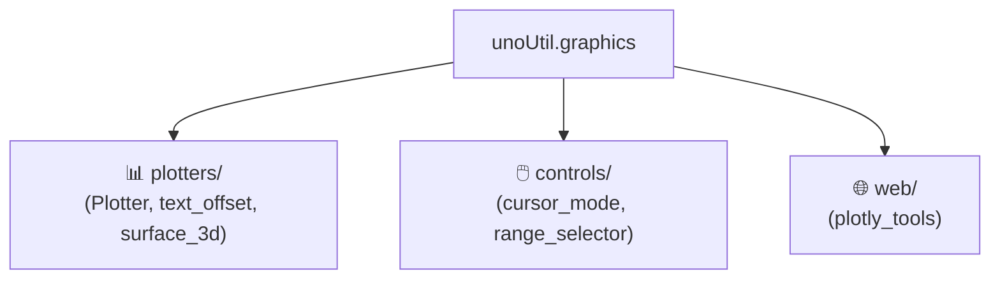

# 🎨 graphics (실차 시각화 및 대화형 인터랙션 패키지) 대시보드

> [!ABSTRACT] 🛠️ 패키지 개요
> 사용자 요청에 따라 기존 `graphicTools`를 **3대 전문 서브패키지(렌더링 플로터, 상호작용 제어, 웹/Plotly)**로 물리 분할하고, 프로세스 정지를 원천 방지하는 Non-blocking 표준을 탑재한 시각화 프레임워크입니다.

---

## 📦 3대 서브패키지 구성

1. 📊 **[[plotters/plotter|plotters (렌더링 플로터)]]**:
   - `Plotter` (`_Plotter_`): 실차 시계열 표준 렌더러
   - `text_offset`: 겹침 방지 데이터 라벨 오프셋
   - `surface_3d`: 3D 노면/타이어 곡면 그리드 시각화
2. 🖱️ **[[controls/cursor_mode|controls (상호작용 컨트롤러)]]**:
   - `set_cursor_mode` (`SetCursorMode`): 십자선 실시간 수치 확인
   - `RangeSelectorMouseClick`: 마우스 드래그 기반 관심 구간 추출
3. 🌐 **web (인터랙티브 웹 차트)**:
   - `make_cmp_plotly`: 브라우저 기반 대화형 멀티 비교 차트

---

## 📚 관련 문서
* 🏗️ **[[26_대규모_파이썬_패키지_모듈화_및_무중단_하위호환_아키텍처#4-시각화-무중단non-blocking-엔지니어링-표준|시각화 무중단(Non-blocking) 엔지니어링 표준]]**
* 🧭 **상위 허브**: [[00_unoUtil_모듈개발_대시보드]]

---

## 📜 버전 이력 및 주요 개발 현황 (Changelog)

### ⚡ v2.4 (2026-09-21) 진행률 바 터미널 렌더링 무결화 및 전각 이중 복색 교정
1. **🎨 텍스트 절단 시 터미널 색상 탈색 방지 (`STR_CLR_END` 강제 삽입)**:
   - 터미널 가로폭 제한으로 문자열이 잘릴 때 색상 리셋 기호가 유실되어, 텍스트가 흰색과 초록색을 불규칙하게 깜빡이며 뒤바뀌던 고질적인 플리커 버그 완벽 수정.
2. **📏 가로폭 초과 시 줄바꿈 복사 현상 방지 (`DECAWM` 제어)**:
   - 프로그레스 바 렌더링 시 자동 개행 방지 코드(`\033[?7l`)를 송신하여 좁은 터미널에서도 잔상 누적 없는 안전 업데이트 보장.
3. **📊 진행 상태 수치 `1/6` 왼쪽 정렬화**:
   - `count_info`를 퍼센티지 옆인 좌측에 그룹화하여 배치(`16.7% (1/6) |███░░|`) ➔ 우측 수치 잘림 시에도 핵심 진행 카운트 100% 가독 생존 보장.

### 🚀 v2.0 (2026-09-18) `graphicTools` 전격 폐기 및 3대 전문 서브패키지 물리 분할
1. **단일 책임 분할**: `plotters/` (표준 렌더러), `controls/` (상호작용 컨트롤러), `web/` (Plotly) 서브패키지로 전면 개편.
2. **시각화 무중단(Non-blocking) 원칙 전면 도입**:
   - 프로세스를 정지(Hang)시키는 `plt.show()`를 소스코드 전체에서 전면 퇴출하고, `plt.savefig()` 후 `plt.close(fig)` 처리 필수화.
