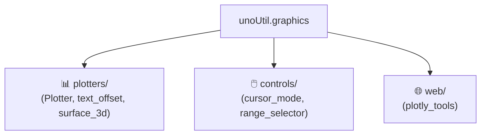

# 🎨 graphics (실차 시각화 및 대화형 인터랙션 패키지) 대시보드

> [!ABSTRACT] 🛠️ 패키지 개요
> 사용자 요청에 따라 기존 `graphicTools`를 **3대 전문 서브패키지(렌더링 플로터, 상호작용 제어, 웹/Plotly)**로 물리 분할하고, 프로세스 정지를 원천 방지하는 Non-blocking 표준을 탑재한 시각화 프레임워크입니다.

---

## 📦 3대 서브패키지 구성

1. 📊 **[[plotters/plotter|plotters (렌더링 플로터)]]**:
   - `Plotter` (`_Plotter_`): 실차 시계열 표준 렌더러
   - `text_offset`: 겹침 방지 데이터 라벨 오프셋
   - `surface_3d`: 3D 노면/타이어 곡면 그리드 시각화
2. 🖱️ **[[controls/cursor_mode|controls (상호작용 컨트롤러)]]**:
   - `set_cursor_mode` (`SetCursorMode`): 십자선 실시간 수치 확인
   - `RangeSelectorMouseClick`: 마우스 드래그 기반 관심 구간 추출
3. 🌐 **web (인터랙티브 웹 차트)**:
   - `make_cmp_plotly`: 브라우저 기반 대화형 멀티 비교 차트

## 📅 1. 프로젝트 주요 버전 이력 (Changelog 타임테이블)

| 버전 | 날짜 | 작업자 | 핵심 수정 및 개발 내역 (Changelog) | 상태 |
| :---: | :---: | :---: | :--- | :---: |
| **v2.7** | 2026-09-23 | uno & Gemini | 🎨 `SetCursorMode` $\rightarrow$ `def set_cursor_mode`, `PairPlotCorrWithScatter` $\rightarrow$ `def plot_pair_corr_with_scatter`, `Regression3D` $\rightarrow$ `def calc_regression_3d` 공식 표준 8대 동사 선언 및 하위 호환 별칭 정합화 완결 | ✅ 완료 |
| **v2.6** | 2026-09-22 | uno & Gemini | 🎨 plot/save 제어 인자 표준 다형성 결합 및 bool_plot/bool_save 네임 섀도잉 방지 격리 수립 🛡️ SetCursorMode, PairPlot 등 비표준 PascalCase 함수를 snake_case(8대 동사 룰)로 정규화하는 마스터 플랜 수립 | ✅ 완료 |
| **v2.4** | 2026-09-21 | uno & Gemini | 🎨 가로폭 초과로 인한 줄바꿈 잔상 오동작 방지 (VT100 DECAWM \033[?7l 제어 이식) 📊 진행 카운팅(1/6) 수치를 퍼센티지 오른쪽 옆 좌측 영역으로 이동시켜 가독 복원 🎨 문자열 잘림 시 복원코드(STR_CLR_END) 강제 추가로 터미널 색상 플리커 완치 | ✅ 완료 |
| **v2.0** | 2026-09-18 | uno | 🔌 graphicTools 폐기 및 3대 서브패키지 (plotters, controls, web) 완전 분할 🖼️ plt.show() 전면 금지 및 Non-blocking 시각화 렌더링 표준 강제 | ✅ 완료 |

---

## 📚 관련 문서
* 🏗️ **[[26_대규모_파이썬_패키지_모듈화_및_무중단_하위호환_아키텍처#4-시각화-무중단non-blocking-엔지니어링-표준|시각화 무중단(Non-blocking) 엔지니어링 표준]]**
* 🧭 **상위 허브**: [[00_unoUtil_모듈개발_대시보드]]

---

