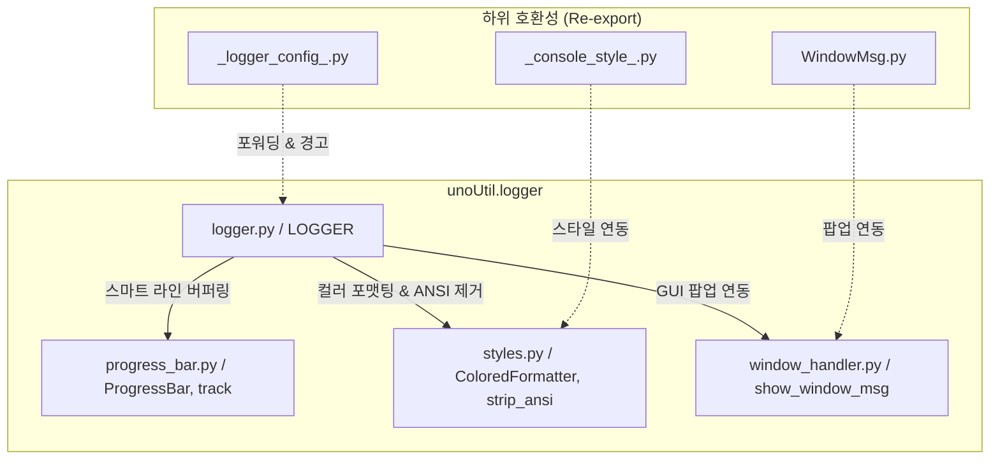

# 🧭 unoUtil 통합 로깅 및 콘솔 모니터링 모듈 사용 매뉴얼 (`logger.md`)

`unoUtil.logger` 패키지는 사내 파이썬 프로젝트의 데이터 계측, 동역학 분석, 전처리 및 시각화 전 과정의 상태를 투명하게 모니터링하고 추적하기 위한 최첨단 통합 로깅 엔진입니다.

이 패키지는 콘솔 컬러링, 정교한 시간 추적(경과 시간 및 델타 타임), 파일 로깅(ANSI 코드 제거), **순수 파이썬 프로그레스 바 충돌 원천 방지 아키텍처**, 그리고 PyQt5 GUI 기반 에러 팝업을 단일 통합 인터페이스(`LOGGER`)로 제공합니다.

> **관련 영구 지식 문서 및 모듈**: [[00_unoUtil_모듈개발_대시보드]], [[styles]], [[progress_bar]], [[window_handler]], [[FileDataReader]], [[VT_ACCBRK]]

---

## 1. 📌 개요 및 개발 배경

차량 시험 데이터 분석(`vehicle`), 대용량 바이너리/로그 파싱(`file_reader`), GPS 좌표 보정 (`gps`) 등 엔지니어링 파이프라인 전반에서 다음과 같은 콘솔 UI 및 로깅 요구사항이 존재했습니다:

1. **로그 포맷의 다변화 요구**:
   - 실시간 시각(`%H:%M:%S`) 기반의 이벤트 기록
   - 직전 작업 대비 소요 시간(`[+0.123s]`)을 추적하는 성능 프로파일링
   - 특정 코드 블록의 시작/종료 소요 시간을 일일이 `time.time()` 하지 않고 자동 측정하는 타이머(`with logger.measure()`)
2. **반복 루프 진행률 가시화 (Progress Bar)**:
   - 수십~수백 개 파일 일괄 로딩(`scan_dir`)이나 수십만 행 데이터 보간 시 진행 상황(%, ETA, 처리속도) 파악 필요
   - 무거운 외부 라이브러리(`tqdm` 등) 없이 순수 파이썬 표준 라이브러리로 동작하는 초경량 프로그레스 바 구현
3. **로거와 프로그레스 바의 충돌 방지**:
   - 프로그레스 바가 화면에 떠 있는 동안 `logger.info()`가 출력되어도 게이지 바가 여러 줄로 복사되거나 화면이 깨지지 않는 스마트 버퍼링
4. **ANSI 탈색 파일 저장 및 GUI 팝업 알림**:
   - 콘솔에는 선명한 ANSI 컬러 및 이모지로 출력하고, 파일(`.log`)에는 색상 코드를 자동 제거(`strip_ansi`)하여 순수 텍스트로 보존
   - 치명적 오류(`ERROR`, `CRITICAL`) 발생 시 연구원이 즉각 인지할 수 있도록 선택적 PyQt5 팝업 메시지 박스 연동

이 모든 요구사항을 해결하기 위해 최첨단 **`LOGGER` 클래스** 기반의 통합 모니터링 프레임워크가 구축되었습니다.

---

## 2. 🏗️ 아키텍처 및 모듈 구성 (v2.0 Clean Architecture)

`unoUtil.logger`는 4개의 전담 모듈이 유기적으로 결합된 고성능 올인원 엔진입니다. 



| 모듈 파일명 | 핵심 클래스 / 함수 | 주요 역할 |
| :--- | :--- | :--- |
| [`logger.py`](file:///D:/uno/Python/Projects/unoUtil/unoUtil/logger/logger.py) | `LOGGER`, `get_core_logger`, `set_global_log_level` | 메인 통합 로거, 타이머 컨텍스트, 프로그레스 바 래퍼, 파일 저장 관리 |
| [`progress_bar.py`](file:///D:/uno/Python/Projects/unoUtil/unoUtil/logger/progress_bar.py) | `ProgressBar`, `track`, `get_active_progressbar` | 캐리지 리턴(`\r`) 기반 경량 진행률 바, 스피너 모드, 라인 클리어(`\033[K`) |
| [`styles.py`](file:///D:/uno/Python/Projects/unoUtil/unoUtil/logger/styles.py) | `ColoredFormatter`, `strip_ansi`, `check_supports_color` | ANSI 컬러 코드, 레벨별 이모지, 터미널 환경 감지 및 파일용 탈색 |
| [`window_handler.py`](file:///D:/uno/Python/Projects/unoUtil/unoUtil/logger/window_handler.py) | `show_window_msg`, `WindowMsgHandler` | PyQt5 메시지 박스 팝업 및 헤드리스 콘솔 fallback 처리 |

---

## 🎨 3. 로그 레벨 및 가시성 표준

`LOGGER`는 파이썬 표준 `logging` 모듈 레벨과 100% 호환되며, 작업 성공을 나타내는 전용 **`SUCCESS`** 레벨(녹색 볼드 + 체크 이모지)이 추가되어 있습니다.

| 레벨 명칭          | 표준 상수 및 값               | 비주얼 스타일             | 용도 및 설명                            |
| :------------- | :---------------------- | :------------------ | :--------------------------------- |
| **`DEBUG`**    | `logging.DEBUG` (10)    | 🔍 DEBUG (회색)       | 개발 중 디버깅 목적의 상세 상태 및 변수 출력         |
| **`INFO`**     | `logging.INFO` (20)     | ℹ️ INFO (청색)        | 일반 진행 프로세스 상황 보고                   |
| **`SUCCESS`**  | `SUCCESS` (25)          | ✅ SUCCESS (녹색 볼드)   | 배치 태스크, 리팩토링 검증, 파일 저장 성공 보고       |
| **`WARNING`**  | `logging.WARNING` (30)  | ⚠️ WARNING (황색 볼드)  | 성능 유실 우려, 하위 호환 매핑 작동 등 경고         |
| **`ERROR`**    | `logging.ERROR` (40)    | ❌ ERROR (적색 볼드)     | 예외 발생, 연산 실패, 복원 오류 (GUI 팝업 선택 가능) |
| **`CRITICAL`** | `logging.CRITICAL` (50) | 🚨 CRITICAL (적색 역상) | 프로그램 중단, 치명적 자원 고갈 (디폴트 GUI 팝업)    |

---

## ⏱️ 4. 시간 포맷 프리셋 및 커스터마이징

로깅 시 시간 축을 추적하는 **5가지 포맷 프리셋**을 제공합니다. 프로젝트 성격에 맞춰 `format_type` 인자로 지정할 수 있습니다.

```python
from unoUtil.logger import LOGGER

# 1. 기본형 (Default: 현재 시각 + 레벨 + 모듈명)
# 출력 예: 14:23:45 [ℹ️ INFO   ] [unoUtil.Core] 메시지
logger_default = LOGGER("Core", format_type="default")

# 2. 누적 소요 시간 (Elapsed: 로거 시작 후 경과 시간 추적)
# 출력 예: [Total  01.25s] [ℹ️ INFO   ] [unoUtil.Core] 메시지
logger_elapsed = LOGGER("Core", format_type="elapsed")

# 3. 델타 타임 추적 (Delta: 직전 로그 출력 시간과의 차이 계산)
# 출력 예: [     +0.04s] [ℹ️ INFO   ] [unoUtil.Core] 메시지
logger_delta = LOGGER("Core", format_type="delta")

# 4. 단순 심플 모드 (Simple: 이름, 시각 제외)
# 출력 예: [ℹ️ INFO   ] 메시지
logger_simple = LOGGER("Core", format_type="simple")

# 5. 초정밀 디테일 모드 (Detailed: 모든 시간 추적 요소 결합)
# 출력 예: 14:23:45 [Total  01.25s] [     +0.04s] [ℹ️ INFO   ] [unoUtil.Core] 메시지
logger_detailed = LOGGER("Core", format_type="detailed")
```

---

## 💻 5. 실무 API 상세 및 사용 예시

### 5.1. 어디서든 1줄 임포트
최상위 패키지 및 바로가기를 모두 지원하므로 원하는 경로로 자유롭게 임포트할 수 있습니다:
```python
from unoUtil import LOGGER, track
# 또는
from unoUtil.logger import LOGGER, track
```

### 5.2. 기본 인스턴스 초기화 및 팩토리 싱글톤
프로젝트 전역에서 네임스페이스가 꼬이지 않도록 싱글톤 팩토리 함수인 `get_core_logger`를 활용하는 것을 적극 권장합니다.

```python
from unoUtil.logger import get_core_logger, LOGGER
import logging

# 방법 A: 싱글톤 팩토리 함수 사용 (강력 권장)
logger = get_core_logger("Parser", level=logging.DEBUG)

# 방법 B: 클래스 직접 인스턴스화 및 파일 저장 옵션 결합
logger = LOGGER(
    name="Parser",
    root_name="unoUtil",
    level=logging.INFO,
    log_file="./logs/session_run.log",      # ANSI 자동 제거 및 폴더 자동 생성 파일 로깅
    gui_popup_on_error=True                 # 에러 시 PyQt5 팝업 연동 활성화
)
```

### 5.3. 로그 레벨 제어 (`set_level`, `set_verbose`, `mute`)
실행 도중 필요에 따라 세밀하게 출력 로그 레벨을 토글하거나 전체 음소거 처리를 제어할 수 있습니다.

```python
# 로그 레벨 수동 지정
logger.set_level(logging.DEBUG)

# 상세 디버깅 모드 토글 (True: DEBUG 활성화, False: WARNING 이상만)
logger.set_verbose(True)

# 완전히 무음 처리 (CRITICAL 이상의 치명적 시스템 장애만 출력하도록 차단)
logger.mute()

# 음소거 해제 및 기본 INFO 레벨 복원
logger.unmute()
```

### 5.4. 코드 블록 소요 시간 정밀 측정 (`measure`, `start_timer`)
특정 연산 영역의 런타임 시간을 검증할 때 수동 계산 없이 우아하게 처리할 수 있습니다.

```python
import time

# 방법 A: 컨텍스트 매니저 사용 (자동 성공/실패 측정 및 오류 에러 로깅 내장)
with logger.measure("실차 제동 시계열 FFT 고속 푸리에 연산"):
    # (연산 수행...)
    time.sleep(0.35)
# 출력: ✅ 실차 제동 시계열 FFT 고속 푸리에 연산 완료 (0.350s)

# 방법 B: 수동 타이머 및 레이블 멀티 트랙킹
logger.start_timer("db_load")
# (대형 DB 쿼리 구동...)
time.sleep(0.12)

logger.start_timer("parse")
# (파싱 구동...)
time.sleep(0.08)

# 특정 레이블의 시간 로깅
logger.log_elapsed("db_load", "데이터베이스 로드 소요") # 🕒 데이터베이스 로드 소요: 0.200s
logger.log_elapsed("parse", "파이싱 소요")             # 🕒 파이싱 소요: 0.080s
```

### 5.5. 📊 프로그레스 바(진행률 바) 완벽 연동 (`track`)
대량 데이터를 루프 돌 때 진행 상태를 모니터링하면서 루프 중간에서 출력되는 정보 로그(`info`)와 프로그레스 바가 서로 콘솔 행을 깨뜨리지 않도록 방어해 줍니다.

#### ❶ 제너레이터 자동 래핑 형태 (`track`)
```python
import time

items = range(100)

# track() 제너레이터로 감싸서 루프를 돌리기만 하면 끝!
for item in logger.track(items, desc="제동 구간 선별 중", unit="file"):
    time.sleep(0.02)
    if item == 50:
        # 진행 중 로그를 출력해도 프로그레스 바가 아래 칸으로 부드럽게 밀려 내려가며 콘솔이 완벽하게 보호됩니다!
        logger.info("👉 50% 분기점 돌파 완료!")
```

#### ❷ 수동 제어 형태 (`progress_bar`)
```python
import time

# 수동 인스턴스를 받아 단계별 수치 직접 제어
pbar = logger.progress_bar(total=200, desc="다중 스레드 캐시 백업", unit="kb")

for i in range(20):
    time.sleep(0.05)
    pbar.update(10) # 10씩 증가
pbar.close() # 종료 및 화면에 잔류시킴
```

#### 🛡️ 프로그레스 바 무결성 및 렌더링 보장 아키텍처
1. **완료 상태(100%) 렌더링 100% 보장**:
   - `close()` 시점에 `self._closed = True` 플래그 설정 이전에 강제 `refresh()`를 선행 호출하여, 루프가 끝났을 때 100% 완료 상태와 최종 처리 속도(`it/s`)가 누락 없이 화면에 기록되도록 설계되었습니다.
2. **비대화형/서브프로세스/IDE 터미널 출력 완화**:
   - `isatty()`가 `False`인 환경(PyCharm 콘솔, Jupyter, 서브프로세스 등)에서도 출력이 영구 차단되지 않으며, `disable=True` 명시적 플래그를 통해 침묵 모드를 정밀 제어할 수 있습니다.
3. **고속 루프 및 소량 항목 즉시 갱신 (`min_interval=0.02`)**:
   - 처리 속도가 매우 빠르거나 파일 수가 적더라도 첫 번째 항목(`n=1`)은 즉시 렌더링되고, `min_interval` 기본값이 `0.02초`로 단축되어 콘솔에 진행 게이지가 즉각적으로 시각화됩니다.
4. **로거-프로그레스 바 충돌 방지 메커니즘 (Anti-Break)**:
   - 프로그레스 바 실행 도중 `logger.info(...)`, `logger.warning(...)` 등의 로그가 발생하면, 내부의 `ProgressBarAwareStreamHandler`가 현재 진행 바 라인을 순간적으로 지우고(`\r\033[K`) 로그를 윗줄에 출력한 뒤 진행 바를 다음 줄에 즉시 복원합니다. 이로 인해 콘솔이 지저분해지거나 여러 줄로 복제되는 현상이 100% 방지됩니다.

### 5.6. 영구 파일 저장 (`add_file_handler`)
* 콘솔에는 알록달록한 ANSI 컬러 및 이모지로 가시성 높게 출력됩니다.
* 파일에는 `strip_ansi()`를 통해 **색상 이스케이프 코드가 완벽히 제거된 순수 텍스트**로 기록되어 텍스트 뷰어나 메모장에서 깨짐 없이 부드럽게 열립니다.

### 5.7. 🛠️ Windows 콘솔(cp949) 이모지 및 다국어 인코딩 안전성
* Windows 기본 콘솔 인코딩(`cp949`) 환경에서 눈꽃(❄️), 로켓(🚀) 등의 이모지나 특수 유니코드 문자가 출력될 때 발생하는 `UnicodeEncodeError`를 원천 차단합니다.
* `ProgressBarAwareStreamHandler` 및 내부 핸들러의 `emit()` 구문에서 인코딩 예외를 정교하게 트래킹 및 포집하여, 안전한 인코딩 대체 문자(`errors='replace'`)로 자동 치환 출력함으로써 시스템 비정상 크래시나 에러 누출 경고를 100% 철저히 방어합니다.

### 5.8. 🌲 프로젝트별 계층형 로거 트리 (`root_name`)
복잡한 대규모 패키지에서는 `root_name`을 지정하여 일관된 네임스페이스 트리를 구성할 수 있습니다:

```python
# 마스터 컨트롤러
logger_master = LOGGER("Master", root_name="SnowBraking")
# 서브 엔진
logger_engine = LOGGER("Engine", root_name="SnowBraking")
logger_twin = LOGGER("Twin", root_name="SnowBraking")

# 콘솔 출력:
# 17:11:30 [INFO   ] [SnowBraking.Master] 파이프라인 시작
# 17:11:30 [INFO   ] [SnowBraking.Twin  ] 3D 격자 맵 구축 완료
# 17:11:30 [DEBUG  ] [SnowBraking.Engine] Random Forest 모델 학습 완료
```
부모 로거(`SnowBraking`)의 레벨을 변경하면 모든 자식 로거(`Master`, `Engine`, `Twin`)의 출력 레벨이 동시에 제어됩니다.

---

## 🛠️ 6. PyQt5 GUI 경고 핸들러 연동 규칙

사내 개발 표준에 따라 GUI 데스크탑 앱(PyQt5 등) 내에서 실행 시, 터미널 로그를 보는 법을 모르는 현장 엔지니어를 위해 에러 발생 시 즉시 안내창을 띄워줄 수 있습니다.

*   `popup=True` 파라미터를 사용하여 즉시 노출할 수 있습니다.
*   기본 시스템 락(Lock) 및 메인 스레드 멈춤 없이 안전하게 동작하도록 내부 설계가 가볍게 처리되어 있습니다.

```python
# 1. INFO 레벨 출력 (일반 콘솔 로깅만 동작)
logger.info("장비 연결 대기 중...")

# 2. 에러 로그 출력 및 즉시 PyQt5 에러 메시지 팝업박스 연동
logger.error("VBOX 계측기 케이블이 분리되었습니다.", popup=True)

# 3. 치명적 시스템 오류 및 즉시 PyQt5 크리티컬 경고창 연동 (디폴트 popup=True)
logger.critical("메모리 누수로 인해 즉시 자원 회수를 시작합니다.")
```

---

## 🔄 7. 레거시 코드 하위 호환성 (Zero Breaking Change)

기존에 `_logger_config_.py`를 사용하던 코드들은 단 1줄도 수정할 필요가 없습니다:

```python
# 기존 코드 그대로 동작 (내부적으로 신규 LOGGER로 포워딩 및 안내 경고 출력)
from unoUtil.convenienceFunction._logger_config_ import get_core_logger, set_global_log_level

logger = get_core_logger("Project", root_logger_name="VT_ACCBRK")
set_global_log_level("VT_ACCBRK", logging.DEBUG)
```

---

## 📊 8. 활용 가이드: 언제 무엇을 쓰는가?

| 상황 / 요구사항 | 추천 도구 / 문법 | 비고 |
| :--- | :--- | :--- |
| 단순 상태 알림, 파라미터 확인 | `logger.info("...")`, `logger.debug("...")` | 실시간 시각 기록 |
| 작업 완료, 검증 통과 | `logger.success("...")` | 볼드 녹색 + 체크 이모지(✔) |
| 특정 연산의 소요 시간 측정 | `with logger.measure("연산명"):` | 타이머 코드 작성 불필요 |
| 대량 파일 / 데이터 순회 루프 | `for item in logger.track(items, desc="..."):` | %, ETA, 속도 렌더링 |
| 야간 배치 / 장시간 분석 로그 보존 | `LOGGER(..., log_file="analysis.log")` | 파일 자동 ANSI 탈색 |
| 사용자 주의가 필수적인 치명적 에러 | `logger.error("...", popup=True)` | PyQt5 윈도우 팝업 연동 |

---

## 🏛| 9. 전사 패키지 적용 현황

`LOGGER` 클래스는 현재 사내 핵심 실차 데이터 분석 패키지에 전면 도입되어 무중단 검증을 완료했습니다:

### 1) `VT_ACCBRK` (실차 가감속 평가 패키지)
* `VT_ACCBRK.py` (`VT_ACCBRK.Core`)
* `VT_ACCBRK_PROJECT.py` (`VT_ACCBRK.Project`)
* `VT_ACCBRK_TIRE.py` (`VT_ACCBRK.Tire`)
* `_CORRECT_.py` (`VT_ACCBRK.Correct`)
* `_AN_MEMORY.py` (`VT_ACCBRK.Memory`)

### 2) `Snow_braking_relate_condition` (스노우 노면 특성 및 제동 보정 패키지)
* `Snow_Braking_Performance.py` (`SnowBraking.Master`)
* `surface_condition_twin.py` (`SnowBraking.Twin`)
* `correction_engine.py` (`SnowBraking.Engine`)
* `spec_analyzer.py` (`SnowBraking.Spec`)
* `snow_physics_utils.py` (`SnowBraking.Physics`)
* `surface_dashboard.py` (`SnowBraking.Dashboard`)

---

## 🔗 10. 연관 영구 지식 문서
* 🧠 **[[24_파이썬_로깅_엔진_원리와_실시간_성능_프로파일링_설계|파이썬 로깅 엔진 원리와 실시간 성능 프로파일링 설계 (포매터/핸들러/인코딩 해부)]]**
* 📘 **[[vt_acc_brk|VT_ACCBRK 실차 가감속 평가 모듈 매뉴얼]]**
* ❄️ **[[20_SnowBrakingPerformance_통합모듈_매뉴얼|SnowBrakingPerformance 통합 모듈 매뉴얼]]**
