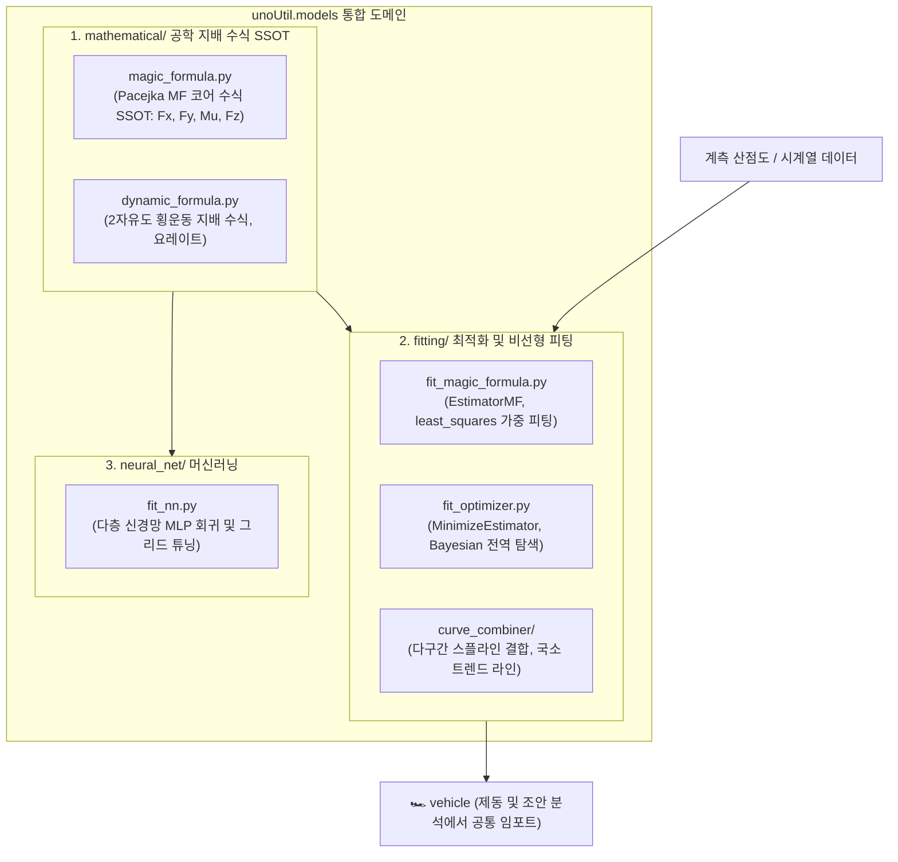

# 📐 unoUtil 공학 모델링 및 최적화 (models) 대시보드 (MOC)

> **상위 허브**: [[00_unoUtil_모듈개발_대시보드|unoUtil 모듈개발 마스터 허브]]  
> **패키지 경로**: `unoUtil.models`  
> **역할**: 타이어 및 차량 동역학 공학 지배 방정식(SSOT), 수치 최적화, 비선형 커브피팅, 다구간 스플라인 결합 및 머신러닝 신경망 모델을 일원화하여 제공하는 최첨단 모델링 도메인

---

## 🏛️ 모델링 아키텍처 및 데이터 흐름



---

## 📜 버전 이력 및 주요 개발 현황 (Changelog)

| 버전 | 일자 | 작업자 | 주요 변경 및 승격 내역 | 상태 |
| :---: | :---: | :---: | :--- | :---: |
| **v3.3** | 2026-09-28 | uno & Gemini | **models 도메인 신설 및 Pacejka Magic Formula SSOT 전면 통합**<br>- `signal_process/curve_fit`과 `ai`를 `unoUtil.models`로 승격 일원화<br>- Pacejka Magic Formula 수식 중복 완전 제거 및 단일 코어 연산 엔진(`calc_magic_formula`) 확립<br>- `mathematical`, `fitting`, `neural_net` 3대 서브패키지 체계 확립<br>- 기존 `unoUtil.ai` 및 `unoUtil.curveFit` 100% 무중단 하위 호환 브릿지 보장 | ✅ 배포 완료 |

---

## 📂 서브모듈 구성 및 1:1 기술 매뉴얼

### 1. 공학 지배 수식 (`mathematical/`) - 단일 진실 공급원 (SSOT)
* [[magic_formula|📐 magic_formula: Pacejka Magic Formula 표준 6-파라미터 지배 수식]]
* [[dynamic_formula|🏎️ dynamic_formula: 2자유도 횡운동 지배 수식 및 요레이트 모델]]

### 2. 최적화 및 비선형 피팅 (`fitting/`)
* [[fit_magic_formula|🎯 fit_magic_formula: 가중치 및 수직하중 연동 최소자승 MF 피팅 추정기]]
* [[fit_optimizer|⚙️ fit_optimizer: Scipy 및 베이지안 가우시안 프로세스 비선형 최적화 추정기]]
* [[curve_combiner|📈 curve_combiner: 다구간 스플라인 결합 및 트렌드 라인 추정기]]

### 3. 기계학습 신경망 (`neural_net/`)
* [[fit_nn|🧠 fit_nn: Keras/Sklearn 기반 다층 신경망(MLP) 회귀 피팅]]

---

## 💡 Quick Start

```python
import numpy as np
from unoUtil.models.mathematical import calc_magic_formula
from unoUtil.models.fitting import EstimatorMF

# 1. Pacejka Magic Formula 단일 코어 수식 직접 연산
slip = np.linspace(0.0, 0.3, 100)
force = calc_magic_formula(slip, B=10.0, C=1.3, D=1.1, E=0.1)

# 2. 계측 데이터 기반 매직 포뮬러 계수 역추정
estimator = EstimatorMF()
res = estimator.fit(slip, force, robust=True)
print(f"추정 완료 (RMSE: {res.rmse:.4f}): {res.params}")
```
