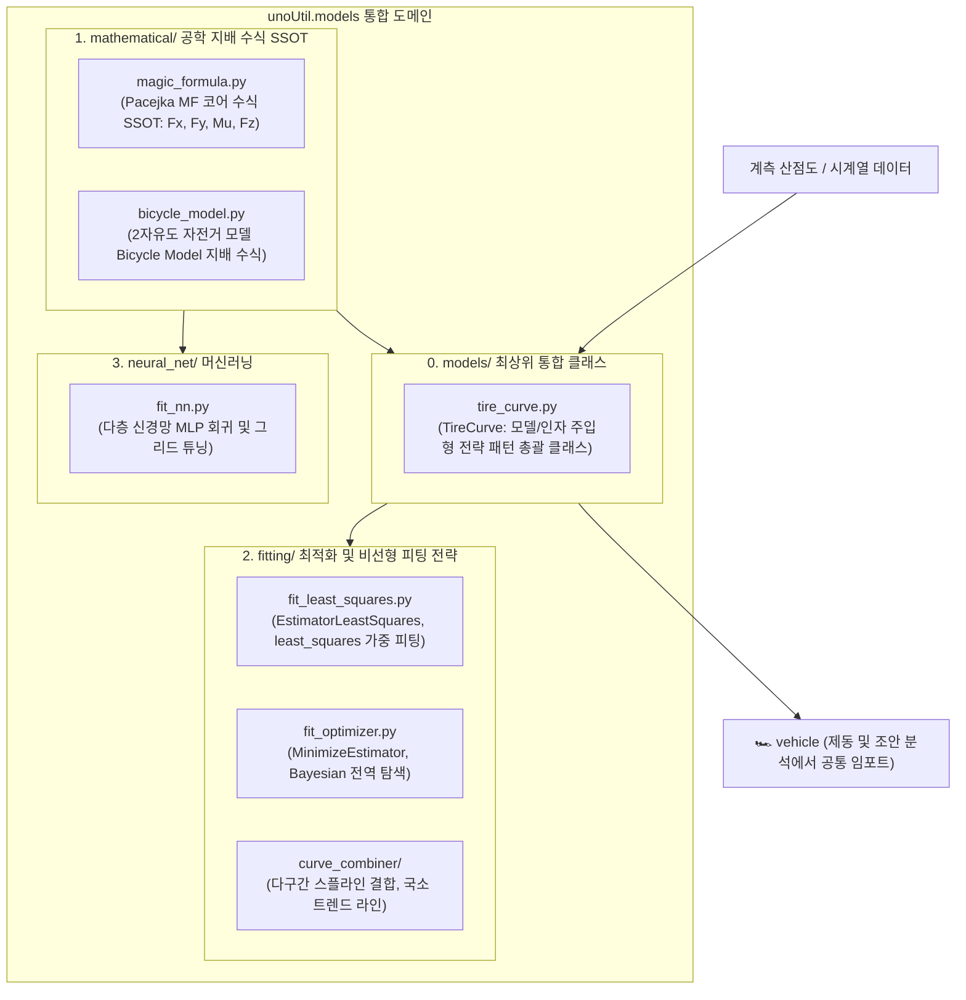

# 📐 unoUtil 공학 모델링 및 최적화 (models) 대시보드 (MOC)

> **상위 허브**: [[00_unoUtil_모듈개발_대시보드|unoUtil 모듈개발 마스터 허브]]  
> **패키지 경로**: `unoUtil.models`  
> **역할**: 타이어 특성 곡선 총괄 클래스(`TireCurve`), 2-DoF 차량 횡운동 자전거 모델(`BicycleModel`), Pacejka Magic Formula 공학 지배 방정식(SSOT) 및 최적화/피팅 엔진을 일원화하여 제공하는 최첨단 모델링 도메인

---

## 🏛️ 모델링 아키텍처 및 전략 패턴



---

## 📜 버전 이력 및 주요 개발 현황 (Changelog)

| 버전 | 일자 | 작업자 | 주요 변경 및 승격 내역 | 상태 |
| :--- :| :---: | :---: | :--- | :---: |
| **v3.3** | 2026-09-28 | uno & Gemini | **TireCurve 통합 클래스 구축 및 Bicycle Model 표준화 완성**<br>- `TireCurve` 총괄 클래스 신설: 모델(`model`) 및 최적화 전략(`method`) 주입형 전략 패턴 구현<br>- 2-DoF 횡운동 모델의 자동차공학 국제 표준 용어인 **`bicycle_model`**로 정규화 및 `BicycleModel` 클래스 캡슐화<br>- Pacejka Magic Formula 수식 중복 완전 제거 및 단일 코어 연산 엔진(`calc_magic_formula`) SSOT 확립<br>- `fit_least_squares` 비선형 최소자승 가중치/Huber loss 추정기 정규화<br>- 기존 `unoUtil.ai` 및 `unoUtil.curveFit` 100% 무중단 하위 호환 보장 (테스트 전수 통과) | ✅ 배포 완료 |

---

## 📂 서브모듈 구성 및 1:1 기술 매뉴얼

### 0. 통합 총괄 모델 클래스
* [[tire_curve|🛞 tire_curve: 타이어 종/횡방향 특성 곡선 통합 모델링 및 비선형 피팅 클래스 (TireCurve)]]

### 1. 공학 지배 수식 (`mathematical/`) - 단일 진실 공급원 (SSOT)
* [[magic_formula|📐 magic_formula: Pacejka Magic Formula 표준 지배 수식 및 메타데이터]]
* [[bicycle_model|🚲 bicycle_model: 2자유도 차량 횡운동 자전거 모델 (Bicycle Model) 및 요레이트]]

### 2. 최적화 및 비선형 피팅 (`fitting/`)
* [[fit_least_squares|🎯 fit_least_squares: 가중치 및 Huber loss 지원 비선형 최소자승 추정기]]
* [[fit_optimizer|⚙️ fit_optimizer: Scipy 및 베이지안 가우시안 프로세스 비선형 최적화 추정기]]
* [[curve_combiner|📈 curve_combiner: 다구간 스플라인 결합 및 트렌드 라인 추정기]]

### 3. 기계학습 신경망 (`neural_net/`)
* [[fit_nn|🧠 fit_nn: Keras/Sklearn 기반 다층 신경망(MLP) 회귀 피팅]]

---

## 💡 Quick Start

```python
import numpy as np
from unoUtil.models import TireCurve, BicycleModel, calc_magic_formula

# 1. TireCurve를 이용한 타이어 제동 데이터 단 1줄 피팅
slip = np.linspace(0.0, 0.3, 100)
force = calc_magic_formula(slip, B=10.0, C=1.3, D=1.1, E=0.1)

tire = TireCurve(direction='longitudinal', method='least_squares')
tire.fit(slip, force)
print(f"제동 강성: {tire.stiffness:.2f}, 피크 마찰: {tire.peak_value:.2f}, 피크 슬립: {tire.peak_slip:.3f}")

# 2. 2-DoF Bicycle Model을 이용한 정상 상태 요레이트 연산
bm = BicycleModel(vel_unit=1.0, angr_unit=1.0)
steering = np.full(50, 2.0)  # 2도 조향
speed = np.linspace(20, 100, 50)  # 20~100 km/h
yaw_rate = bm.predict(steering, speed)
```
