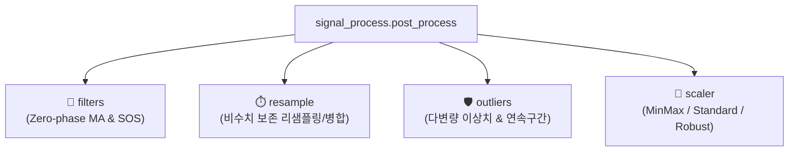

# 📶 post_process (신호 후처리 및 정제 패키지) 대시보드

> [!ABSTRACT] 🛠️ 패키지 개요
> 기존의 단일 모놀리식 파일(`_UnoPP_.py`)을 **단일 책임 원칙(SRP)**에 따라 4대 전문 서브모듈로 분할하고, 100% 무중단 하위 호환성을 제공하는 차세대 실차 신호 후처리 패키지입니다.

---

## 📦 4대 핵심 서브모듈 구성 및 링크

1. 🌊 **[[filters|filters (Zero-Phase 이동평균 필터)]]**:
   - `moving_average` (`SP_MovingAverage`): 위상 지연 없는 양방향 필터
   - `moving_average_fast` (`SP_HighSpeed_MovingAverage`): 고속 SOS 필터
2. ⏱️ **[[resample|resample (비수치 보존 리샘플링)]]**:
   - `resample_data` (`SP_Resample`), `interpolate_data` (`SP_Interpolation`), `merge_data` (`SP_Merge`)
3. 🛡️ **[[outliers|outliers (이상치 정제 및 연속구간)]]**:
   - `remove_outliers` (`SP_RMOutlier`): Percentile, Z-score, iForest, Extended IF
   - `find_continuous_interval` (`SP_FindContinue`): 제동 등 유효 구간 색출
4. 📐 **[[scaler|scaler (데이터 정규화)]]**:
   - `scale_data` (`SP_Normal`): MinMax, StandardScaler, RobustScaler

---

## 📚 관련 영구 공학 지식 레퍼런스
* 📡 **[[25_실차_신호처리_및_시계열_데이터_정제_공학|실차 신호처리 및 시계열 데이터 정제 공학]]**
* 🏗️ **[[26_대규모_파이썬_패키지_모듈화_및_무중단_하위호환_아키텍처|대규모 파이썬 패키지 모듈화 및 무중단 하위호환 아키텍처]]**
* 🧭 **상위 허브**: [[00_unoUtil_모듈개발_대시보드]]
