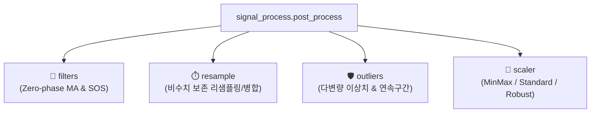

# 📶 post_process (신호 후처리 및 정제 패키지) 대시보드

> [!ABSTRACT] 🛠️ 패키지 개요
> 기존의 단일 모놀리식 파일(`_UnoPP_.py`)을 **단일 책임 원칙(SRP)**에 따라 4대 전문 서브모듈로 분할하고, 100% 무중단 하위 호환성을 제공하는 차세대 실차 신호 후처리 패키지입니다.

---

## 📦 4대 핵심 서브모듈 구성 및 링크

1. 🌊 **[[filters|filters (Zero-Phase 이동평균 필터)]]**:
   - `moving_average` (`SP_MovingAverage`): 위상 지연 없는 양방향 필터
   - `moving_average_fast` (`SP_HighSpeed_MovingAverage`): 고속 SOS 필터
2. ⏱️ **[[resample|resample (비수치 보존 리샘플링)]]**:
   - `resample_data` (`SP_Resample`), `interpolate_data` (`SP_Interpolation`), `merge_data` (`SP_Merge`)
3. 🛡️ **[[outliers|outliers (이상치 정제 및 연속구간)]]**:
   - `remove_outliers` (`SP_RMOutlier`): Percentile, Z-score, iForest, Extended IF
   - `find_continuous_interval` (`SP_FindContinue`): 제동 등 유효 구간 색출
4. 📐 **[[scaler|scaler (데이터 정규화)]]**:
   - `scale_data` (`SP_Normal`): MinMax, StandardScaler, RobustScaler

---

## 📚 관련 영구 공학 지식 레퍼런스
* 📡 **[[25_실차_신호처리_및_시계열_데이터_정제_공학|실차 신호처리 및 시계열 데이터 정제 공학]]**
* 🏗️ **[[26_대규모_파이썬_패키지_모듈화_및_무중단_하위호환_아키텍처|대규모 파이썬 패키지 모듈화 및 무중단 하위호환 아키텍처]]**
* 🧭 **상위 허브**: [[00_unoUtil_모듈개발_대시보드]]

---

## 📜 버전 이력 및 주요 개발 현황 (Changelog)

### ⚡ v2.4 (2026-09-21) 패키지 내부 레거시 브릿지 완전 정화 및 legacy 서브폴더 신설
1. **📂 하위 패키지 내 레거시 브릿지 이격 격리**:
   - `_UnoPP_.py`, `_UnoPP_.md`, `ExtendedIsolationForest.py` 등 표준 폴더에 섞여 있던 레거시 파일들을 `post_process/legacy/` 하위로 전격 이동 및 격리 완료.
2. **🔌 표준 임포트 순수성 복원 및 의존성 정제**:
   - `outliers.py` 등 표준 모듈 내에서 구버전 브릿지 파일을 직접 load하던 import 구문을 전수 제거하고, **순수 차세대 v2.0 API만을 바라보도록 코드를 정밀 수술**했습니다.
3. **🔌 상위 제동 엔진 내 의존도 교정**:
   - `an_response.py`, `an_slip_pdf.py`, `func_acc_brk.py` 등 가감속 및 제동 물리 엔진 내부에서 `_UnoPP_`를 가리키던 옛날식 import를 순수 V2.0 표준 패키지(`unoUtil.signal_process.post_process`) 호출로 완벽 수정.

### 🚀 v2.0 (2026-09-18) 모놀리식 단일 파일 분해 및 4대 전문 서브모듈 승격
1. **단일 책임 분할**: 거대 `_UnoPP_.py` 파일 하나에 몰려있던 신호처리 기술을 `filters`, `resample`, `outliers`, `scaler` 4개 물리 파일로 전면 개편.
2. **하위 호환 100% 매핑**: `sys.modules` 동적 리다이렉터 주입으로 구버전 사내 코드의 무중단 구동 영구 지원.
