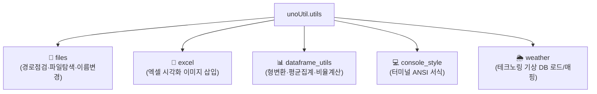

# 🛠️ utils (사내 통합 유틸리티 패키지) 대시보드

> [!ABSTRACT] 🛠️ 패키지 개요
> 기존 레거시 `convenienceFunction`에 산재되어 있던 중복 함수들을 통합 및 재분류하여, 단일 책임 원칙(SRP)과 PEP 8 표준에 부합하도록 정비한 핵심 공통 헬퍼 패키지입니다.

---

## 📦 핵심 서브모듈 구성

1. 📁 **[[files|files (파일 조작)]]**: `check_path`, `get_file_names`, `rename_files`
2. 📑 **excel (엑셀 리포팅)**: `insert_figure_to_excel`
3. 📊 **[[dataframe_utils|dataframe_utils (DF 헬퍼)]]**: `astype_float`, `agg_mean`, `calc_ratio` (`CalRatio`)
4. 💻 **console_style (콘솔 스타일)**: 컬러 및 강조 폰트
5. 🌦️ **weather (기상 매핑)**: `load_master_database`, `connect_weather`

## 📅 1. 프로젝트 주요 버전 이력 (Changelog 타임테이블)

| 버전 | 날짜 | 작업자 | 핵심 수정 및 개발 내역 (Changelog) | 상태 |
| :---: | :---: | :---: | :--- | :---: |
| **v2.6** | 2026-09-22 | uno & Gemini | 🛠️ save, excel, html 3대 제어 인자 공통 지능형 다형성 해결사(`resolve_save_path`) 설계 수립 🛡️ files.py 및 excel.py 내 레거시 헝가리안 인자군 완전 정제 및 bool_print/bool_save 섀도잉 방지 헌법 확정 | ✅ 완료 |
| **v2.5** | 2026-09-22 | uno & Gemini | 🌦️ weather.py 내의 모든 보간 호출 위치에서 숫자형 컬럼(`select_dtypes(include='number')`)만 골라 처리하도록 고도화하여 Pandas 2.0+ `FutureWarning` 경고 100% 원천 차단 | ✅ 완료 |
| **v2.4** | 2026-09-21 | uno & Gemini | 🌦️ make_surfaceSensor, make_stationSensor, connect_weather 내 시간보간 전 (.infer_objects) 선제 호출 🌦️ Pandas 2.0+ 마스터 기상 DB 시간 보간 FutureWarning 경고 완벽 진압 및 자가 진단 통과 | ✅ 완료 |
| **v2.0** | 2026-09-18 | uno | 🛠️ convenienceFunction 전면 해체 및 files, excel, dataframe_utils, weather 공통 모듈 정비 🔌 sys.modules 위임 바인딩으로 사내 헬퍼 함수 100% 하위 호환 완비 | ✅ 완료 |

---

## 📚 관련 문서
* 🧭 **상위 허브**: [[00_unoUtil_모듈개발_대시보드]]

---

