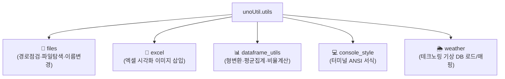

# 🛠️ utils (사내 통합 유틸리티 패키지) 대시보드

> [!ABSTRACT] 🛠️ 패키지 개요
> 기존 레거시 `convenienceFunction`에 산재되어 있던 중복 함수들을 통합 및 재분류하여, 단일 책임 원칙(SRP)과 PEP 8 표준에 부합하도록 정비한 핵심 공통 헬퍼 패키지입니다.

---

## 📦 핵심 서브모듈 구성

1. 📁 **[[files|files (파일 조작)]]**: `check_path`, `get_file_names`, `rename_files`
2. 📑 **excel (엑셀 리포팅)**: `insert_figure_to_excel`
3. 📊 **[[dataframe_utils|dataframe_utils (DF 헬퍼)]]**: `astype_float`, `agg_mean`, `calc_ratio` (`CalRatio`)
4. 💻 **console_style (콘솔 스타일)**: 컬러 및 강조 폰트
5. 🌦️ **weather (기상 매핑)**: `load_master_database`, `connect_weather`

---

## 📚 관련 문서
* 🧭 **상위 허브**: [[00_unoUtil_모듈개발_대시보드]]
