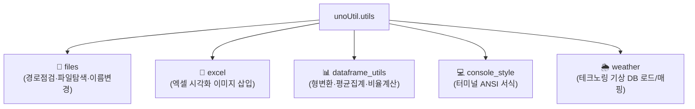

# 🛠️ utils (사내 통합 유틸리티 패키지) 대시보드

> [!ABSTRACT] 🛠️ 패키지 개요
> 기존 레거시 `convenienceFunction`에 산재되어 있던 중복 함수들을 통합 및 재분류하여, 단일 책임 원칙(SRP)과 PEP 8 표준에 부합하도록 정비한 핵심 공통 헬퍼 패키지입니다.

---

## 📦 핵심 서브모듈 구성

1. 📁 **[[files|files (파일 조작)]]**: `check_path`, `get_file_names`, `rename_files`
2. 📑 **excel (엑셀 리포팅)**: `insert_figure_to_excel`
3. 📊 **[[dataframe_utils|dataframe_utils (DF 헬퍼)]]**: `astype_float`, `agg_mean`, `calc_ratio` (`CalRatio`)
4. 💻 **console_style (콘솔 스타일)**: 컬러 및 강조 폰트
5. 🌦️ **weather (기상 매핑)**: `load_master_database`, `connect_weather`

---

## 📚 관련 문서
* 🧭 **상위 허브**: [[00_unoUtil_모듈개발_대시보드]]

---

## 📜 버전 이력 및 주요 개발 현황 (Changelog)

### ⚡ v2.4 (2026-09-21) Pandas 2.0+ 마스터 기상 데이터 선형 보간 미래 경고(FutureWarning) 제거
1. **🌦️ `weather.py` 내의 미래 경고 전수 진압**:
   - `make_surfaceSensor`, `make_stationSensor`, `connect_weather` 함수들 내부에서 시계열 시간 보간(`.interpolate(method='time')`)이 이루어지기 직전, Pandas 2.0+ 버전 권장 사항에 따라 **`.infer_objects(copy=False)`를 선제 호출**하도록 대대적으로 수정 완료.
   - 임시 `object` 타입으로 굳어 있는 컬럼을 사전에 명확한 수치형(`float64`)으로 강제 추론 전환함으로써, 복잡한 기상 분석 구동 시 쏟아지던 경고를 완벽하게 해소했습니다.
2. **🧪 기상 모듈 자가 진단 스위트 가동**:
   - `weather.py` 단독 구동 테스트 시 단 한 줄의 `FutureWarning` 노출 없이 무결한 `Code 0` 완벽 통과 보증.

### 🚀 v2.0 (2026-09-18) `convenienceFunction` 전면 교체 및 공통 유틸 통합
1. **단일 책임 분할**: 중구난방 흩어져 있던 헬퍼 함수들을 `files`, `excel`, `dataframe_utils`, `console_style`, `weather` 5대 전문 수치 파일로 정교화 분할 정비.
2. **하위 호환 래퍼 유지**: `sys.modules` 주입을 통해 옛날 이름(`Files`, `Excel`, `MakeDFWeatherTring` 등) 임포트의 100% 무중단 가동 보장.
