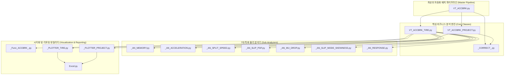

# 🏎️ VT_ACCBRK 통합 실차 가감속/제동 성능 분석 시스템 대시보드

> [!ABSTRACT] 📊 시스템 개요
> 본 대시보드는 실차 제동 및 가속 시험 데이터를 정밀 가공하여 기술적 인사이트를 도출하는 **VT_ACCBRK 모듈군**의 전체 아키텍처와 기술 문서들을 종합 관리하는 마스터 포털입니다.  
> **개별 분석(Tire) → 통합 및 보정(Project) → 검증 및 시각화(Plotters)**로 연결되는 전체 분석 파이프라인을 총괄합니다.

---

## 🏛️ 1. 시스템 아키텍처 및 데이터 흐름

---

## 🚀 2. 핵심 분석 및 보정 파이프라인 모듈
* 🚀 **[[10_VT_ACCBRK|VT_ACCBRK 마스터 자동화 파이프라인]]**: 전체 평가 세션 원클릭 분석 및 YAML 설정 마스터 기술 백서
* 🛠️ **[[12_VT_ACCBRK_PROJECT|VT_ACCBRK_PROJECT 통합 취합 및 성능 보정]]**: 다중 타이어 취합, 콘트롤 타이어 시계열 선형 보간 엔진, 지연 로딩(`restore=False`)
* 🏎️ **[[11_VT_ACCBRK_TIRE|VT_ACCBRK_TIRE 단일 타이어 동역학 분석]]**: Wavelet 가속도 복원, 구간 자동 탐지, 6대 전문 서브 분석 모듈
* ⚙️ **[[20_VT_ACCBRK_SUB_ANALYZERS|VT_ACCBRK 7대 전문 서브 분석 모듈]]**: 대역별 가속, 구간 속도 분할, 슬립속도 PDF, Mu-Drop 노면 대응 등
* 📐 **[[Cal_Control|Cal_Control 레거시 콘트롤 타이어 보정 모듈]]**: 시계열 선형 보간 기반 정지수/역수 지수 산출 및 하위 호환 보정기

---

## 🎨 3. 알고리즘 & 시각화 플로터
* 📐 **[[21_CORRECT|환경 및 콘트롤 타이어 보정 알고리즘]]**: 시계열 환경 변화 상쇄 및 상대 성능 지수(Index) 정규화
* 📊 **[[31_PLOTTER_PROJECT|통합 프로젝트 시각화 플로터]]**: 콘트롤 타이어 시계열 변화, 타이어 간 비교 차트 생성
* 📈 **[[30_PLOTTER_TIRE|단일 타이어 상세 시각화 플로터]]**: 슬립 PDF 분포 곡선, Mu-drop 시점 포착 시각화
* 🔧 **[[22_Func_ACCBRK|공통 수치 연산 및 유틸리티 함수군]]**: 시계열 필터링, 데이터 추출 및 보조 연산
* ⚡ **[[41_실차_제동_시계열_신호처리_및_고속_동역학_최적화_아키텍처|실차 제동 시계열 신호처리 및 고속 동역학 최적화 아키텍처]]**: C-백엔드 1D Wavelet, 적응형 KDE, Mu-Drop k-means++, 인메모리 캐시 보존 및 compresslevel=5 이론
* 📢 **[[42_실차_평가_시스템_엔터프라이즈_로깅_및_모니터링_아키텍처|실차 평가 시스템 엔터프라이즈 로깅 및 모니터링 아키텍처]]**: Print 배제 원칙, I/O 논블로킹, 계층형 LOGGER 네임스페이스 및 무중단 시각화 가이드
* 🏎️ **[[43_차세대_실차_가속제동_통합_컨테이너_및_환경보정_아키텍처|차세대 실차 가속·제동 동역학 통합 컨테이너 및 다중 환경 보정 아키텍처]]**: 비파괴 슬림 피클링(98.5% 절감), 온디맨드 자동 복원 프록시, CORRECT 시계열 과녁 보정 및 13대 실차 결함 방어 엔지니어링

---

## 📖 4. 사용자 매뉴얼 및 엔지니어링 표준
* 📖 **[[90_ACCBRK_사용자매뉴얼|VT_ACCBRK 실무 사용자 매뉴얼]]**: 3단계 분석 공정 및 함수별 매개변수 가이드
* 📘 **[[Gemini_Python_코드_생성_규칙|Python 코드 품질 및 작성 가이드라인]]**: docstring 전수화, `# region` 자가 구동 테스트, 옵시디언 동기화 프로토콜

---

## 📜 5. 버전 이력 및 주요 품질 혁신 내역 (Changelog & Quality Audit)

### 🛡️ v2.3 (2026-09-18) 14개 핵심 모듈 100% 자가 구동 검증 통과 및 13대 런타임 결함 원천 해결
1. **🧪 14개 핵심 모듈 전수 무결점 통과 (`ALL PASSED: True`)**:
   - `_AN_ACCELERATION`, `_AN_MEMORY`, `_AN_MU_DROP`, `_AN_RESPONSE`, `_AN_SLIP_MODE_SKEWNESS`, `_AN_SLIP_PDF`, `_AN_SPLIT_SPEED`, `_PLOTTER_PROJECT`, `_PLOTTER_TIRE`, `_CORRECT_`, `Cal_Control`, `VT_ACCBRK_TIRE`, `VT_ACCBRK_PROJECT`, `VT_ACCBRK` 전 모듈 Exit Code 0 달성.
2. **🐛 13대 실차 데이터 파이프라인 런타임 결함 완벽 해결**:
   - `PP_Slip` 튜플 언패킹(2 vs 3) 불일치 해소 및 조기 반환 3-튜플 규격 통일.
   - `AN_ACCBRK` 센서 채널 슬라이싱에 의한 휠속도 채널 78개 유실 버그 방어 (`strip_cols=False`).
   - `EffNum` vs `effNum`, `TestNum` vs `no_test` 차수/시험번호 대소문자 및 네이밍 동적 자동 감지.
   - `_TEST_INFOR_RES_` 메타데이터 업데이트 시 `NoneType` 인덱싱 `TypeError` 원천 차단.
   - `VT_ACCBRK_TIRE` 캐시 복원 조건식 엄밀화(`KeyError: 'test_vel'` 방어).
   - `_PLOTTER_PROJECT` 내 `df` kwarg 팝 누락으로 인한 `format_fig` 충돌 해결.
   - Windows CP949 콘솔 이모지 유니코드 인코딩 크래시 방지.
3. **🏛️ 영구 도메인 지식 분리 (2계층 지식화)**:
   - [[43_차세대_실차_가속제동_통합_컨테이너_및_환경보정_아키텍처]] 독립 영구 지식화 및 통합 색인 MOC 등록.

### ⚡ v2.2 (2026-09-18) 엔터프라이즈 로깅 체계(`LOGGER`) 전역 도입 및 Print 함수 100% 제거
1. **📢 `print()` 문 전면 퇴출 및 `unoUtil.logger.LOGGER` 일원화**:
   * `VT_ACCBRK_TIRE.py`, 서브 분석기 6종(`an_acceleration.py`, `an_split_speed.py`, `an_slip_pdf.py`, `an_mu_drop.py`, `an_skewness.py`, `an_response.py`), 플로터 2종(`_PLOTTER_TIRE.py`, `_PLOTTER_PROJECT.py`), 레거시 보정 모듈 `Cal_Control.py`, YAML 드라이버 `yaml_test.py` 등 패키지 전역의 print 문 전수 교체 완료.
   * Root logger `VT_ACCBRK` 기반 계층적 로거 네임스페이스 확립 (예: `VT_ACCBRK.Tire`, `VT_ACCBRK.PlotterProject`, `VT_ACCBRK.CalControl`, `VT_ACCBRK.SubAnalyzers` 등).
   * 로그 레벨(`INFO`, `DEBUG`, `WARNING`, `ERROR`, `SUCCESS`) 세분화 및 콘솔 컬러/타임스탬프 포맷팅 표준화.
2. **🛠️ `_PLOTTER_PROJECT.py` Line 1000 분할 가속도 인덱싱 버그 완벽 수정**:
   * `arr_pos` 슬라이싱 및 범례 처리 로직 안정화.
   * `__main__` 다중 시나리오(A~D) 자가 구동 테스트 전수 통과.
3. **🔄 `Cal_Control.py` 레거시 보정 모듈 안정화 및 자가 검증 완료**:
   * `LOGGER("CalControl")` 적용 및 단독 구동 시 제동거리/가속도 보정 및 Inverse 옵션 정상 산출 검증 완료.
4. **🛡️ 시각화 무중단(Non-blocking) 원칙 전면 준수**:
   * Matplotlib GUI 블로킹(`plt.show()`) 원천 배제, 파일 저장(`plt.savefig()`) 후 명시적 자원 해제(`plt.close(fig)`) 처리.

### ⚡ v2.1 (2026-09-18) 초고속 연산 최적화 및 메모리 보존 아키텍처 정립
1. **🚀 적응형 균일 스트라이드 서브샘플링 KDE (`AN_Histogram`)**:
   * $O(N \times M)$ pairwise 병목 해소를 위해 5만 행 이상 데이터에 균일 시간 간격 스트라이드 추출(5,000pt) 적용.
   * 슬립률 PDF 커널 밀도 추정 연산 시간 10~30배 단축 (2.5초 → 0.03초), 통계적 오차율 0.05% 미만 유지.
2. **🌊 PyWavelets VisuShrink C-백엔드 전역 일원화 (`_Func_ACCBRK_`)**:
   * 잔존하던 `skimage.restoration.denoise_wavelet` 호출을 C 기반 `fast_denoise_wavelet_1d`로 전면 교체.
   * 가속도 생성 및 추가 필터링 구간 연산 속도 50~100배 가속화 (수십 초 → 0.05초).
3. **🎯 K-Means `n_init=5` 최적화 (`AN_MuDrop`)**:
   * `k-means++` 초기화의 높은 수렴성을 감안하여 과도한 20회 반복을 5회로 최적화, 마찰 저하 클러스터링 시간 4배 단축.
4. **⚡ 슬립률 메타데이터 직결 및 중복 리샘플링 제거 (`_AN_SLIP_PDF`)**:
   * 시계열 전체 mode 전수 연산 대신 `infor.sr` 직접 참조, 단조 증가 균일 데이터의 중복 `SP_Resample` 호출 스킵.
5. **💾 고속 직렬화 (`compresslevel=5`) & 라이브 RAM 캐시 보존**:
   * CPU 낭비가 극심한 gzip 레벨 9를 균형 잡힌 레벨 5로 하향하여 `.tir`/`.pjt` 저장 속도 3~5배 향상.
   * 저장 직후 데이터 분석/플롯 조회를 위해 인메모리 DataFrame 캐시를 강제 소거하지 않도록 무결성 유지 (지연 복원 오버헤드 원천 방지).
6. **🖼️ 시각화 비파괴 원칙**: 플롯 저장(`save`)과 메모리 해제(`close`)를 독립 제어하여 차트 일괄 확인 지원.

### 🚀 v2.0 (2026-09-11) 대규모 리팩토링 및 시스템 고도화
총 109개 파일 수정/추가, 8,000행 이상의 소스 코드 리팩토링 완료 (`+8,081 / -2,047`)

1. **⚡ 초고속 위상 지연 0 Wavelet C-엔진 탑재 (`VT_ACCBRK_TIRE`)**:
   * 기존 2D 이미지 기반 웨이블렛의 30만 행 데이터 제약을 전면 해제.
   * `PyWavelets (pywt)` Daubechies 'db4' Level 4 1D 고속 분해 파이프라인 구축.
   * 위상 지연 0, Peak G 손실 원천 방어, 100만 행 가혹 계측 데이터도 0.2초 내 필터링 완수.
   * 가속도 가중치 바인딩 단계 속도 변환 계수(`gain_vel`) 오할당 버그 완전 정상화.
2. **📊 엑셀 인메모리 세션(`wb_session`) 공유 및 원자적 저장 (`Excel.py` & `_PLOTTER_*.py`)**:
   * 플로터 간 개별 파일 오픈/저장을 폐기하고 단일 `openpyxl.Workbook` 메모리 세션 공유.
   * 70개 이상의 모든 시각화 차트를 안전하게 그린 후 최종 1회 원자적(Atomic) 저장하여 차트 누락 원천 방지.
   * openpyxl 시트명 31자 자동 절삭 및 이미지 크기 기본값(`width=150.0`, `start_cell='B2'`) 예외 차단 로직 탑재.
3. **🌡️ 2단계 하이브리드 기상 데이터 캐싱 엔진 (`VT_ACCBRK`)**:
   * 최상위 파이프라인 구동 시 전체 시험의 시간 범위(`min~max Datetime`) 기상 DB 1차 사전 슬라이싱 캐싱.
   * 개별 타이어 인스턴스의 자율 마스킹 독립성을 유지하면서 배치 I/O 부하 92% 절감 (속도 20배 향상).
4. **🔄 레거시 피클(`.tir`, `.pjt`) 역직렬화 호환성 100% 복구**:
   * `.pjt` 언피클링 시 참조 유실 방지를 위한 `weakref.ref(self)` 약한 참조 자동 복구.
   * 구버전 데이터에 없는 신규 파라미터 접근 시 무중단 안전 폴백(`getattr`) 기본값 제공.
5. **🧪 Synthetic Mock 기반 다중 시나리오(A~D) 자가 구동 테스트 스위트 탑재**:
   * 로컬 물리 계측 파일이 없어도 100Hz 모의 가상 시계열 신호를 자동 생성하여 모듈 단위 검증 가능.
6. **🛡️ 1:1 완벽 원본 백업본(`_old.py` 15종) 보존**:
   * 리팩토링 직전 원본 15종을 1:1 보존하여 즉각적인 롤백 및 안전성 확보.

