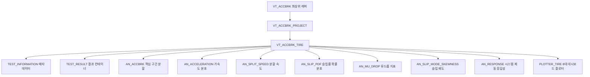

> [!NOTE] 🧭 Obsidian 네비게이션 & 시스템 계층
> - **상위 제어기**: [[12_VT_ACCBRK_PROJECT]] (프로젝트 취합 및 보정), [[10_VT_ACCBRK]] (전체 자동화)
> - **전역 허브**: [[unoUtil]] (사내 도구 통합 색인)
> - **영구 도메인 이론**: [[41_실차_제동_시계열_신호처리_및_고속_동역학_최적화_아키텍처]] (Wavelet, KDE, 캐시 최적화), [[42_실차_평가_시스템_엔터프라이즈_로깅_및_모니터링_아키텍처]] (로거 표준 및 무중단 시각화)
> - **하위 6대 서브 분석 모듈**:
>   - [[_AN_ACCELERATION]]: 가속도/감속도 속도 구간별 적산 분석
>   - [[_AN_SPLIT_SPEED]]: 고속/저속 구간별 속도 분할 분석
>   - [[_AN_SLIP_PDF]]: 슬립율 확률 밀도 함수(KDE PDF) 분석
>   - [[_AN_MU_DROP]]: 수막현상 마찰력 급감(Mu-Drop) 거리 분석
>   - [[_AN_SLIP_MODE_SKEWNESS]]: 2D 슬립 지형도 및 왜도 분석
>   - [[_AN_RESPONSE]]: 제동 시스템 초기 응답성 및 지연 분석
>   - [[30_PLOTTER_TIRE]]: 단일 타이어 전문 플롯 시각화 대시보드

# 🏎️ VT_ACCBRK_TIRE: 단일 타이어 가속 및 제동 성능 분석 엔진 (Expert Guide)

`VT_ACCBRK_TIRE`는 차량의 고주파 시계열 주행 계측 데이터(VBOX GNSS/IMU 센서 로우 데이터 등)로부터 개별 타이어의 가속(Acceleration) 및 제동(Braking) 성능을 물리 동역학 관점에서 정밀 추적하고 모델링하는 핵심 단일 분석 엔진입니다.

---

## 1. 개요 및 아키텍처 (3-Layer Architecture)

본 분석 모듈은 원시 시계열 데이터 가공부터 6대 고전·현대 동역학 서브 연산, 그리고 최종 8대 전문가용 플롯 대시보드 출력까지 총 3단계의 수직 계층을 이룹니다.



### 1.1 준비 계층 (Ready Layer: Data Refinement)
* **물리량 자동 평탄화 및 보정**: 입력된 계측 데이터의 형태가 MultiIndex 컬럼일지라도 수평 평탄화 처리를 선제 가동하고 속도 및 시간 채널을 검증합니다.
* **고속 신호 복원 (C-백엔드 1D Wavelet Denoising)**: 가속도 채널이 미소실되었거나 계측 센서 노이즈가 과도할 경우, 단순 미분에 따른 물리량 왜곡 및 위상 지연(Phase lag)을 원천 방지하기 위해 **PyWavelets C-백엔드 VisuShrink MAD 필터링 (`fast_denoise_wavelet_1d`, Daubechies 'db4', Level 4)**을 가동하여 0.05초 이내에 피크 감속도(Peak G)를 100% 보존하며 노이즈를 완벽하게 제거합니다. [[41_실차_제동_시계열_신호처리_및_고속_동역학_최적화_아키텍처]] 참조.
* **기상 데이터 자동 슬라이싱**: 외부 웨더 마스터 DB가 주입되면 시험 계측 구간의 시간대를 역산하여, 평가 당시의 `10분 단위` 노면 온도, 외기 습도 등의 환경 변수를 타이어 객체 내부에 자동으로 바인딩해 줍니다.

### 1.2 핵심 계층 (Core Layer: Segment & Valid Engine)
* **지능형 가감속 구간 자동 슬라이싱**: 연속된 긴 시계열 주행 이력 속환에서 가속도 및 감속 G의 동적 변량 노드를 정밀 감지하여, 사용자가 정의한 평가 속도 범위(`test_vel`) 내의 **"순수 평가 시험 행위 구간(Run)"**들만 지능적으로 세분화(Segmentation) 및 번호를 태깅합니다.
* **이상치(Outlier) 배제 및 통계적 필터링**: 운전자의 돌발 조작 편차나 불량 세션을 감쇄하고자, 전체 주행 런 중 가장 경향성이 우수하고 오차가 극소화된 **상위 N개의 유효 런(Valid Runs)**을 자동으로 색인 및 가중 요약합니다.

### 1.3 실행 계층 (Action Layer: Advanced Analytics)
* **6대 전문 서브 분석**: 속도 밴드별 평균 가속도, 임계 속도 고/저속 제동력 이분할, 커널 밀도 슬립 확률분포(KDE PDF), ML 기반 마찰 전이 영역(Mu-Drop) 거리 변량, 2D 고해상도 지형도 슬립 왜도, 초기 응답 랙 및 OLS 회귀 기울기를 일괄 연산 처리합니다.

---

## 2. 핵심 메커니즘: 정밀 온디맨드 자가 복원 (Self-Restoration)

### 2.1 설계 배경 (Pain Point 해결)
시험 1회당 100Hz 고주파 계측 데이터프레임은 수십만 행(수십 MB)에 달합니다. 이를 수많은 타이어별로 전부 디바이스 상에 직렬화 저장하거나 병합 호출하면 메모리 폭발 및 하드디스크 I/O 병목이 필연적으로 야기됩니다.

### 2.2 자가 복원 동작 원리
1. **초경량 압축 직렬화 (`__getstate__`)**:
   - 객체 디스크 저장(`.save()`) 시 원본 계측 데이터프레임(`self.df`)과 실행 환경 파라미터(`self.test_params`)만 골라 보존하고, 가공 계산 완료된 수십 MB급 분석 테이블(`result.df`)은 과감히 소거하여 파일 크기를 **단 수십 KB(1/1000배)로 초경량화**한 뒤 최고 단계 Gzip Level 9 압축을 가동합니다.
   - OS 커널 소켓 자원인 내부 복원용 락(`_restore_lock`)은 직렬화 바인딩 목록에서 안전하게 바이패스합니다.
2. **부모 참조 관계 실시간 재정렬 (`__setstate__`)**:
   - 언피클링(`.load()`) 시, 멀티스레드 환경에서 안전하도록 새로운 `threading.Lock()`을 재생성하여 마운트합니다.
   - 하위 6대 서브 분석기들의 부모 참조 포인트(`_outer_ref` weakref)를 새로 복원 복사되어 올라온 메모리 공간상의 인스턴스 실제 주소로 완벽하게 갱신하여 약한 참조 유실을 차단합니다.
3. **지연 로딩 기반 온디맨드 자동 기동 (`@property result`)**:
   - 로딩 직후에는 내부 결과 테이블이 `None`인 상태로 **0.05초 만에 초고속 로드**를 완수합니다.
   - 이후, 외부 호출자가 특정 데이터(예: `obj.result.df`)를 가리키는 시점에, 내부 `_restore_lock`이 작동하면서 잠들어 있던 파라미터 묶음(`self.test_params`)을 꺼내 **단 1회 스스로 `self.analysis(...)`를 기동하여 연산 결과를 자율 복원**합니다.

---

## 3. 클래스 인터페이스 및 메서드 상세 명세

### 3.1 생성자: `__init__(df_raw, **kwargs)`
- **기능**: 계측된 원시 테이블을 주입받아 multiindex 평탄화, Wavelet 평활 가속도 보정, 기상 정보 결합 및 미소 이동거리 적산을 완료하여 준비 계층 상태로 셋업합니다.
- **주요 인자**:
  - `df_raw` (`pd.DataFrame`): GNSS/IMU 계측 시계열 데이터.
  - `sr` (`int`): 계측 샘플 레이트 (기본값: `100` Hz).
  - `weather` (`pd.DataFrame`): 웨더 스테이션 온도/습도 마스터 정보.
  - `item` (`str`): 시험 구분 (`'brk'` 제동 또는 `'acc'` 가속).
  - `surface` (`str`): 시험장 노면 상태 (`'dry'`, `'wet'`, `'snow'`, `'con'`).
  - `local_pos` (`str` / `dict`, optional): 로컬 직교 좌표계(`PosX`, `PosY`) 변환 기준 위치 및 회전각.

### 3.2 핵심 구간 분석: `analysis(test_vel, sel_mode=None, valid_count=None, outlier=None, local_pos=None, **kwargs)` -> `VT_ACCBRK_TIRE`
- **기능**: 차속 변화율 노드를 정밀 슬라이싱하여 제동/가속 유효 런을 선별하고, 이상치 제거 및 상위 런을 병합하여 6대 서브 분석 모듈에 수치를 피팅 연산합니다.
- **인자**:
  - `test_vel` (`list[int]`): 분석 대상 목표 [시작 속도, 종료 속도].
  - `sel_mode` (`str` / `list[int]`): `'max_min'`, `'minimum_std'` 통계 모드 지정 또는 분석가 수동 지정 런 리스트.
  - `outlier` (`list[int]`): 분석 연산에서 완전 배제할 비정상 주행 런 번호 딕셔너리/리스트.
  - `local_pos` (`str` / `dict`, optional): 로컬 직교 좌표계(`PosX`, `PosY`) 변환 기준 위치 및 회전각 ('technoring', 'technotrack' 또는 `{'reflong': float, 'reflat': float, 'rotate': float}`).

### 3.3 서브 분석 모듈 및 시각화 가이드

#### 1) `detect_test_segments` (유효 구간 자동 분할)
- **Pain Point Killer**: 수십 분에 달하는 롱 테이크 주행 로그에서 제동 페달 조작 지점과 정지 지점만 기하학적 변화율로 감지하여 마진 없이 깔끔하게 잘라냅니다.
- **예시**:
  ```python
  obj_tire.detect_test_segments(target=[100, 1], min_sec=1.5)
  ```

#### 2) `analysis_mu_drop` (수막현상 마찰력 급감 감지)
- **Pain Point Killer**: 종차가속도와 4륜 개별 바퀴 속도의 상대 변화율 벡터에 KMeans 클러스터링 및 의사결정나무(Decision Tree)를 결합하여, 수막현상(Hydroplaning) 전이가 일어나 마찰 그립이 무너진 순간의 임계 속도와 거리 손실분(m)을 기계학습으로 추출합니다.
- **예시**:
  ```python
  obj_tire.analysis_mu_drop(col_wa='WAFL', ncl=2)
  ```

#### 3) `analysis_slip_speed_pdf` (슬립 확률밀도 분포 수치적분)
- **Pain Point Killer**: 단순 산술평균 슬립율 대신, ABS 제어 도중 실차속 대비 미세 휠 슬립 거동을 가우시안 평활 커널 밀도 추정(KDE PDF) 및 사다리꼴 수치 적분(trapz)을 이용하여 타이어가 어떤 접지 슬립 밴드에서 일정하게 끈끈한 힘을 유지하며 힘을 썼는지 요약해 줍니다.
- **예시**:
  ```python
  obj_tire.analysis_slip_speed_pdf(eff_range=[[0, 20]], pos='front', bw=0.15)
  ```

---

## 4. 실무자를 위한 퀵 가이드 및 안전망

> 🛡️ **안전 무결성 및 메모리 설계**
> - **결측 센서 강건성**: 임계 휠 속도 엔코더 신호에 결측이나 튀는 고조파 노이즈가 유입되어도, 내부 필터링 및 선형 보간을 가동하여 런타임 에러 없이 보정을 마칩니다.
> - **체이닝 구조 API**: 대부분의 분석 함수가 `self` 자가 인스턴스를 반환하므로 물 흐르듯 간결한 체이닝 방식으로 분석 및 저장 명령을 한 줄에 기술할 수 있습니다.
> - **인메모리(RAM) 캐시 보존 및 고속 직렬화**: `.save()` 호출 시 RAM 상의 연산 DataFrame 캐시를 강제 소거하지 않으므로, 저장 직후에도 지연 복원 재연산(`analysis`) 오버헤드 없이 즉시 플롯과 결과 조회가 가능합니다. 또한 파일 저장 시 실무 골디락스 존인 `compresslevel=5`를 채택하여 저장 속도를 3~5배 가속화했습니다. [[41_실차_제동_시계열_신호처리_및_고속_동역학_최적화_아키텍처]] 참조.

### 🎯 주행 분석 시나리오별 핵심 함수 매칭
| 나의 세부 동역학 연구 목적 | 최적 서브 클래스/함수 | 물리 연산 결과 획득 필드 |
| :--- | :--- | :--- |
| **속도 대역별 가속 강인성 대조** | `AN_ACCELERATION` | `vel_{min}_{max}_acc` ($g$) |
| **고속/저속 분할 제동력 분석** | `AN_SPLIT_SPEED` | `split_dist_high` ($m$) |
| **ABS 제동 과도 응답 지연 추적** | `AN_RESPONSE` | `sys_response_time` (초), `rising_slope` |
| **수막현상에 의한 주행 손실율 산출** | `AN_MU_DROP` | `mudrop_dist` ($m$), 임계 마찰 속도 |

---

## 5. 실무 밀착형 종합 예제 코드

```python
# [변수 네이밍 규칙 준수: 변수타입_목적(이름)]
import pandas as pd
from unoUtil.vehicleTest.ACCBRK.VT_ACCBRK_TIRE import VT_ACCBRK_TIRE

# 1. 시계열 계측 로우 테이블 및 기상 DB 로드
df_vbox_raw = pd.read_csv("braking_raw_100hz.csv")
df_weather_master = pd.read_csv("weather_master.csv")

# 2. 분석 엔진 초기화 및 구간 세그멘테이션 기동
obj_ev3_tire = VT_ACCBRK_TIRE(
    df_raw=df_vbox_raw,
    req="26RE040025KF",
    set="T1",
    item="brk",
    surface="wet",
    weather=df_weather_master,
    print=True
)

# 3. 체이닝 공법을 이용한 원클릭 분석, 플롯 드로잉, 경량화 디바이스 저장 (.tir)
(
    obj_ev3_tire.detect_test_segments(target=[80, 20])
    .analysis(test_vel=[80, 20], valid_count=6, outlier=[1]) # 1번 아웃라이어 수동 배제
    .plt(save="./output_fig", html=True)  # 고해상도 차트 및 html 시각화
    .save(path="./output_objects/T1.tir")  # 단 50KB 용량으로 초경량 직렬화 백업
)

print("✅ 단일 타이어 성능 가공 및 백그라운드 지연 로드 셋업이 성공적으로 준비되었습니다!")
```

**Documented by your Coding Partner & Technical Writer, uno.**
