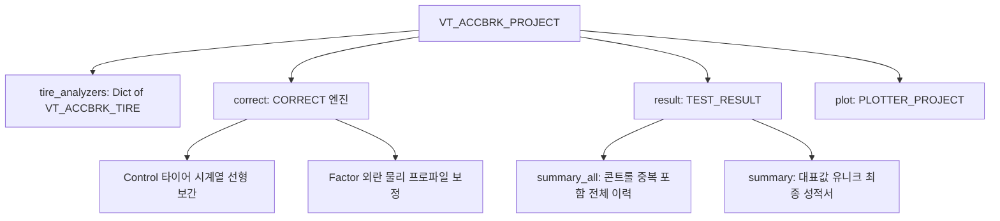

> [!NOTE] 🧭 Obsidian 네비게이션 & 시스템 계층
> - **상위 제어기**: [[10_VT_ACCBRK]] (전체 자동화 파이프라인 마스터)
> - **전역 허브**: [[unoUtil]] (사내 도구 통합 색인)
> - **영구 도메인 이론**: [[41_실차_제동_시계열_신호처리_및_고속_동역학_최적화_아키텍처]] (Wavelet, KDE, 캐시 최적화), [[42_실차_평가_시스템_엔터프라이즈_로깅_및_모니터링_아키텍처]] (로거 표준 및 무중단 시각화)
> - **하위 관리 객체**:
>   - [[11_VT_ACCBRK_TIRE]]: 개별 타이어 데이터 컨테이너
>   - [[21_CORRECT]]: 콘트롤 타이어 시계열 선형 보간 알고리즘
>   - [[Cal_Control]]: 레거시 콘트롤 타이어 보정 모듈 (하위 호환)
>   - [[31_PLOTTER_PROJECT]]: 프로젝트 단위 비교 차트 플로터

# 🛠️ VT_ACCBRK_PROJECT: 통합 성능 보정 및 비교 분석 엔진

`VT_ACCBRK_PROJECT`는 복수의 타이어 분석 인스턴스([`VT_ACCBRK_TIRE`])들을 하나의 프로젝트로 수집·통합하여 관리하는 **비교 평가 및 성능 보정 오케스트레이터(Orchestrator)**입니다.

---

## 1. 개요 및 프로젝트 오케스트레이션 철학

실외 주행 시험장 환경에서는 주행 시간에 따른 기온 변화, 태양광 및 습도에 의한 노면 마찰계수(μ) 변동, 트랙 건조 상태 변이 등의 다양한 환경 외란이 불가피하게 발생합니다. 이러한 외기 변동 요인은 타이어 고유의 물리적 접지력 성능을 정량적으로 대조하기 어렵게 만드는 가장 큰 노이즈 요소(Pain Point)입니다.

`VT_ACCBRK_PROJECT`는 시험 중간중간 반복 주행된 **콘트롤 타이어(Control/Reference)**의 실측 변화 추이를 시계열 정렬하여 선형 보간 보정하거나, 계측 장비로부터 취득된 **외란 요인 물리 계수(노면 온도, 수온 등)**를 직접 역산 대입하여, 각 대조 테스트 타이어들의 왜곡 없는 순수 성능 지수(Index %, 100% 기준) 및 최종 보정 성능값(Corrected Value)을 도출합니다.

---

## 2. 아키텍처 및 내부 핵심 컴포넌트

이 모듈은 데이터 수집부터 최종 시각화 보고서 생성까지 총 3단계의 논리적 계층(Layer)으로 설계되었습니다.



### 2.1 주요 멤버 변수 (Attributes)

| 변수명 | 타입 | 설명 |
| :--- | :--- | :--- |
| `self.prj_name` | `str` | 프로젝트 식별 명칭 (저장 파일명 및 결과 그래프의 Prefix 작동) |
| `self.tire_analyzers` | `dict[str, VT_ACCBRK_TIRE]` | 등록된 개별 타이어 분석 객체 딕셔너리 (Key: 타이어 세트명, 예: `'C1'`, `'T1'`) |
| `self.correct` | `CORRECT` | 보정 파라미터 관리 및 연산 알고리즘을 전담하는 통합 엔진 |
| `self.result.summary_all` | `pd.DataFrame` | 모든 반복 콘트롤(C1_1, C1_2...)을 포함하여 보정 연산이 최종 완료된 전체 결과 데이터프레임 |
| `self.result.summary` | `pd.DataFrame` | 중복 콘트롤 중 첫 번째 차수만 유지하여 최종 요약 보고서 성적서 양식으로 필터링된 결과 데이터프레임 |
| `self.plot` | `PLOTTER_PROJECT` | 타이어 간 막대그래프, 산점도, 비교 대시보드(Ridgeline 등)를 생성하는 시각화 엔진 |
| `self.col_tire` | `str` | 타이어 세트 식별 컬럼명 (기본값: `'TestTireSet'`) |
| `self.col_seq` | `str` | 시계열 정렬 및 선형 보간의 기준 축 컬럼명 (기본값: `'Datetime'`) |
| `self.ref_kwd` | `str` | 기준 콘트롤 타이어를 자동 마스킹할 정규식 키워드 (기본값: `'c'`) |

---

## 3. 성능 보정(Correction) 메커니즘 심층 분석

`VT_ACCBRK_PROJECT`는 `_CORRECT_.py` 모듈과의 협조를 통해 크게 두 가지 패러다임의 강력한 보정 기능을 지원합니다.

### ① 방식 1: 콘트롤 타이어 기반 시계열 선형 보간 보정 (`correct_type='control'`)

주행 순서 상 전후에 배치된 콘트롤 타이어 실측 데이터들의 시간순 추이를 동적 보정 기준선(Baseline)으로 형성합니다.

1. **콘트롤 식별**: `df[col_tire].str.contains(f"(?i)^{ref_kwd}")` 정규표현식으로 콘트롤 타이어(예: `C1`, `C2`, `CTR`) 행을 마스킹합니다.
2. **시계열 정렬**: 전체 시험 데이터셋을 시간축(`col_seq`, `Datetime`) 기준으로 순차 정렬합니다.
3. **보정 기준선 (`adj_refer`) 생성**:
   - 콘트롤 타이어의 실제 계측값을 기준 노드에 고정합니다.
   - 콘트롤 노드 사이의 가변 구간은 아래와 같이 선형 보간(Linear Interpolation)합니다:
     $$\text{adj\_refer}_{t} = \text{Interpolate}(\text{Control}_{\text{prev}}, \text{Control}_{\text{next}})$$
   - 첫 번째 콘트롤 이전의 테스트 타이어 구간은 `bfill()`, 마지막 콘트롤 이후 구간은 `ffill()`로 각각 외삽(Padding)하여 빈틈없는 보정 기준선을 구성합니다.
4. **성능 지수 (`Index`, %) 산출**:
   - **가속 지표 (Positive, 클수록 우수)**:
     $$\text{Index} = \frac{\text{Target}}{\text{adj\_refer}} \times 100$$
   - **제동/거리 지표 (Negative, 작을수록 우수 - 기본 정지수 방식)**:
     $$\text{Index} = \frac{2 \times \text{adj\_refer} - \text{Target}}{\text{adj\_refer}} \times 100$$
   - **역지수 방식 (Negative Inverse, `inverse=True` 옵션 - 성적서 표기 통일용)**:
     $$\text{Index} = \frac{\text{adj\_refer}}{\text{Target}} \times 100$$
5. **최종 보정 성능값 (`Corrected`, `corr_`) 산출**:
   - **Positive**: $\text{Mean}(\text{adj\_refer}) \times \frac{\text{Index}}{100}$
   - **Negative**: $\text{Mean}(\text{Target}) + \text{Mean}(\text{Target}) \times \left(1 - \frac{\text{Index}}{100}\right)$

### ② 방식 2: 환경 외란 물리 요인 기반 보정 (`correct_type='factor'`)

콘트롤 타이어를 여러 대 반복 주행하기 어렵거나 기온, 노면 온도의 실시간 외란 물리 센서 수치를 통해 정량 매칭 보정할 때 가동합니다.

- **보정 산식**:
  $$\Delta Factor = Factor - RefValue$$
  $$corr\_brk = brk\_mean - \frac{\Delta Factor}{Step} \times Gain$$
- **사전 지원 프로파일 (`factor_basic`)**:
  - `'dry'`: $Gain = 1.0, Step = 10.0$ (노면온도 10℃ 변화당 제동거리 1.0m 보정)
  - `'wet'`: $Gain = 0.4, Step = 10.0$ (노면온도 10℃ 변화당 제동거리 0.4m 보정)
  - `'snow'`: $Gain = 0.8, Step = 10.0$ (노면온도 10℃ 변화당 제동거리 0.8m 보정)
- **사용자 정의 프로파일**: `correct_factor={'gain': 0.6, 'step': 5.0, 'ref_value': 25.0}` 형태로 자유롭게 사전 주입 가능.

### ③ 보정 적용 범위 제어 (`correct_range`)

| 옵션값 | 보정 대상 컬럼 | 비고 |
| :--- | :--- | :--- |
| `'all'` (기본값) | 모든 가속/감속 성능 지표 전체 | `brk_mean`, `acc_mean`, `split_*`, `mudrop_dist` 등 |
| `'dist'` / `'only'` | 제동거리 및 감속 관련 지표만 | `brk_mean`, `split_dist_high`, `split_dist_low`, `mudrop_dist` |
| `'acc'` | 가속도 및 가속 시간 지표만 | `acc_mean`, `split_acc_high`, `split_acc_low` |
| `List[str]` | 사용자가 지정한 특정 컬럼 리스트 | 예: `['brk_mean']` (원하는 컬럼만 선택 보정) |

---

## 4. 클래스 인터페이스 및 메서드 상세 명세

### 1. `__init__(name='', ref_kwd='c', **kwargs)`
- **기능**: 프로젝트 오케스트레이터 객체를 생성하고 하위 시각화 플로터 및 빈 컨테이너를 빌드합니다.
- **인자**:
  - `name` (`str`): 프로젝트의 고유 대표명.
  - `ref_kwd` (`str`): 콘트롤 타이어 식별용 접두 키워드.

### 2. `add_tire(obj, tire=None)` -> `None`
- **기능**: 분석 완료된 타이어 인스턴스를 프로젝트 하위 목록에 추가 등록합니다.
- **아키텍처 안전망**: 원본 타이어 객체의 훼손을 차단하기 위해 내부적으로 **`deepcopy`** 처리된 복사본 사본을 마운트하여 연산 무결성을 지킵니다.
- **인자**:
  - `obj` (`VT_ACCBRK_TIRE`): 단일 타이어 분석기 인스턴스.
  - `tire` (`str`, optional): 세트 식별 키워드. 미지정 시 타이어 메타정보에서 자동 추출합니다.

### 3. `cal_corrected(inverse=False, **kwargs)` -> `pd.DataFrame`
- **기능**: 등록된 전체 타이어 세션의 시계열 정렬 및 콘트롤 기반 동적 선형보간 보정 연산을 총괄 실행하고, 보정 결과 테이블을 반환합니다.
- **인자**:
  - `inverse` (`bool`): 제동거리와 같은 Negative 지표의 인덱스 산출 시 역지수 산식을 활성화할지 여부.

### 4. `update_summary()` -> `None`
- **기능**: 프로젝트 외부에서 타이어 인스턴스의 하위 수치나 사양 정보를 수정한 경우, 프로젝트 데이터프레임과 요약 성적서에 바인딩된 원천 수치들을 다시 전수 취합하여 일관성을 동기화합니다.

### 5. `plt(save=None, excel=None, html=False, close=True)` -> `None`
- **기능**: 8대 비교 전문 차트(제동 성능, 가속 응답, 2D PDF Ridgeline, 수막현상 loss 등)를 레이아웃에 맞춰 일괄 출력 및 이미지 저장, HTML 출력, 엑셀 워크북 병합을 완수합니다.
- **인자**:
  - `excel` (`dict`): 저장 경로, 시트명 정보 딕셔너리.
  - `excel_opt` (`str`): 동일 프로젝트 내 비교 차트 배치 방향 (기본값: `"down"`으로 세로 정렬).
  - `next_project` (`bool`): 엑셀 워크북 내에 연속적으로 다른 프로젝트를 이어 그릴 때 우측 확장 영역 자동 산출 및 배치 여부.

### 6. `save_pjt(path, print=True, **kwargs)` -> `None`
- **기능**: 수집된 타이어 사본들과 프로젝트 보정 데이터 전체를 실무 최적 압축률(`compresslevel=5`)로 패키징하여 `.pjt` 단일 파일로 기록 보관합니다 (3~5배 가속).
- **인메모리 캐시 보존**: 저장 직후에도 메모리 캐시를 소거하지 않아 후속 플롯 및 데이터 조회가 즉각 가능합니다.

### 7. `save_tires(path=None, **kwargs)` -> `None`
- **기능**: 프로젝트에 속한 개별 타이어 객체들을 `.tir` 개별 파일로 분할 저장합니다 (`compresslevel=5`).

### 8. `load(file=None, **kwargs)` [Class Method] -> `VT_ACCBRK_PROJECT`
- **기능**: 디스크 상에 바이너리로 저장되어 있던 `.pjt` 프로젝트 상태를 복원하여 완전한 파이썬 개체로 역직렬화합니다. `restore=False` 지연 로딩을 통한 초고속 복원이 가능합니다.

---

## 5. 실무자를 위한 퀵 가이드 및 안전망

> 💡 **실무 요약 꿀팁**
> - **데이터 안전망**: `add_tire` 시 `deepcopy`가 내장되어 원본 객체를 보호하므로 프로젝트 상에서 자유롭게 실험 수치를 조율하셔도 안전합니다.
> - **콘트롤 유실 복구**: 실수로 콘트롤 타이어를 하나도 지정하지 않거나 식별자가 달라도, 프로그램이 비정상 종료되는 대신 첫 번째 행을 임시 기준으로 자동 매핑하여 처리를 중단 없이 완수합니다.
> - **RAM 라이브 캐시 보존 및 고속 직렬화**: `save_pjt()` 호출 시 실무 골디락스 존인 `compresslevel=5`를 적용하여 저장 속도를 극대화하고, RAM 상의 연산 캐시를 유지하여 사후 분석 시 재연산 지연이 없습니다. [[41_실차_제동_시계열_신호처리_및_고속_동역학_최적화_아키텍처]] 참조.

### 🎯 분석 목적별 핵심 메서드 매칭 테이블
| 나의 실무 분석 목적 | 최적 호출 함수/메서드 | 기대 효과 |
| :--- | :--- | :--- |
| **시간순 외기 변이 제거 및 보정 실행** | `cal_corrected(inverse=True)` | 정밀 선형 보간 및 보정 거리/지표 획득 |
| **타이어 간 성능 직관 대조 플롯 생성** | `plt(save='path', html=True)` | 보고서용 고해상도 PNG 및 인터랙티브 웹 그래프 자동 저장 |
| **결과 요약 데이터 프레임만 추출** | `makefile_summary()`, `makefile_summary_all()` | 엑셀 원천 데이터에 즉각 바인딩 가능한 콤팩트 테이블 획득 |
| **장기 보관용 인스턴스 백업** | `save_pjt(path='file_name.pjt')` | 압축 백업을 통해 대용량 원시 데이터 없이 단 0.05초 만에 복원 가능 |

---

## 6. 실무 밀착형 종합 예제 코드

```python
# [변수 네이밍 규칙 준수: 변수타입_목적(이름)]

# 1. 비교 평가 프로젝트 선언 및 타이어 분석 완료본 (.tir) 수집
pjt_suv_project = VT_ACCBRK_PROJECT(name="SUV_Tire_Comparison", ref_kwd="CTR")
pjt_suv_project.add_tire_file(file="./data/T1_result.tir")
pjt_suv_project.add_tire_file(file="./data/T2_result.tir")
pjt_suv_project.add_tire_file(file="./data/CTR_result.tir")

# 2. 성능 보정 연산 즉시 가동 (성적서 표준 양식을 위해 역지수 모드 가동)
pjt_suv_project.cal_corrected(inverse=True)

# 3. 실무 보고서용 데이터 요약본 자동 추출 및 인코딩 저장
df_result_final = pjt_suv_project.makefile_summary()
df_result_final.to_csv("SUV_Final_Report.csv", encoding="utf-8-sig")

# 4. 종합 8대 시각화 그래프 자동 렌더링 및 엑셀 일괄 삽입 저장
excel_cfg = {
    'excel_path': "./SUV_Final_Braking_Report.xlsx",
    'sheet_name': 'Graph_Comparison',
    'start_cell': 'B2',
    'width': 150
}
pjt_suv_project.plt(
    save="./final_plots", 
    excel=excel_cfg,
    html=True, 
    close=True
)

# 5. 초고속 실무 압축 백업 (compresslevel=5, RAM 라이브 캐시 보존)
pjt_suv_project.save_pjt(path="./SUV_Tire_Comparison.pjt")

print("🎉 비교 프로젝트 보정, 데이터 요약, 엑셀 그래프 저장이 모두 성공적으로 처리되었습니다!")
```

**Documented by your Coding Partner & Technical Writer, uno.**
