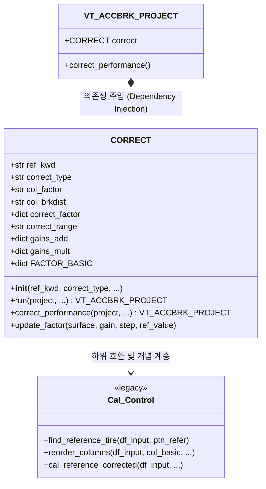

> [!NOTE] 🧭 Obsidian 네비게이션 & 시스템 계층
> - **상위 허브**: [[00_VT_ACCBRK_대시보드]], [[VT_ACCBRK_PROJECT]]
> - **영구 도메인 이론**: [[43_차세대_실차_가속제동_통합_컨테이너_및_환경보정_아키텍처]] (가상 과녁 선형 보간 및 환경 팩터 보정 모델), [[40_제동_성능_자동분석_및_기상_공간QC_보정_시스템]]

# CORRECT & Cal_Control 성능 보정 모듈 상세 엔지니어링 매뉴얼

**모듈 파일**: [`_CORRECT_.py`](file:///D:/uno/Python/Projects/unoUtil/unoUtil/vehicleTest/ACCBRK/_CORRECT_.py), [`Cal_Control.py`](file:///D:/uno/Python/Projects/unoUtil/unoUtil/vehicleTest/ACCBRK/Cal_Control.py)  
**주요 클래스 및 함수**: `CORRECT`, `cal_reference_corrected`, `find_reference_tire`, `reorder_columns`  
**연계 모듈**: [`VT_ACCBRK_PROJECT.py`](file:///D:/uno/Python/Projects/unoUtil/unoUtil/vehicleTest/ACCBRK/VT_ACCBRK_PROJECT.py), [`VT_ACCBRK.py`](file:///D:/uno/Python/Projects/unoUtil/unoUtil/vehicleTest/ACCBRK/VT_ACCBRK.py)  
**버전**: 2026 Revision (통합 객체지향 보정 엔진 및 환경 인자 하이브리드 지원)

---

## 1. 개요 및 보정(Correction)의 필요성

실차 제동/가속(ACCBRK) 시험은 수 시간에 걸쳐 야외 주행로(Track)에서 수행되므로, 시험 진행에 따라 **노면 온도(Track Temp), 외기온도, 습도, 노면 마찰력(Mu Drift)** 등이 지속적으로 변화합니다.

동일한 타이어라도 오전 9시(노면온도 15℃)와 오후 2시(노면온도 35℃)에 측정한 제동거리는 유의미한 물리적 편차를 보이게 됩니다. 따라서 시험 결과의 객관적인 타이어 간 성능 비교를 위해서는 **외란(Disturbance)에 의한 편차를 보정하여 표준 상태로 환산하는 보정 엔진**이 필수적입니다.

`unoUtil.vehicleTest.ACCBRK`는 두 가지 강력한 보정 아키텍처를 제공합니다:

1. **Control Tire 기반 시계열 선형 보간 보정 (`correct_type='control'`)**:
   - 시험 시작(C1_1st)과 종료(C1_2nd) 혹은 중간에 주기적으로 투입되는 기준(Control) 타이어의 성능 변화 추이를 선형 보간(Linear Interpolation)하여 각 시험 타이어의 보정 지수(Index)와 보정 성능을 산출합니다.
2. **환경 인자 기반 물리 계수 보정 (`correct_type='factor'`)**:
   - 노면온도, 외기온도 등 실시간 기상 관측 데이터(`TrackTemp`, `BRK Dry Asp` 등)와 기준 물리 프로파일(예: 10℃당 0.4m 변화)을 결합하여 절대 물리량을 직접 보정합니다.

---

## 2. 아키텍처 및 클래스 다이어그램



---

## 3. 핵심 클래스: `CORRECT` (`_CORRECT_.py`)

### 3.1 생성자 파라미터 규격

```python
CORRECT(
    ref_kwd: str = 'c',
    correct_type: Optional[str] = 'control',
    col_factor: Optional[str] = 'BRK Dry Asp',
    col_brkdist: Optional[str] = 'brk_mean',
    correct_factor: Optional[Union[dict, str]] = None,
    correct_range: Optional[Union[str, list[str]]] = 'all',
    gains_add: Optional[dict[str, Union[float, int]]] = None,
    gains_mult: Optional[dict[str, Union[float, int]]] = None,
    **kwargs
)
```

| 파라미터명 | 타입 | 기본값 | 상세 설명 |
| :--- | :--- | :--- | :--- |
| `ref_kwd` | `str` | `'c'` | 콘트롤 타이어 세트명 식별용 정규식 키워드 (`r'^c\d+'`). |
| `correct_type` | `str` | `'control'` | 보정 방식 (`'control'` : 콘트롤 타이어 시계열 보간, `'factor'` : 환경 인자 계수 보정). |
| `col_factor` | `str` | `'BRK Dry Asp'` | 외란 요인 데이터 컬럼명 (기상 데이터 결합 열). |
| `col_brkdist` | `str` | `'brk_mean'` | 보정의 기준이 되는 대표 제동거리 컬럼명. |
| `correct_factor`| `str`/`dict` | `None` | 외란 보정 계수 프로파일 (`'dry'`, `'wet'`, `'snow'` 또는 커스텀 dict). |
| `correct_range` | `str`/`list` | `'all'` | 보정 적용 범위 (`'all'`, `'dist'`, `'acc'`, `'only'` 또는 커스텀 컬럼 리스트). |
| `gains_add` | `dict` | `None` | 특정 지표 컬럼에 대한 수동 덧셈 게인 (Offset). |
| `gains_mult` | `dict` | `None` | 특정 지표 컬럼에 대한 수동 곱셈 게인 (Scaling). |

---

### 3.2 노면별 기본 물리 프로파일 (`FACTOR_BASIC`)

`_CORRECT_.py`는 실차 평가 현장의 경험적 물리 데이터를 기반으로 기본 팩터 프로파일을 내장하고 있습니다:

```python
correct_factor_basic = {
    'dry':  {'gain': 1.0, 'step': 10.0, 'ref_value': None}, # 마른 노면: 10도당 1.0m
    'wet':  {'gain': 0.4, 'step': 10.0, 'ref_value': None}, # 젖은 노면: 10도당 0.4m
    'snow': {'gain': 0.8, 'step': 10.0, 'ref_value': None}  # 스노우/아이스: 10도당 0.8m
}
```

---

### 3.3 보정 알고리즘 상세

#### A. Control Tire 선형 보간 (`correct_type='control'`)

1. **기준점 추출**: `mask_ref_tire`로 지정된 콘트롤 타이어 행들의 시험 시각(`Datetime`)과 측정값을 획득.
2. **시계열 보간**: `df.interpolate(method='linear').ffill().bfill()`을 적용하여 전체 시험 구간에 걸친 콘트롤 타이어 가상 기준값(`adj_refer_*`) 산출.
3. **지수 및 보정값 계산**:
   - **클수록 좋은 지표 (Positive, 예: 가속도 `acc_mean`)**:
     $$\text{Index} = \frac{\text{Raw}}{\text{adj\_refer}} \times 100$$
     $$\text{Corrected} = \text{Control\_Mean} \times \frac{\text{Index}}{100}$$
   - **작을수록 좋은 지표 (Negative, 예: 제동거리 `brk_mean`)**:
     $$\text{Index} = \frac{2 \times \text{adj\_refer} - \text{Raw}}{\text{adj\_refer}} \times 100$$
     $$\text{Corrected} = \text{Control\_Mean} + \text{Control\_Mean} \times \left(1 - \frac{\text{Index}}{100}\right)$$

#### B. Factor 외란 보정 (`correct_type='factor'`)

1. **외란 편차 산출**:
   $$\Delta \text{Factor} = \text{col\_factor} - \text{ref\_value}$$
2. **보정 비율(Ratio) 계산**:
   $$\text{corr\_ratio} = 1.0 + \frac{\Delta \text{Factor}}{\text{step}} \times \frac{\text{gain}}{\text{ref\_dist}}$$
3. **지표별 적용**:
   제동거리는 나눗셈(`Raw / corr_ratio`), 가속도는 곱셈(`Raw * corr_ratio`)으로 보정.

---

## 4. 레거시 모듈: `Cal_Control.py`

`Cal_Control.py`는 구버전 함수형 파이프라인에서 단독 데이터프레임 보정에 사용되던 모듈입니다.

- **`find_reference_tire(df_input, ptn_refer='c')`**: 콘트롤 타이어 마스크 및 첫 번째 콘트롤 타이어만 남기는 요약용 마스크 반환.
- **`reorder_columns(df_input, col_basic, col_target, col_target_add)`**: 컬럼 우선순위 재정렬.
- **`cal_reference_corrected(df_input, ...)`**: 데이터프레임 단위 직접 보정 함수.

> [!NOTE]
> 신규 프로젝트 및 객체지향 파이프라인에서는 `_CORRECT_.CORRECT` 사용이 표준이며, `Cal_Control.py`는 기존 레거시 코드와의 100% 하위 호환성을 위해 유지 및 보강되었습니다.

---

## 5. 사용 예제 코드

### 5.1 `CORRECT` 엔진을 이용한 독립 프로젝트 보정

```python
import pandas as pd
from unoUtil.vehicleTest.ACCBRK._CORRECT_ import CORRECT
from unoUtil.vehicleTest.ACCBRK.VT_ACCBRK_PROJECT import VT_ACCBRK_PROJECT

# 1. 보정 엔진 인스턴스 생성 (콘트롤 타이어 보정)
engine = CORRECT(
    ref_kwd='c',
    correct_type='control',
    correct_range='all'
)

# 2. 프로젝트 객체에 주입 및 실행
project = VT_ACCBRK_PROJECT().load("0. db/Dry_Test.pjt")
engine.run(project)

# 3. 보정 완료된 요약본 확인
print(project.result.summary[['TestTireSet', 'brk_mean', 'corr_brk_mean', 'index_brk_mean']])
```

### 5.2 노면온도 Factor 기반 보정

```python
# 노면온도(TrackTemp) 기준 10도당 0.2m 변화 물리 모델 적용
factor_profile = {
    'gain': 0.2,
    'step': 10.0,
    'ref_value': 25.0 # 기준 노면온도 25℃
}

engine_factor = CORRECT(
    correct_type='factor',
    col_factor='TrackTemp',
    col_brkdist='brk_mean',
    correct_factor=factor_profile,
    correct_range='all'
)

engine_factor.run(project)
```
