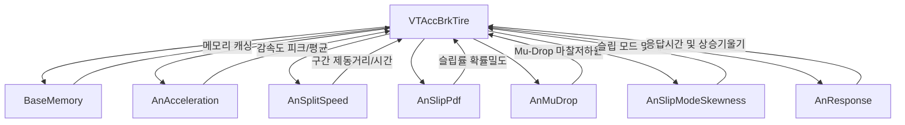

# unoUtil vehicle/acc_brk 기반 유틸리티 및 전용 분석 모듈 엔지니어링 매뉴얼 (func_acc_brk.md)

**주요 모듈군**:
1. 기반 함수 라이브러리: `func_acc_brk.py`
2. 6대 서브 물리 분석기: `analyzers/` (`an_acceleration.py`, `an_mu_drop.py`, `an_response.py`, `an_skewness.py`, `an_slip_pdf.py`, `an_split_speed.py`)
3. 시각화 및 리포팅 엔진: `plotter_tire.py`, `plotter_project.py`
**버전**: 2026 v2 정식 표준 (PascalCase/8대 동사 준수, 로거 레벨 격리, 1D Wavelet 가속화 및 모듈별 자율 시뮬레이션 탑재)

---

## 1. 기반 함수 모듈: `func_acc_brk.py`

`func_acc_brk.py`는 ACCBRK 모듈 전역에서 사용되는 물리 계산, 통계 필터링, 동적 프로퍼티 디스크립터, 데이터 구조 변환 함수들을 총괄하는 핵심 기반 라이브러리입니다.

### 1.1 주요 함수군 분류

| 카테고리 | 대표 함수명 | 기능 설명 |
| :--- | :--- | :--- |
| **핵심 가감속 분석** | `calc_acc_brk` | 가감속 시험 데이터 구간 분할, 유효 런 선별 및 6대 서브 분석 종합 (`level` 제어) |
| **휠 슬립 연산** | `calc_slip` | 4륜 개별 휠속도 기반 동적 슬립률(Slip Ratio) 계산 (`level` 제어) |
| **기준 타이어 보정** | `calc_reference_corrected` | 콘트롤 타이어 시계열 추이 기반 성능 지수 및 보정값 계산 (`level` 제어) |
| **신호 필터링** | `filter_acc`, `filter_moving_average` | 가속도 및 속도 신호의 이동 평균, 이상치 절사 및 노이즈 필터링 |
| **구간 분할 및 추출**| `calc_split_speed`, `get_valid_trials` | 목표 속도 구간(예: 100~0 km/h) 자동 감지 및 개별 시험 차수(Trial) 슬라이싱 |
| **통계 분석** | `calc_statistics`, `calc_outlier_iqr` | 평균, 표준편차, 변동계수(CV), IQR 기반 이상치 판별 |
| **기상/환경 연계** | `integrate_weather_data` | 타이어 시험 타임스탬프와 기상 관측소 10분 주기 DB 인터폴레이션 결합 |
| **좌표계 변환** | `calc_acc_brk(local_pos=...)` | GNSS 위경도 좌표를 평면 직교 좌표계(`PosX`, `PosY`)로 투영/회전 변환 |
| **결과 요약 및 정렬**| `reorder_columns`, `merge_dataframes` | 통일된 컬럼 명명 규칙 적용 및 요약 테이블 포맷 정렬 |

### 1.2 핵심 개선 사항 (v2 정식 표준)

- **로거 레벨 표준화 및 print 인자 퇴출**: `level: Union[int, str] = logging.INFO` (또는 `DEBUG`) 표준 인자를 도입하고 독자 로거(`LOGGER("VT_ACCBRK.Detect", level=level)`)를 바인딩하여 전역 로거 간섭 없이 호출자별 독립 로깅 제어.
- **표준 파라미터 네이밍 준수**: `df_input`, `df_raw` $\rightarrow$ `data: pd.DataFrame`, `flag_print` $\rightarrow$ `level`.
- **C 기반 고속 1D Wavelet Denoising 탑재 (`fast_denoise_wavelet_1d`)**: PyWavelets VisuShrink C-백엔드를 연동하여 0.05초 이내 노이즈 제거 및 에지 보존.
- **WGS84 타원체 정밀 측지 계산 모드 연동**: 평면 직교 좌표계(`PosX`, `PosY`) 변환 시 GPS 비정상 좌표(`0.0, 0.0`) 격리 및 인덱스 100% 보존.

---

## 2. 6대 서브 물리 분석기 (`analyzers/`)

각 서브 분석기는 단일 타이어(`VTAccBrkTire`) 내부에서 독립된 물리 영역의 정밀 분석을 담당하는 컴포넌트입니다.



### 2.1 모듈별 기능 명세

1. **`an_acceleration.py` (`AnAcceleration`)**: 제동/가속 중 최대 가속도(Peak G), 평균 가속도(Mean G), 속도 밴드별 평균 가속도 산출.
2. **`an_split_speed.py` (`AnSplitSpeed`)**: 고속/저속 구간별 분할 제동거리 및 통과 시간 분석.
3. **`an_slip_pdf.py` (`AnSlipPdf`)**: 4륜 슬립률의 커널 밀도 추정(KDE PDF) 및 특정 슬립 밴드 효율 점수 산출.
4. **`an_mu_drop.py` (`AnMuDrop`)**: KMeans 및 Decision Tree 기반 수막현상 마찰 급감 속도 및 손실 거리 산출.
5. **`an_skewness.py` (`AnSlipModeSkewness`)**: 슬립률 최빈값(Mode) 및 왜도(Skewness) 2D 지형도 분석.
6. **`an_response.py` (`AnResponse`)**: 제동 초기 반응 지연 시간 및 가속도 상승 기울기(OLS) 분석.

---

## 3. 단위 모듈 검증 방법

모든 서브 분석기 및 유틸리티 모듈은 로컬 파일이 없어도 즉시 동작 가능한 **다중 시나리오 독립 실행 스위트(`if __name__ == "__main__":`)**를 내장하고 있습니다:

```bash
# 서브 분석기 독립 검증 (Windows PowerShell)
python unoUtil/vehicle/acc_brk/analyzers/an_acceleration.py
python unoUtil/vehicle/acc_brk/analyzers/an_split_speed.py
python unoUtil/vehicle/acc_brk/analyzers/an_slip_pdf.py
python unoUtil/vehicle/acc_brk/analyzers/an_mu_drop.py
python unoUtil/vehicle/acc_brk/analyzers/an_skewness.py
python unoUtil/vehicle/acc_brk/analyzers/an_response.py

# 코어 엔진 및 파이프라인 검증
python unoUtil/vehicle/acc_brk/func_acc_brk.py
python unoUtil/vehicle/acc_brk/correct.py
python unoUtil/vehicle/acc_brk/vt_acc_brk_tire.py
python unoUtil/vehicle/acc_brk/vt_acc_brk_project.py
python unoUtil/vehicle/acc_brk/vt_acc_brk.py
```
