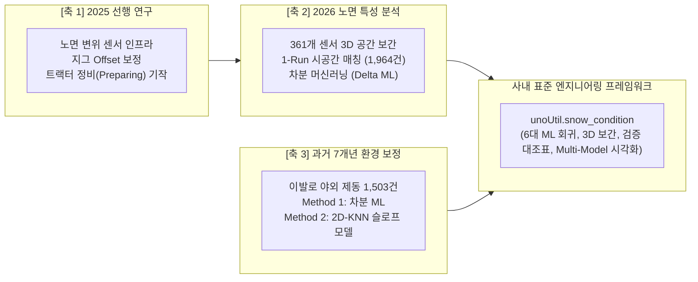

# 🏔️ Snow 기반기술 연구개발 통합 색인 (Master MOC Hub)

> ⚡ **Quick Jump**: [🗺️ 연구 로드맵](#️-1-스노우-기반기술-연구개발-3대-축-로드맵) · [📂 3대 세부 프로젝트](#-2-3대-세부-연구-프로젝트-인벤토리) · [🤖 보정 모델 연구 현황](#-3-환경-보정-후보-모델군-및-검토-현황) · [🏛️ unoUtil 프레임워크](#️-4-사내-표준-프레임워크-연계-unutilsnow_condition)

> [!ABSTRACT] ❄️ 스노우 기반기술 총괄 개요
> 자연 기상 상태에서 급변하는 눈 트랙의 물리적 환경(눈 침하 깊이, 기온, 습도, 융해/재동결)을 과학적으로 계측하고 수학적으로 격리하여, **시험 일자나 날씨 조건에 관계없이 타이어 고유의 스노우 제동 성능 실력을 공정하게 복원·정규화하는 지능형 엔지니어링 시스템** 구축 프로젝트입니다.

---

## 🗺️ 1. 스노우 기반기술 연구개발 3대 축 로드맵



---

## 📂 2. 3대 세부 연구 프로젝트 인벤토리

스노우 기반기술은 **데이터의 성격, 연구 목적, 적용 알고리즘**에 따라 3대 독립 축으로 전문화되어 관리됩니다:

| 구분 | 대주제 | 핵심 연구 내용 및 성과 | 주요 산출물 및 문서 링크 |
| :---: | :--- | :--- | :---: |
| **1️⃣** | **2025 Snow 기반기술**<br>(선행 연구 & 계측 인프라) | • 초음파/레이저 다채널 센서 지그 기구 오차(Offset) 보정 수립<br>• 트랙터 정비(Preparing: 오전 1회, 점심 1회)에 따른 노면 물리적 리셋 규명<br>• 5대 설질 변화(압력, 융해-재동결, 습윤, 구조적, 파괴적) 기작 정립 | [[10_2025_Snow_기반기술/00_2025_Snow_기반기술_대시보드\|2025 대시보드 바로가기]]<br>[[10_2025_노면특성_계측장비_사양\|노면 계측장비 사양]] |
| **2️⃣** | **2026 Snow Surface**<br>(디지털 트윈 & 차분 보정) | • 361개 노면 센서 스냅샷 기반 3D 트랙 격자 맵 구축<br>• 1-Run 단위 제동 데이터 1:1 시공간 결합 (실측 1,964건 전수 완료)<br>• 동일 타이어 1st(Ref) vs 2nd(Raw) 환경 차분 머신러닝 보정 ($D_{\text{corr}} = D_{\text{raw}} - \Delta D_{\text{pred}}$)<br>• 타이어 사양(컴파운드/패턴) 순위 보존도 및 분산 감소율 분석 | [[20_2026_Snow_Surface_Characteristics/00_2026_Snow_Surface_Characteristics_대시보드\|2026 대시보드 바로가기]]<br>[[20_2026_Snow_Surface_Characteristics/30_SnowSurface_DailyNote\|SnowSurface 일자별 일지]] |
| **3️⃣** | **과거 7개년 환경 보정**<br>(히스토리 제동 DB 복원) | • **노면 센서가 부재한 과거 7개년(2018~2024)** 실차 제동 1,503건 사후 보정<br>• **Method 1**: 반복 시험 차분 머신러닝 ($\Delta T, \Delta AH \to \Delta D$)<br>• **Method 2**: 동일 스펙(규격+패턴+차량) 기준 잔차 2D 공간 슬로프 모델 (2D-KNN 러프 평활화 / LOESS)<br>• 타이어 3대 카테고리(Studless, Stud, AllSeason)별 온·습도 민감도 도출 | [[30_Historical_Braking_Data_Correct/00_과거_스노우_제동_환경보정_종합_통합보고서\|과거 7개년 종합 보고서]] |

---

## 🤖 3. 환경 보정 후보 모델군 및 검토 현황

현재 보정 시스템은 특정 단일 알고리즘을 강제 고정하지 않고, **연구 목적과 평가 데이터 조건에 따라 유연하게 선택할 수 있는 다형성(Polymorphic) 체계**로 운용되고 있습니다:

```text
┌────────────────────────────────────────────────────────────────────────────────────────┐
│                              환경 보정 머신러닝 후보군 및 적용 영역                        │
├───────────────────┬─────────────────────────────────────┬──────────────────────────────┤
│      후보 모델     │               적용 영역 및 역할      │       현재 검증 성과 및 특징   │
├───────────────────┼─────────────────────────────────────┼──────────────────────────────┤
│ Random Forest     │ • 실측 노면 침하차 + 절대습도차 기반│ • R² = 0.512 ~ 0.86, MAE=0.51m│
│ (주력 후보 1)     │   비선형 차분 복원 (Method 1)       │ • 비선형 상호작용 포착 우수  │
├───────────────────┼─────────────────────────────────────┼──────────────────────────────┤
│ KNN Regressor     │ • 2D/3D 등고선 보정 맵 시각화       │ • R² = 0.542, MAE = 0.496m    │
│ (주력 후보 2)     │ • 국소 거리 가중 곡면 보정          │ • 가장 부드러운 연속 곡면 형성│
├───────────────────┼─────────────────────────────────────┼──────────────────────────────┤
│ 2D-KNN / LOESS    │ • 노면 센서가 없는 과거 7개년       │ • 동일 스펙 기준선 대비 잔차  │
│ (슬로프 모델)     │   기상 기반 공간 보정 (Method 2)    │   러프 평활화로 과적합 방어   │
├───────────────────┼─────────────────────────────────────┼──────────────────────────────┤
│ SVR (RBF Kernel)  │ • 마진 기반 이상치 저항 보정        │ • MAE = 0.559m, 일반화 우수   │
├───────────────────┼─────────────────────────────────────┼──────────────────────────────┤
│ Ridge / Linear    │ • 물리적 단위당 감도 해석 기준선    │ • 물리적 직관성 제공 (Base)   │
└───────────────────┴─────────────────────────────────────┴──────────────────────────────┘
```

> [!TIP] 💡 최신 다중 모델 비교 시각화 엔진 탑재
> 최신 파이썬 프레임워크(`unoUtil.snow_condition.correction_plotter`)에 **`scatter_restoration_comparison`**(복원 수렴도 1:1 대조) 및 **`correction_map_comparison`**(동일 컬러바 2D 등고선 대조) 함수가 탑재되어, 연구자가 복수 모델의 거동을 Side-by-Side로 직접 대조하며 최적 모델을 비교·선택할 수 있습니다.

---

## 🏛️ 4. 사내 표준 프레임워크 연계 (`unoUtil.snow_condition`)

모든 스노우 환경 보정 알고리즘은 사내 표준 라이브러리인 **`unoUtil`** 12대 공식 도메인으로 이관되어 단일 공급원(SSOT)으로 관리됩니다:

* **소스 코드 위치**: `D:\uno\Python\Projects\unoUtil\unoUtil\snow_condition\`
* **7대 코어 모듈 구성**:
  1. `schema.py`: 47대 SSOT 표준 컬럼 명세 및 `harmonize_snow_dataframe()` 데이터 정규화 단일 관문.
  2. `physics.py`: Sonntag 증기압 공식 기반 상대습도 $\to$ 절대습도 변환 및 물리식.
  3. `surface_interpolator.py` / `surface_animator.py`: 3D 트랙 센서 공간 격자화 및 Plotly 애니메이션.
  4. `correction_model.py`: 6대 머신러닝 회귀 학습 및 데이터프레임 일괄 보정 (`SnowCorrectionModel`).
  5. `correction_validator.py`: 1st(Ref) vs 2nd(Corr) 정밀 대조표 산출 및 오차 개선율 요약.
  6. `correction_plotter.py`: Figure 1~4 핵심 검증 차트 및 Side-by-Side 멀티 모델 비교 시각화.
  7. `slope_model.py`: 과거 7개년 데이터 보정 전담 2D 공간 슬로프 보정 엔진 (`SnowSlopeModel`).

---

## 📚 5. 영구 지식 아카이브 링크

* 📖 [[04_Resources/30_스노우_노면_공학/00_스노우_노면_공학_통합_색인|스노우 노면 공학 통합 지식 색인 (MOC)]]
* ❄️ [[04_Resources/30_스노우_노면_공학/31_스노우_노면_디지털트윈_및_제동성능_보정_위키|스노우 노면 디지털 트윈 및 제동 성능 보정 종합 위키]]
* 📄 [[04_Resources/30_스노우_노면_공학/90_스노우_선행연구_논문_리뷰|스노우 선행 연구 및 학술 논문 리뷰]]
