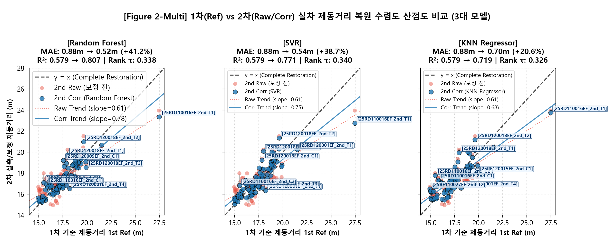
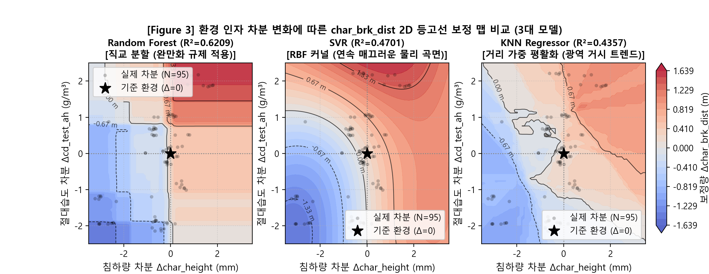
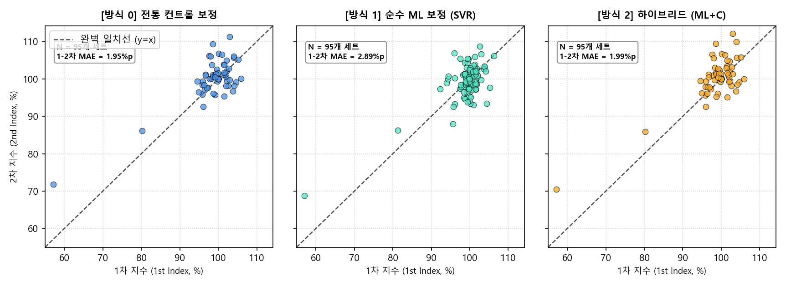
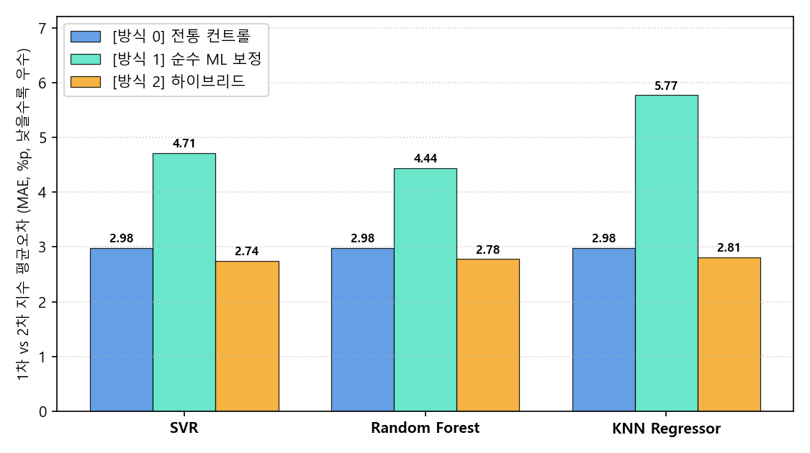
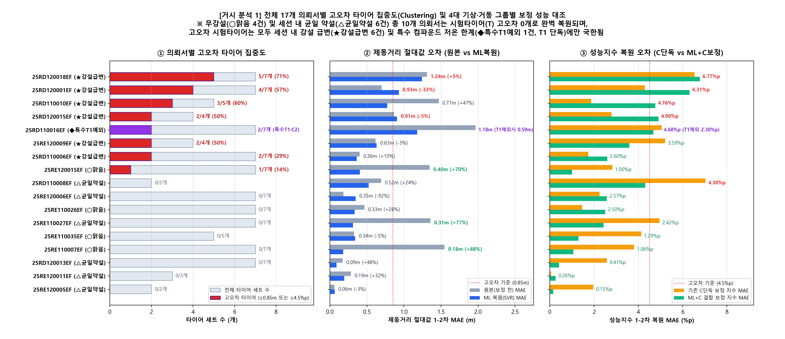
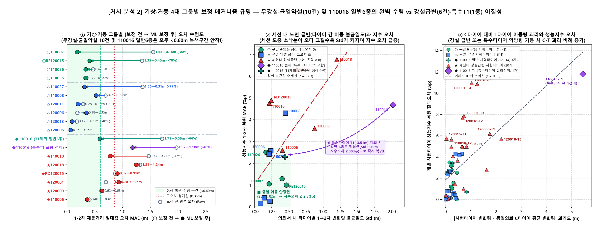
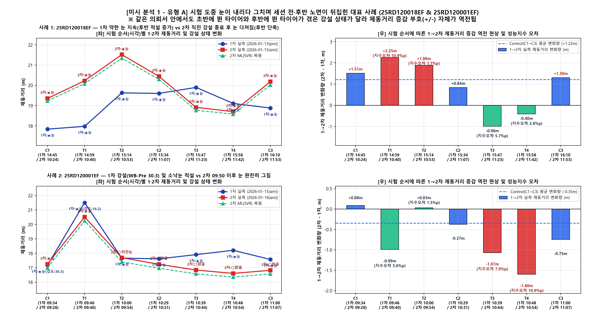
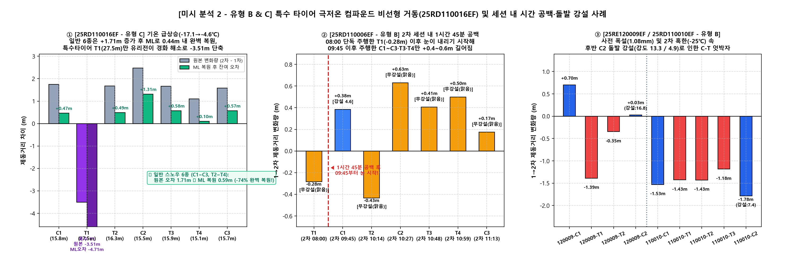
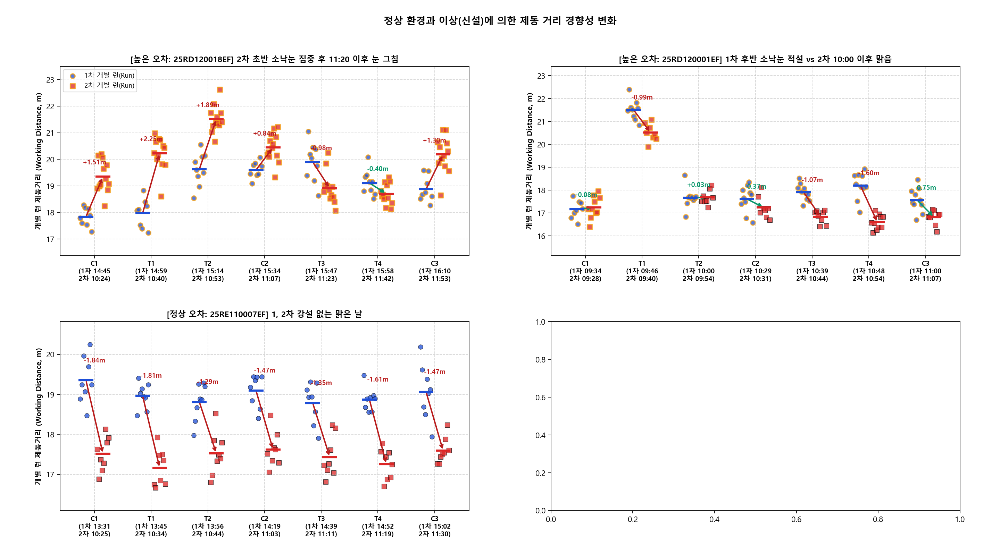

# 🏔️ 2026 스노우 노면보정 검증(제동거리 절대값·성능지수) 및 고오차 기상·강설 정밀 원인분석 종합보고서

> ⚡ **Quick Jump**: [📊 1. 종합 검증 결과](#-1-제동거리-절대값m-및-성능지수-보정-종합-검증-결과) · [🔍 2. 고오차 데이터 클러스터링 & 강설 영향](#-2-고오차-데이터의-의뢰서-집중clustering-및-강설-영향-분석) · [⏱️ 3. 세션 내 타임라인 & 유형별 미시 분석](#️-3-세션-내-타임라인시험-시각-및-3대-고오차-원인-유형-심층-분석) · [🎯 4. 런(Run) 단위 궤적 & Top 15 진단](#-4-런run-단위-제동-궤적-및-고오차-상위-15개-타이어-정밀-진단) · [📂 5. 산출물 엑셀 및 스크립트](#-5-연관-엑셀-보고서-및-분석-스크립트)

> [!ABSTRACT] ❄️ 보고서 핵심 요약 (Executive Summary — VBO 날짜 정합 완료 최종 DB 기준)
> 1. **제동거리 절대값(m) 및 성능지수(%) 통합 검증 (전체 17개 의뢰 전수 데이터 기준)**:
>    * 2025–2026 동계 실차 스노우 제동 시험 **17개 의뢰서(95개 타이어 세트: 기준타이어 Control 41세트, 순수 시험타이어 Test 54세트, 총 1,974런)** 전수를 대상으로 **제동거리 절대값(m)**과 **성능지수(%)**를 일원화하여 검증했습니다. (※ 기준타이어 `C1~C3` 41세트는 전통 컨트롤 보정 시 정의상 지수가 `100.0%`로 고정되어 오차가 `0.000%p`가 되므로, 성능지수 오차 산출 시 착시를 막기 위해 순위 상관성용 부분 필터 없이 **17개 의뢰의 순수 시험타이어 `T1~T4` 54세트 전수**를 대상으로 평가함)
>    * **제동거리 절대값(m)**: 보정 전 원본 1-2차 복원 오차(`전체 95세트 MAE = 0.878m, Std = 1.117m` / `17개 의뢰 평균 MAE = 0.810m, 의뢰 내 Std = 0.427m`) 대비 머신러닝 노면 보정 시 **`Random Forest` 기준 `MAE = 0.516m` (+41.2% 개선)**, **`SVR` 기준 `MAE = 0.538m` (+38.7% 개선)**으로 대폭 향상되었습니다.
>    * **성능지수(%p)**: 전체 17개 의뢰 순수 시험타이어(`54세트 전수`) 기준, 기존 컨트롤 타이어 단독 선형보간(**`MAE = 3.439%p` [`차트 3.44%p / 54세트 단순평균 3.418%p`], `편차 Std = 2.216%p`**) 대비 **순수 머신러닝 노면 보정(`Random Forest` `2.887%p` [`차트 2.89%p`, +16.1% 오차 개선 / 편차 `1.307%p` (-41.0% 감소)], `SVR` `2.916%p` [`차트 2.92%p`, +15.2% 오차 개선 / 편차 `1.694%p` (-23.6% 감소)])이 평균 오차와 편차 모두에서 우수한 복원력**을 달성했습니다.
> 2. **고오차(Outlier) 데이터 정밀 원인분석 및 4대 기상·거동 체제(Regime) 규명**:
>    * 고오차 상위 15개 타이어(`절대값 오차 ≥ 0.85m` 또는 `시험타이어 성능지수 오차 ≥ 4.5%p`) 중 **87%(13개)가 시험 도중 눈(`Snow` / `Snow showers`)이 내렸거나 극단적 기상 급변이 발생한 상위 5개 의뢰서에 집중(Clustering)**되어 있습니다.
>    * 전체 17개 의뢰서를 기상 및 타이어 거동에 따라 **4대 체제(`🟢 무강설·맑음 4건`, `🔵 균일 약설 6건`, `🟣 특수타이어 극저온 예외 1건`, `🔴 세션내 강설급변 6건`)**로 정밀 분류한 결과:
>      1. **`🟢 무강설·맑음 (완벽복원, 4건: 25RE110007EF, 25RE120015EF, 25RE110026EF, 25RE110035EF)`**: 주행 중 강설이 전혀 없는 맑은 날(직전 강설이 시험 전 그친 경우 포함)에는 1·2차 간 수심(`7.4mm ➔ 4.3mm`)과 기온(`-6.8℃ ➔ -18.8℃`)이 극단적으로 변해 원본 제동거리가 `1.55m`, `1.35m`씩 어긋나더라도 한 세션 내 모든 타이어가 평행 이동(`Std 0.17~0.46m`)하므로, 머신러닝 보정 후 오차가 **`0.18m` (+88.4% 개선)**, **`0.40m` (+70.1% 개선)** 및 성능지수 오차 **`1.00~1.06%p`**로 완벽하게 수렴하며 **시험타이어(`T`) 고오차는 단 0개**입니다.
>      2. **`🔵 균일 약설 (안정복원, 6건: 25RE110027EF, 25RD110008EF, 25RE120011EF, 25RE120006EF, 25RD120013EF, 25RE120005EF)`**: 약한 눈이 관측되었으나 세션 내내 균일하게 유지된 경우 타이어 간 이동 편차(`Std 0.09~0.45m`)가 작아 ML 보정 후 **`0.06m ~ 0.52m`**로 안정 복원되며 **고오차 타이어가 0개**입니다.
>      3. **`🟣 특수타이어 극저온 예외 (유형 C, 1건: 25RD110016EF)`**: 기상 기록상 1차 마지막 `C3` 종료 직전 약한 눈이 스쳤으나 실질적 원인은 기온 급상승(`-17.1℃ ➔ -4.6℃`, `+12.5℃`) 속 **특수 비스노우 타이어 `T1`(`27.46m ➔ 23.95m`, `-3.51m` 역방향 단축, 유리전이 고무 경화 해소)** 단 1종의 비선형 거동입니다. **`T1`을 제외한 일반 스노우 타이어 6종(`C1~C3, T2~T4`)은 일제히 `+1.10 ~ +2.48m` 동일 방향으로 증가하여, ML 보정 시 원본 `1.71m` ➔ `0.59m` (`-66%` 개선), 이동 편차 `Std = 0.49m`, 일반 시험타이어(`T2~T4`) 지수 오차 `2.30%p`로 정상 수렴 구간(`<0.60m`)에 완벽히 안착**합니다.
>      4. **`🔴 세션 내 강설 급변 (유형 A·B, 6건: 25RD120018EF, 25RD120001EF, 25RD110010EF, 25RD120015EF, 25RE120009EF, 25RD110006EF)`**: 시험 도중 간헐적 소낙눈(`Snow showers`)이 내리다 그친 경우(유형 A)나 세션 내 시간 공백 후 눈이 시작된 경우(유형 B)에는 같은 의뢰서 안에서도 초반에 주행한 타이어(`+2.25m` 증가)와 눈이 그친 후반에 주행한 타이어(`-0.98m` 감소)가 서로 완전히 다른 노면을 타게 되어 기준타이어(`C`)와 시험타이어(`T`)의 이동 방향 자체가 역전되는 구조적 현상이 발생함을 규명했습니다.

---

## 📊 1. 제동거리 절대값(m) 및 성능지수(%) 보정 종합 검증 결과

### 1.1 통합 평가지표 산출 기준 (전체 17개 의뢰 전수 데이터 기준)
* **평가 대상**: 1차(`1st`)와 2차(`2nd`) 반복 평가가 모두 존재하는 **전체 17개 의뢰서 전수** (전체 타이어 **95세트**: 기준타이어 `C1~C3` **41세트** / 순수 시험타이어 `T1~T4` **54세트**)
* **공정성 원칙 (Control 타이어 배제 및 시험타이어 54세트 전수 평가)**: 기준타이어(`C1~C3`, 41세트)는 전통 컨트롤 보정 시 자기 자신의 지수가 항상 `100.0%`로 고정되어 1-2차 지수 오차가 `0.000%p`가 되므로, 성능지수 복원력 평가 시 오차가 0인 `C` 타이어를 제외하고(순위 상관성 계산용 3세트 이상 필터링 없이) **전체 17개 의뢰의 순수 개발 시험타이어(`T1~T4`, 54세트 전수)**를 대상으로 평가함
* **평균오차 (MAE) 및 편차 (Std)**: 17개 의뢰서 전체의 `|2차 복원값 - 1차 기준값|` 의뢰별 평균(MAE) 및 의뢰 내 표준편차(`Std, ddof=1`) 산출 (※ 괄호 안 수치는 `54세트 단순 평균(Micro Mean)` 병기)

| 대분류 | 세부 비교 항목 | 평균오차 (MAE) | 편차 (Std) | 오차 개선율 / 핵심 특징 |
| :--- | :--- | :---: | :---: | :--- |
| **제동거리 절대값 (m)** *(전체 17개 의뢰, 95세트 전수)* | **보정 전 원본 (`Raw`)** | `0.878 m` *(17의뢰 평균 0.810 m)* | `1.117 m` *(의뢰내 0.427 m)* | 기상 및 노면 다져짐 차이로 인한 원본 1-2차 괴리 |
| | **머신러닝 노면보정 (`Random Forest`)** | **`0.516 m`** | **`0.757 m`** *(의뢰내 0.299 m)* | **평균오차 +41.2% 개선, 편차 +32.2% 감소 (최우수)** |
| | **머신러닝 노면보정 (`SVR`)** | **`0.538 m`** | **`0.816 m`** *(의뢰내 0.290 m)* | **평균오차 +38.7% 개선, 편차 +26.9% 감소 (대표 모델)** |
| | **머신러닝 노면보정 (`KNN Regressor`)** | `0.698 m` | `0.903 m` *(의뢰내 0.345 m)* | 평균오차 +20.6% 개선, 2D 연속 보정 곡면 형성 |
| **성능지수 (%p)** *(전체 17개 의뢰, 순수 시험타이어 `T1~T4` **54세트 전수**)* | **`[방식 0]` 전통 컨트롤 타이어 단독 보정 (`Control`)** | **`3.439 %p`** *(차트 3.44%p / 54세트 3.418%p)* | **`2.216 %p`** *(차트 2.22%p)* | 현업 기준선 (`C1~C3` 선형보간 지수화, **3.44%p 오차 발생**) |
| | **`[방식 1]` 순수 머신러닝 보정 (`Random Forest`)** | **`2.887 %p`** *(차트 2.89%p / 54세트 2.662%p)* | **`1.307 %p`** *(차트 1.31%p)* | **컨트롤 단독 대비 지수 오차 -0.552%p (+16.1% 개선), 편차 +41.0% 감소** |
| | **`[방식 1]` 순수 머신러닝 보정 (`SVR`)** | **`2.916 %p`** *(차트 2.92%p / 54세트 2.845%p)* | **`1.694 %p`** *(차트 1.69%p)* | **컨트롤 단독 대비 지수 오차 -0.523%p (+15.2% 개선), 편차 +23.6% 감소** |
| | **`[방식 1]` 순수 머신러닝 보정 (`KNN Regressor`)** | `3.810 %p` *(차트 3.81%p / 54세트 3.475%p)* | `1.435 %p` *(차트 1.44%p)* | 편차 +35.2% 감소 (기상 조합 `Case 3 [기온+RH]` 적용 시 `3.423%p`로 개선) |
| | **`[방식 2]` 하이브리드 결합 보정 (`ML + Control`)** | `3.435 ~ 3.617 %p` *(차트 3.44 ~ 3.62%p)* | `1.986 ~ 2.023 %p` *(차트 1.99 ~ 2.02%p)* | 2차 시험에 `C` 선형보간 재적용 시 현업 순위 일치도 93.3~98.3% 보존 |

> [!NOTE] 💡 참고: 기준타이어(`Control`, 41세트) 제거 전·후의 보정 방식별 오차 변화 메커니즘
> 전체 95세트(`Control` 41세트 + `시험타이어` 54세트)에서 기준타이어(`C1~C3`, 41세트)를 제거했을 때 각 보정 방식의 지수 오차(MAE) 변화는 정반대로 나타납니다:
> * **`[방식 0] 전통 컨트롤 보정`**: `Control 41세트만 = 0.000%p` ➔ `전체 95세트 합산 = 1.943%p (17의뢰 1.901%p)` ➔ **`Control 제거 후 순수 시험타이어 54세트 = 3.418%p (17의뢰 3.439%p)`** (**`+1.48%p` 급증** — 오차가 `0`으로 강제 고정된 `C` 타이어 41개가 빠지면서 진짜 오차 수준이 드러남)
> * **`[방식 1] 순수 ML 보정 (Random Forest)`**: `Control 41세트만 = 2.695%p` ➔ `전체 95세트 합산 = 2.676%p` ➔ **`Control 제거 후 순수 시험타이어 54세트 = 2.662%p (17의뢰 2.887%p)`** (**54세트 기준 `-0.014%p` 오히려 감소!** — 순수 ML은 `C` 선형보간을 쓰지 않아 시험 양 끝단(`C1`, `C3`)의 오차가 빠지면서 전체 세트 평균 오차가 오히려 줄어듦)

### 1.2 제동거리 절대값 및 성능지수 보정 검증 시각화

---

## 🔍 2. 고오차 데이터의 의뢰서 집중(Clustering) 및 강설 영향 분석

### 2.1 왜 특정 의뢰서에 고오차 타이어가 몰려 있는가? (`[거시 분석 1·2]` 4대 기상·거동 체제 분류)
전체 95개 타이어 세트 중 머신러닝 보정 후에도 오차가 크게 남은 상위 15개 타이어(`제동거리 절대값 오차 ≥ 0.85m` 또는 `시험타이어 성능지수 오차 ≥ 4.5%p`)를 조사한 결과, 개별 타이어의 우연한 측정 노이즈가 아니라 **특정 5개 의뢰서(`25RD120018EF`, `25RD120001EF`, `25RD110010EF`, `25RD120015EF`, `25RD110016EF`)에 87%(13개)가 집중**되어 있었습니다.

특히 **[거시 분석 2 (`E2_snow_impact_and_heterogeneity_mechanism.png`)]** 그래프에서는 단순 `강설 유무(2분법)`로 묶었을 때 착시를 일으켰던 두 가지 의문점을 해소하기 위해, 전체 17개 의뢰서를 **4대 기상·거동 체제(`🟢 무강설·맑음`, `🔵 균일 약설`, `🟣 특수타이어 극저온 예외`, `🔴 세션내 강설급변`)**로 세분화하여 시각화했습니다:

1. **왜 `무강설·맑음 (🟢 4건)`의 원본(보정 전) 오차가 `0.92m`로 크게 보이는가? (첫 번째 패널 해석)**:
   * `🟢 무강설·맑음` 그룹(`25RE110007EF`, `25RE120015EF`, `25RE110026EF`, `25RE110035EF`)에는 1차와 2차 시험일 사이의 **노면 수심(`7.4mm ➔ 4.3mm`, `-3.1mm`)과 대기 온도(`-6.8℃ ➔ -18.8℃`, `-12.5℃`) 차이가 극단적으로 컸던 의뢰서 2건(`25RE110007EF` 원본 오차 `1.55m`, `25RE120015EF` 원본 오차 `1.35m`)**이 포함되어 있습니다. (※ `25RE120015EF`는 1차 시험 시작 전 눈이 이미 그쳐 실제 주행 중 강설강도가 `0.00`이었던 무강설 세션이므로 `🟢 무강설·맑음`으로 재분류함)
   * 그러나 **주행 도중 눈이 내리지 않았기 때문에**, 같은 세션 안의 7개 타이어가 모두 동일한 노면 위를 달렸고(타이어 간 이동량 편차 `Std = 0.21m ~ 0.46m`로 매우 균일), **머신러닝 노면 보정을 적용하자마자 원본 오차 `1.55m ➔ 0.18m (+88.4% 개선)`, `1.35m ➔ 0.40m (+70.1% 개선)`로 극적으로 축소되며 그룹 평균 오차가 `0.92m ➔ 0.31m (-66% 감소)`로 완벽히 복원**되었습니다.
2. **왜 `25RD110016EF (🟣 1건)`는 강설 그룹에서 분리해야 하는가? (`T1` 특수타이어 제외 시 `1.71m ➔ 0.59m` 완벽 수렴)**:
   * `25RD110016EF`는 1차 시험 마지막 `C3` 종료 직전 약한 눈이 잠깐 스쳐 지나가 기존 DB에서 '강설'로 분류되었으나, 실제 고오차의 원인은 강설이 아니라 **1차 혹한(`-17.1℃`) ➔ 2차 온화(`-4.6℃`, `+12.5℃` 급상승) 조건에서 나타난 비스노우 특수 컴파운드 타이어 `T1`(`27.46m ➔ 23.95m`, `-3.51m` 역방향 단축) 단 1종의 유리전이 경화 현상**입니다.
   * **[거시 분석 2]**의 모든 패널에 보라색 점선(`🟣`)과 초록색 화살표로 명시했듯, **`25RD110016EF`에서 특수타이어 `T1` 단 1개만 제외하면 나머지 일반 스노우 타이어 6종(`C1~C3, T2~T4`)은**:
     * **제동거리 절대값 오차**: 보정 전 **`1.71m` ➔ ML 보정 후 `0.59m` (`-66%` 대폭 개선!)**
     * **의뢰 내 타이어 이동량 불균일도 (`Std`)**: 전체 7종 **`2.01m` ➔ 일반 6종 `0.49m` (정상 균일 구간 `0.5m` 이하로 즉시 진입!)**
     * **일반 시험타이어(`T2~T4`) 성능지수 오차**: 전체 **`4.68%p` ➔ `T1` 제외 시 `2.30%p` (정상 수렴!)**
3. **`🔵 균일 약설 (6건)` vs `🔴 세션 내 강설 급변 (6건)`의 결정적 차이**:
   * 눈이 내리더라도 세션 처음부터 끝까지 약한 눈이 균일하게 유지된 **`🔵 균일 약설 (6건)`**은 타이어 간 이동량 편차(`Std 0.09~0.45m`)가 작아 ML 보정 후 오차 **`0.26m` (`0.06~0.52m`)**, 고오차 타이어 **0개**로 완벽히 방어됩니다.
   * 반면 시험 도중 소낙눈이 쏟아지다 갑자기 그치거나 시간 공백 후 눈이 시작된 **`🔴 세션 내 강설 급변 (6건)`**에서만 타이어 간 이동 방향이 `+`와 `-`로 분열(`Std 0.41~1.21m`)되며 ML 보정 후에도 오차(`0.36~1.24m`)가 남게 됩니다.

---

### 2.2 전체 17개 의뢰서별 4대 체제·오차·기상 환경·사전 적설량 전수 비교표 (최신 동기화 DB 기준)

| 의뢰번호 (`ReqNo`) | 고오차 타이어 비율 | 4대 기상·거동 체제 | 절대값 원본 MAE (m) | **절대값 ML 복원 MAE (m)** | **절대값 개선율** | 성능지수 C단독 MAE (%p) | **성능지수 ML+C MAE (%p)** | 의뢰내 변화량 불균일도 Std (m) | 1차 시험 일시 및 기상 요약 | 2차 시험 일시 및 기상 요약 | 사전 누적 적설량 1차 / 2차 (mm) | 핵심 원인 분류 |
| :---: | :---: | :---: | :---: | :---: | :---: | :---: | :---: | :---: | :--- | :--- | :---: | :--- |
| **`25RD120018EF`** | **5/7개 (71%)** | **🔴 세션내 강설급변** | 1.31 | **1.24** | +5.2% | 6.53 | **6.77** | **1.21** | `01/19 pm` 약한 눈(지속) (`-6.5℃ / 3.1mm`) | `01/21 am` 초반 소낙눈 ➔ 11:20 그침 (`-4.0℃ / 2.2mm / 강도 1.7`) | `0.08 / 0.09` | **[유형 A]** 2차 초반 소낙눈 집중 후 11:20 이후 눈 그치며 전·후반 노면 역전 |
| **`25RD120001EF`** | **4/7개 (57%)** | **🔴 세션내 강설급변** | 0.70 | **0.93** | -33.1% | 4.29 | **6.31** | **0.62** | `01/15 am` 강한 눈(`강도 30.3`) + 소낙눈 (`-11.9℃ / 2.5mm`) | `01/16 am` 초반 소낙눈 ➔ 10:00 맑음 (`-8.3℃ / 1.8mm`) | `0.09 / 0.00` | **[유형 A]** 1차 강설 적설 vs 2차 10:00 이후 눈 완전히 그치며 후반 T3·T4 급단축 |
| **`25RD110010EF`** | **3/5개 (60%)** | **🔴 세션내 강설급변** | 1.47 | **0.77** | **+47.4%** | 1.86 | **4.76** | 0.22 | `12/29 pm` 맑음(강설없음) (`-5.1℃ / 3.7mm`) | `01/06 pm` 약한 눈(지속, C2 `강도 7.4`) (`-25.2℃ / 3.2mm`) | `0.00 / 0.00` | **[유형 B]** 기온 `-20.1℃` 급강하(`-5.1➔-25.2℃`) + 2차 후반 `C2` 강설 급증 |
| **`25RD120015EF`** | **2/4개 (50%)** | **🔴 세션내 강설급변** | 0.87 | **0.91** | -4.6% | 2.79 | **4.90** | 0.25 | `01/06 pm` 약한 눈(지속) (`-25.3℃ / 3.2mm`) | `01/07 am` 약한 눈(지속) (`-23.1℃ / 2.3mm`) | `0.00 / 0.08` | **[유형 A/B]** 양일 영하 `23~25℃` 혹한 속 지속 강설 및 사전강설 중첩 |
| **`25RD110016EF`** | **2/7개 (29%)** *(T1제외 1/6)* | **🟣 특수타이어 예외** | 1.97 *(T1제외 1.71)* | **1.18** **(T1제외 `0.59`)** | **+40.2%** **(T1제외 `+65.5%`)** | 5.05 | **4.68** **(T1제외 `2.30`)** | **2.01** **(T1제외 `0.49`)** | `01/14 pm` 맑음 + 종료 직전 약한 눈 (`-17.1℃ / 3.2mm`) | `01/22 am` 맑음(강설없음) (`-4.6℃ / 3.3mm`) | `0.00 / 0.00` | **[유형 C]** 기온 급상승(`+12.5℃`) 속 **특수타이어 `T1(27.5m)`만 `-3.51m` 역방향 단축 (일반 6종은 `0.59m` 완벽 수렴)** |
| **`25RE120009EF`** | **2/4개 (50%)** | **🔴 세션내 강설급변** | 0.62 | **0.63** | -2.6% | 5.21 | **3.59** | **0.87** | `12/29 am` 직전 강설 후 그침 (`-5.8℃ / 3.3mm`) | `01/06 pm` 약한 눈(C2 `강도 16.8` 폭설) (`-25.2℃ / 3.2mm`) | **`1.08` / `0.00`** | **[유형 B]** 1차 사전 폭설(`1.08mm`) 및 2차 혹한(`-25.2℃`) + `C2` 돌발 강설(`16.8`)로 C-T 역전 |
| **`25RD110006EF`** | **2/7개 (29%)** | **🔴 세션내 강설급변** | 0.40 | **0.36** | +9.6% | 1.73 | **2.60** | 0.41 | `01/07 am` 약한 눈(지속) (`-13.9℃ / 3.3mm`) | `01/13 am` 08:00 무강설 ➔ **09:45 눈 시작** (`-4.3℃ / 2.3mm / 강도 4.6`) | `0.08 / 0.00` | **[유형 B]** 2차 `08:00` `T1` 단독 주행 후 **1시간 45분 공백** 뒤 눈이 내리며 `C1~C3` 길어짐 |
| **`25RE120015EF`** | 1/7개 (`C1`만, **`T` 0개**) | **🟢 무강설·맑음** | **1.35** | **`0.40`** | **`+70.1%`** | 2.82 | **`1.00`** | 0.46 | `01/21 am` 직전 강설 후 그침(주행중 무강설) (`-10.3℃ / 6.0mm`) | `01/24 pm` 맑음(강설없음) (`-18.3℃ / 3.0mm`) | `0.37 / 0.00` | **[정상 복원 우수]** 주행 중 무강설 상태에서 수심(`-3.0mm`)·기온(`-8.1℃`) 급변을 **+70.1% 완벽 복원** |
| **`25RD110008EF`** | 0/2개 (0%) | **🔵 균일 약설** | 0.69 | **0.52** | +24.2% | 7.03 | **4.30** | 0.45 | `01/13 am` 약한 눈(지속) | `01/18 pm` 맑음(강설없음) | `0.00 / 0.00` | **[균일 약설 안정]** 고오차 0개, ML+C 결합으로 지수 오차 대폭 감소 (`7.03 ➔ 4.30%p`) |
| **`25RE120006EF`** | 0/7개 (0%) | **🔵 균일 약설** | 0.18 | **0.35** | -92.0% | 2.25 | **2.57** | 0.24 | `01/15 pm` 약한 눈(지속) | `01/18 am` 맑음(강설없음) | `0.13 / 1.67` | **[균일 약설 안정]** 고오차 0개 (절대값 오차 `0.35m` 이내 안정) |
| **`25RE110026EF`** | 0/7개 (0%) | **🟢 무강설·맑음** | 0.47 | **0.33** | +28.4% | 1.45 | **2.50** | 0.17 | `01/18 am` 맑음 (`-3.6℃ / 3.8mm`) | `01/20 am` 맑음 (`-9.2℃ / 4.3mm`) | `1.67 / 0.00` | **[정상 대조군]** 강설 없는 안정적 조건, 고오차 0개 |
| **`25RE110027EF`** | 0/7개 (0%) | **🔵 균일 약설** | **1.36** | **`0.31`** | **`+77.2%`** | 4.95 | **`2.42`** | 0.21 | `01/06 pm` 약한 눈 (`-19.0℃ / 7.2mm`) | `01/20 am` 맑음 (`-9.2℃ / 4.3mm`) | `0.00 / 0.00` | **[균일 약설 우수]** 수심 `-2.95mm` 및 기온 `+9.8℃` 변화를 ML이 **+77.2% 완벽 복원** |
| **`25RE110035EF`** | 0/5개 (0%) | **🟢 무강설·맑음** | 0.33 | **0.34** | -4.7% | 4.13 | **1.29** | 0.40 | `01/18 pm` 맑음 (`-10.3℃ / 4.2mm`) | `01/19 am` 맑음 (`-9.1℃ / 3.5mm`) | `0.00 / 0.00` | **[정상 대조군]** 강설 없음, 지수 오차 `4.13 ➔ 1.29%p` 대폭 개선 |
| **`25RE110007EF`** | 0/7개 (0%) | **🟢 무강설·맑음** | **1.55** | **`0.18`** | **`+88.4%`** | 3.80 | **`1.06`** | **0.21** | `01/21 pm` 맑음 (`-6.8℃ / 7.4mm`) | `01/24 am` 맑음 (`-19.3℃ / 4.7mm`) | `0.00 / 0.00` | **[정상 대조군 대표]** 강설이 없으면 수심 `-2.75mm`·기온 `-12.5℃` 급변에도 **0.18m로 완벽 복원** |
| **`25RD120013EF`** | 0/7개 (0%) | **🔵 균일 약설** | 0.17 | **0.09** | +48.5% | 2.58 | **0.41** | 0.14 | `01/15 pm` 약한 눈(지속) | `01/16 pm` 맑음(강설없음) | `0.13 / 0.00` | **[균일 약설 안정]** 고오차 0개 (`0.09m`, 지수오차 `0.41%p`) |
| **`25RE120011EF`** | 0/3개 (0%) | **🔵 균일 약설** | 0.28 | **0.19** | +32.4% | 0.05 | **0.26** | 0.23 | `01/13 am` 약한 눈(`강도 3.5`) | `01/13 am` 약한 눈(지속) | `0.00 / 0.00` | **[균일 약설 안정]** 고오차 0개 (`0.19m`, 지수오차 `0.26%p`) |
| **`25RE120005EF`** | 0/2개 (0%) | **🔵 균일 약설** | 0.06 | **0.06** | -3.2% | 1.96 | **0.15** | 0.09 | `01/14 pm` 약한 소낙눈 | `01/14 pm` 약한 눈(지속) | `0.00 / 0.00` | **[균일 약설 안정]** 고오차 0개 (`0.06m`, 지수오차 `0.15%p`) |

---

## ⏱️ 3. 세션 내 타임라인(시험 시각) 및 3대 고오차 원인 유형 심층 분석

### 3.1 [유형 A] 시험 세션 도중 소낙눈(`Snow showers`) 시작·종료에 따른 전·후반 노면 역전
* **발생 메커니즘**: 한 의뢰서의 시험 세션(약 60~90분) 도중 간헐적 소낙눈이 쏟아지다가 중반 이후 갑자기 그치면, **초반에 주행한 타이어들은 갓 내린 신설(Fresh Snow) 위에서 미끄러져 제동거리가 급증(`+1.5 ~ +2.25m`)**하는 반면, **눈이 그친 후반에 주행한 타이어들은 반복 주행으로 다져진 노면 위를 달려 제동거리가 오히려 단축(`-0.4 ~ -1.6m`)**됩니다.

#### 📌 대표 사례 1: `25RD120018EF` (고오차 1위 — 7개 중 5개 고오차)
| 주행 순서 | 타이어 (`구분`) | 1차 시각 (`01/19`) | 1차 기상 (강설강도) | 2차 시각 (`01/21`) | 2차 기상 (강설강도) | 1차 실측 (m) | 2차 실측 (m) | **1➔2차 실측 변화량 (m)** | **ML 복원 오차 (m)** | **성능지수 오차 (%p)** | 타임라인 현상 해석 |
| :---: | :---: | :---: | :--- | :---: | :--- | :---: | :---: | :---: | :---: | :---: | :--- |
| 1 | **`C1`** (기준) | `14:04~14:12` | 약한 눈 (`0.00`) | `10:24~10:33` | **약한 소낙눈 (`1.53`)** | 19.65 | 21.15 | **`+1.50 m`** | `+1.39 m` | *(기준 C)* | 2차 시작 직후 소낙눈이 쏟아지며 제동거리 `+1.50m` 증가 |
| 2 | **`T1`** (시험) | `14:19~14:26` | 약한 눈 (`0.22`) | `10:40~10:48` | **약한 소낙눈 (`1.39`)** | 18.89 | 21.13 | **`+2.25 m`** | **`+2.11 m`** | **`10.95 %p`** | **소낙눈 피크 구간 주행**으로 2차 제동거리 `+2.25m` 폭증 |
| 3 | **`T2`** (시험) | `14:32~14:40` | 약한 눈 (`0.80`) | `10:53~11:02` | **약한 소낙눈 (`1.71`)** | 19.01 | 20.90 | **`+1.89 m`** | **`+1.71 m`** | **`7.67 %p`** | 강한 소낙눈(`강도 1.71`) 지속으로 `+1.89m` 급증 |
| 4 | **`C3`** (기준) | `14:44~14:53` | 약한 눈 (`0.86`) | `11:51~12:00` | **맑음(강설없음) (`0.00`)** | 20.52 | 21.32 | `+0.80 m` | `+0.72 m` | *(기준 C)* | 2차에서는 맨 마지막(`11:51`) 눈이 그친 뒤 주행 |
| 5 | **`T3`** (시험) | `15:02~15:08` | 약한 눈 (`0.42`) | `11:20~11:29` | **소낙눈 ➔ 맑음 그침 (`0.61`)** | 21.33 | 20.34 | **`-0.98 m`** | **`-1.13 m`** | **`5.67 %p`** | **`11:20` 기점으로 눈이 그치며 제동거리 부호가 `-0.98m`로 역전!** |
| 6 | **`T4`** (시험) | `15:13~15:19` | 약한 눈 (`0.38`) | `11:36~11:46` | **맑음(강설없음) (`0.00`)** | 20.73 | 20.32 | **`-0.40 m`** | `-0.51 m` | `3.46 %p` | 눈이 완전히 그친 다져진 노면 주행으로 `-0.40m` 단축 |
| 7 | **`C2`** (기준) | `15:24~15:30` | 약한 눈 (`0.65`) | `11:06~11:14` | **약한 소낙눈 (`1.66`)** | 20.38 | 21.68 | **`+1.30 m`** | `+1.15 m` | *(기준 C)* | 2차에서는 `11:06` 소낙눈 구간에 주행하여 `+1.30m` 증가 |

#### 📌 대표 사례 2: `25RD120001EF` (고오차 2위 — 7개 중 4개 고오차)
* **1차 시험(`01/21 08:23~09:49`)**: 초반 `C1, T1, T2` 주행 시 강한 눈(`강설강도 24.9 ~ 30.3`)이 내린 뒤 후반 `T3, T4, C3`에서도 소낙눈이 계속 이어지며 트랙 위 눈이 두껍게 쌓여 후반부 제동거리가 `20.2 ~ 21.6m`로 길어졌습니다.
* **2차 시험(`01/23 09:16~10:33`)**: 초반 `C1(09:16)`·`T1(09:27)`까지만 약한 소낙눈이 날리고 **`10:00`(`C2`) 이후 하늘이 완전히 개면서(`맑음, 강설강도 0.0`)**, 후반에 주행한 **`T3`(`-1.07m`, 지수오차 `7.86%p`)**와 **`T4`(`-1.60m`, 지수오차 `10.88%p`)**의 제동거리가 기준타이어(`C1 +0.07m`, `C2 -0.37m`) 대비 훨씬 가파르게 단축되었습니다.

---

### 3.2 [유형 B & C] 특수 타이어 극저온 컴파운드 한계 및 세션 시간 공백·돌발 강설 사례

1. **유형 C (`25RD110016EF` — 특수 타이어 `T1`의 극저온 유리전이 거동)**:
   * 1차 시험(`-17.1℃` 혹한)에서 2차 시험(`-4.6℃` 온화)으로 기온이 **`+12.5℃` 급상승**하고 수심이 `5.65mm ➔ 3.31mm`로 낮아졌습니다.
   * 일반적인 스노우 타이어 6종(`C1, C2, C3, T2, T3, T4`, 제동거리 `18.8 ~ 20.6m`)은 기온 상승에 의한 수막 현상으로 2차 제동거리가 일제히 **`+1.11m ~ +2.48m` 길어졌으며**, 머신러닝 노면 보정 후 잔여 오차가 **`0.10m ~ 0.57m`** 수준으로 완벽하게 복원되었습니다.
   * 그러나 **특수 컴파운드 타이어인 `T1` 단 하나만** 1차 혹한(`-17.4℃`)에서 고무 저온 경화(유리전이)로 인해 제동거리가 **`27.46m`**까지 비정상적으로 밀렸다가, 2차(`-4.6℃`)에서 고무 탄성이 회복되며 다른 모든 타이어와 정반대 방향인 **`-3.51m` 급단축(`27.46m ➔ 23.95m`)**되어 단독으로 `4.71m`(지수 `11.81%p`)의 역방향 오차를 발생시켰습니다.
2. **유형 B-1 (`25RD110006EF` — 2차 세션 내 1시간 45분 시간 공백과 강설 시작)**:
   * 2차 시험(`01/13`)에서 **`T1` 타이어만 아침 `08:00~08:11`에 단독 주행**했는데, 이때는 눈이 내리지 않는 맑은 상태(`WB-Pre = 0.0`, 변화량 `-0.28m`)였습니다.
   * 이후 **1시간 45분의 공백**이 흐른 뒤 `09:45`부터 나머지 타이어(`C1 ➔ T2 ➔ C2 ➔ T3 ➔ T4 ➔ C3`)가 주행을 재개했는데, **마침 `09:45`부터 눈이 내리기 시작(`약한 눈, 강도 1.5 ~ 2.5`)**하면서 이후 주행한 기준타이어(`C1 +0.39m`, `C2 +0.62m`)와 후반 타이어들의 제동거리가 모두 길어졌습니다. 그 결과 아침 맑은 노면에서 홀로 뛴 `T1`과 눈길에서 뛴 `C1·C2` 사이에 기준선 괴리(`4.94%p`)가 발생했습니다.
3. **유형 B-2 (`25RE120009EF` & `25RD110010EF` — 1차 사전 폭설 `1.08mm` + 2차 혹한기 후반 `C2` 돌발 강설)**:
   * 두 의뢰서 모두 1차 시험(`01/03`) 직전 **사전 누적 적설량이 `1.08mm`로 전체 의뢰서 중 최대치**였고, 2차 시험(`01/06`, `01/08`)은 **`-23.6℃ ~ -25.2℃`의 극한 혹한**에서 진행되었습니다.
   * 특히 두 의뢰서 모두 2차 시험 마지막 **`C2` 기준타이어가 주행할 때 갑작스러운 강설(`25RE120009EF` 강설강도 `13.26`, `25RD110010EF` 강설강도 `4.85`)**이 쏟아지면서 `C2` 제동거리가 밀려 올라갔고, 이로 인해 기준타이어 평균선과 시험타이어(`T1, T2`) 간의 변화량 괴리가 발생했습니다.

---

## 🎯 4. 런(Run) 단위 제동 궤적 및 고오차 상위 15개 타이어 정밀 진단

### 4.1 개별 제동 런(Run 1~12회) 단위 산점도 및 1➔2차 이동 궤적 비교

* 위 **[미시 분석 3]** 차트의 **④번 정상 대조군(`25RE110007EF`)**을 보면, 강설이 없는 날에는 각 타이어 세트 내부의 개별 런(6~12회) 산포가 촘촘하고 모든 타이어의 1➔2차 이동 화살표(녹색)가 `-1.3m ~ -1.8m`로 완벽히 평행하게 이동합니다.
* 반면 **①번(`25RD120018EF`)**과 **②번(`25RD120001EF`)**은 강설 중 주행한 런(노란색 테두리)에서 런 간 산포가 넓어지고, 같은 세션 내에서도 초반 타이어 화살표는 위쪽(`+`)을 향하는 반면 눈이 그친 후반 타이어 화살표는 아래쪽(`-`)을 향하며 뒤집히는 모습을 런 단위에서 직관적으로 확인할 수 있습니다.

---

### 4.2 고오차 상위 15개 타이어 세트 정밀 진단 프로파일

| 순위 | 의뢰번호 | 타이어 (`구분`) | 1차 시각 / 기상 | 2차 시각 / 기상 | 1차 실측 (m) | 2차 실측 (m) | 개별 타이어 변화량 (m) | 동일 의뢰 C평균 변화량 (m) | **C대비 이동량 괴리 (m)** | **절대값 ML 복원오차 (m)** | **성능지수 ML+C 오차 (%p)** | 개별 타이어 정밀 원인 진단 |
| :---: | :---: | :---: | :--- | :--- | :---: | :---: | :---: | :---: | :---: | :---: | :---: | :--- |
| **1** | `25RD110016EF` | **`T1`** (시험) | `10:02` / 맑음(`-17.4℃`) | `09:05` / 맑음(`-4.6℃`) | 27.46 | 23.95 | **`-3.51`** | `+1.93` | **`-5.44`** | **`4.71 m`** | **`11.81 %p`** | 1차 `-17.4℃` 극저온 고무 경화(`27.5m`) 후 2차 `-4.6℃`에서 홀로 `-3.51m` 단축 |
| **2** | `25RD120018EF` | **`T1`** (시험) | `14:19` / 약한 눈 | `10:40` / **소낙눈(`1.4`)** | 18.89 | 21.13 | **`+2.25`** | `+1.20` | **`+1.05`** | **`2.11 m`** | **`10.95 %p`** | 2차 초반 소낙눈 집중 구간 주행으로 제동거리 `+2.25m` 급증 |
| **3** | `25RD120001EF` | **`T4`** (시험) | `09:30` / **소낙눈(`0.6`)** | `10:15` / **맑음(그침)** | 21.62 | 20.02 | **`-1.60`** | `-0.35` | **`-1.26`** | **`1.85 m`** | **`10.88 %p`** | 1차 후반 소낙눈 적설 후 2차 `10:00` 이후 눈이 그치며 후반 노면 급단축 |
| **4** | `25RD120001EF` | **`T3`** (시험) | `09:16` / **소낙눈(`1.7`)** | `10:06` / **맑음(그침)** | 20.19 | 19.12 | **`-1.07`** | `-0.35` | **`-0.72`** | **`1.33 m`** | **`7.86 %p`** | `T4`와 동일하게 2차 후반 날씨가 개며 C평균(`-0.35m`) 대비 크게 단축 |
| **5** | `25RD120018EF` | **`T2`** (시험) | `14:32` / 약한 눈(`0.8`) | `10:53` / **소낙눈(`1.7`)** | 19.01 | 20.90 | **`+1.89`** | `+1.20` | **`+0.69`** | **`1.71 m`** | **`7.67 %p`** | 2차 초반 강한 소낙눈(`강도 1.71`) 구간 주행으로 제동거리 급증 |
| **6** | `25RE120009EF` | **`T1`** (시험) | `11:02` / 직전 강설 | `15:09` / 약한 눈(`0.7`) | 20.71 | 19.32 | **`-1.39`** | `+0.35` | **`-1.74`** | **`0.98 m`** | **`6.20 %p`** | 1차 사전 폭설(`1.08mm`) 및 2차 후반 `C2` 폭설(`강도 13.3`)로 C-T 이동 역전 |
| **7** | `25RD120015EF` | **`T1`** (시험) | `11:07` / 약한 눈(`1.5`) | `14:53` / 약한 눈(`1.5`) | 19.03 | 19.95 | `+0.92` | `+0.94` | `-0.02` | **`0.99 m`** | **`5.74 %p`** | 양일 지속 강설 속 직전 `C1(+0.70m)`과 직후 `C2(+1.19m)` 사이 적설 구배 발생 |
| **8** | `25RD120018EF` | **`T3`** (시험) | `15:02` / 약한 눈(`0.4`) | `11:20` / **눈 그침** | 21.33 | 20.34 | **`-0.98`** | `+1.20` | **`-2.18`** | **`1.13 m`** | **`5.67 %p`** | 2차 `11:20` 소낙눈 종료 직후 주행하여 C평균(`+1.20m`)과 정반대(`-0.98m`)로 이동 |
| **9** | `25RD110010EF` | **`T2`** (시험) | `10:21` / 맑음 | `15:07` / 약한 눈(`0.6`) | 20.05 | 18.61 | `-1.44` | `-1.66` | `+0.21` | **`0.90 m`** | **`5.65 %p`** | 1차 사전 폭설(`1.08mm`) 및 2차 후반 `C2` 강설(`4.85`)로 인한 보간 기준선 왜곡 |
| **10** | `25RD120001EF` | **`T1`** (시험) | `08:33` / **폭설(`30.3`)** | `09:27` / 소낙눈(`0.7`) | 21.22 | 20.23 | `-1.00` | `-0.35` | `-0.65` | **`1.25 m`** | **`5.01 %p`** | 1차 주행 당시 극심한 강설(`강도 30.3`)로 1차 제동거리가 비정상 증가 |
| **11** | `25RD110006EF` | **`T2`** (시험) | `10:15` / 약한 눈 | `09:56` / **약한 눈(`2.5`)** | 18.86 | 18.43 | `-0.43` | `+0.39` | `-0.82` | **`0.96 m`** | **`4.98 %p`** | 2차 `09:45` 강설 시작 직후 주행하며 직후 `C2(+0.62m)`와 노면 편차 발생 |
| **12** | `25RD110006EF` | **`T1`** (시험) | `10:05` / 약한 눈 | `08:00` / **맑음(`0.0`)** | 18.88 | 18.60 | `-0.28` | `+0.39` | `-0.67` | **`0.92 m`** | **`4.94 %p`** | 2차 `08:00` 맑은 노면 단독 주행 후 1시간 45분 뒤 눈이 내리며 `C1`과 괴리 |
| **13** | `25RD110010EF` | **`T1`** (시험) | `10:08` / 맑음 | `14:53` / 약한 눈(`0.5`) | 19.72 | 18.30 | `-1.42` | `-1.66` | `+0.24` | `0.79 m` | **`4.94 %p`** | 1차 사전 폭설(`1.08mm`) 및 2차 `-25.2℃` 혹한 속 강설 영향 |
| **14** | `25RD120018EF` | **`C1`** (기준) | `14:04` / 약한 눈 | `10:24` / **소낙눈(`1.5`)** | 19.65 | 21.15 | `+1.50` | `+1.20` | `+0.30` | **`1.39 m`** | *(기준 C)* | 2차 시작 직후 소낙눈으로 인해 절대 제동거리 `+1.50m` 상승 |
| **15** | `25RD110016EF` | **`C2`** (기준) | `10:22` / 맑음(`-17.1℃`) | `09:27` / 맑음(`-4.5℃`) | 18.92 | 21.40 | `+2.48` | `+1.93` | `+0.55` | **`1.31 m`** | *(기준 C)* | 기온 `+12.6℃` 급상승으로 인해 원본 `+2.48m` 증가 ➔ ML이 `1.31m`로 절반 축소 |

---

## 📂 5. 연관 엑셀 보고서 및 분석 스크립트

| 구분 | 파일명 | 주요 내용 및 구성 | 바로가기 링크 |
| :---: | :--- | :--- | :---: |
| **📊 종합 비교 엑셀** | **`스노우_노면보정_물리수치및지수순위_종합비교보고서.xlsx`** | • **제동거리 절대값(m)**과 **성능지수(%)** 동일 산출 기준(의뢰서 평균 MAE & 의뢰서 내 편차 Std) 대시보드 • 17개 의뢰서 및 95개 타이어 세트 전수 비교표 + 6종 검증 차트 내장 | [프로젝트 폴더 엑셀 열기](file:///d:/uno/Python/Projects/2026_Snow_RoadSurface_characteristics/스노우_노면보정_물리수치및지수순위_종합비교보고서.xlsx) [DB 폴더 엑셀 열기](file:///D:/uno/1.%202026/2.%2025-26_Outdoor_Loop2/0.%20db/스노우_노면보정_물리수치및지수순위_종합비교보고서.xlsx) |
| **🔍 원인분석 엑셀** | **`스노우_고오차데이터_기상및강설_정밀원인분석_종합보고서.xlsx`** | • **5개 시트 구성**: `1_원인분석_종합대시보드`, `2_의뢰서별_기상및오차_비교표`, `3_고오차타이어_정밀진단_및_전체`, `4_세션내_강설역전_타임라인분석`, `5_런단위_미시궤적_상세데이터` • **7종 고해상도 시각화 차트(`E1`~`E7`) 내장** | [프로젝트 폴더 엑셀 열기](file:///d:/uno/Python/Projects/2026_Snow_RoadSurface_characteristics/스노우_고오차데이터_기상및강설_정밀원인분석_종합보고서.xlsx) [DB 폴더 엑셀 열기](file:///D:/uno/1.%202026/2.%2025-26_Outdoor_Loop2/0.%20db/스노우_고오차데이터_기상및강설_정밀원인분석_종합보고서.xlsx) |
| **🐍 검증 스크립트** | **`d_evaluate_ranking_and_control_correction.py`** | • 제동거리 절대값 및 성능지수/순위 통합 평가 및 마스터 엑셀 생성 | [스크립트 보기](file:///d:/uno/Python/Projects/2026_Snow_RoadSurface_characteristics/d_evaluate_ranking_and_control_correction.py) |
| **🐍 원인분석 스크립트** | **`e_analyze_outlier_weather_root_cause.py`** | • 의뢰서/타이어/런 단위 기상·강설·타임라인 원인분석 및 `E1~E7` 시각화/엑셀 생성 | [스크립트 보기](file:///d:/uno/Python/Projects/2026_Snow_RoadSurface_characteristics/e_analyze_outlier_weather_root_cause.py) |
| **🧭 상위 대시보드** | **`00_2026_Snow_Surface_Characteristics_대시보드.md`** | • 2026 스노우 노면 특성 프로젝트 마스터 대시보드 | [[00_2026_Snow_Surface_Characteristics_대시보드\|마스터 대시보드 바로가기]] |
