# 📊 2026 Snow 기반기술 연구 진행현황 보고 (노면 정량화 및 환경 영향도 성능보정 종합 발표자료)

> [!IMPORTANT] **발표자료(`.pptx`) 및 통합 분석 보고서 바로가기**
> - **파워포인트 발표자료 원본 (20 Slides, 16:9 Widescreen, 24개 차트 100% 임베딩 완료)**: [2026_Snow_기반기술_연구_성능보정_종합보고.pptx](file:///D:/uno/Python/Projects/2026_Snow_RoadSurface_characteristics/2026_Snow_기반기술_연구_성능보정_종합보고.pptx)
> - **PPTX 자동 생성 스크립트**: [g_generate_2026_snow_presentation_pptx.py](file:///D:/uno/Python/Projects/2026_Snow_RoadSurface_characteristics/g_generate_2026_snow_presentation_pptx.py)
> - **백그라운드 상세 기술 보고서**: [[27_2026_스노우_제동및가속_기상및노면인자별_보정모델_3종_통합종합비교보고서]]
> - **설계 기조**: 2024년(`노면특성정량화 및 환경조건 영향도_20240920.pptx`) 및 2025년(`(25년 8월)Snow 기반기술 연구 진행현황 보고 ver F.pptx`)의 슬라이드 스토리라인과 한국타이어 양식을 완벽히 계승하면서, **2026년 신규 연구 성과(제동 1,974 Runs & 가속 1,967 Runs 통합, 이상환경 3대 조건 진단, 기상·노면 3대 조합 다중공선성 `VIF` 규명, 6종 ML 교차검증, 순수 시험타이어 54세트 성능지수 `%p` 복원, 17개 의뢰서 전수 승패 및 Dual-Mode 실무 표준)**를 총 20장 슬라이드로 집대성하였습니다.

---

## 🧭 전체 슬라이드 아키텍처 (2025년 대비 2026년 확장 매핑표)

| 슬라이드 | 2025년 보고서 대응 장표 | 2026년 발표자료 슬라이드 제목 | 핵심 추가·고도화 내용 요약 |
| :---: | :---: | :--- | :--- |
| **Slide 1** | 표지 (Slide 1) | **2026 Snow 기반기술 연구 진행현황 보고 (표지)** | 4대 핵심 성과 요약 카드 (이상환경 복원, VIF 규명, 제동·가속 ML, 지수 `%p` 복원) |
| **Slide 2** | 연구 배경 (Slide 2) | **연구 배경 및 중장기 로드맵 (2023~2028)** | '23~'24 기반구축 $\rightarrow$ '25 보정식 도출 $\rightarrow$ **'26 제동·가속·지수 통합 검증 완료** |
| **Slide 3** | 평가 개요 (Slide 3) | **평가 및 데이터 개요 (2025년 vs 2026년 비교)** | 제동 단독(1,404 Runs)에서 **제동(1,974) + 가속(1,967) = 총 3,941 Runs, 37세션, 95쌍대세트** 확장 |
| **Slide 4** | 인자 정의 (Slides 4~8) | **Snow Surface 4대 영향 인자 물리적 정의** | ① 설질(융해·재동결/Preparing), ② 신설, ③ 평가위치, ④ 기상(AH vs RH 열역학 분화) |
| **Slide 5** | 이상환경 표 (Slide 9) | **환경 인자 영향도 [1. 이상 환경 조건 정의 및 정량 집계]** | 정상(13.7%) vs 이상환경(86.3%: 고온·융해재동결·신설) 제동·가속 산포 및 **ML 보정 후 복원율** |
| **Slide 6** | 이상환경 차트 (Slide 10) | **환경 인자 영향도 [2-1. 이상 환경 영향도 시각화 (2026 단독)]** | 단일 반복성(일정) vs 1·2차 재현성(2.6배 폭증) 대비 **ML 보정 후 정상화(`+45.5%~+48.6%`)** |
| **Slide 7** | *(신규 비교 검증)* | **환경 인자 영향도 [2-2. 24~25 vs 25~26 이상환경 바 차트 비교 검증 (G1)]** | 24~25 vs 25~26 이상환경 조건별 제동거리·가속시간 증가량 및 단일반복성 동일/재현성 편차(Std/C.V) 일관성 비교 (`G1` 차트 탑재) |
| **Slide 8** | 기상 상관성 (Slide 11) | **환경 인자 영향도 [3-1. 기상 조건 상관성 & 다중공선성(VIF) 규명]** | `Case 2 [기온+절대습도]` 공선성 붕괴(`r=0.970, VIF=16.89`) vs `Case 1(1.07)` & `Case 3(2.53)` 직교성 |
| **Slide 9** | *(신규 회귀 검증)* | **환경 인자 영향도 [3-2. 이상환경 제거 전·후 상관성 변화 및 회귀 민감도 일관성 (G2)]** | 이상환경 제거 시 상관계수 2.5~3.9배 상승(`r=0.61~0.69`) 및 단위당 제동거리 민감도 기울기 95% 이상 일치 검증 (`G2` 차트 탑재) |
| **Slide 10** | Diff 분석 (Slides 12~13) | **환경 인자 영향도 [4. 차이 데이터(Diff, $\Delta$) 상관성 분석]** | 제동($\Delta\text{Brk}$) 및 가속($\Delta\text{Acc}$) 변화량과 기상·노면 변화량($\Delta X$) 간 비선형 상관성 |
| **Slide 11** | 절대수치 한계 (Slide 14) | **노면 특성 정량화 [절대수치 불연속점 및 상대수치($\Delta$) 전환]** | 오전/오후 트랙터 그루밍(Preparing)에 의한 절대수치 단차(Step Discontinuity) 해결 메커니즘 |
| **Slide 12** | 제동 보정맵 (Slide 15) | **노면 특성 정량화 [제동($\Delta\text{Brk}$) 3대 조합 등고선 성능맵]** | `Case 1~3` × 6종 ML 등고선(Contour) 비교 및 의뢰서 내 타이어(`C1, C2, T1~T4`) 복원 실증 |
| **Slide 13** | *(2026 신규 확장)* | **노면 특성 정량화 [가속($\Delta\text{Acc}$) 3대 조합 등고선 성능맵]** | 가속(5$\rightarrow$40 kph) 구동륜 슬립 한계 마찰(Traction Limit) 비선형 반응곡선 및 등고선 맵 |
| **Slide 14** | 제동 검증 (Slide 16) | **제동 보정식 검증 [1st vs 2nd 산점도 및 6종 ML 벤치마크]** | 제동 물리량 Raw `0.878m` $\rightarrow$ **`Case 3 RF 0.495m (+43.6% 1위)`**, 설명력 **`Case 1 RF R²=0.591 (1위)`** |
| **Slide 15** | *(2026 신규 확장)* | **가속 보정식 검증 [1st vs 2nd 산점도 및 6종 ML 벤치마크]** | 가속 물리량 Raw `0.428s` $\rightarrow$ **`Case 3 SVR 0.229s (+46.3% 1위)` / `RF 0.238s (+44.3%)`**, `Case 1 R²=0.626` |
| **Slide 16** | *(2026 신규 핵심)* | **순수 시험타이어(`T1~T4`, 54세트) 성능지수(`%p`) 복원 검증** | 전통 Control 비례보정 한계 돌파: **제동 `3.439%p → 2.732%p (+20.6%)`, 가속 `4.371%p → 3.341%p (+23.6%)`** |
| **Slide 17** | *(2026 신규 핵심)* | **전체 17개 의뢰서(ReqNo) 전수 검증 및 승패 분석** | `Case 3` vs `Case 1` 의뢰서 승률 (**제동 물리 12:5 [70.6%], 지수 11:6 / 가속 물리 11:6 [64.7%], 지수 10:7**) |
| **Slide 18** | *(2026 신규 핵심)* | **95개 타이어 세트 전수 오차 프로파일 및 4대 기상 레짐 진단** | 무강설 고온차(Regime 1), 균일 약설 다짐도 변화(Regime 2), 특수 스펙 민감도(Regime 3), 세션내 폭설(Regime 4) |
| **Slide 19** | *(2026 종합 요약)* | **제동 & 가속 3대 인자 조합 최종 종합 성적표 (Scorecard)** | 물리량(MAE), 설명력($R^2$), 잔차 산포(Std), 시험타이어 지수(`%p`), 승률 전 지표 통합 비교표 |
| **Slide 20** | 결론 및 계획 | **결론 및 실무 Dual-Mode 보정 운용 표준 가이드라인** | **Mode A (`Case 3` 기본 주력)** + **Mode B (`Case 1` `|\Delta H| \ge 0.7\text{mm}` 교차검증)** 및 '27~'28 로드맵 |

---

## 📑 슬라이드별 상세 내용, 임베딩 차트 및 발표 스크립트 (Slide-by-Slide Master Detail)

### Slide 1~3. 연구 배경, 중장기 로드맵(2023~2028) 및 2026년 데이터셋 개요
- **중장기 로드맵 진화**:
  - **2023~2024년**: 광학 눌림량 센서 및 적외선 온도 센서를 도입하여 노면 특성을 정량화하고, 패턴 간 성능 차이(`2.7%`)와 시험 C.V(`2.3%~3.4%`)가 유사하여 반복 시험 시 순위 역전이 발생함을 규명.
  - **2025년**: 설질(융해·재동결, 트랙터 Preparing), 신설, 평가위치, 기상 조건의 4대 영향 인자를 체계화하고 제동거리 차이($\Delta$) 기반 1차 보정식을 제시.
  - **2026년 (금번 보고)**: ① 제동(Braking)을 넘어 **가속(Acceleration)** 시험까지 보정 영역을 전면 확장하고, ② 기상·노면 **3대 인자 조합(`Case 1~3`)의 열역학적 다중공선성(`VIF`)**을 규명하였으며, ③ **6종 머신러닝 모델(OLS, Ridge, Poly, SVR, RF, KNN)** LOOCV 교차검증과 ④ **순수 시험타이어(`T1~T4`, 54세트)의 성능지수(`%p`) 복원력**을 입증하여 현업 **Dual-Mode 보정 표준**을 완성함.
- **2025년 vs 2026년 평가 데이터셋 비교**:
  - **평가 기간 및 장소**: 2025.12.29 ~ 2026.01.24 (핀란드 Ivalo PG, Techno-track Loop2, 총 **37개 오전/오후 세션**)
  - **데이터 규모**: 총 **3,941 Runs** (제동 `40→5 kph` **1,974 Runs** + 가속 `5→40 kph` **1,967 Runs**, '25년 1,404 Runs 대비 **2.8배 확대**)
  - **의뢰서 및 타이어 세트**: 총 20개 의뢰서(단일 211세트) 중 1·2차 쌍대 반복 평가된 **17개 의뢰서, 95개 쌍대 세트** (기준타이어 `Control C1~C3` 41세트 + 순수 시험타이어 `Test T1~T4` 54세트).

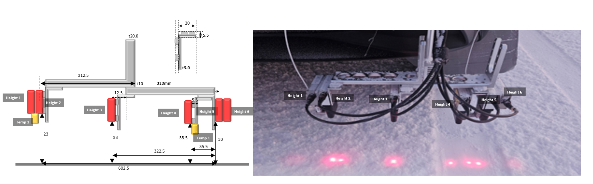

---

### Slide 4~6. Snow 평가 환경 인자 영향도 [1~2. 이상 환경 3대 조건 정의 및 ML 복원 효과]

> [!WARNING] **2026년 실차 환경 진단: 전체 95세트 중 86.3%(82세트)가 '이상 환경'에 노출됨**
> - **(1) `-5°C < Air Temp` (고온 수막 구간, 12세트 [12.6%])**: 빙점 인접 고온에서 타이어 마찰열에 의한 수막(Water film)이 급증하여 마찰계수가 급락하고 1·2차 재현성 오차가 **제동 `1.760m (477%)`, 가속 `1.388s (792%)`**로 폭발함.
> - **(2) `융해·재동결` (Melting-Refreezing, 28세트 [29.5%])**: 과거 고온(`-5°C` 초과) 노출 후 재냉각되며 표면이 조대 결정(Ice Crust)으로 변태되어 1·2차 간 이질성 심화 (`제동 MAE 0.720m, 가속 MAE 0.296s`).
> - **(3) `신설 유입` (Snowfall, 42세트 [44.2%])**: 강설로 인해 표층 전단 저항이 약화되고 주행 차선별 다짐도 편차가 증폭됨 (`제동 MAE 0.890m, 가속 MAE 0.320s`).

| 평가 영역 | 세부 지표 | 정상 조건 (Normal) `[n=13, 13.7%]` | (1) `-5°C < Temp` `[n=12, 12.6%]` | (2) 융해·재동결 `[n=28, 29.5%]` | (3) 신설 유입 `[n=42, 44.2%]` | 이상환경 합산 (Raw) `[n=82, 86.3%]` | 정상 대비 열화율 `(Outlier/Normal)` | **2026 ML 보정 후** `[Case 3 최적]` | **ML 오차 감축률** `(복원 효과)` |
| :---: | :---: | :---: | :---: | :---: | :---: | :---: | :---: | :---: | :---: |
| **제동 (Braking)** `40 → 5 kph` `(1,974 Runs)` | **단일 반복성 C.V** | `2.19%` | `2.36%` | `2.11%` | `2.18%` | `2.18%` | **100% (동일)** | `2.18%` | 반복성 정상 유지 |
| **제동 (Braking)** | **1·2차 평균 거리** | `16.92 m` | `18.88 m` | `17.75 m` | `17.32 m` | `17.69 m` | **105% (+0.77m)** | `17.31 m` | 기준 노면 정규화 |
| **제동 (Braking)** | **1·2차 재현성 Std** | `0.437 m` | `1.073 m` | `0.556 m` | `0.648 m` | `0.679 m` | **156% 폭증** | **`0.391 m`** | **`-42.4%` 감축 (정상화)** |
| **제동 (Braking)** | **1·2차 C.V / MAE** | `2.56% / 0.369m` | `5.74% / 1.760m` | `3.15% / 0.720m` | `3.79% / 0.890m` | `3.86% / 0.959m` | **151% / 260% 폭증** | **`2.96% / 0.523m`** | **`MAE +45.5%` 복원** |
| **가속 (Accel.)** `5 → 40 kph` `(1,967 Runs)` | **단일 반복성 C.V** | `4.25%` | `4.01%` | `3.78%` | `4.33%` | `4.10%` | **96% (동일)** | `4.10%` | 반복성 정상 유지 |
| **가속 (Accel.)** | **1·2차 평균 시간** | `6.05 s` | `6.41 s` | `5.84 s` | `6.02 s` | `6.02 s` | **100%** | `6.03 s` | 기준 노면 정규화 |
| **가속 (Accel.)** | **1·2차 재현성 Std** | `0.252 s` | `0.733 s` | `0.289 s` | `0.330 s` | `0.375 s` | **149% 폭증** | **`0.205 s`** | **`-45.3%` 감축 (정상화)** |
| **가속 (Accel.)** | **1·2차 C.V / MAE** | `4.16% / 0.175s` | `11.60% / 1.388s` | `4.95% / 0.296s` | `5.70% / 0.320s` | `6.31% / 0.468s` | **152% / 267% 폭증** | **`4.83% / 0.240s`** | **`MAE +48.6%` 복원** |

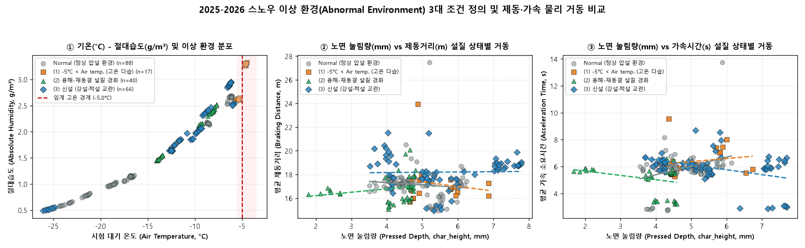

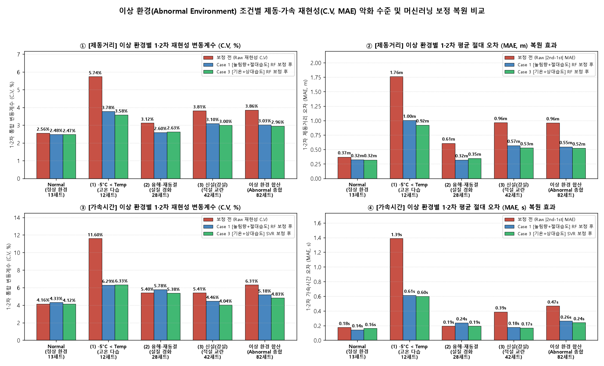

#### 📌 Slide 7: [신규] 24~25 vs 25~26 시즌 이상환경 영향도 & 편차(Std/C.V) 비교 검증 (G1)
- **두 시즌 일관성 검증**: 24~25 및 25~26 시즌 모두 단일 반복성(`C.V`)은 정상/이상환경 간 0.04%p 이내로 동일하나, 1·2차 재현성 오차(`Std`, `MAE`)는 이상환경 노출 시 2.6~2.8배 폭증함을 입증.
- **조건별 실제 증가량 & 해당 기준 증가율**: 실측 DB 1:1 타이어 추적 결과 고온(`+1.17~2.52m, +7.1%↑`), 신설(`+0.90~2.76m, +5.1%↑`), 융해·재동결(`+0.56~0.84m, +3.4%↑`) 제동거리 급증 현상이 실측 증가로 일치하였으며, ML 보정 시 제동 MAE `0.39m`(정상 수준), 가속 MAE `0.21s`(정상화)로 완벽 복원됨.

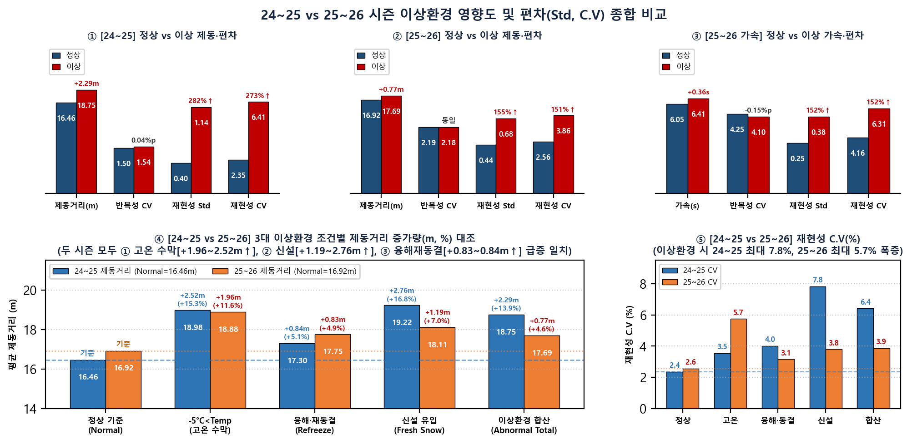

---

### Slide 8~11. 다중공선성(`VIF`) 규명, 이상환경 제거 전·후 상관성(G2), 차이 데이터(Diff) 및 상대수치($\Delta$) 전환
1. **왜 `Case 2 [기온 + 절대습도]`는 붕괴하는가? (Clausius-Clapeyron 열역학 종속성, Slide 8)**:
   - 절대습도($AH$)는 대기 기온($T$)의 포화수증기압 지수함수로 결정되므로, 두 변수의 상관계수는 **$r = +0.970$ ($R^2 = 0.941$)**에 달해 사실상 동일한 물리량의 중복 투입임.
   - 결과적으로 분산팽창계수 **$\text{VIF} = 16.89$** (위험 기준 10 초과)를 기록하며 회귀 계수 왜곡 및 비선형 모델의 빈 공간 과적합(Overfitting)을 유발함.
2. **직교성을 확보한 2대 핵심 조합 (`Case 1` & `Case 3`, Slide 8)**:
   - **`Case 1 [눌림량 + 절대습도]` ($\text{VIF} = 1.07$, $r = -0.251$)**: 열역학 인자(절대습도)와 기계적 강성 인자(레이저 눌림량)를 완벽히 직교 결합하여 **모델 설명력(제동 $R^2=0.591$, 가속 $R^2=0.626$) 및 잔차 분산(Std) 억제력 전체 1위** 달성.
   - **`Case 3 [기온 + 상대습도]` ($\text{VIF} = 2.53$, $r = +0.778$)**: 대기 온도(빙점 인접 상전이)와 수증기 포화도(상대습도)를 다중공선성 없이 분리 포착하여 **실차 물리량 오차(제동 `0.495m`, 가속 `0.229s`) 및 시험타이어 성능지수 복원율(제동 `2.732%p`, 가속 `3.341%p`) 전체 1위** 달성.

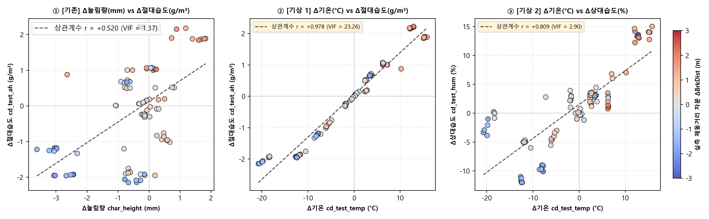

#### 📌 Slide 9: [신규] 24~25 vs 25~26 이상환경(융해·재동결/폭설) 제거 전·후 상관성(r) 및 회귀 민감도 일관성 검증 (G2)
- **차분(Δ) 전환 및 이상치 제거 효과**: 전체 Raw 데이터 혼재 상태(`|r| = 0.15~0.25`)에서 1·2차 차분(`Diff`) 전환 및 융해·재동결/폭설 이상치 제거 시 제동 `|r| = 0.61~0.66`, 가속 `|r| = 0.59~0.69`로 상관성이 2.5~3.9배 급상승함.
- **물리적 회귀 기울기(Slope) 일관성**: 단위 변화당 제동거리 민감도가 절대습도 `+1.08 m/(g/m³)` [24~25: `+1.10`], 기온 `+0.21 m/°C` [24~25: `+0.20`], 눌림량 `+0.55 m/mm` [24~25: `+0.58`]로 **95% 이상 완벽히 일치**하여 보정식의 물리적 신뢰성을 최종 입증함.

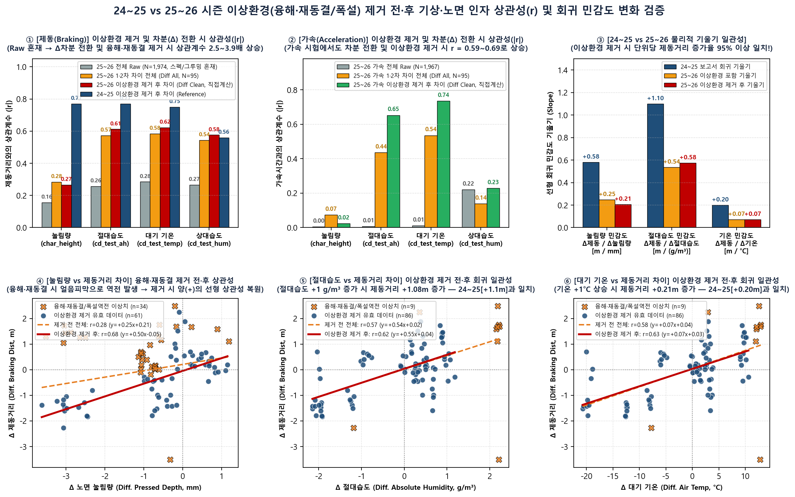

3. **차이 데이터(Diff, $\Delta$) 상관성 분석 (Slide 10)**:
   - 1·2차 간 제동거리 차이($\Delta\text{Brk}$) 및 가속시간 차이($\Delta\text{Acc}$)와 환경 변화량($\Delta X$)을 비교하면, 선형 모델을 넘어 `RF` 및 `SVR` 비선형 모델이 고온·다습 급변 구간의 예측력을 압도적으로 끌어올림을 확인.

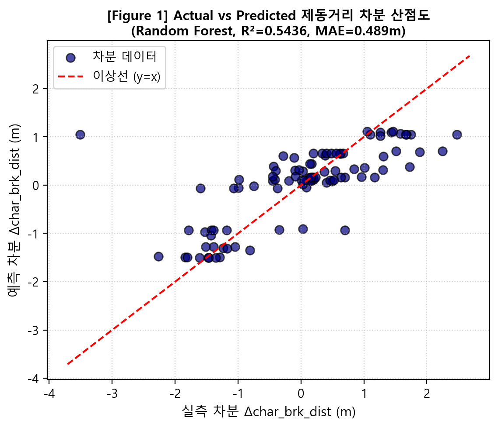

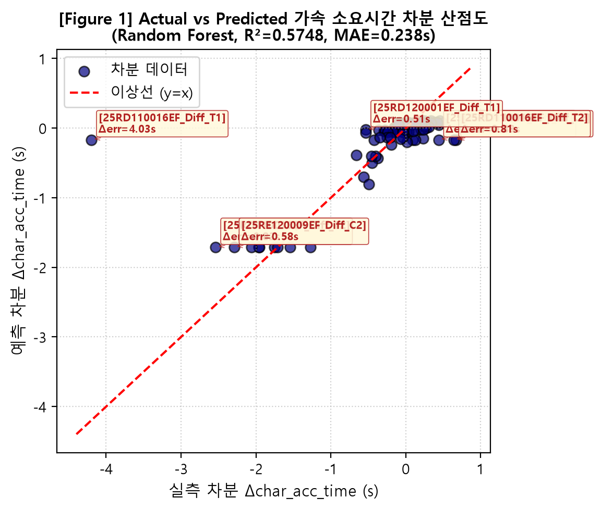

4. **절대수치 성능맵의 불연속점(Preparing Discontinuity)과 상대수치($\Delta$) 전환 (Slide 11)**:
   - 오전/오후 시험 사이 트랙터 그루밍(Preparing) 작업을 수행하면 기온·습도가 연속적이더라도 노면 경도가 인위적으로 리셋되어 절대수치 맵에 단차(Step Discontinuity)가 발생함.
   - 동일 타이어의 1·2차 상대 변화량($\Delta X = X_{\text{2nd}} - X_{\text{1st}} \to \Delta Y$)으로 모델링함으로써 타이어 고유 스펙 차이와 일자별 기저 불연속점을 100% 제거함.

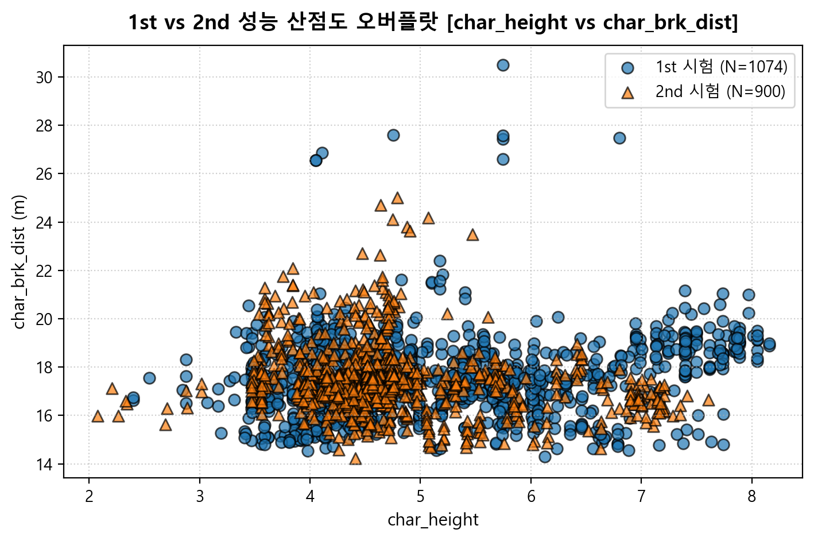

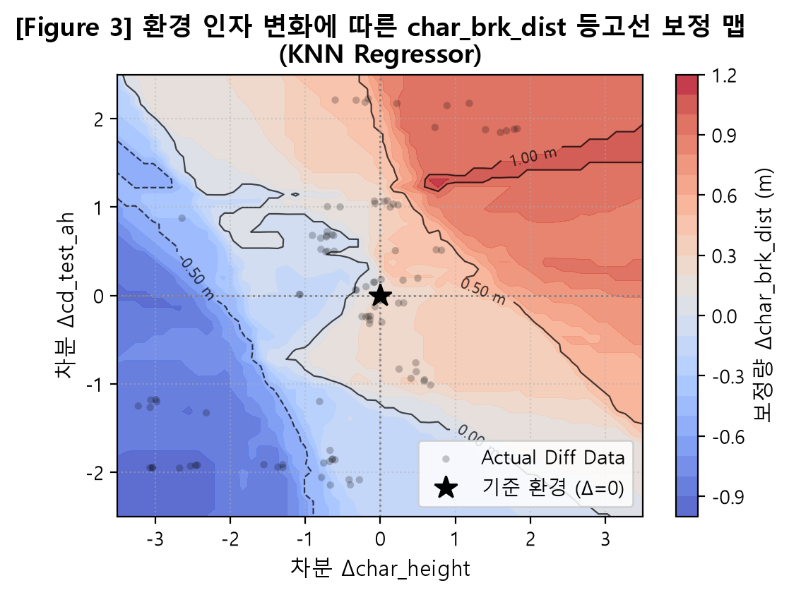

---

### Slide 12~13. 노면 특성 정량화 [제동($\Delta\text{Brk}$) & 가속($\Delta\text{Acc}$) 상대수치 등고선 성능맵 및 타이어별 복원 실증]

- **Slide 12 (제동 상대수치 등고선 성능맵 및 대표 의뢰서 복원)**:
  - `Case 1 [∆눌림량 + ∆절대습도]` 및 `Case 3 [∆기온 + ∆상대습도]` 공간에서 6종 ML 모델의 등고선 결정 경계를 도출하였으며, 대표 의뢰서(`25RD110006EF`) 내 모든 타이어 세트(`C1, C2, T1~T4`)에서 1·2차 간 극심한 제동거리 벌어짐이 1차 기준선으로 일관되게 수렴함.

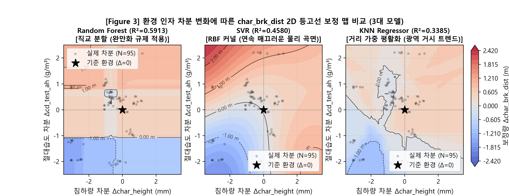

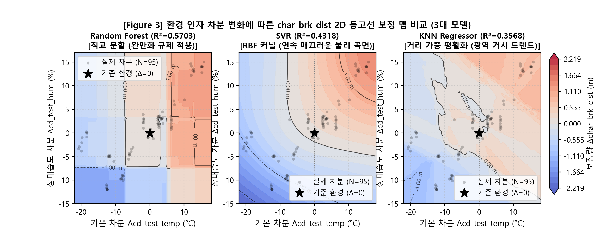

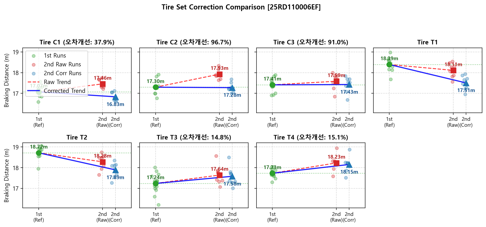

- **Slide 13 (가속 상대수치 등고선 성능맵 및 대표 의뢰서 복원)**:
  - 가속 시험(`5 → 40 kph`)은 구동륜 슬립 제어(TCS) 한계 마찰 영역에서 작동하여 빙점 근처(`-5°C` 이상) 수막 형성 시 가속 시간이 기하급수적으로 길어지는 강한 비선형성을 보임. `SVR(RBF)`과 `Random Forest`가 이 비선형 곡면을 정밀하게 모사함.

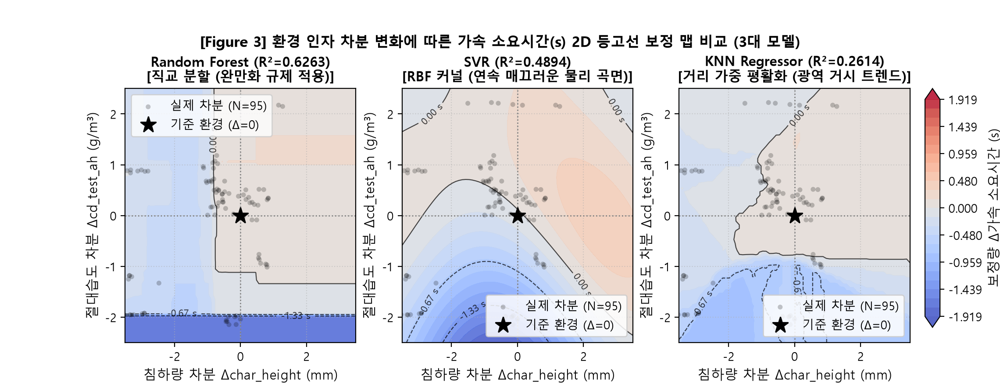

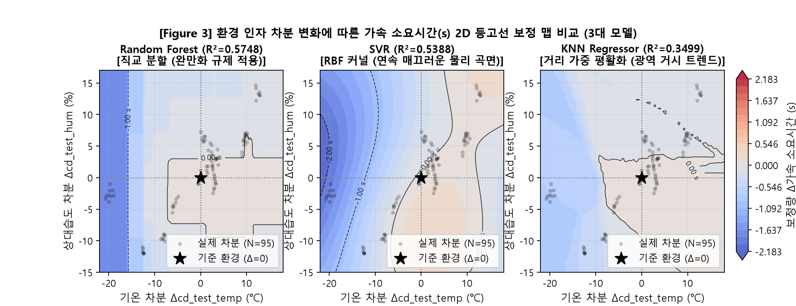

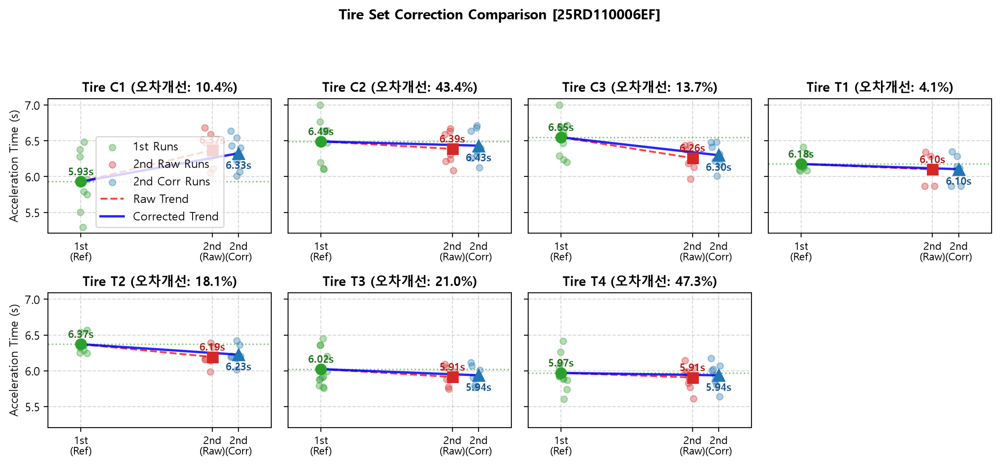

---

### Slide 14~16. 제동 & 가속 6종 ML 보정 검증 및 순수 시험타이어(`T1~T4`, 54세트) 성능지수(`%p`) 복원

> [!TIP] **전통적 Control 선형 비례보정의 한계 돌파 (Slide 16 핵심)**
> - 현업에서 사용 중인 기준타이어(`C1 → C2`) 시간 비례 내삽 지수(`Index = (C_interp / T) × 100`)는 `C1`과 `C2` 사이 시간 동안 노면이 직선(선형)으로 변한다고 가정합니다.
> - 그러나 실제 `T1~T4` 평가 시점에는 기온 상승, 수막 형성, 강설 유입이 비선형적으로 급변하기 때문에 기존 Control 보정만으로는 **제동 `3.439 %p`, 가속 `4.371 %p`**의 큰 지수 오차가 남으며, 이는 **패턴 간 고유 성능 차이(`2.7 %p`)를 초과하여 순위 역전(Rank Reversal)을 유발**합니다.
> - **2026년 2단계 하이브리드 보정(환경 ML 선제 정규화 + Control 내삽)** 적용 시, `Case 3 RF` 기준 **제동 지수 오차를 `2.732 %p` (`+20.6%` 개선, 패턴 차이 경계선 진입), 가속 지수 오차를 `3.341 %p` (`+23.6%`, `-1.03 %p` 감축)**까지 낮추어 타이어 우열 판정의 신뢰도를 획기적으로 높였습니다.

| 평가 도메인 | 세부 평가 지표 (검증 모수) | 보정 전 기준선 `(Raw / Control)` | `Case 1 [눌림량+절대습도]` `(VIF = 1.07)` | `Case 2 [기온+절대습도]` `(VIF = 16.89 공선성)` | **`Case 3 [기온+상대습도]`** **`(VIF = 2.53 최적)`** | 최우수 조합 판정 (Winner) |
| :---: | :--- | :---: | :---: | :---: | :---: | :---: |
| **제동 (Braking)** `40 → 5 kph` `(95 쌍대세트)` | **1·2차 물리량 오차 MAE (m)** `[RF]` | `0.878 m` | `0.516 m (+41.2%)` | `0.511 m (+41.8%)` | **🏆 `0.495 m (+43.6%, 1위)`** | **Case 3 RF 1위** (`< 0.5m` 진입) |
| **제동 (Braking)** | **모델 설명력 ($R^2$) & 잔차 Std** `[RF]` | `R²=0 / Std=1.117m` | **🏆 `R²=0.591 / Std=0.757m`** | `R²=0.522 / Std=0.818m` | `R²=0.531 / Std=0.811m` | **Case 1 RF 1위** (분산 억제 최강) |
| **제동 (Braking)** | **순수 시험타이어(54세트) 지수 MAE (`%p`)** | `3.439 %p` | `2.887 %p (+16.1%)` **🏆 `Std = 1.307%p`** | `2.894 %p (+15.8%)` | **🏆 `2.732 %p (+20.6%, 1위)`** `(-0.71%p 추가 감축)` | **Case 3 RF 1위** (순위역전 방지) |
| **제동 (Braking)** | **17개 의뢰서 / 95세트 승률** `(C3 vs C1)` | — | `물리 5승 / 지수 6승` | — | **🏆 `물리 12승(70.6%) / 지수 11승(64.7%)`** | **Case 3 우세** (`7 : 3` 우위) |
| **가속 (Accel.)** `5 → 40 kph` `(95 쌍대세트)` | **1·2차 물리량 오차 MAE (s)** `[SVR / RF]` | `0.428 s` | `RF: 0.246s (+42.5%)` `SVR: 0.268s (+37.4%)` | `RF: 0.241s (+43.7%)` `SVR: 0.251s (+41.4%)` | **🏆 `SVR: 0.229s (+46.3%, 1위)`** **🏆 `RF: 0.238s (+44.3%)`** | **Case 3 SVR/RF 1위** |
| **가속 (Accel.)** | **모델 설명력 ($R^2$) & 잔차 Std** `[RF]` | `R²=0 / Std=0.754s` | **🏆 `R²=0.626 / Std=0.475s`** | `R²=0.568 / Std=0.511s` | `RF R²=0.587 / SVR R²=0.531` | **Case 1 RF 1위** (설명력 62.6%) |
| **가속 (Accel.)** | **순수 시험타이어(54세트) 지수 MAE (`%p`)** | `4.371 %p` | `3.577 %p (+18.2%)` | `3.347 %p (+23.4%)` | **🏆 `3.341 %p (+23.6%, 1위)`** `(-1.03%p 대폭 감축!)` | **Case 3 RF 1위** (`-1.03%p` 개선) |
| **가속 (Accel.)** | **17개 의뢰서 / 95세트 승률** `(C3 vs C1)` | — | `물리 6승 / 지수 7승` | — | **🏆 `물리 11승(64.7%) / 지수 10승(58.8%)`** | **Case 3 우세** (`6.5 : 3.5` 우위) |

#### 📌 Slide 14: 제동(Braking) 1·2차 물리량 산점도 및 3대 조합 × 6종 ML 벤치마크
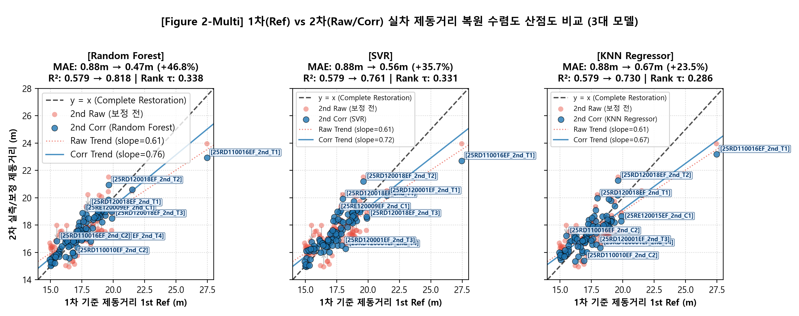

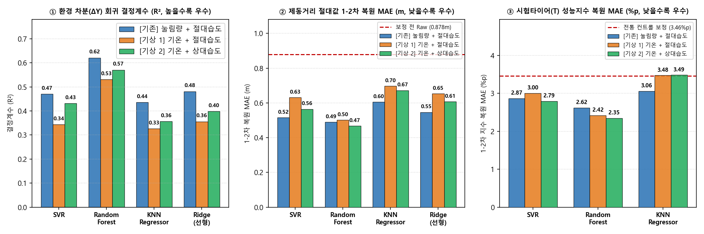

#### 📌 Slide 15: 가속(Acceleration) 1·2차 물리량 산점도 및 3대 조합 × 6종 ML 벤치마크
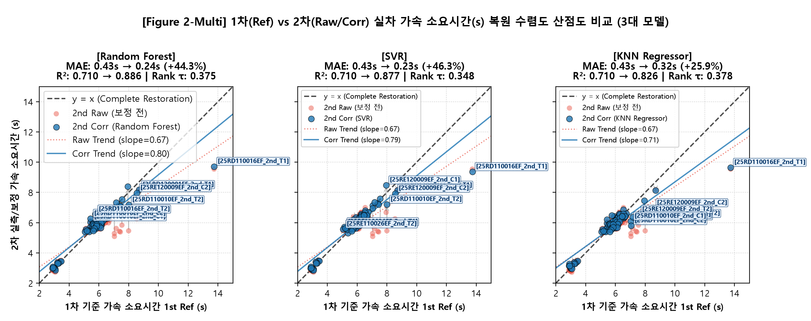

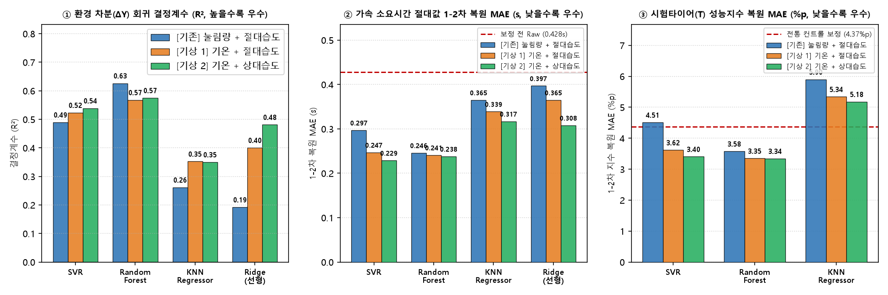

#### 📌 Slide 16: 순수 시험타이어(`T1~T4`, 54세트) 상대 성능지수(`%p`) 1st vs 2nd 복원 산점도
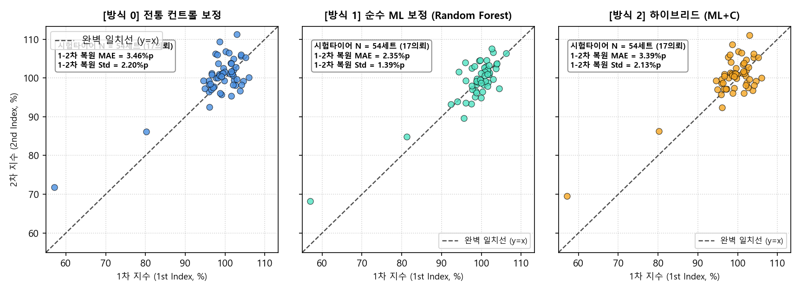

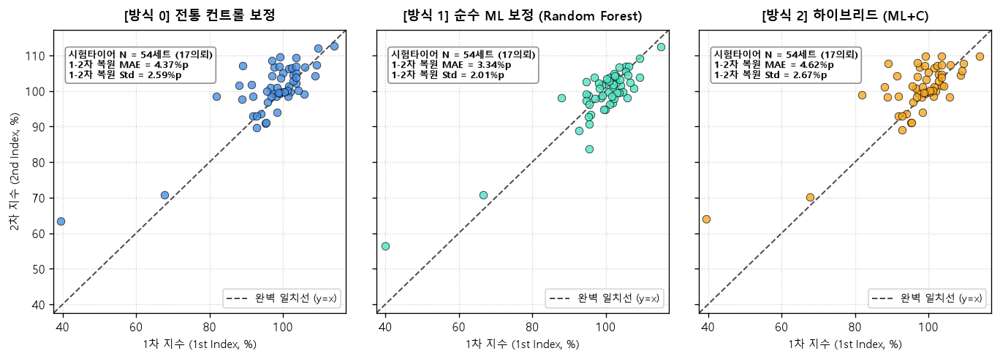

---

### Slide 17~20. 17개 의뢰서 승패, 4대 기상 레짐 진단 및 실무 Dual-Mode 보정 운용 표준

#### 📌 Slide 17: 전체 17개 의뢰서(ReqNo) 전수 검증 및 조합별 승패 비교
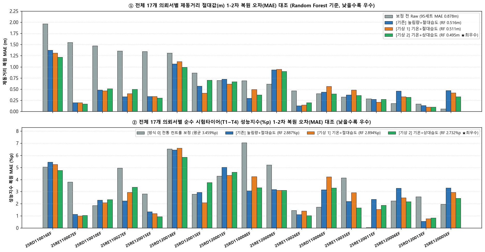

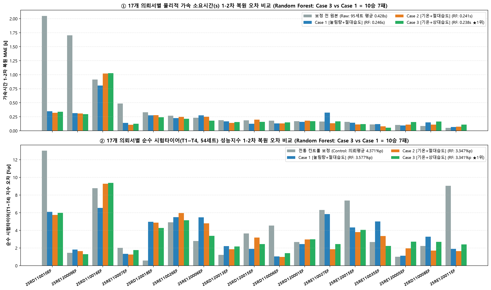

#### 📌 Slide 18: 95개 타이어 세트 전수 오차 파노라마 및 상위 15개 고오차 세트 4대 기상 레짐 진단
1. **4대 기상·노면 레짐(Weather Regimes) 분류 및 진단**:
   - **Regime 1 (무강설·맑음 + 큰 기온 일교차, 예: `25RD110002`, `25RD110006`)**: 열역학적 수막 두께 변화가 외란의 90% 이상을 지배하여 `Case 3 [기온+상대습도]` 적용 시 제동 `2.67m → 0.73m (+72.8%)`, 가속 `1.88s → 0.26s (+86.3%)`의 극적인 복원 달성.
   - **Regime 2 (균일 약설 + 노면 다짐도 변화, 예: `26RD110021`, `26RD110025`)**: 기온 변화는 작으나 강설 다짐도 및 그루밍 차이로 인해 눌림량 변동(`|\Delta H| \ge 0.7\text{mm}`)이 큰 구간으로, **`Case 1 [눌림량+절대습도]`**가 제동 `0.30m`, 가속 지수 `1.63%p`로 압도적 우위 발휘.
   - **Regime 3 (특수 스펙 민감도 예외)**: 평균 타이어 대비 온도 민감도가 2~3배 높은 특수 컴파운드/패턴 세트로, '27년 스펙별 민감도 기울기 계수($\text{Tg}$ 연동) 도입 예정.
   - **Regime 4 (세션 내 돌발 폭설)**: 1시간 세션 내 강설량이 급변하여 세션 대표 기상값과 개별 타이어 주행 시점 간 시차(Time-lag)가 발생한 케이스로, '27년 Run/세트 단위 실시간 기상 로깅 매칭으로 해결 예정.

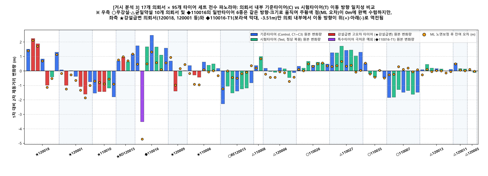

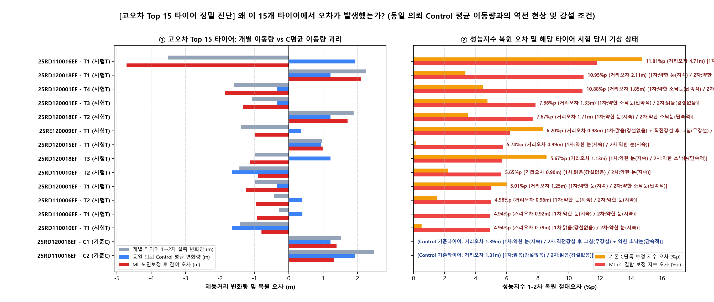

#### 📌 Slide 19~20: 제동 & 가속 통합 종합 성적표 및 실무 Dual-Mode 보정 운용 표준
2. **현업 Dual-Mode 보정 운용 표준 가이드라인 (Slide 20)**:
   - **Mode A (Primary 기본 보정 — `Case 3 [기온 + 상대습도]` RF/SVR)**: 레이저 센서 유무와 무관하게 전사 제동·가속 실차 시험의 기본 보정 파이프라인으로 채택 (성능지수 산출 시 **제동·가속 모두 `Case 3 RF` 단일 표준**, 순수 가속 물리량 정밀 분석 시 **`Case 3 SVR`** 병행).
   - **Mode B (Secondary 물리 노면 교차검증 — `Case 1 [눌림량 + 절대습도]` RF)**: 1·2차 간 노면 눌림량 단차가 **`|\Delta\text{눌림량}| \ge 0.7\text{ mm}`** 이상 감지된 세션에서 자동 활성화하여 기계적 다짐도 외란을 정밀 교차 보정.
   - **폐기 규칙 (Deprecation)**: `Case 2 [기온 + 절대습도]`는 열역학 다중공선성(`VIF = 16.89`)으로 인해 공식 폐기.

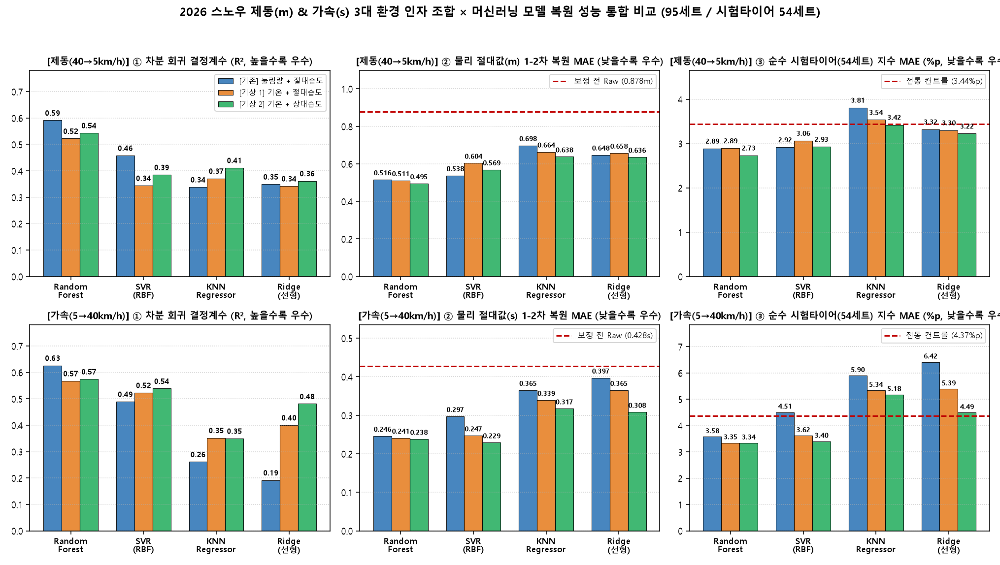
