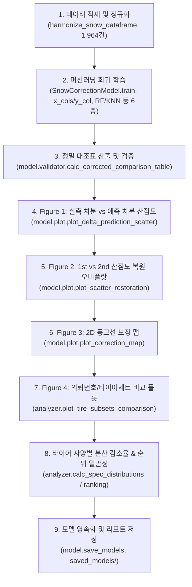

# ❄️ c_run_snow_correction_pipeline.py 상세 매뉴얼

이 모듈은 사내 표준 프레임워크인 **`unoUtil.snow_condition`**과 스노우 제동 성능 분석기인 **`snow_braking_performance.SnowSpecAnalyzer`**를 직렬 연계하여, 머신러닝 학습, 보정 대조 데이터 테이블 생성, 4대 핵심 검증 차트 시각화, 타이어 사양별 분산 감소율 분석, 모델 영속화 및 종합 보고서 생성을 단 하나의 통합 실행 파이프라인으로 일원화한 마스터 러너 스크립트입니다.

동적 특성 인자 리스트(`--x-cols`), 목표 성능 컬럼(`--y-col`), 결측치(NaN) 방어 가드(`--missing-strategy`)를 지원하여 다양한 환경 조건 및 연구 목적에 맞추어 유연하게 실행할 수 있습니다.

---

## 🏛️ 1. 파이프라인 개요 및 아키텍처

본 스크립트는 `unoUtil.snow_condition`의 **컴포지션 패턴(Composition Pattern)** 기반 객체(`SnowCorrectionModel`, `SnowCorrectionValidator`, `SnowCorrectionPlotter`)와 `SnowSpecAnalyzer`를 아래와 같이 9단계로 순차 가동합니다:



---

## 📋 2. 주요 생성 결과물

| 구분 | 파일명 예시 | 설명 |
| :--- | :--- | :--- |
| **데이터 테이블** | `corrected_{y_col}_comparison_table.xlsx` | 의뢰번호, 세트, run(1st/2nd), 원래 성능값, 보정 성능값, 예측변화량, 환경인자 전수 수록 |
| **Figure 1** | `1_Diff_Actual_vs_Predicted_{y_col}.png` | 차분 예측 모델 성능 검증 (실측 차분치 vs 예측 차분치 $y=x$ 산점도) |
| **Figure 2** | `2_Final_Correction_1st_vs_2nd_{y_col}.png` | 1차(Ref) vs 2차(Raw / Corrected) 성능 산점도 오버플랏 및 오차 수렴 검증 |
| **Figure 2-B** | `2_Scatter_Overplot_1st_vs_2nd_{x_col}.png` | 지정된 주요 환경 인자 대비 1차/2차 시험 차수별 성능 산점도 오버플랏 |
| **Figure 3** | `3_Snow_Surface_{x1}_VS_{x2}_Contour.png` | 2대 주요 환경 인자 변화량 vs 목표 성능 2D 등고선 보정 맵 |
| **Figure 4-A** | `4_Tire_Subplots_25RD110006EF.png` | 의뢰서 내 전체 타이어 세트 실측(Raw) vs 보정(Corr) 복원 궤적 서브플롯 그리드 |
| **Figure 4-B** | `4_Tire_SingleSet_25RD110006EF_T1.png` | 특정 타이어 세트('T1') 집중 단일 상세 분석 플롯 |
| **모델 영속화** | `saved_models/` | 학습 완료된 다중 ML 모델 바이너리 디렉토리 |

---

## 💻 3. 실행 방법 (CLI 인자 지원)

### 1) 기본 실행 (노면 침하 깊이 + 절대습도)
```powershell
d:\uno\Python\envs\unoBase\python.exe c_run_snow_correction_pipeline.py
```

### 2) 커스텀 환경 인자(기온 + 절대습도) 지정 실행
```powershell
d:\uno\Python\envs\unoBase\python.exe c_run_snow_correction_pipeline.py --x-cols cd_test_temp,cd_test_ah
```

### 3) 백그라운드 배치 모드 (플롯 창 비활성화)
```powershell
d:\uno\Python\envs\unoBase\python.exe c_run_snow_correction_pipeline.py --no-show
```

### 4) 다변량 인자 및 모델 지정 실행
```powershell
d:\uno\Python\envs\unoBase\python.exe c_run_snow_correction_pipeline.py --x-cols char_height,cd_test_temp,cd_test_ah --model "Random Forest" --missing-strategy drop --no-show
```
