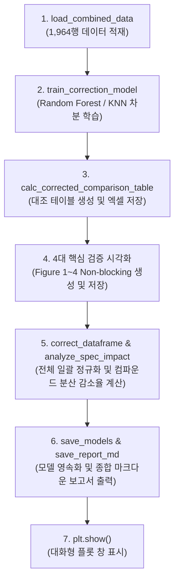

# ❄️ c_run_snow_correction_pipeline.py 상세 매뉴얼

이 모듈은 `c_plot_correction_verification.py`와 `c_train_correction_and_plot_maps.py` 두 개로 분산되어 있던 머신러닝 학습, 보정 대조 데이터 테이블 생성, 4대 핵심 검증 차트 시각화, 컴파운드 사양별 분산 감소율 분석, 모델 영속화 및 종합 마크다운 보고서 생성을 단 하나의 통합 실행 파이프라인으로 일원화한 마스터 러너 스크립트입니다.

---

## 🏛️ 1. 파이프라인 개요 및 아키텍처

본 스크립트는 `SnowBrakingPerformance` 파사드 마스터 객체를 통해 아래의 10단계 프로세스를 원스톱 순차 가동합니다:



---

## 📋 2. 주요 생성 결과물

| 구분 | 파일명 | 설명 |
| :--- | :--- | :--- |
| **데이터 테이블** | `corrected_braking_comparison_table.xlsx` | 의뢰번호, 세트, run(1st/2nd), 원래 제동거리, 보정 제동거리, 예측변화량, 환경인자 전수 수록 |
| **Figure 1** | `1_Diff_Actual_vs_Predicted.png` | 차분 예측 모델 성능 검증 (실측 차분치 vs 예측 차분치 $y=x$ 산점도) |
| **Figure 2** | `2_Final_Correction_1st_vs_2nd.png` | 1차(Ref) vs 2차(Actual / Corrected) 제동거리 산점도 및 Adjusted $R^2$ 복원 |
| **Figure 3** | `3_Snow_Surface_Factors_VS_Braking_Contour.png` | 눈 침하 깊이 변화량 vs 절대습도 변화량 제동거리 2D 등고선 맵 (슬라이드 6번 표준) |
| **Figure 4** | `4_Tire_Subplots_25RD110006EF.png` | 의뢰서별 타이어 세트 실측치(Raw 1st, 2nd) vs 모델 예측치(Predict 2nd) 2x2 서브플롯 |
| **모델 영속화** | `saved_models/` | 학습 완료된 다중 ML 모델 바이너리 디렉토리 |
| **종합 보고서** | `snow_correction_report.md` | 모델 메트릭, 최적 파라미터, 사양별 분산 감소율, 차트 링크를 종합한 기술 보고서 |

---

## 💻 3. 실행 방법

### 3.1 터미널 표준 실행 (그래프 창 팝업 포함)
```powershell
D:\uno\Python\envs\unoBase\python.exe c_run_snow_correction_pipeline.py
```

### 3.2 백그라운드 무중단 실행 (플롯 팝업 생략)
```powershell
D:\uno\Python\envs\unoBase\python.exe c_run_snow_correction_pipeline.py --no-show
```

### 3.3 파이썬 스크립트 내에서 모듈로 임포트하여 활용
```python
from pathlib import Path
from c_run_snow_correction_pipeline import run_snow_correction_pipeline

sbp = run_snow_correction_pipeline(
    primary_model='Random Forest',
    show_plots=False
)
```
