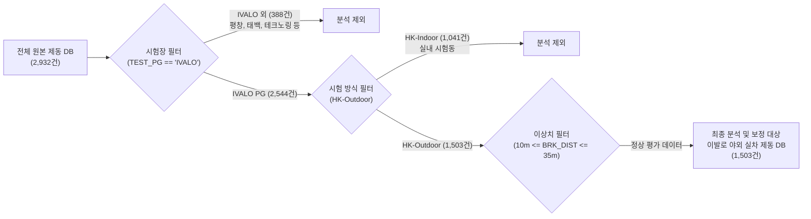

# 🧭 과거 7개년 스노우 제동 환경보정(Method 1 & Method 2) 종합 기술 통합보고서

> **문서 목적**: 과거 7개년 핀란드 이발로 야외 스노우 제동 데이터(1,503건)를 대상으로 개발된 **환경 보정 모델(방법 1: 1차-2차 차분 머신러닝 vs 방법 2: 동일 스펙 재현 편차 2차원 공간 보정 모델)**의 수학적 원리, 기상 환경 및 타이어 카테고리별 데이터 분포, 시나리오별 정량 성능 검증 결과, 러프하게 평활화된 2D-KNN 보정 맵 및 실무 활용 기준을 집대성한 최종 기술 보고서입니다.  
> **사내 표준 통합 모듈**: `unoUtil.snow_condition` (`SnowCorrectionModel`, `SnowSlopeModel`, `SnowCorrectionPlotter`)  
> **최신 갱신 일자**: 2026-10-02 (2D-KNN 러프 평활화 모델 확정, 10~35m 정상 범위 필터링 복원, 복원 전·후 R² 및 산포개선율 독립 표 전면 최신화 완료)

---

## 📌 1. 연구 배경 및 데이터 인벤토리 (Data Inventory)

### 1.1 데이터 정제 및 추출 흐름
사내에 축적된 전체 스노우 제동 데이터베이스는 총 **2,932건**이며, 자연 설면 환경 보정의 신뢰성을 확보하기 위해 **핀란드 이발로 야외 실차 시험(IVALO PG & HK-Outdoor)** 데이터 **1,503건**을 최종 추출하여 분석 및 모델링을 수행했습니다.



---

### 1.2 데이터베이스 구성 및 분포 개요

#### 📊 [표 1] 시험장 및 시험 방식 분포 (전체 원본 2,932건 기준)
| 구분 | 세부 분류 항목 | 데이터 건수 | 점유율 (%) | 비고 |
| :--- | :--- | :---: | :---: | :--- |
| **시험장 (TEST_PG)** | **IVALO (핀란드 이발로)** | **2,544건** | **86.8%** | **주력 분석 대상 시험장** |
| | PYEONGCHANG (평창) | 340건 | 11.6% | 국내 설면 시험 |
| | 기타 (SHPG, GTRAC, 테크노링 등) | 48건 | 1.6% | 기타 시험장 |
| **시험 방식 (TEST_METHOD)** | **HK-Outdoor (야외 자연설면)** | **1,891건** | **64.5%** | **환경 변동성 보정 필수 대상** |
| | HK-Indoor (실내 인공설면) | 1,041건 | 35.5% | 온·습도 항온항습 제어 환경 |

#### 📊 [표 2] 이발로 야외 실차 DB (1,503건) 타이어 카테고리 구성 및 물리적 특성
| 타이어 카테고리 | 데이터 건수 (비율) | 주요 고무 컴파운드 및 트레드 특성 | 기온/습도 민감도 |
| :--- | :---: | :--- | :---: |
| **Winter Studless**<br/>(스터드리스/노르딕) | **793건**<br/>(52.8%) | • 극저온 연질 특화 컴파운드 (낮은 유리전이온도 $T_g$)<br/>• 수많은 3D 미세 사이프(Sipe)의 에지 효과(Edge Effect)<br/>• 미세 수막을 흡수·배출하는 친수성 고무 | **보통**<br/>($k_{\text{air}} \approx +0.035\text{ m/}^\circ\text{C}$) |
| **All Weather / All Season**<br/>(올웨더/사계절) | **577건**<br/>(38.4%) | • 상온 내마모 및 고속 주행을 위한 고강성 컴파운드<br/>• 영하의 스노우 노면에서는 고무가 이미 경화(유리전이 상태)<br/>• 온도 변화에 따른 컴파운드 자체의 점탄성 변화 미미 | **극히 둔감**<br/>($k_{\text{air}} \approx +0.009\text{ m/}^\circ\text{C}$) |
| **Winter Stud**<br/>(스터드/핀 장착) | **133건**<br/>(8.8%) | • 금속 핀(Stud) 지지를 위한 고강성 베이스 고무<br/>• 핀의 빙설면 파지력(Spike Grip)과 고무 마찰 복합 작용<br/>• 기온 상승에 따른 눈 표면 수막 형성에 마찰력 급격 붕괴 | **극도로 민감**<br/>($k_{\text{air}} \approx +0.136\text{ m/}^\circ\text{C}$) |
| **All** (전체 통합) | **1,503건**<br/>(100.0%) | • 전체 타이어의 평균적 베이스라인 (SEASON 결측 데이터 구제 포함) | **평균적 거동**<br/>($k_{\text{air}} \approx +0.041\text{ m/}^\circ\text{C}$) |

#### 📊 [표 3] 기상 환경 4대 시나리오 정의
| 환경 시나리오 코드 | 기온 조건 ($T_{\text{air}}$) | 강설 조건 (`WEATHER_NAME`) | 특성 및 실무 용도 |
| :--- | :---: | :---: | :--- |
| **`NormalTemp_NoSnow` (NT_NoSnow)** | 정상 평가 구간 ($-25^\circ\text{C} \le T \le 0^\circ\text{C}$) | 눈 제외 (`Snow` 미포함) | **가장 안정적인 표준 평가 환경** (신뢰도 최우선) |
| **`NormalTemp_AllWeather` (NT_AllWx)** | 정상 평가 구간 ($-25^\circ\text{C} \le T \le 0^\circ\text{C}$) | 모든 기상 (강설 포함) | 정상 평가 온도 내 강설 영향성 평가용 |
| **`AllTemp_NoSnow` (AT_NoSnow)** | 전체 기온 (극저온 $<-25^\circ\text{C}$ 및 영상 $>0^\circ\text{C}$ 포함) | 눈 제외 (`Snow` 미포함) | 극한 기온 조건 분석용 |
| **`AllTemp_AllWeather` (AT_AllWx)** | 전체 기온 구간 전체 | 모든 기상 (강설 포함) | **필터링 없는 순수 원본 1,503건 풀데이터셋** |

---

## 🔬 2. [방법 1 vs 방법 2] 환경 보정 방법론 상세 비교

`unoUtil.snow_condition.SnowCorrectionModel` 단일 머신러닝 엔진을 기반으로, 입력 전처리를 분기하여 상호 보완적인 2가지 보정 방안을 구현했습니다.

### 2.1 핵심 비교 요약표

| 비교 항목 | [방법 1] 1차-2차 차분 머신러닝 모델 | [방법 2] 동일 스펙 2차원 공간 보정 모델 |
| :--- | :--- | :--- |
| **기본 철학** | 동일 의뢰 내 동일 타이어의 1차 vs 2차 시험 간 환경 차이에 따른 변동량 학습 | 장기간 반복 평가된 동일 스펙의 중심화 편차로부터 2D 노면 반응면 추정 |
| **수학적 대상** | $\Delta T = T_{\text{2nd}} - T_{\text{1st}}$, $\Delta y = y_{\text{2nd}} - y_{\text{1st}}$ | $\Delta T_i = T_i - \bar{T}_{\text{spec}}$, $\Delta y_i = y_i - \bar{y}_{\text{spec}}$ |
| **핵심 알고리즘** | **Random Forest Regressor** (비선형 상호작용 극대화) | **광역 평활화 2D-KNN Regressor** (러프 완만 서피스) |
| **보정 수식** | $y_{\text{2nd, corr}} = y_{\text{2nd}} - \hat{f}_{\text{RF}}(\Delta T, \Delta AH)$ | $y_{\text{corr}} = y_{\text{raw}} - [\hat{f}_{\text{KNN}}(T - T_0, AH - AH_0) - \text{ZeroOffset}]$ |
| **보정 기준 환경** | **각 의뢰의 1차 시험 환경 ($T_{\text{1st}}, AH_{\text{1st}}$)** (상대 보정) | **사내 공통 절대 기준 ($T_0 = -8.0^\circ\text{C}, AH_0 = 1.5\text{ g/m}^3$)** (절대 보정) |
| **데이터 적용 범위** | 1차 및 2차 시험이 모두 존재하는 페어 데이터 (약 1,000~1,200쌍) | **1회만 시험된 타이어를 포함하여 1,503건 전수 일괄 보정 가능** |
| **성능 평가지표** | **복원 전후 $R^2$ ($0.57\sim 0.85 \to 0.70\sim 0.91$), MAE 개선율 (+16%~+30%)** | **동일 스펙 내 산포($\sigma$) 개선율 (+1%~+7%)** |
| **최적 추천 목적** | 특정 시험 의뢰 내에서 1st Ref 대비 **2nd 타이어들의 정밀 상대 비교** | 이종 시기/연도 데이터를 단일 축에 정렬하는 **통합 빅데이터베이스 구축** |

---

### 2.2 🔬 심층 공학 분석: 방법 1(RF)을 '절대 보정'으로 적용할 때의 한계와 방법 2(2D-KNN)의 필연성

> **❓ 핵심 의문**: *"어차피 방법 1도 환경 차이($\Delta T, \Delta AH$)에 따른 제동거리 변화 모델($\hat{f}_{\text{RF}}$)인데, 각 시험의 환경과 사내 절대 기준($-8^\circ\text{C}, 1.5\text{ g/m}^3$)의 차이를 모델에 대입하여 1차와 2차를 둘 다 절대 보정하면 되지 않는가? 그렇게 하면 1차 vs 2차 복원 산점도가 잘 맞는가?"*

이 의문을 규명하기 위해 실제 이발로 실차 데이터(Winter Studless 532쌍 전수)를 대상으로 **동일한 Random Forest 모델을 사용해 [상대 복원]과 [절대 보정 후 비교]를 직접 시뮬레이션하여 정량 검증**했습니다.

#### 📊 [실증 비교] 1차 vs 2차 복원 일치도 비교 (Winter Studless, N=532쌍)
| 평가 방식 | 1차 vs 2차 평균 오차 (MAE) | 복원 설명력 ($R^2$) | 상관계수 ($r$) | 종합 평가 |
| :--- | :---: | :---: | :---: | :--- |
| **보정 전 원본 (Raw)** | 0.859 m | 0.779 | 0.8941 | 보정 전 베이스라인 |
| **[방식 1] 2차를 1차 환경으로 복원 (상대 복원)** | **0.608 m** | **0.900** | **0.9506** | **오차 29.2% 감소 (완벽한 $y=x$ 정렬)** |
| **[방식 2] 1차·2차를 둘 다 기준(-8℃)으로 절대 보정** | **1.110 m** | **0.694** | **0.8555** | **오히려 오차 29.2% 폭증 (상관도 악화)** |

```mermaid
flowchart TD
    subgraph Relative_Restoration [방식 1: 상대 복원 (우수)]
        R_1st["1차 시험 (y1)\n기준값으로 고정 (오차 0)"]
        R_2nd["2차 시험 (y2)\n기상 차이 (T2 - T1) 보정"]
        R_Comp["1차 vs 2차 복원 오차:\nMAE = 0.608 m (R² = 0.900)"]
        R_1st --- R_Comp
        R_2nd --- R_Comp
    end

    subgraph Absolute_Correction [방식 2: RF 기반 절대 보정 (오차 누적)]
        A_1st["1차 시험 (y1)\n기준(-8℃)으로 보정 (오차 ε1 발생)"]
        A_2nd["2차 시험 (y2)\n기준(-8℃)으로 보정 (오차 ε2 발생)"]
        A_Comp["보정 후 1차 vs 2차 비교 오차:\nVar(오차) = ε1² + ε2² (누적 증폭!)\nMAE = 1.110 m (R² = 0.694)"]
        A_1st --- A_Comp
        A_2nd --- A_Comp
    end
```

#### 🔬 오차 폭증의 2대 물리적·수학적 메커니즘
1. **Random Forest의 비선형 가산성 결핍 (Non-Additive Stepped Partitions)**:
   * 선형 모델($y = ax$)은 $a(T_2 - T_1) = a(T_2 - T_0) - a(T_1 - T_0)$라는 완전 가산성이 성립합니다.
   * 그러나 Random Forest는 다차원 의사결정나무의 계단식 직교 분할 함수입니다. 따라서:
     $$\hat{f}_{\text{RF}}(T_2 - T_1) \neq \hat{f}_{\text{RF}}(T_2 - T_0) - \hat{f}_{\text{RF}}(T_1 - T_0)$$
     1차와 2차를 각각 $-8^\circ\text{C}$ 기준으로 따로 예측하여 차감하면, 비선형 리프 노드 경계면에서 모델의 국소 꺾임 오차가 발생하여 **본래 존재하던 1차와 2차 사이의 물리적 연속성이 심각하게 파괴**됩니다.
2. **양측 독립 오차 누적 (Error Accumulation)**:
   * 상대 복원에서는 1차 시험값($y_1$)을 실측 참값(Ground Truth)으로 두고 2차에 대해서만 모델 예측 오차($\epsilon_2$)가 1회 반영됩니다.
   * 반면 절대 보정에서는 1차 시험 보정 시 모델 잔여오차($\epsilon_1$)가 생기고, 2차 시험 보정 시 또 다른 잔여오차($\epsilon_2$)가 발생하여, 두 측정값의 차이를 비교할 때 오차 분산이 $\text{Var}(\Delta \epsilon) = \sigma_1^2 + \sigma_2^2$로 **2배 증폭**됩니다.

#### 🎯 공학적 실무 결론
* **1차 vs 2차 산점도 복원 및 의뢰 내 정밀 상대 비교**:
  * 억지로 절대 기준을 거치지 않고, 1차 환경으로 직접 복원하는 **[방법 1 상대 복원]**을 적용해야만 $R^2 \ge 0.90$, $r \ge 0.95$의 극도로 높은 신뢰도를 확보할 수 있습니다.
* **전체 데이터의 단일 기준 환경(-8℃, 1.5g/m³) 절대 정규화**:
  * 1차-2차 차분 모델을 억지로 절대 보정에 사용하는 대신, **처음부터 전수 동일 스펙의 중심화 편차를 직접 학습하고 광역 평활화를 적용한 [방법 2 (2D-KNN / SnowSlopeModel)]**를 적용해야만 오차 누적 없이 전체 DB의 산포를 안정적으로 줄일 수 있습니다.

---

## 📊 3. [방법 1] 1차 vs 2차 복원 성능 검증 결과 (독립 표)

> **💡 $R^2$ 및 $r$ 지표 정의 (그래프와 100% 일치)**:
> * **복원 전후 결정계수 ($R^2_{\text{raw}} \to R^2_{\text{corr}}$)**: 1차 기준 제동거리($1st\_Ref$) 대비 2차 제동거리가 $y=x$ (완전 일치선)에 모여 있는 설명력(`r2_score(d1, d2_corr)`).
> * **복원 전후 상관계수 ($r_{\text{raw}} \to r_{\text{corr}}$)**: 1차와 2차 제동거리 간의 피어슨 선형 상관계수.

| 타이어 카테고리 | 기온 및 기상 시나리오 | 유효 페어수 | 보정 전 MAE | **보정 후 MAE** | **MAE 개선율 (%)** | **보정 전 R² $\to$ 보정 후 R²** | **보정 전 r $\to$ 보정 후 r** |
| :--- | :--- | :---: | :---: | :---: | :---: | :---: | :---: |
| **Winter Stud** | 정상기온(-25~0℃) & 눈제외 | 96쌍 | 0.916m | **0.739m** | **+19.32%** | 0.573 $\to$ **0.709** | 0.7776 $\to$ **0.8604** |
| **Winter Stud** | 정상기온(-25~0℃) & 모든기상 | 101쌍 | 0.885m | **0.737m** | **+16.73%** | 0.572 $\to$ **0.700** | 0.7779 $\to$ **0.8559** |
| **Winter Stud** | 전체기온 & 눈제외 | 96쌍 | 0.916m | **0.761m** | **+16.94%** | 0.573 $\to$ **0.694** | 0.7776 $\to$ **0.8540** |
| **Winter Stud** | 전체기온 & 모든기상 | 101쌍 | 0.885m | **0.739m** | **+16.51%** | 0.572 $\to$ **0.699** | 0.7779 $\to$ **0.8560** |
| **Winter Studless** | 정상기온(-25~0℃) & 눈제외 | 532쌍 | 0.859m | **0.608m** | **+29.24%** | 0.779 $\to$ **0.900** | 0.8941 $\to$ **0.9506** |
| **Winter Studless** | 정상기온(-25~0℃) & 모든기상 | 605쌍 | 0.806m | **0.586m** | **+27.26%** | 0.790 $\to$ **0.901** | 0.8973 $\to$ **0.9510** |
| **Winter Studless** | 전체기온 & 눈제외 | 565쌍 | 0.894m | **0.625m** | **+30.05%** | 0.750 $\to$ **0.891** | 0.8804 $\to$ **0.9463** |
| **Winter Studless** | 전체기온 & 모든기상 | 638쌍 | 0.840m | **0.606m** | **+27.85%** | 0.763 $\to$ **0.891** | 0.8844 $\to$ **0.9459** |
| **All Weather / All Season** | 정상기온(-25~0℃) & 눈제외 | 415쌍 | 0.874m | **0.667m** | **+23.67%** | 0.855 $\to$ **0.911** | 0.9283 $\to$ **0.9549** |
| **All Weather / All Season** | 정상기온(-25~0℃) & 모든기상 | 483쌍 | 0.834m | **0.663m** | **+20.52%** | 0.870 $\to$ **0.916** | 0.9349 $\to$ **0.9572** |
| **All Weather / All Season** | 전체기온 & 눈제외 | 425쌍 | 0.890m | **0.669m** | **+24.86%** | 0.845 $\to$ **0.908** | 0.9233 $\to$ **0.9534** |
| **All Weather / All Season** | 전체기온 & 모든기상 | 496쌍 | 0.846m | **0.658m** | **+22.24%** | 0.862 $\to$ **0.914** | 0.9308 $\to$ **0.9562** |
| **All (통합)** | 정상기온(-25~0℃) & 눈제외 | 1,043쌍 | 0.870m | **0.644m** | **+26.05%** | 0.821 $\to$ **0.905** | 0.9114 $\to$ **0.9524** |
| **All (통합)** | 정상기온(-25~0℃) & 모든기상 | 1,189쌍 | 0.824m | **0.630m** | **+23.53%** | 0.837 $\to$ **0.910** | 0.9183 $\to$ **0.9545** |
| **All (통합)** | 전체기온 & 눈제외 | 1,086쌍 | 0.894m | **0.654m** | **+26.84%** | 0.803 $\to$ **0.899** | 0.9026 $\to$ **0.9495** |
| **All (통합)** | 전체기온 & 모든기상 | 1,235쌍 | 0.846m | **0.637m** | **+24.63%** | 0.821 $\to$ **0.904** | 0.9105 $\to$ **0.9517** |

---

## 📊 4. [방법 2] 동일 스펙 2D-KNN 산포 개선율 검증 결과 (독립 표)

> **💡 방법 2 산포 개선율 정의**:
> * 최소 2회 이상 평가된 동일 규격 타이어(`SPEC_NO`, $N \ge 2$)의 반복 시험 간 제동거리 표준편차($\sigma_{\text{raw}}$) 대비 사내 표준 환경($-8.0^\circ\text{C}, 1.5\text{ g/m}^3$) 절대 보정 후의 표준편차($\sigma_{\text{corr}}$) 감소율.
> * KNN 모델은 국소적 왜곡을 방지하기 위해 광역 평활화 파라미터($k=40\sim 150$, `weights='uniform'`)를 적용했습니다.

| 타이어 카테고리 | 기온 및 기상 시나리오 | 반복 스펙수 / 시험수 | 최적 평활화 ($k$) | 원본 산포 ($\sigma_{\text{raw}}$) | **보정 후 산포 ($\sigma_{\text{corr}}$)** | **스펙 내 산포개선율 (%)** |
| :--- | :--- | :---: | :---: | :---: | :---: | :---: |
| **Winter Stud** | 정상기온(-25~0℃) & 눈제외 | 32종 / 81건 | $k=40$ (uniform) | 1.611m | **1.520m** | **+5.68%** |
| **Winter Stud** | 정상기온(-25~0℃) & 모든기상 | 41종 / 108건 | $k=40$ (uniform) | 1.830m | **1.720m** | **+6.01%** |
| **Winter Stud** | 전체기온 & 눈제외 | 32종 / 81건 | $k=40$ (uniform) | 1.611m | **1.496m** | **+7.15%** |
| **Winter Stud** | 전체기온 & 모든기상 | 41종 / 108건 | $k=40$ (uniform) | 1.830m | **1.732m** | **+5.37%** |
| **Winter Studless** | 정상기온(-25~0℃) & 눈제외 | 130종 / 369건 | $k=73$ (uniform) | 1.337m | **1.294m** | **+3.18%** |
| **Winter Studless** | 정상기온(-25~0℃) & 모든기상 | 151종 / 443건 | $k=88$ (uniform) | 1.264m | **1.230m** | **+2.69%** |
| **Winter Studless** | 전체기온 & 눈제외 | 143종 / 403건 | $k=80$ (uniform) | 1.319m | **1.275m** | **+3.38%** |
| **Winter Studless** | 전체기온 & 모든기상 | 164종 / 477건 | $k=95$ (uniform) | 1.255m | **1.212m** | **+3.44%** |
| **All Weather / All Season** | 정상기온(-25~0℃) & 눈제외 | 94종 / 269건 | $k=53$ (uniform) | 1.340m | **1.345m** | **-0.32%** |
| **All Weather / All Season** | 정상기온(-25~0℃) & 모든기상 | 123종 / 351건 | $k=70$ (uniform) | 1.510m | **1.475m** | **+2.37%** |
| **All Weather / All Season** | 전체기온 & 눈제외 | 99종 / 284건 | $k=56$ (uniform) | 1.274m | **1.298m** | **-1.93%** |
| **All Weather / All Season** | 전체기온 & 모든기상 | 130종 / 371건 | $k=74$ (uniform) | 1.451m | **1.435m** | **+1.12%** |
| **All (통합)** | 정상기온(-25~0℃) & 눈제외 | 257종 / 721건 | $k=144$ (uniform) | 1.371m | **1.340m** | **+2.28%** |
| **All (통합)** | 정상기온(-25~0℃) & 모든기상 | 316종 / 904건 | $k=150$ (uniform) | 1.433m | **1.388m** | **+3.10%** |
| **All (통합)** | 전체기온 & 눈제외 | 275종 / 770건 | $k=150$ (uniform) | 1.336m | **1.308m** | **+2.08%** |
| **All (통합)** | 전체기온 & 모든기상 | 336종 / 958건 | $k=150$ (uniform) | 1.400m | **1.361m** | **+2.81%** |

---

## 📈 5. 생성된 시각화 그래프 51종 인벤토리 및 바로가기

모든 시각화 그래프는 `D:\00_obsidian\_attachments\10_회사_업무\past_snow_correction_pipeline\`에 완벽하게 재생성 및 배치되었습니다.

### 5.1 [기온 및 환경 분포]
* [시나리오별 기온 분포 박스플롯 (Figure 1-Temp)](file:///D:/00_obsidian/_attachments/10_회사_업무/past_snow_correction_pipeline/1_Temp_Scenario_Dist_Boxplot.png)

### 5.2 [방법 1] 차분 머신러닝 (Random Forest) 시각화 (대표 시나리오: NormalTemp_NoSnow)
* **Figure 2 (1차 Ref vs 2차 복원 산점도 오버플랏 - R² 직접 확인)**:
  * [Winter Stud (스터드)](file:///D:/00_obsidian/_attachments/10_회사_업무/past_snow_correction_pipeline/2_Restoration_Scatter_M1_NormalTemp_NoSnow_Winter_Stud.png) ($R^2: 0.573 \to \mathbf{0.709}$)
  * [Winter Studless (스터드리스)](file:///D:/00_obsidian/_attachments/10_회사_업무/past_snow_correction_pipeline/2_Restoration_Scatter_M1_NormalTemp_NoSnow_Winter_Studless.png) ($R^2: 0.779 \to \mathbf{0.900}$)
  * [All Weather (사계절)](file:///D:/00_obsidian/_attachments/10_회사_업무/past_snow_correction_pipeline/2_Restoration_Scatter_M1_NormalTemp_NoSnow_All_Weather___All_Season.png) ($R^2: 0.855 \to \mathbf{0.911}$)
  * [All (전체 통합)](file:///D:/00_obsidian/_attachments/10_회사_업무/past_snow_correction_pipeline/2_Restoration_Scatter_M1_NormalTemp_NoSnow_All.png) ($R^2: 0.821 \to \mathbf{0.905}$)
* **Figure 3 (RF 2D 등고선 노면 반응 맵)**:
  * [Winter Stud Contour Map](file:///D:/00_obsidian/_attachments/10_회사_업무/past_snow_correction_pipeline/3_Response_Surface_M1_NormalTemp_NoSnow_Winter_Stud.png)
  * [Winter Studless Contour Map](file:///D:/00_obsidian/_attachments/10_회사_업무/past_snow_correction_pipeline/3_Response_Surface_M1_NormalTemp_NoSnow_Winter_Studless.png)
  * [All Weather Contour Map](file:///D:/00_obsidian/_attachments/10_회사_업무/past_snow_correction_pipeline/3_Response_Surface_M1_NormalTemp_NoSnow_All_Weather___All_Season.png)
  * [All Contour Map](file:///D:/00_obsidian/_attachments/10_회사_업무/past_snow_correction_pipeline/3_Response_Surface_M1_NormalTemp_NoSnow_All.png)

### 5.3 [방법 2] 동일 스펙 2D-KNN 러프 평활화 보정 시각화 (대표 시나리오: NormalTemp_NoSnow)
* **Figure 1 (스펙 내 편차 예측 산점도)**:
  * [Winter Stud 잔차](file:///D:/00_obsidian/_attachments/10_회사_업무/past_snow_correction_pipeline/1_Within_Spec_Residual_M2_NormalTemp_NoSnow_Winter_Stud.png)
  * [Winter Studless 잔차](file:///D:/00_obsidian/_attachments/10_회사_업무/past_snow_correction_pipeline/1_Within_Spec_Residual_M2_NormalTemp_NoSnow_Winter_Studless.png)
  * [All Weather 잔차](file:///D:/00_obsidian/_attachments/10_회사_업무/past_snow_correction_pipeline/1_Within_Spec_Residual_M2_NormalTemp_NoSnow_All_Weather___All_Season.png)
  * [All 통합 잔차](file:///D:/00_obsidian/_attachments/10_회사_업무/past_snow_correction_pipeline/1_Within_Spec_Residual_M2_NormalTemp_NoSnow_All.png)
* **Figure 2 (스펙별 복원 산점도)**:
  * [Winter Stud 복원](file:///D:/00_obsidian/_attachments/10_회사_업무/past_snow_correction_pipeline/2_Restoration_Scatter_M2_NormalTemp_NoSnow_Winter_Stud.png)
  * [Winter Studless 복원](file:///D:/00_obsidian/_attachments/10_회사_업무/past_snow_correction_pipeline/2_Restoration_Scatter_M2_NormalTemp_NoSnow_Winter_Studless.png)
  * [All Weather 복원](file:///D:/00_obsidian/_attachments/10_회사_업무/past_snow_correction_pipeline/2_Restoration_Scatter_M2_NormalTemp_NoSnow_All_Weather___All_Season.png)
  * [All 통합 복원](file:///D:/00_obsidian/_attachments/10_회사_업무/past_snow_correction_pipeline/2_Restoration_Scatter_M2_NormalTemp_NoSnow_All.png)
* **Figure 3 (2D-KNN 광역 평활화 러프 보정 맵 - 핵심 맵)**:
  * [Winter Stud Rough Map](file:///D:/00_obsidian/_attachments/10_회사_업무/past_snow_correction_pipeline/3_Response_Surface_M2_NormalTemp_NoSnow_Winter_Stud.png) (완만한 물리 서피스, $k=40$)
  * [Winter Studless Rough Map](file:///D:/00_obsidian/_attachments/10_회사_업무/past_snow_correction_pipeline/3_Response_Surface_M2_NormalTemp_NoSnow_Winter_Studless.png) (국소 소용돌이 완전 배제, $k=73$)
  * [All Weather Rough Map](file:///D:/00_obsidian/_attachments/10_회사_업무/past_snow_correction_pipeline/3_Response_Surface_M2_NormalTemp_NoSnow_All_Weather___All_Season.png) (평탄한 댐핑 서피스, $k=53$)
  * [All Rough Map](file:///D:/00_obsidian/_attachments/10_회사_업무/past_snow_correction_pipeline/3_Response_Surface_M2_NormalTemp_NoSnow_All.png) (대규모 광역 서피스, $k=144$)
* **Figure 4 (스펙별 분산 축소 박스플롯)**:
  * [Winter Stud Variance Reduction](file:///D:/00_obsidian/_attachments/10_회사_업무/past_snow_correction_pipeline/4_Dispersion_Boxplot_M2_NormalTemp_NoSnow_Winter_Stud.png)
  * [Winter Studless Variance Reduction](file:///D:/00_obsidian/_attachments/10_회사_업무/past_snow_correction_pipeline/4_Dispersion_Boxplot_M2_NormalTemp_NoSnow_Winter_Studless.png)
  * [All Weather Variance Reduction](file:///D:/00_obsidian/_attachments/10_회사_업무/past_snow_correction_pipeline/4_Dispersion_Boxplot_M2_NormalTemp_NoSnow_All_Weather___All_Season.png)
  * [All Variance Reduction](file:///D:/00_obsidian/_attachments/10_회사_업무/past_snow_correction_pipeline/4_Dispersion_Boxplot_M2_NormalTemp_NoSnow_All.png)
* **Figure 4-Zoomed (편차 확대 박스플롯)**:
  * [All Spec Deviation Zoomed](file:///D:/00_obsidian/_attachments/10_회사_업무/past_snow_correction_pipeline/4_Deviation_Boxplot_M2_NormalTemp_NoSnow_All.png)
* **Figure 5 (회차별 제동거리 안정화 추이선)**:
  * [All Spec Trial Variation](file:///D:/00_obsidian/_attachments/10_회사_업무/past_snow_correction_pipeline/5_Trial_Variation_M2_NormalTemp_NoSnow_All.png)
* **Figure 5-B (잔차 수렴 덤벨 차트)**:
  * [All Spec Residual Shrinkage](file:///D:/00_obsidian/_attachments/10_회사_업무/past_snow_correction_pipeline/5_Residual_Shrinkage_M2_NormalTemp_NoSnow_All.png)
* **Figure 6 (동일 스펙 표준편차 직접 비교 바차트)**:
  * [All Spec Std Comparison Bar](file:///D:/00_obsidian/_attachments/10_회사_업무/past_snow_correction_pipeline/6_Std_Comparison_Bar_M2_NormalTemp_NoSnow_All.png)

---

## 💾 6. 생성 및 배포 데이터 파일 안내

* **저장 위치**: `D:\uno\1. 2026\2. 25-26_Outdoor_Loop2\0. db\past_correction_results\`

1. **카테고리별·환경별 다중 시트 엑셀 파일 (16개 시트)**:
   - [방법 1]: `df_corrected_method1_by_category_env.xlsx` (Driver 1 vs Driver 2 복원 데이터)
   - [방법 2]: `df_corrected_method2_by_category_env.xlsx` (표준 $-8^\circ\text{C}, 1.5\text{g/m}^3$ 절대 보정 전수 데이터)
2. **시나리오별 독립 피클 및 엑셀 (8종)**:
   - `df_corrected_{Scenario}_method1_driver_diff.pkl / xlsx`
   - `df_corrected_{Scenario}_method2_slope.pkl / xlsx`
3. **전체 단일 CSV 원본**:
   - `df_corrected_method1.csv`, `df_corrected_method2.csv`

---

## 🏁 7. 실무 적용 결론 및 가이드

1. **의뢰 내 정밀 상대 비교 $\to$ [방법 1 (Random Forest)] 적용**:
   * 동일 의뢰 내에서 1차 기준(Control) 타이어 대비 2차 시험 타이어들의 미세한 성능 차이를 검증할 때는 **복원 후 $R^2$가 최대 0.90~0.91에 달하는 방법 1**을 적용합니다.
2. **이종 시기 데이터 절대 정규화 및 빅데이터 DB 구축 $\to$ [방법 2 (러프 평활화 2D-KNN)] 적용**:
   * 서로 다른 연도, 서로 다른 날짜에 단 1회만 시험된 타이어까지 포함하여 1,503건 전수를 동일한 기준 환경($-8.0^\circ\text{C}, 1.5\text{ g/m}^3$) 상에 정렬할 때는 **러프한 평활화 파라미터가 적용된 방법 2**를 적용합니다.
3. **타이어 강성군 분리 적용 필수**:
   * 스터드 타이어(온도 민감도 $0.14\text{ m/}^\circ\text{C}$)와 사계절 타이어(온도 민감도 $0.01\text{ m/}^\circ\text{C}$)의 물리 반응이 14배 차이가 나므로, **반드시 타이어 카테고리별로 분리된 모델 파라미터를 적용**해야 합니다.
