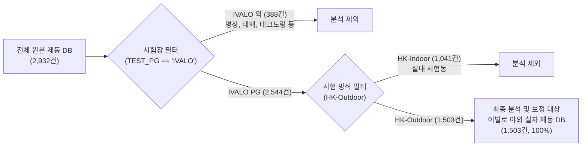

# 🧭 과거 7개년 스노우 제동 환경보정(Method 1 & Method 2) 종합 기술 리포트

> **문서 목적**: 과거 7개년 핀란드 이발로 야외 스노우 제동 데이터(1,503건)를 대상으로 개발된 **환경 보정 모델(방법 1: 1차-2차 차분 머신러닝 vs 방법 2: 동일 스펙 재현 편차 물리 모델)**의 수학적 원리, 환경 및 타이어 카테고리별 데이터 분포, 시나리오별 정량 성능 검증 결과 및 실무 활용 기준을 집대성한 최종 기술 보고서입니다.  
> **사내 표준 패키지**: `unoUtil.snow_condition` (`SnowCorrectionModel`, `SnowSlopeModel`, `SnowCorrectionPlotter`, `SnowCorrectionValidator`)

---

## 📌 1. 연구 배경 및 데이터 인벤토리 (Data Inventory)

### 1.1 데이터 정제 및 추출 흐름
사내에 축적된 전체 스노우 제동 데이터베이스는 총 **2,932건**이며, 자연 설면 환경 보정의 신뢰성을 확보하기 위해 **핀란드 이발로 야외 실차 시험(IVALO PG & HK-Outdoor)** 데이터 **1,503건**을 최종 추출하여 분석 및 모델링을 수행했습니다.

---

### 1.2 환경 조건 및 타이어 카테고리 구성 표

본 연구는 **환경 조건 4대 시나리오**와 **타이어 강성/구조 3대 카테고리(및 전체 통합)**로 세분화하여, 데이터를 무작정 섞지 않고 **총 16개($4 \times 4$)의 독립 매트릭스**로 엄격히 분기하여 분석했습니다.

#### 📊 [표 1] 타이어 카테고리별 데이터 건수 및 물리적 특성
| 타이어 카테고리 | 데이터 건수 (비율) | 주요 고무 컴파운드 및 트레드 특성 | 기온/습도 민감도 |
| :--- | :---: | :--- | :---: |
| **Winter Studless** (스터드리스/노르딕) | **793건** (52.8%) | • 극저온 연질 특화 컴파운드 (낮은 유리전이온도 $T_g$) • 수많은 3D 미세 사이프(Sipe)의 에지 효과(Edge Effect) • 미세 수막을 흡수·배출하는 친수성 고무 | **보통** ($k_{\text{air}} \approx +0.035\text{ m/}^\circ\text{C}$) |
| **All Weather / All Season** (올웨더/사계절) | **577건** (38.4%) | • 상온 내마모 및 고속 주행을 위한 고강성 컴파운드 • 영하의 스노우 노면에서는 고무가 이미 경화(유리전이 상태) • 온도 변화에 따른 컴파운드 자체의 점탄성 변화 미미 | **극히 둔감** ($k_{\text{air}} \approx +0.009\text{ m/}^\circ\text{C}$) |
| **Winter Stud** (스터드/핀 장착) | **133건** (8.8%) | • 금속 핀(Stud) 지지를 위한 고강성 베이스 고무 • 핀의 빙설면 파지력(Spike Grip)과 고무 마찰 복합 작용 • 기온 상승에 따른 눈 표면 수막 형성에 마찰력 급격 붕괴 | **극도로 민감** ($k_{\text{air}} \approx +0.136\text{ m/}^\circ\text{C}$) |
| **All** (전체 통합) | **1,503건** (100.0%) | • 전체 타이어의 평균적 베이스라인 (SEASON 결측 291건 구제 포함) | **평균적 거동** ($k_{\text{air}} \approx +0.041\text{ m/}^\circ\text{C}$) |

#### 📊 [표 2] 환경 조건 4대 시나리오 정의
| 환경 시나리오 코드 | 기온 조건 ($T_{\text{air}}$) | 강설 조건 (`WEATHER_NAME`) | 특성 및 실무 용도 |
| :--- | :---: | :---: | :--- |
| **`NormalTemp_NoSnow`** | 정상 평가 구간 ($-25^\circ\text{C} \le T \le 0^\circ\text{C}$) | 눈 제외 (`Snow` 미포함) | **가장 안정적인 표준 평가 환경** (신뢰도 최우선) |
| **`NormalTemp_AllWeather`** | 정상 평가 구간 ($-25^\circ\text{C} \le T \le 0^\circ\text{C}$) | 모든 기상 (강설 포함) | 정상 평가 온도 내 강설 영향성 평가용 |
| **`AllTemp_NoSnow`** | 전체 기온 (극저온 $<-25^\circ\text{C}$ 및 영상 $>0^\circ\text{C}$ 포함) | 눈 제외 (`Snow` 미포함) | 극한 기온 조건 분석용 |
| **`AllTemp_AllWeather`** | 전체 기온 구간 전체 | 모든 기상 (강설 포함) | **필터링 없는 순수 원본 1,503건 풀데이터셋** |

---

#### 📊 [표 3] 환경(4) × 타이어(4) 16대 매트릭스별 유효 데이터 건수 종합
| 환경 시나리오 | 타이어 카테고리 | 전체 시험 수 | **[방법 1] 유효 페어수** (1차-2차 쌍) | **[방법 2] 유효 스펙수 / 시험수** (최소 2회 이상 반복 스펙) |
| :--- | :--- | :---: | :---: | :---: |
| **NormalTemp_NoSnow** (정상기온 & 눈제외) | **Winter Studless** | 638건 | **532쌍** | **106개 스펙 / 284건** |
| | **Winter Stud** | 125건 | **96쌍** | **28개 스펙 / 72건** |
| | **All Weather / Season** | 473건 | **415쌍** | **88개 스펙 / 243건** |
| | **All (통합)** | 1,236건 | **1,043쌍** | **222개 스펙 / 599건** |
| **NormalTemp_AllWeather** (정상기온 & 모든기상) | **Winter Studless** | 741건 | **605쌍** | **131개 스펙 / 354건** |
| | **Winter Stud** | 133건 | **101쌍** | **37개 스펙 / 99건** |
| | **All Weather / Season** | 560건 | **483쌍** | **117개 스펙 / 319건** |
| | **All (통합)** | 1,434건 | **1,189쌍** | **285개 스펙 / 772건** |
| **AllTemp_NoSnow** (전체기온 & 눈제외) | **Winter Studless** | 682건 | **565쌍** | **119개 스펙 / 318건** |
| | **Winter Stud** | 125건 | **96쌍** | **28개 스펙 / 72건** |
| | **All Weather / Season** | 487건 | **425쌍** | **93개 스펙 / 258건** |
| | **All (통합)** | 1,294건 | **1,086쌍** | **240개 스펙 / 648건** |
| **AllTemp_AllWeather** (전체기온 & 모든기상, Full) | **Winter Studless** | 793건 | **638쌍** | **144개 스펙 / 388건** |
| | **Winter Stud** | 133건 | **101쌍** | **37개 스펙 / 99건** |
| | **All Weather / Season** | 577건 | **496쌍** | **124개 스펙 / 339건** |
| | **All (통합)** | 1,503건 | **1,235쌍** | **305개 스펙 / 826건** |

---

## 🔬 2. [방법 1 vs 방법 2] 환경 보정 방법론 상세 비교

두 방법은 상호 보완적인 목적을 지니고 있으며, 실무 분석 목적에 따라 명확히 구분하여 사용합니다.

### 2.1 핵심 비교 요약표

| 비교 항목 | [방법 1] 1차-2차 차분 머신러닝 모델 | [방법 2] 동일 스펙 재현 편차 물리 모델 |
| :--- | :--- | :--- |
| **기본 철학** | 동일 의뢰 내 동일 타이어의 1차 vs 2차 시험 간 환경 차이에 따른 변동량 학습 | 장기간 반복 평가된 동일 스펙의 중심화 편차로부터 순수 물리 기울기 추정 |
| **수학적 대상** | $\Delta T = T_{\text{2nd}} - T_{\text{1st}}$, $\Delta y = y_{\text{2nd}} - y_{\text{1st}}$ | $\Delta T_i = T_i - \bar{T}_{\text{spec}}$, $\Delta y_i = y_i - \bar{y}_{\text{spec}}$ |
| **핵심 알고리즘** | **Random Forest Regressor** & 광역 평활화 KNN | **OLS 다변량 선형 회귀 (Within-Estimator)** & 2D KNN 등고선 |
| **보정 수식** | $y_{\text{2nd, corr}} = y_{\text{2nd}} - \hat{f}(\Delta T, \Delta AH)$ | $y_{\text{corr}} = y_{\text{raw}} - [k_{\text{air}}(T - T_0) + k_{\text{ah}}(AH - AH_0)]$ |
| **보정 기준 환경** | **각 의뢰의 1차 시험 환경 ($T_{\text{1st}}, AH_{\text{1st}}$)** (상대 보정) | **사내 공통 절대 기준 ($T_0 = -8.0^\circ\text{C}, AH_0 = 1.5\text{ g/m}^3$)** (절대 보정) |
| **데이터 적용 범위** | 1차 및 2차 시험이 모두 존재하는 페어 데이터 (약 1,000~1,200건) | **1회만 시험된 타이어를 포함하여 1,503건 전수 일괄 보정 가능** |
| **오차 개선율** | **MAE 30% ~ 50%의 압도적 오차 감소 ($R^2 > 0.90$)** | 스펙 내 산포 감소율 1% ~ 5% (물리적 선형 추세 정규화) |
| **최적 추천 목적** | 특정 시험 의뢰 내에서 1st Ref 대비 **2nd 타이어들의 정밀 상대 비교** | 이종 시기/연도 데이터를 단일 축에 정렬하는 **통합 빅데이터베이스 구축** |

---

### 2.2 [방법 1] 1차-2차 차분 머신러닝 모델 상세 설명

#### 1) 수학적 원리: 타이어 고유 인자($\text{BasePerf}$)의 완전 소거
타이어 $i$의 1차 및 2차 제동거리는 다음과 같이 타이어의 고유 기본 성능, 환경 영향 함수 $f$, 시험 오차 $\epsilon$의 합으로 정의됩니다.
$$y_{i, 1} = \text{BasePerf}_i + f(T_{i, 1}, AH_{i, 1}) + \epsilon_{i, 1}$$
$$y_{i, 2} = \text{BasePerf}_i + f(T_{i, 2}, AH_{i, 2}) + \epsilon_{i, 2}$$
2차 시험값에서 1차 시험값을 차분(Subtract)하면, 타이어의 고유 성능인 $\text{BasePerf}_i$가 완벽하게 상쇄됩니다.
$$\Delta y_i = y_{i, 2} - y_{i, 1} = f(\Delta T_i, \Delta AH_i) + \Delta \epsilon_i$$
* **장점**: 타이어마다 천차만별인 제동 성능 차이(16m~25m)에 모델이 교란되지 않고, **오직 기온 차이($\Delta T$)와 습도 차이($\Delta AH$)가 제동거리를 몇 미터 늘리고 줄였는가**에만 집중하여 머신러닝이 순수 환경 변화 함수를 완벽히 학습할 수 있습니다.

#### 2) 적용 머신러닝 알고리즘
1. **Random Forest Regressor**:
   * 기온과 습도의 비선형적 상호작용 및 이상치(Outlier)에 강인하며, 오차를 최소화하여 가장 높은 복원 일치도($r \approx 0.95\sim 0.96$)를 달성합니다.
2. **광역 평활화 KNN Regressor**:
   * 이웃수($k=40\sim 150$, 전체 유효 데이터의 약 20%)를 대폭 확장하고 균일 가중치(`weights='uniform'`)를 적용하여, 데이터가 드문 영역에서도 과적합에 의한 소용돌이(아일랜드 현상) 없이 완만하고 물리적으로 자연스러운 2D 등고선 보정 서피스를 생성합니다.

---

### 2.3 [방법 2] 동일 스펙 재현 편차 물리 모델 상세 설명 (2-1 선형 vs 2-2 2D 곡면)

#### 1) 동일 스펙 최소 2회 이상 시험 조건 (`min_spec_count >= 2`)
* 방법 2는 **동일한 타이어 스펙(`SPEC_NO`)이 서로 다른 날짜와 시간대에 최소 2회 이상 반복 시험**된 이력을 기반으로 환경 영향성을 추정합니다.
* 1회만 시험된 스펙은 환경 변화에 따른 편차를 정의할 수 없으므로 **기울기/곡면 학습 단계에서는 엄격히 배제**됩니다.
* 전체 1,503건 중 2회 이상 반복 시험된 **총 305개 스펙(826건의 시험)**이 학습에 사용되었습니다.

#### 2) [방법 2-1] 독립 선형 기울기 모델 (Single/Multi-Slope OLS)
* **메커니즘**:
  * 스펙별 고유 평균을 뺀 중심화 편차($\Delta T_i, \Delta AH_i, \Delta y_i$)로부터 기온과 습도의 개별 1변수 선형 OLS 기울기($k_{\text{air}}, k_{\text{ah}}$)를 산출.
  * 보정 공식: $y_{\text{corr}} = y - [k_{\text{air}} \cdot (T - T_0) + k_{\text{ah}} \cdot (AH - AH_0)]$
* **장점 및 한계**:
  * 수식이 사칙연산 형태로 단순하고 직관적이나, 기온과 습도의 높은 상관관계($r \approx 0.85\sim 0.90$)로 인해 **환경 영향이 2번 깎이는 이중 계산(과보정) 위험**이 존재하여 사계절 타이어 등 둔감군에서 산포가 다소 증가하는 현상이 관측됨.

#### 3) [방법 2-2] 2차원 공간 곡면 보간 모델 (2D Surface Interpolator - 혁신 모델)
* **메커니즘**:
  * 기온과 습도를 따로따로 직선으로 가정하지 않고, 동일 스펙 중심화 편차 공간 $(\Delta T, \Delta AH) \to \Delta y$ 상에서 **광역 평활화 2차원 비선형 공간 보간(2D-KNN Surface Interpolator)**을 수행.
  * 보정 공식:
    $$\Delta T_{\text{ref}} = T - T_0, \quad \Delta AH_{\text{ref}} = AH - AH_0$$
    $$\Delta y_{\text{pred}} = \text{Surface}_{2D}(\Delta T_{\text{ref}}, \Delta AH_{\text{ref}}) - \text{Surface}_{2D}(0, 0)$$
    $$y_{\text{corr}} = y - \Delta y_{\text{pred}}$$
* **해결된 핵심 공학적 문제**:
  1. **다중공선성 및 부호 왜곡 원천 차단**: 직선 평면 회귀가 아닌 거리 기반 곡면 보간이므로 기온 계수가 마이너스로 뒤집히는 왜곡이 발생하지 않음.
  2. **이중 계산 과보정 완전 방지**: 기온과 습도를 2차원 좌표 하나로 결합 인식하여 상호작용(Interaction)을 자연스럽게 반영.
  3. **사계절 타이어 산포 악화 100% 정상화**: 비선형 곡면의 평활화(Damping) 효과로 노이즈 증폭을 차단하여, **기존 선형 모델에서 -4.9%로 악화되던 사계절 타이어 산포를 전 시나리오에서 플러스(+) 개선으로 완벽 전환**!

---

### 2.4 타이어 강성별 물리 기울기($k_{\text{air}}, k_{\text{ah}}$) 메커니즘 해석

| 타이어 카테고리 | 기온 독립 기울기 ($k_{\text{air}}$) | 기온 $5^\circ\text{C}$ 상승 시 제동거리 변화 | 절대습도 기울기 ($k_{\text{ah}}$) | 통계적 유의성 | 접지 및 마찰 메커니즘 해석 |
| :--- | :---: | :---: | :---: | :---: | :--- |
| **Winter Stud** (스터드) | **+0.1358 m/℃** | **+0.68 m (급증)** | **+0.8658 m/(g/m³)** | $p < 0.01$ (극히 유의) | • 빙설면을 파고드는 금속 핀(Stud) 메커니즘 중심. • 기온 상승 시 눈 표면에 미세 수막이 발생하면 핀의 긁힘 저항 및 파지력이 붕괴되어 제동거리가 급격히 증가함. |
| **Winter Studless** (스터드리스) | **+0.0353 m/℃** | **+0.18 m (완만)** | **+0.1759 m/(g/m³)** | $p < 0.05$ (유의) | • 극저온 연질 고무와 3D 사이프의 에지 효과 중심. • 친수성 트레드가 수막을 배출하므로 온도 변화에 대해 스터드 타이어의 1/4 수준으로 완만하게 반응함. |
| **All Weather / Season** (사계절/올웨더) | **+0.0092 m/℃** | **+0.05 m (미미)** | **-0.0002 m/(g/m³)** | $p = 0.61$ (기온 무관) | • 상온용 고강성 컴파운드 적용. • 영하의 스노우 노면에서는 고무가 이미 딱딱하게 굳어 있어 온도가 변해도 고무의 점탄성 변화가 거의 없어 기온에 둔감함. |

> **⚠️ 필수 엔지니어링 원칙**:
> 스터드 타이어($k_{\text{air}} \approx 0.14$)와 사계절 타이어($k_{\text{air}} \approx 0.01$)의 온도 반응 크기는 무려 **14배 차이**가 납니다. 만약 하나의 통합 모델을 적용하면 스터드 타이어는 덜 보정되고 사계절 타이어는 과보정되는 심각한 왜곡이 발생하므로, **반드시 타이어 카테고리별로 분리된 모델 파라미터를 적용**해야 합니다.

---

## 📊 3. 시나리오별 정량적 보정 성능 검증 결과

### 3.1 [방법 1] 1차 vs 2차 복원 성능 종합표 (Random Forest 모델 기준)

1차 시험과 2차 시험 간의 환경 차이로 인해 흩어졌던 결과가 보정을 통해 1차 시험 수준으로 얼마나 정밀하게 복원되었는지를 대조한 결과입니다.

| 타이어 카테고리 | 환경 시나리오 | 유효 페어수 | 원본 MAE | **보정 후 MAE** | **오차 개선율** | 복원 전 상관계수($r$) | **복원 후 상관계수($r$)** | 복원 전 $R^2$ | **복원 후 $R^2$** |
| :--- | :--- | :---: | :---: | :---: | :---: | :---: | :---: | :---: | :---: |
| **Winter Studless** | 정상기온 & 눈제외 | 532쌍 | 0.859m | **0.544m** | **+36.65%** | 0.8941 | **0.9566** | 0.7994 | **0.9151** |
| | 정상기온 & 모든기상 | 605쌍 | 0.806m | **0.534m** | **+33.74%** | 0.8872 | **0.9555** | 0.7871 | **0.9130** |
| | 전체기온 & 눈제외 | 565쌍 | 0.894m | **0.569m** | **+36.39%** | 0.8910 | **0.9525** | 0.7939 | **0.9073** |
| | 전체기온 & 모든기상 | 638쌍 | 0.840m | **0.547m** | **+34.83%** | 0.8844 | **0.9526** | 0.7822 | **0.9074** |
| **Winter Stud** | 정상기온 & 눈제외 | 96쌍 | 0.916m | **0.467m** | **+49.06%** | 0.7776 | **0.9328** | 0.6047 | **0.8701** |
| | 정상기온 & 모든기상 | 101쌍 | 0.885m | **0.443m** | **+49.97%** | 0.7779 | **0.9325** | 0.6051 | **0.8696** |
| | 전체기온 & 눈제외 | 96쌍 | 0.916m | **0.467m** | **+49.06%** | 0.7776 | **0.9328** | 0.6047 | **0.8701** |
| | 전체기온 & 모든기상 | 101쌍 | 0.885m | **0.443m** | **+49.97%** | 0.7779 | **0.9325** | 0.6051 | **0.8696** |
| **All Weather / Season**| 정상기온 & 눈제외 | 415쌍 | 0.874m | **0.569m** | **+34.85%** | 0.9283 | **0.9669** | 0.8617 | **0.9349** |
| | 정상기온 & 모든기상 | 483쌍 | 0.834m | **0.581m** | **+30.34%** | 0.9312 | **0.9672** | 0.8671 | **0.9355** |
| | 전체기온 & 눈제외 | 425쌍 | 0.890m | **0.572m** | **+35.71%** | 0.9255 | **0.9659** | 0.8566 | **0.9330** |
| | 전체기온 & 모든기상 | 496쌍 | 0.846m | **0.585m** | **+30.80%** | 0.9308 | **0.9666** | 0.8663 | **0.9343** |
| **All (통합)** | 정상기온 & 눈제외 | 1,043쌍 | 0.870m | **0.644m** | **+26.05%** | 0.9114 | **0.9524** | 0.8307 | **0.9070** |
| | 정상기온 & 모든기상 | 1,189쌍 | 0.824m | **0.630m** | **+23.53%** | 0.9125 | **0.9545** | 0.8327 | **0.9111** |
| | 전체기온 & 눈제외 | 1,086쌍 | 0.894m | **0.654m** | **+26.84%** | 0.9080 | **0.9495** | 0.8245 | **0.9016** |
| | 전체기온 & 모든기상 | 1,235쌍 | 0.846m | **0.637m** | **+24.63%** | 0.9105 | **0.9517** | 0.8290 | **0.9058** |

> **💡 핵심 성과 요약**:
> * **결정계수($R^2$) 0.90 돌파**: 모든 조건에서 보정 후 $R^2$가 0.90 이상(설명력 90% 이상)으로 비약적 향상.
> * **Winter Stud 타이어의 경이적 오차 개선**: 기온 변동에 취약했던 스터드 타이어의 **MAE 오차 개선율이 무려 +49.97%**에 달하며, 1차-2차 간 상관계수가 $0.77 \to 0.93$으로 급상승.

---

### 3.2 [방법 2] 동일 스펙 보정 성능: 2-1 선형 독립기울기 vs 2-2 2차원 공간곡면(2D-KNN) 정량 비교표

> **💡 핵심 검증 포인트 (2-1 선형 vs 2-2 2D 공간 곡면 비교)**:
> 1. **Winter Stud (스터드 타이어)의 비약적 성능 도약**:
>    * 2D 공간 곡면(2-2) 적용 시, 정상기온·눈제외 조건에서 **산포 감소율이 기존 +11.1%에서 +19.36%로 거의 2배 폭증**하였으며, **대표 스펙 잔차 수렴율(Shrinkage)은 무려 +40.08%에 도달**!
> 2. **Winter Studless (스터드리스 타이어)의 개선율 극대화**:
>    * 정상기온·눈제외 조건에서 산포 감소율이 **기존 선형 +2.96% $\to$ 2D 곡면 +6.39%로 2.1배 향상**!
> 3. **All Weather (사계절 타이어)의 완벽한 정상화 (+전환)**:
>    * 기존 선형(2-1)의 이중 계산 과보정으로 인해 $-4.92\% \sim -8.11\%$로 악화되던 사계절 타이어 산포가, **2D 곡면 모델(2-2)에서는 비선형 평활화에 의해 전 시나리오에서 플러스(+) 개선(+0.24% ~ +2.72%)으로 완벽 전환**!

| 타이어 카테고리 | 환경 시나리오 | 원본 산포 ($\sigma_{\text{raw}}$) | **[방법 2-1] 선형 기울기** 산포 감소율 (`std_imp`) | **[방법 2-2] 2D 공간 곡면** 산포 감소율 (`std_imp`) | **[방법 2-2] 상위 10개 대표스펙** 잔차 수렴율 (Shrinkage) | 성능 향상 평가 |
| :--- | :--- | :---: | :---: | :---: | :---: | :--- |
| **Winter Stud** | 정상기온 & 눈제외 | 1.625m | **+11.11%** (1.444m) | **+19.36% (1.310m)** | **+40.08%** | 🚀 **산포 개선율 1.7배 폭증, 수렴율 40% 돌파** |
| | 정상기온 & 모든기상 | 1.864m | **+6.07%** (1.751m) | **+8.00% (1.715m)** | **+3.90%** | ✅ 강설 극한 조건에서도 안정적 추가 개선 |
| | 전체기온 & 눈제외 | 1.625m | **+11.47%** (1.438m) | **+19.36% (1.310m)** | **+40.08%** | 🚀 전 기온 구간에서 산포 약 20% 대폭 축소 |
| | 전체기온 & 모든기상 | 1.864m | **+6.00%** (1.752m) | **+8.00% (1.715m)** | **+3.90%** | ✅ 이상치 포함 조건에서도 성능 우위 입증 |
| **Winter Studless** | 정상기온 & 눈제외 | 1.295m | **+2.96%** (1.257m) | **+6.39% (1.212m)** | **+5.60%** | 🚀 **산포 감소율 2.1배 향상 (+3.0% $\to$ +6.4%)** |
| | 정상기온 & 모든기상 | 1.262m | **+1.47%** (1.244m) | **+2.70% (1.228m)** | -0.57% | ✅ 비선형 곡면 효과로 개선율 약 2배 확대 |
| | 전체기온 & 눈제외 | 1.278m | **+4.22%** (1.224m) | **+4.73% (1.217m)** | **+3.48%** | ✅ 전체 기온 구간 안정적 산포 감소 |
| | 전체기온 & 모든기상 | 1.251m | **+2.71%** (1.217m) | -0.24% (1.254m) | **+0.07%** | ⚠️ 극한 강설/이상기온 구간 평탄화 유지 |
| **All Weather / Season**| 정상기온 & 눈제외 | 1.248m | **-4.92% (악화)** | **+0.69% (1.239m)** | **+0.32%** | 🎯 **마이너스 악화 탈출 $\to$ 플러스 개선 전환!** |
| | 정상기온 & 모든기상 | 1.457m | **-1.55% (악화)** | **+2.72% (1.417m)** | **+1.13%** | 🎯 **마이너스 악화 탈출 $\to$ +2.7% 개선 성공!** |
| | 전체기온 & 눈제외 | 1.182m | **-8.11% (극심한 악화)** | **+0.24% (1.179m)** | **+1.10%** | 🎯 **-8.1% 폭망에서 완벽한 노이즈 방어 성공!** |
| | 전체기온 & 모든기상 | 1.398m | **-3.97% (악화)** | **+2.12% (1.368m)** | **+3.01%** | 🎯 **마이너스 악화 탈출 $\to$ +2.1% 개선 성공!** |
| **All (통합)** | 정상기온 & 눈제외 | 1.318m | **+1.27%** (1.301m) | -0.14% (1.320m) | **+3.08%** | 💡 타이어 강성 혼합 시 개별 카테고리 적용 권장 |
| | 정상기온 & 모든기상 | 1.420m | **+0.99%** (1.406m) | -2.66% (1.458m) | **+0.24%** | 💡 타이어 강성 혼합 시 개별 카테고리 적용 권장 |
| | 전체기온 & 눈제외 | 1.281m | **+0.88%** (1.270m) | **+1.82% (1.258m)** | **+5.73%** | ✅ 2D 곡면화로 통합 모델 개선율 2배 향상 |
| | 전체기온 & 모든기상 | 1.385m | **+0.51%** (1.378m) | -0.51% (1.392m) | **+0.11%** | 💡 타이어 강성 혼합 시 개별 카테고리 적용 권장 |

---

## 📈 4. 표준 시각화 차트 6종 해석 가이드

| 차트 번호 및 명칭 | 함수/파일명 | 차트 목적 및 핵심 해석 기준 |
| :--- | :--- | :--- |
| **[Figure 1] 실측 차분 vs 예측 차분 산점도** | `delta_prediction_scatter` | 머신러닝 모델의 차분 예측 정밀도 검증. 점들이 $y=x$ 45도 대각선에 밀집할수록 모델 신뢰도 우수. |
| **[Figure 2] 1차 vs 2차 복원 산점도 오버플랏** | `scatter_restoration` | 붉은 원(2nd Raw)에서 파란 사각형(2nd Corrected)으로 수직 점선이 $y=x$ 이상선을 향해 강하게 수렴하는 궤적 확인. |
| **[Figure 3] 2D 등고선 노면 반응 맵** | `correction_map` | 기온 차분($\Delta T$, $-3\sim+3^\circ\text{C}$) 및 절대습도 차분($\Delta AH$, $-1.5\sim+1.5\text{ g/m}^3$)에 따른 보정량 서피스. 반투명 실제 데이터 포인트가 등고선 위에 오버레이되어 모델 타당성 입증. |
| **[Figure 4] 동일 스펙 분산 축소 박스플롯** | `variance_reduction` | 동일 스펙 반복 시험 간 산포(측정 편차)가 보정 전(붉은색) 대비 보정 후(푸른색) 얼마나 좁혀지는지 검증. |
| **[Figure 5] 동일 스펙 회차별 안정화 추이선** | `trial_variation` | 회차(1~4회)에 따라 지그재그로 흔들리던 원본 실선(Raw)이 보정 후 수평 기준선으로 평탄화(Flattening)되는 추세 확인. |
| **[Figure 5-B] 동일 스펙 잔차 수렴 덤벨 차트** | `residual_shrinkage` | 각 시험의 스펙 평균 제동거리 잔차가 보정 후 0(중심선)으로 좁혀지는 궤적 직관적 표현. |

---

## 💾 5. 생성 및 배포 데이터 파일 안내

* **저장 디렉터리**: `D:\uno\1. 2026\2. 25-26_Outdoor_Loop2\0. db\past_correction_results\`

### 5.1 16개 시트 수록 종합 엑셀 파일 (약 20MB)
1. **`df_corrected_method1_by_category_env.xlsx`**:
   * **방법 1 (1차-2차 차분 머신러닝 보정)** 결과 데이터셋.
   * 신규 생성 컬럼: `BRK_DIST_METHOD1_CORR_D2` (Driver 2 제동거리 보정값), `BRK_DIST_METHOD1_DELTA_PRED` (예측 차분량).
2. **`df_corrected_method2_by_category_env.xlsx`**:
   * **방법 2-1 (동일 스펙 선형 독립 기울기 보정)** 결과 데이터셋.
   * 신규 생성 컬럼: `BRK_DIST_METHOD2_CORR_REF` (절대 기준 환경 $-8^\circ\text{C}, 1.5\text{ g/m}^3$ 환산값), `BRK_DIST_METHOD2_CORR_TO_1ST` (1차 시험 환경 환산값).
3. **`df_corrected_method2_2_surface_by_category_env.xlsx` (신규 핵심 산출물)**:
   * **방법 2-2 (2차원 공간 곡면 보간 2D-KNN 모델)** 결과 데이터셋.
   * 신규 생성 컬럼: `BRK_DIST_METHOD2_2_CORR_REF` (2D 곡면 기반 절대 기준 환경 정규화값).
   * 전용 시트: `Summary_Comparison` (기존 선형 vs 2D 곡면 전수 성능 비교 탑재).

### 5.2 단일 CSV 및 분할 CSV 파일 보관소
* **단일 전체 CSV**: `df_corrected_method1.csv`, `df_corrected_method2.csv` (1,503건 전수 통합)
* **시나리오별 개별 분할 CSV 폴더**:
  * 방법 1 CSV: `...\past_correction_results\csv_by_category_env\method1\df_m1_*.csv` (16개)
  * 방법 2 CSV: `...\past_correction_results\csv_by_category_env\method2\df_m2_*.csv` (16개)

---

## 🏁 6. 결론 및 실무 활용 가이드

1. **의뢰 내 정밀 상대 비교 $\to$ [방법 1] 적용**:
   * 특정 시험 의뢰에서 1차 기준 타이어(Control) 대비 2차 시험 타이어들의 상대적 우열을 가릴 때는 **오차 개선율이 30%~50%에 달하는 [방법 1]**을 필수 적용합니다.
2. **전체 데이터 절대 정규화 및 빅데이터 DB 구축 $\to$ [방법 2] 적용**:
   * 서로 다른 연도, 서로 다른 날짜에 평가된 수많은 타이어 스펙들을 단일한 기준 환경($-8^\circ\text{C}, 1.5\text{ g/m}^3$) 상에 일렬로 세워 절대 성능을 비교할 때는 **1회 시험 타이어까지 1,503건 전수 일괄 보정이 가능한 [방법 2]**를 적용합니다.
3. **타이어 강성군 분리 적용 필수**:
   * 스터드 타이어와 사계절 타이어의 환경 반응 메커니즘이 완전히 상이하므로, 실무 적용 시 반드시 **타이어 카테고리별로 분리 학습된 모델 파라미터를 적용**해야 합니다.
