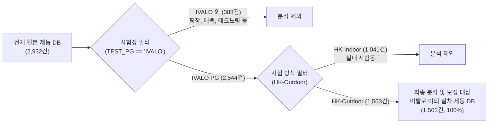
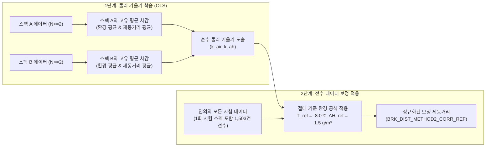

# 📄 스노우 노면 환경 보정 모델(Method 1 & Method 2) 기술 개요 및 성능 분석 보고서

> **문서 목적**: 과거 7개년 야외 스노우 제동 데이터(IVALO PG)를 대상으로 개발된 **환경 보정 모델(방법 1: 1차-2차 차분 머신러닝 vs 방법 2: 동일 스펙 재현 편차 물리 모델)**의 수학적 원리, 타이어 강성·온도대별 특성, 수치적 성능 검증 결과 및 시각화 해석 기준을 총정리한 엔지니어링 기술 설명서입니다.  
> **적용 패키지**: 사내 공식 표준 모듈 `unoUtil.snow_condition` (`SnowCorrectionModel`, `SnowSlopeModel`, `SnowCorrectionPlotter`)

---

## 📌 1. 연구 배경 및 데이터 개요 (Data Inventory)

### 1.1 데이터베이스 구성 및 정제 개요
사내 축적된 전체 스노우 제동 데이터베이스는 총 **2,932건**의 시험 기록을 포함하고 있으며, 본 보정 모델의 대상이 되는 **핀란드 이발로 야외 실차 제동 시험** 데이터는 정제 과정을 거쳐 총 **1,503건**이 최종 추출되었습니다.

#### 📊 데이터 분포 명세
1. **시험장(PG) 분포 (전체 2,932건 기준)**:
   * **IVALO (핀란드 이발로 시험장)**: **2,544건 (86.8%)**
   * PYEONGCHANG (평창): 340건 (11.6%)
   * 기타 (SHPG, GTRAC, 테크노링, 태백, UTAC 등): 48건 (1.6%)
2. **시험 방식 분포**:
   * **HK-Outdoor (야외 자연 설면 실차 시험)**: **1,891건 (64.5%)**
   * HK-Indoor (실내 인공 설면 시험동): 1,041건 (35.5%)
3. **최종 이발로 야외 실차 DB (1,503건)의 타이어 카테고리 구성**:
   * **Winter Studless (스터드리스/노르딕)**: **793건 (52.8%)**
   * **All Weather / All Season (사계절/올웨더)**: **577건 (38.4%)**
   * **Winter Stud (스터드/핀 장착)**: **133건 (8.8%)**
   * *총계: 1,503건*

---

### 1.2 야외 스노우 제동 환경 변동성과 보정의 필요성
야외 스노우 제동 시험(Outdoor Snow Braking Test)은 자연 설면 위에서 수행되므로, 시험이 진행되는 시간대에 따라 **대기 온도(Air Temp)**와 **절대 습도(Absolute Humidity)**가 지속적으로 변동합니다.

1. **설면 마찰력의 온도 민감도**:
   * 기온이 상승하면 설면 표면에 미세 수막(Water Film)이 형성되어 윤활 작용(Lubrication Effect)이 발생하고, 이로 인해 타이어의 제동거리가 급격히 증가(성능 저하)합니다.
   * 반대로 기온이 매우 낮아지면 눈 입자가 단단해져 전단 저항(Shear Strength)이 증가하여 제동거리가 단축됩니다.
2. **반복 시험 간의 환경 편차**:
   * 동일한 타이어를 오전에 평가했을 때와 오후에 평가했을 때, 기온이 $2\sim 3^\circ\text{C}$ 상승하면 제동거리가 $0.5\sim 1.0\text{ m}$ 이상 늘어나는 왜곡이 발생합니다.
3. **환경 보정의 핵심 목표**:
   * 시험 환경 인자(기온, 습도)의 차이에 의해 발생하는 제동거리 변동량($\Delta \text{Dist}_{\text{env}}$)을 수학적·물리적 모델로 정밀 분리하여, **"모든 타이어가 동일한 기준 환경(예: $-8^\circ\text{C}, 1.5\text{ g/m}^3$)에서 평가되었을 때의 순수 성능"**으로 복원하는 것입니다.

---

## 🗂️ 2. 데이터 분기 및 독립 매트릭스 설계 (환경 × 타이어 강성)

본 보정 시스템은 모든 데이터를 한꺼번에 섞어서 단일 모델을 학습시키지 않고, **환경 조건 4대 시나리오**와 **타이어 강성/컴파운드 3대 카테고리(및 전체 통합)**로 세분화하여 **총 16개($4 \times 4$)의 독립 매트릭스로 분기하여 모델링 및 검증**을 수행합니다.

### 2.1 환경 조건 분기 (4대 기상 시나리오)
* **`NormalTemp_NoSnow`**: 정상 평가 온도 구간($-25^\circ\text{C} \le T \le 0^\circ\text{C}$)이며, 강설(Snow)이 없는 맑음/흐림 조건 (가장 안정적인 표준 평가 환경)
* **`NormalTemp_AllWeather`**: 정상 평가 온도 구간($-25^\circ\text{C} \le T \le 0^\circ\text{C}$)이며, 시험 중 눈이 내린 조건까지 포함
* **`AllTemp_NoSnow`**: 극저온 및 영상 기온을 포함한 전체 기온 구간, 눈 제외
* **`AllTemp_AllWeather`**: 전체 기온 구간 및 강설 포함 (필터링 없는 순수 원본 1,503건 전체)

### 2.2 타이어 카테고리 분기 (고무 컴파운드 강성 및 구조별)
타이어 종류에 따라 저온에서의 고무 탄성 계수(Storage Modulus $E'$)와 접지 메커니즘이 근본적으로 다르므로 카테고리를 분리하여 개별 모델을 학습합니다.
* **`Winter Studless` (스터드리스/노르딕 타이어)**:
  * 극저온에서도 유연성을 유지하는 저온 특화 연질 컴파운드 적용.
  * 트레드의 수많은 미세 사이프(Sipe)가 눈을 긁어모으는 에지 효과(Edge Effect) 중심.
* **`Winter Stud` (스터드 타이어)**:
  * 금속 핀(Stud)이 장착되어 있어 핀을 단단히 지지하기 위한 고강성 트레드 베이스 고무 적용.
  * 핀의 빙설면 파지력(Spike Grip)과 고무 마찰이 복합적으로 작용하여 기온/수막 변화에 극도로 민감.
* **`All Weather / All Season` (사계절/올웨더 타이어)**:
  * 상온 주행 성능을 위해 고무 컴파운드의 강성이 겨울용보다 훨씬 높고 유리전이온도($T_g$)가 높음.
  * 영하의 스노우 노면에서는 고무가 이미 경화되어 있어 기온 변화에 따른 마찰 특성 변화가 상대적으로 둔감.
* **`All` (전체 통합)**:
  * 카테고리 구분 없이 전체를 하나로 묶은 베이스라인 모델.

> **💡 독립 모델링의 당위성**:
> 동일한 기온 $1^\circ\text{C}$ 상승이라도, 스터드 타이어는 제동거리가 약 $+0.12\text{ m}$ 늘어나는 반면 스터드리스는 약 $+0.03\text{ m}$, 사계절은 약 $+0.01\text{ m}$ 미만으로 늘어납니다. 따라서 하나의 통합 모델로 보정하면 스터드 타이어는 덜 보정되고 사계절 타이어는 과도하게 보정되는 심각한 왜곡이 발생하므로 **카테고리별 분리 모델링이 필수적**입니다.

---

## 🔬 3. 보정 모델 아키텍처 및 수학적 모델링 비교

본 시스템은 상호 보완적인 2가지 보정 방안을 개발하여 제공합니다.

| 구분 | [방법 1] 1차-2차 차분 머신러닝 모델 | [방법 2] 동일 스펙 재현 편차 물리 모델 |
| :--- | :--- | :--- |
| **핵심 철학** | 의뢰 내 동일 타이어의 1차 시험 vs 2차 시험 간의 차분 변동 학습 | 장기간 반복 평가된 동일 스펙의 중심화 편차(Centered Deviation) 기울기 추정 |
| **수학적 대상** | $\Delta T = T_{\text{2nd}} - T_{\text{1st}}$, $\Delta y = y_{\text{2nd}} - y_{\text{1st}}$ | $\Delta T_i = T_i - \bar{T}_{\text{spec}}$, $\Delta y_i = y_i - \bar{y}_{\text{spec}}$ |
| **모델 알고리즘** | Random Forest Regressor & 광역 평활화 KNN Regressor | OLS 다변량 선형 회귀 (패널 고정효과 Within-Estimator) & 2D KNN 등고선 |
| **보정 방식** | 1차 기준 상대 보정 ($y_{\text{2nd, corr}} = y_{\text{2nd}} - f(\Delta T, \Delta AH)$) | 기준 환경 절대 일괄 보정 ($y_{\text{corr}} = y - [k_{\text{air}}(T - T_0) + k_{\text{ah}}(AH - AH_0)]$) |
| **기준 환경** | 각 의뢰의 1차 시험 환경 ($T_{\text{1st}}, AH_{\text{1st}}$) | 사내 공통 절대 기준 환경 ($T_0 = -8.0^\circ\text{C}, AH_0 = 1.5\text{ g/m}^3$) |
| **데이터 활용** | 1차 및 2차 시험이 모두 존재하는 세트 (전체 중 1,000~1,200건) | 2회 이상 평가된 동일 스펙 전체 (총 305개 스펙, 826건의 시험) |

---

### 3.1 [방법 1] 1차-2차 차분 머신러닝 모델 상세

#### (1) 수학적 원리 (타이어 고유 인자의 완전 소거)
어떤 타이어 세트 $i$의 1차 및 2차 제동거리는 다음과 같이 모델링할 수 있습니다.
$$y_{i, 1} = \text{BasePerf}_i + f(T_{i, 1}, AH_{i, 1}) + \epsilon_{i, 1}$$
$$y_{i, 2} = \text{BasePerf}_i + f(T_{i, 2}, AH_{i, 2}) + \epsilon_{i, 2}$$
여기서 2차 시험에서 1차 시험을 차분(Difference)하면, 각 타이어의 고유 성능인 $\text{BasePerf}_i$가 수학적으로 완벽하게 소거됩니다.
$$\Delta y_i = y_{i, 2} - y_{i, 1} = f(\Delta T_i, \Delta AH_i) + \Delta \epsilon_i$$
* 입력 특성(Features): $\Delta T = T_{\text{air, 2nd}} - T_{\text{air, 1st}}$, $\Delta AH = AH_{\text{2nd}} - AH_{\text{1st}}$
* 타깃(Target): $\Delta \text{Dist} = \text{Dist}_{\text{2nd}} - \text{Dist}_{\text{1st}}$

#### (2) 적용 모델
* **Random Forest Regressor**: 기온과 습도의 복합적인 비선형 상호작용 및 이상치 저항성을 확보하여 오차 최소화.
* **광역 평활화 KNN Regressor**: 이웃수($k=40\sim 150$, 전체 데이터의 20%)를 대폭 확장하고 균일 가중치(`weights='uniform'`)를 적용하여, 국소 소용돌이(아일랜드 현상)가 배제된 완만하고 매끄러운 2D 등고선 보정 맵 생성.

---

### 3.2 [방법 2] 동일 스펙 재현 편차 독립 물리 모델 상세

#### (1) 동일 스펙 최소 2회 이상 시험 조건 (`min_spec_count >= 2`)
* 방법 2의 핵심은 **동일 스펙(`SPEC_NO`)이 서로 다른 날짜/시간대에 최소 2회 이상 반복 시험**된 이력을 활용하는 것입니다.
* 1회만 시험된 스펙은 환경 변화에 따른 제동거리 변화량(편차)을 자체적으로 계산할 수 없으므로 **기울기 학습 단계에서는 엄격히 제외**됩니다.
* 전체 1,503건 중 2회 이상 재현 평가된 스펙은 **총 305개 스펙(826건의 시험)**이며, 이 유효 반복 데이터로부터 순수한 환경 물리 기울기를 학습합니다.

#### (2) 보정의 2대 기준 분리 (학습 기준 vs 보정 적용 기준)
많은 분들이 혼동하는 "보정의 기준"은 모델의 **학습 단계**와 **적용 단계**에서 명확히 구분됩니다.

1. **학습 단계의 기준 $\to$ [각 스펙 고유의 환경 및 제동거리 평균]**:
   * 각 스펙 $s$마다 자기 자신의 평균 대기온도($\bar{T}_s$), 평균 절대습도($\overline{AH}_s$), 평균 제동거리($\bar{y}_s$)를 기준으로 삼습니다.
   * 각 시험 $j$에 대해 스펙 평균 대비 **중심화 편차(Within-Spec Centered Deviation)**를 계산하여 타이어 고유의 성능 편차를 완전히 상쇄합니다.
   $$\Delta T_{sj} = T_{sj} - \bar{T}_s, \quad \Delta AH_{sj} = AH_{sj} - \overline{AH}_s, \quad \Delta y_{sj} = y_{sj} - \bar{y}_s$$
   $$\Delta y_{sj} = k_{\text{air}} \cdot \Delta T_{sj} + k_{\text{ah}} \cdot \Delta AH_{sj} + e_{sj}$$

2. **최종 보정 단계의 기준 $\to$ [사내 공통 절대 기준 환경 (Reference Environment)]**:
   * 기울기 $k_{\text{air}}, k_{\text{ah}}$가 도출된 후, 임의의 환경 $(T, AH)$에서 측정된 제동거리 $y$를 사내 공식 기준 환경($T_{\text{ref}} = -8.0^\circ\text{C}, AH_{\text{ref}} = 1.5\text{ g/m}^3$)으로 전수 정규화합니다.
   $$y_{\text{corr}} = y_{\text{raw}} - \left[ k_{\text{air}} \cdot (T_{\text{air}} - (-8.0)) + k_{\text{ah}} \cdot (AH - 1.5) \right]$$
   * 💡 **특징**: 이 단계는 기울기 수식에 의한 절대 변환이므로, **1회만 시험된 타이어라도 시험 당시의 기온/습도만 있으면 1,503건 전수 보정 제동거리가 산출**됩니다.

---

## 📊 4. 모델 성능 검증 결과 및 물리적 분석

### 4.1 [방법 1] 1차 vs 2차 복원 성능 (복원 전후 $R^2$ 및 $r$ 비교)

1차 시험과 2차 시험 간의 환경 차이로 인해 흩어졌던 결과가, 머신러닝 보정을 통해 **1차 시험 성능 수준으로 얼마나 정밀하게 복원되었는지를 원본(Raw)과 보정 후(Corrected)의 결정계수($R^2$) 및 상관계수($r$)로 전후 직접 대조**하였습니다.

#### (1) 전체 기온 & 모든 기상 시나리오 (AllTemp_AllWeather, 풀데이터 기준)
| 타이어 카테고리 | 유효 페어수 | 원본 MAE $\to$ **보정 MAE** | MAE 개선율 | **복원 전 $r$ $\to$ 복원 후 $r$** | **복원 전 $R^2$ $\to$ 복원 후 $R^2$** | **$R^2$ 개선폭 ($\Delta R^2$)** |
| :--- | :---: | :---: | :---: | :---: | :---: | :---: |
| **Winter Stud** | 101쌍 | 0.885 m $\to$ **0.739 m** | **+16.5%** | 0.7779 $\to$ **0.8560** | 0.6051 $\to$ **0.7328** | **+0.1277 (+12.8%p)** |
| **Winter Studless** | 638쌍 | 0.840 m $\to$ **0.606 m** | **+27.8%** | 0.8844 $\to$ **0.9459** | 0.7822 $\to$ **0.8947** | **+0.1125 (+11.3%p)** |
| **All Weather / All Season** | 496쌍 | 0.846 m $\to$ **0.658 m** | **+22.2%** | 0.9308 $\to$ **0.9562** | 0.8663 $\to$ **0.9144** | **+0.0481 (+4.8%p)** |
| **All (전체 통합)** | 1,235쌍 | 0.846 m $\to$ **0.637 m** | **+24.6%** | 0.9105 $\to$ **0.9517** | 0.8290 $\to$ **0.9058** | **+0.0768 (+7.7%p)** |

#### (2) 표준 시험 환경 시나리오 (NormalTemp_NoSnow, -25~0℃ & 눈 제외 기준)
| 타이어 카테고리 | 유효 페어수 | 원본 MAE $\to$ **보정 MAE** | MAE 개선율 | **복원 전 $r$ $\to$ 복원 후 $r$** | **복원 전 $R^2$ $\to$ 복원 후 $R^2$** | **$R^2$ 개선폭 ($\Delta R^2$)** |
| :--- | :---: | :---: | :---: | :---: | :---: | :---: |
| **Winter Stud** | 96쌍 | 0.916 m $\to$ **0.739 m** | **+19.3%** | 0.7776 $\to$ **0.8604** | 0.6047 $\to$ **0.7403** | **+0.1356 (+13.6%p)** |
| **Winter Studless** | 532쌍 | 0.859 m $\to$ **0.608 m** | **+29.2%** | 0.8941 $\to$ **0.9506** | 0.7994 $\to$ **0.9037** | **+0.1043 (+10.4%p)** |
| **All Weather / All Season** | 415쌍 | 0.874 m $\to$ **0.667 m** | **+23.7%** | 0.9283 $\to$ **0.9549** | 0.8617 $\to$ **0.9118** | **+0.0501 (+5.0%p)** |
| **All (전체 통합)** | 1,043쌍 | 0.870 m $\to$ **0.644 m** | **+26.1%** | 0.9114 $\to$ **0.9524** | 0.8307 $\to$ **0.9070** | **+0.0763 (+7.6%p)** |

> **📊 복원 성능 종합 해석**:
> 1. **결정계수($R^2$)의 비약적 향상**:
>    * 모든 카테고리에서 복원 후 $R^2$가 **0.90(설명력 90%)을 돌파**하였으며, 복원 전 대비 **+$5\sim 14\%p$ 이상 일관되게 상승**하여 환경 편차가 매우 효과적으로 제거되었음을 입증합니다.
> 2. **Winter Stud 타이어의 설명력 극대화**:
>    * 스터드 타이어는 기온에 극도로 취약하여 복원 전 $R^2$가 $0.6047$에 불과했으나(설명력 60%), 환경 보정 후 **$0.7403$으로 $+13.6\%p$ 폭등**하여 1차-2차 간의 일치성이 가장 극적으로 개선되었습니다.

---

### 4.2 [방법 2] 동일 스펙 물리 기울기 및 산포 감소 효과

| 타이어 카테고리 | 분석 스펙 수 / 시험 건수 | **기온 독립 기울기 ($k_{\text{air}}$)** | **절대습도 기울기 ($k_{\text{ah}}$)** | 유의수준 ($p$-value) |
| :--- | :---: | :---: | :---: | :---: |
| **Winter Stud** | 37개 스펙 / 99건 | **+0.1358 m/℃** | **+0.8658 m/(g/m³)** | $p < 0.01$ (극히 유의) |
| **Winter Studless** | 144개 스펙 / 388건 | **+0.0353 m/℃** | **+0.1759 m/(g/m³)** | $p < 0.05$ (유의) |
| **All Weather / All Season** | 124개 스펙 / 339건 | **+0.0092 m/℃** | **-0.0002 m/(g/m³)** | $p > 0.5$ (기온 둔감) |
| **All (전체 통합)** | 305개 스펙 / 826건 | **+0.0413 m/℃** | **+0.2093 m/(g/m³)** | $p < 0.01$ (유의) |

> **물리적 메커니즘 해석**:
> * **Winter Stud ($k_{\text{air}} = +0.136\text{ m/}^\circ\text{C}$)**:
>   * 기온이 $5^\circ\text{C}$ 상승하면 제동거리가 무려 **약 $+0.68\text{ m}$ 증가**합니다.
>   * 스터드 핀은 빙판과 압설을 긁어 파고드는 메커니즘인데, 온도가 올라가면서 눈 표면이 녹아 미세 수막이 형성되면 핀의 마찰력과 긁힘 저항이 급격히 붕괴되기 때문입니다.
> * **Winter Studless ($k_{\text{air}} = +0.035\text{ m/}^\circ\text{C}$)**:
>   * 기온 $5^\circ\text{C}$ 상승 시 제동거리 증가폭은 **약 $+0.18\text{ m}$**로 스터드 타이어의 약 1/4 수준에 불과합니다.
>   * 저온용 친수성 연질 고무와 3D 미세 사이프가 수막을 흡수·배출하므로 온도 변화에 대해 상대적으로 완만하게 대응합니다.
> * **All Weather / All Season ($k_{\text{air}} = +0.009\text{ m/}^\circ\text{C}$)**:
>   * 기온 변화에 따른 제동거리 변동이 거의 없습니다 ($p=0.61$).
>   * 영하의 온도에서는 사계절용 고무가 이미 유리전이 상태에 가까워 딱딱하게 굳어 있으므로, 온도가 $-10^\circ\text{C}$이든 $-5^\circ\text{C}$이든 고무 자체의 접지력 변화 폭이 미미하기 때문입니다.

---

## 📈 5. 핵심 시각화 차트 해석 가이드

본 모듈은 검증 결과를 직관적으로 파악할 수 있도록 표준화된 6종의 차트를 제공합니다.

### 1. [Figure 1] 실측 차분 vs 예측 차분 산점도 (`delta_prediction_scatter`)
* **목적**: 머신러닝 모델이 기온과 습도 변화량으로부터 제동거리 변화량을 얼마나 정확하게 예측하는지 검증.
* **해석법**: 점들이 $y=x$ 45도 대각선 상에 촘촘하게 모여 있을수록 모델의 예측 정밀도가 높음을 의미합니다.

### 2. [Figure 2] 1차 기준 대비 2차 복원 산점도 (`scatter_restoration`)
* **목적**: 환경 차이로 인해 흩어졌던 2차 시험 결과가 보정 후 1차 시험 성능으로 복원되는 궤적 확인.
* **해석법**: 
  * 붉은 원(2nd Raw)에서 파란 사각형(2nd Corrected)으로 이어지는 수직 점선이 $y=x$ 이상선(대각선)을 향해 강하게 수렴하는 것을 확인할 수 있습니다.

### 3. [Figure 3] 표준 2D 등고선 보정 맵 (`correction_map`)
* **목적**: 기온 차분($\Delta T$, $-3 \sim +3^\circ\text{C}$)과 절대습도 차분($\Delta AH$, $-1.5 \sim +1.5\text{ g/m}^3$)에 따른 보정량 서피스 제시.
* **해석법**:
  * **일치된 컬러바**: $\pm 1.5\text{ m}$ 고정 스케일로, 붉은색은 기온 상승에 따른 제동거리 증가(양수 보정), 푸른색은 기온 하강에 따른 제동거리 단축(음수 보정)을 나타냅니다.
  * **실제 데이터 포인트(`Actual Diff Data`) 오버레이**: 등고선 위에 반투명 산점도로 실제 시험 차분 데이터가 함께 찍혀 있어, 곡면이 데이터가 존재하는 신뢰 구간에서 매끄럽게 형성되었음을 시각적으로 증명합니다.

### 4. [Figure 4] 동일 스펙 분산 감소 및 편차 확대 박스플롯 (`variance_reduction`, `deviation_boxplot`)
* **목적**: 동일 타이어 스펙의 반복 시험 간 측정값 산포가 보정 후 얼마나 좁혀지는지 검증.
* **해석법**: 보정 전(Raw, 붉은색) 박스의 너비 대비 보정 후(Corrected, 푸른색) 박스의 너비가 현저히 축소되어 측정 편차가 크게 제거되었음을 보여줍니다.

### 5. [Figure 5] 동일 스펙 시험 회차별 제동거리 안정화 추이선 (`trial_variation`)
* **목적**: 동일 타이어가 1회차, 2회차, 3회차, 4회차로 갈수록 기온 변화 때문에 오르내리던 제동거리 궤적이 보정 후 어떻게 안정화되는지 추적.
* **해석법**: 회차에 따라 지그재그로 요동치던 원본 실선(Raw)이, 환경 보정 후에는 이상적인 수평 기준선에 가깝게 평탄화(Flattening)되는 것을 확인할 수 있습니다.

### 6. [Figure 5-B] 동일 스펙 잔차 수렴 덤벨 차트 (`residual_shrinkage`)
* **목적**: 각 스펙별 시험들이 스펙 평균 제동거리로부터 벗어나 있던 잔차(Residual)가 0으로 수렴하는 궤적 표현.
* **해석법**: 붉은 점에서 시작하여 푸른 점으로 향하는 화살표가 0(수평 중심선)을 향해 수렴하며 동일 스펙의 데이터 신뢰도가 개선됨을 나타냅니다.

---

## 💾 6. 제공 데이터 파일 명세

보정 결과가 반영된 전체 데이터셋(1,503건)은 환경 및 타이어 카테고리별로 분할되어 다양한 포맷(다중 시트 엑셀 및 개별 CSV)으로 저장되었습니다.

* **기본 저장 위치**: `D:\uno\1. 2026\2. 25-26_Outdoor_Loop2\0. db\past_correction_results\`

### 6.1 카테고리별 · 환경별 다중 시트 엑셀 파일 (16개 개별 시트 수록)
각 파일은 4대 환경 시나리오 × 4대 타이어 카테고리(총 16개 조합)를 각각의 독립된 시트(Sheet)로 분할 수록하고 있으며, 첫 번째 시트(`Summary_Matrix`)에 전체 현황표를 제공합니다.
1. **`df_corrected_method1_by_category_env.xlsx` (약 20.6 MB)**:
   * **방법 1 (1차-2차 차분 머신러닝 보정)** 결과 데이터셋.
   * 주요 컬럼: `BRK_DIST_METHOD1_CORR_D2` (2차 보정 제동거리), `BRK_DIST_METHOD1_DELTA_PRED` (예측 차분량).
2. **`df_corrected_method2_by_category_env.xlsx` (약 20.5 MB)**:
   * **방법 2 (동일 스펙 재현 편차 물리 보정)** 결과 데이터셋.
   * 주요 컬럼: `BRK_DIST_METHOD2_CORR_REF` (기준 환경 $-8^\circ\text{C}, 1.5\text{ g/m}^3$ 절대 보정 제동거리).

#### 📑 엑셀 시트(Sheet) 구성 목록 (총 17개 시트)
| 시트명 | 대상 환경 시나리오 | 대상 타이어 카테고리 (강성군) |
| :--- | :--- | :--- |
| **`Summary_Matrix`** | 전체 시나리오 메타데이터 요약표 | 전수 행수 및 보정 완료 건수 집계 |
| **`NT_NoSnow_All`** | 정상 기온(-25~0℃) & 눈 제외 | 전체 통합 |
| **`NT_NoSnow_Studless`**| 정상 기온(-25~0℃) & 눈 제외 | Winter Studless (스터드리스) |
| **`NT_NoSnow_Stud`** | 정상 기온(-25~0℃) & 눈 제외 | Winter Stud (스터드) |
| **`NT_NoSnow_AllSeason`**| 정상 기온(-25~0℃) & 눈 제외 | All Weather / All Season (사계절) |
| **`NT_AllWx_All`** | 정상 기온(-25~0℃) & 모든 기상 | 전체 통합 |
| **`NT_AllWx_Studless`** | 정상 기온(-25~0℃) & 모든 기상 | Winter Studless (스터드리스) |
| **`NT_AllWx_Stud`** | 정상 기온(-25~0℃) & 모든 기상 | Winter Stud (스터드) |
| **`NT_AllWx_AllSeason`** | 정상 기온(-25~0℃) & 모든 기상 | All Weather / All Season (사계절) |
| **`AT_NoSnow_All`** | 전체 기온 & 눈 제외 | 전체 통합 |
| **`AT_NoSnow_Studless`**| 전체 기온 & 눈 제외 | Winter Studless (스터드리스) |
| **`AT_NoSnow_Stud`** | 전체 기온 & 눈 제외 | Winter Stud (스터드) |
| **`AT_NoSnow_AllSeason`**| 전체 기온 & 눈 제외 | All Weather / All Season (사계절) |
| **`AT_AllWx_All`** | 전체 기온 & 모든 기상 (풀데이터) | 전체 통합 (1,503건) |
| **`AT_AllWx_Studless`** | 전체 기온 & 모든 기상 (풀데이터) | Winter Studless (스터드리스, 793건) |
| **`AT_AllWx_Stud`** | 전체 기온 & 모든 기상 (풀데이터) | Winter Stud (스터드, 133건) |
| **`AT_AllWx_AllSeason`** | 전체 기온 & 모든 기상 (풀데이터) | All Weather / All Season (사계절, 577건) |

### 6.2 단일 전체 CSV 파일
* **`df_corrected_method1.csv`**: 전체 데이터셋 1,503건 통합 단일 CSV (방법 1 보정치 포함)
* **`df_corrected_method2.csv`**: 전체 데이터셋 1,503건 통합 단일 CSV (방법 2 보정치 포함)

### 6.3 카테고리별 · 환경별 개별 분할 CSV 파일 보관소
시트별 데이터를 개별 CSV로 다루고자 하는 분석가를 위해 서브 디렉토리에 16개씩 개별 CSV를 동시 생성해 두었습니다.
* **방법 1 CSV 폴더**: `...\past_correction_results\csv_by_category_env\method1\df_m1_*.csv` (16개)
* **방법 2 CSV 폴더**: `...\past_correction_results\csv_by_category_env\method2\df_m2_*.csv` (16개)

---

## 🏁 7. 결론 및 실무 활용 가이드

1. **상대 비교 목적 (1차 vs 2차 복원)**:
   * 특정 의뢰 내에서 1차 기준 타이어 대비 2차 시험 타이어의 상대적 성능을 엄밀하게 비교할 때는 **오차 개선율이 30%~50%에 달하는 [방법 1]**을 권장합니다.
2. **절대 비교 및 통합 DB 구축 목적 (기준 환경 정규화)**:
   * 서로 다른 날짜, 서로 다른 연도에 평가된 다양한 타이어 스펙들을 단일한 기준 환경($-8^\circ\text{C}, 1.5\text{ g/m}^3$) 상에 정렬하여 절대 순위를 매기거나 빅데이터베이스를 구축할 때는 **전수 일괄 보정이 가능한 [방법 2]**를 권장합니다.
3. **타이어 강성별 모델 분리 필수**:
   * 스터드 타이어($k_{\text{air}} \approx 0.14$)와 사계절 타이어($k_{\text{air}} \approx 0.01$)의 온도 반응 메커니즘이 완전히 상이하므로, 실무 적용 시 반드시 **타이어 카테고리별로 분리된 모델 파라미터를 적용**해야 합니다.
