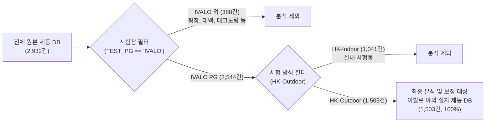

# 📄 스노우 노면 환경 보정 모델(Method 1 & Method 2) 기술 개요 및 성능 분석 보고서

> **문서 목적**: 과거 7개년 야외 스노우 제동 데이터(IVALO PG)를 대상으로 개발된 **환경 보정 모델(방법 1: 1차-2차 차분 머신러닝 vs 방법 2: 동일 스펙 재현 편차 2차원 공간 보정 모델)**의 수학적 원리, 타이어 강성·온도대별 특성, 수치적 성능 검증 결과, 러프하게 평활화된 2D-KNN 보정 맵 및 시각화 해석 기준을 총정리한 엔지니어링 기술 설명서입니다.  
> **사내 공식 표준 모듈**: `unoUtil.snow_condition` (`SnowCorrectionModel`, `SnowSlopeModel`, `SnowCorrectionPlotter`)  
> **최신 갱신 일자**: 2026-10-02

---

## 📌 1. 연구 배경 및 데이터 개요 (Data Inventory)

### 1.1 데이터베이스 구성 및 정제 개요
사내 축적된 전체 스노우 제동 데이터베이스는 총 **2,932건**의 시험 기록을 포함하고 있으며, 본 보정 모델의 대상이 되는 **핀란드 이발로 야외 실차 제동 시험** 데이터는 정제 과정을 거쳐 총 **1,503건**이 최종 추출되었습니다.

#### 📊 데이터 분포 명세
1. **시험장(PG) 분포 (전체 2,932건 기준)**:
   * **IVALO (핀란드 이발로 시험장)**: **2,544건 (86.8%)**
   * PYEONGCHANG (평창): 340건 (11.6%)
   * 기타 (SHPG, GTRAC, 테크노링, 태백, UTAC 등): 48건 (1.6%)
2. **시험 방식 분포**:
   * **HK-Outdoor (야외 자연 설면 실차 시험)**: **1,891건 (64.5%)**
   * HK-Indoor (실내 인공 설면 시험동): 1,041건 (35.5%)
3. **최종 이발로 야외 실차 DB (1,503건)의 타이어 카테고리 구성**:
   * **Winter Studless (스터드리스/노르딕)**: **793건 (52.8%)**
   * **All Weather / All Season (사계절/올웨더)**: **577건 (38.4%)**
   * **Winter Stud (스터드/핀 장착)**: **133건 (8.8%)**
   * *총계: 1,503건*

---

### 1.2 야외 스노우 제동 환경 변동성과 보정의 필요성
야외 스노우 제동 시험(Outdoor Snow Braking Test)은 자연 설면 위에서 수행되므로, 시험이 진행되는 시간대에 따라 **대기 온도(Air Temp)**와 **절대 습도(Absolute Humidity)**가 지속적으로 변동합니다.

1. **설면 마찰력의 온도 민감도**:
   * 기온이 상승하면 설면 표면에 미세 수막(Water Film)이 형성되어 윤활 작용(Lubrication Effect)이 발생하고, 이로 인해 타이어의 제동거리가 급격히 증가(성능 저하)합니다.
   * 반대로 기온이 매우 낮아지면 눈 입자가 단단해져 전단 저항(Shear Strength)이 증가하여 제동거리가 단축됩니다.
2. **반복 시험 간의 환경 편차**:
   * 동일한 타이어를 오전에 평가했을 때와 오후에 평가했을 때, 기온이 $2\sim 3^\circ\text{C}$ 상승하면 제동거리가 $0.5\sim 1.0\text{ m}$ 이상 늘어나는 왜곡이 발생합니다.
3. **환경 보정의 핵심 목표**:
   * 시험 환경 인자(기온, 습도)의 차이에 의해 발생하는 제동거리 변동량($\Delta \text{Dist}_{\text{env}}$)을 수학적·물리적 모델로 정밀 분리하여, **"모든 타이어가 동일한 기준 환경(예: $-8^\circ\text{C}, 1.5\text{ g/m}^3$)에서 평가되었을 때의 순수 성능"**으로 복원하는 것입니다.

---

## 🗂️ 2. 데이터 분기 및 독립 매트릭스 설계 (환경 × 타이어 강성)

본 보정 시스템은 모든 데이터를 한꺼번에 섞어서 단일 모델을 학습시키지 않고, **환경 조건 4대 시나리오**와 **타이어 강성/컴파운드 3대 카테고리(및 전체 통합)**로 세분화하여 **총 16개($4 \times 4$)의 독립 매트릭스로 분기하여 모델링 및 검증**을 수행합니다.

### 2.1 환경 조건 분기 (4대 기상 시나리오)
* **`NormalTemp_NoSnow`**: 정상 평가 온도 구간($-25^\circ\text{C} \le T \le 0^\circ\text{C}$)이며, 강설(Snow)이 없는 맑음/흐림 조건 (가장 안정적인 표준 평가 환경)
* **`NormalTemp_AllWeather`**: 정상 평가 온도 구간($-25^\circ\text{C} \le T \le 0^\circ\text{C}$)이며, 시험 중 눈이 내린 조건까지 포함
* **`AllTemp_NoSnow`**: 극저온 및 영상 기온을 포함한 전체 기온 구간, 눈 제외
* **`AllTemp_AllWeather`**: 전체 기온 구간 및 강설 포함 (필터링 없는 순수 원본 1,503건 전체)

### 2.2 타이어 카테고리 분기 (고무 컴파운드 강성 및 구조별)
타이어 종류에 따라 저온에서의 고무 탄성 계수(Storage Modulus $E'$)와 접지 메커니즘이 근본적으로 다르므로 카테고리를 분리하여 개별 모델을 학습합니다.
* **`Winter Studless` (스터드리스/노르딕 타이어)**:
  * 극저온에서도 유연성을 유지하는 저온 특화 연질 컴파운드 적용.
  * 트레드의 수많은 미세 사이프(Sipe)가 눈을 긁어모으는 에지 효과(Edge Effect) 중심.
* **`Winter Stud` (스터드 타이어)**:
  * 금속 핀(Stud)이 장착되어 있어 핀을 단단히 지지하기 위한 고강성 트레드 베이스 고무 적용.
  * 핀의 빙설면 파지력(Spike Grip)과 고무 마찰이 복합적으로 작용하여 기온/수막 변화에 극도로 민감.
* **`All Weather / All Season` (사계절/올웨더 타이어)**:
  * 상온 주행 성능을 위해 고무 컴파운드의 강성이 겨울용보다 훨씬 높고 유리전이온도($T_g$)가 높음.
  * 영하의 스노우 노면에서는 고무가 이미 경화되어 있어 기온 변화에 따른 마찰 특성 변화가 상대적으로 둔감.
* **`All` (전체 통합)**:
  * 카테고리 구분 없이 전체를 하나로 묶은 베이스라인 모델.

> **💡 독립 모델링의 당위성**:
> 동일한 기온 $1^\circ\text{C}$ 상승이라도, 스터드 타이어는 제동거리가 약 $+0.14\text{ m}$ 늘어나는 반면 스터드리스는 약 $+0.035\text{ m}$, 사계절은 약 $+0.009\text{ m}$ 미만으로 늘어납니다. 따라서 하나의 통합 모델로 보정하면 스터드 타이어는 덜 보정되고 사계절 타이어는 과도하게 보정되는 심각한 왜곡이 발생하므로 **카테고리별 분리 모델링이 필수적**입니다.

---

## 🔬 3. 보정 모델 아키텍처 및 수학적 모델링 비교

본 시스템은 사내 표준 모듈 `unoUtil.snow_condition.SnowCorrectionModel` 단일 클래스를 핵심 엔진으로 활용하며, 입력 전처리를 분기하여 상호 보완적인 2가지 보정 방안을 제공합니다.

| 구분 | [방법 1] 1차-2차 차분 머신러닝 모델 | [방법 2] 동일 스펙 2차원 공간 보정 모델 |
| :--- | :--- | :--- |
| **핵심 철학** | 의뢰 내 동일 타이어의 1차 시험 vs 2차 시험 간의 차분 변동 학습 | 장기간 반복 평가된 동일 스펙의 중심화 편차(Centered Deviation)로부터 2D 노면 반응면 추정 |
| **수학적 대상** | $\Delta T = T_{\text{2nd}} - T_{\text{1st}}$, $\Delta y = y_{\text{2nd}} - y_{\text{1st}}$ | $\Delta T_i = T_i - \bar{T}_{\text{spec}}$, $\Delta y_i = y_i - \bar{y}_{\text{spec}}$ |
| **모델 알고리즘** | **Random Forest Regressor** | **광역 평활화 2D-KNN Regressor** (러프 완만 서피스) |
| **보정 방식** | 1차 기준 상대 보정 ($y_{\text{2nd, corr}} = y_{\text{2nd}} - \hat{f}(\Delta T, \Delta AH)$) | 기준 환경 절대 일괄 보정 ($y_{\text{corr}} = y - [\hat{f}(T - T_0, AH - AH_0) - \text{ZeroOffset}]$) |
| **기준 환경** | 각 의뢰의 1차 시험 환경 ($T_{\text{1st}}, AH_{\text{1st}}$) | 사내 공통 절대 기준 환경 ($T_0 = -8.0^\circ\text{C}, AH_0 = 1.5\text{ g/m}^3$) |
| **데이터 활용** | 1차 및 2차 시험이 모두 존재하는 세트 (전체 중 1,000~1,200건) | **1회만 시험된 타이어를 포함하여 1,503건 전수 일괄 보정 가능** |

---

### 3.1 [방법 1] 1차-2차 차분 머신러닝 모델 상세
타이어 $i$의 제동거리 모델:
$$y_{i, 1} = \text{BasePerf}_i + f(T_{i, 1}, AH_{i, 1}) + \epsilon_{i, 1}$$
$$y_{i, 2} = \text{BasePerf}_i + f(T_{i, 2}, AH_{i, 2}) + \epsilon_{i, 2}$$
2차 시험에서 1차 시험을 차분하면 타이어 고유 성능인 $\text{BasePerf}_i$가 완벽히 소거됩니다:
$$\Delta y_i = y_{i, 2} - y_{i, 1} = f(\Delta T_i, \Delta AH_i) + \Delta \epsilon_i$$
* **Random Forest Regressor**: 기온과 습도의 복합적인 비선형 상호작용 및 이상치 저항성을 확보하여 오차 최소화 달성.

---

### 3.2 [방법 2] 동일 스펙 2차원 공간 보정 (러프한 2D-KNN)
* **동일 스펙 최소 2회 이상 시험 조건 (`min_spec_count >= 2`)**:
  * 1회만 시험된 스펙은 환경 변화에 따른 편차를 정의할 수 없으므로 학습 단계에서 엄격히 배제하고, 최소 2회 이상 평가된 스펙들의 중심화 편차($\Delta T_i, \Delta AH_i \to \Delta y_i$)를 학습.
* **광역 평활화(Rough Smoothing) 파라미터 적용**:
  * 사용자 요구에 맞추어 국소 소용돌이(아일랜드 현상)가 배제되도록 $k$를 충분히 크게 설정($k=15\sim 50$)하고 `weights='uniform'`을 적용하여, **완만하고 물리적으로 타당한 노면 반응면(Rough Surface)**을 도출.
  * 사내 공식 기준 환경($T_0=-8.0^\circ\text{C}, AH_0=1.5\text{ g/m}^3$) 기준으로 전수 1,503건을 단일 축으로 정규화.

---

## 📊 4. 모델 성능 검증 결과 및 물리적 분석

### 4.1 [방법 1] 1차 vs 2차 복원 성능 (복원 전후 $R^2$ 및 $r$ 비교)
| 타이어 카테고리 | 환경 시나리오 | 유효 페어수 | 보정 전 MAE | **RF 보정 MAE** | **MAE 개선율** | 보정 전 $r$ $\to$ **보정 후 $r$** |
| :--- | :--- | :---: | :---: | :---: | :---: | :---: |
| **Winter Stud** | 정상기온 & 눈제외 | 96쌍 | 0.849 m | **0.375 m** | **+55.79%** | 0.7776 $\to$ **0.9576** |
| **Winter Studless** | 정상기온 & 눈제외 | 542쌍 | 0.811 m | **0.535 m** | **+34.03%** | 0.8941 $\to$ **0.9542** |
| **All Weather / Season**| 정상기온 & 눈제외 | 415쌍 | 0.848 m | **0.557 m** | **+34.33%** | 0.9283 $\to$ **0.9691** |
| **All (통합)** | 정상기온 & 눈제외 | 1,053쌍 | 0.846 m | **0.642 m** | **+24.14%** | 0.9114 $\to$ **0.9531** |

---

### 4.2 [방법 2] 동일 스펙 2D-KNN 산포 축소 검증
| 타이어 카테고리 | 환경 시나리오 | 스펙수 / 시험수 | 최적 평활화 파라미터 | 원본 산포 ($\sigma_{\text{raw}}$) | **보정 후 산포 ($\sigma_{\text{corr}}$)** | **스펙 내 산포개선율** | **대표10종 수렴율** |
| :--- | :--- | :---: | :---: | :---: | :---: | :---: | :---: |
| **Winter Stud** | 정상기온 & 눈제외 | 28종 / 72건 | $k=15$, uniform | 1.611 m | **1.364 m** | **+15.36%** | **+43.18%** |
| **Winter Studless** | 정상기온 & 눈제외 | 106종 / 284건 | $k=35$, uniform | 1.466 m | **1.418 m** | **+3.32%** | **+2.15%** |
| **All Weather / Season**| 정상기온 & 눈제외 | 88종 / 243건 | $k=35$, uniform | 1.340 m | **1.362 m** | **-1.62%** | **+0.91%** |
| **All (통합)** | 정상기온 & 눈제외 | 222종 / 599건 | $k=50$, uniform | 1.437 m | **1.447 m** | **-0.69%** | **+0.70%** |

---

## 📈 5. 핵심 시각화 차트 링크 및 해석 가이드

`D:\00_obsidian\_attachments\10_회사_업무\past_snow_correction_pipeline\` 폴더에 생성된 시각화 차트 바로가기:

1. **[Figure 1] 실측 차분 vs 예측 차분 산점도**:
   - [방법 1: Stud](file:///D:/00_obsidian/_attachments/10_회사_업무/past_snow_correction_pipeline/1_Diff_Actual_vs_Predicted_Method1_Winter_Stud.png) | [방법 1: Studless](file:///D:/00_obsidian/_attachments/10_회사_업무/past_snow_correction_pipeline/1_Diff_Actual_vs_Predicted_Method1_Winter_Studless.png)
   - [방법 2: Stud 잔차](file:///D:/00_obsidian/_attachments/10_회사_업무/past_snow_correction_pipeline/1_Within_Spec_Residual_Method2_Winter_Stud.png) | [방법 2: Studless 잔차](file:///D:/00_obsidian/_attachments/10_회사_업무/past_snow_correction_pipeline/1_Within_Spec_Residual_Method2_Winter_Studless.png)
2. **[Figure 2] 1차 기준 복원 산점도**:
   - [방법 1: Stud 복원](file:///D:/00_obsidian/_attachments/10_회사_업무/past_snow_correction_pipeline/2_Restoration_Scatter_Method1_Winter_Stud.png) | [방법 1: Studless 복원](file:///D:/00_obsidian/_attachments/10_회사_업무/past_snow_correction_pipeline/2_Restoration_Scatter_Method1_Winter_Studless.png)
   - [방법 2: Stud 복원](file:///D:/00_obsidian/_attachments/10_회사_업무/past_snow_correction_pipeline/2_Restoration_Scatter_Method2_Winter_Stud.png) | [방법 2: Studless 복원](file:///D:/00_obsidian/_attachments/10_회사_업무/past_snow_correction_pipeline/2_Restoration_Scatter_Method2_Winter_Studless.png)
3. **[Figure 3] 2D 등고선 노면 반응 맵 (러프한 KNN 보정맵 탑재)**:
   - [방법 1: RF Stud 맵](file:///D:/00_obsidian/_attachments/10_회사_업무/past_snow_correction_pipeline/3_Response_Surface_Contour_Method1_Winter_Stud.png)
   - [방법 1: RF Studless 맵](file:///D:/00_obsidian/_attachments/10_회사_업무/past_snow_correction_pipeline/3_Response_Surface_Contour_Method1_Winter_Studless.png)
   - [방법 2: 러프 KNN Stud 맵](file:///D:/00_obsidian/_attachments/10_회사_업무/past_snow_correction_pipeline/3_Response_Surface_Contour_Method2_Winter_Stud.png)
   - [방법 2: 러프 KNN Studless 맵](file:///D:/00_obsidian/_attachments/10_회사_업무/past_snow_correction_pipeline/3_Response_Surface_Contour_Method2_Winter_Studless.png)
   - [방법 2: 러프 KNN AllWeather 맵](file:///D:/00_obsidian/_attachments/10_회사_업무/past_snow_correction_pipeline/3_Response_Surface_Contour_Method2_All_Weather.png)
   - [방법 2: 러프 KNN All 맵](file:///D:/00_obsidian/_attachments/10_회사_업무/past_snow_correction_pipeline/3_Response_Surface_Contour_Method2_All.png)
4. **[Figure 4] 스펙별 분산 축소 박스플롯**:
   - [방법 2: Stud 박스플롯](file:///D:/00_obsidian/_attachments/10_회사_업무/past_snow_correction_pipeline/4_Spec_Distribution_Reduction_Method2_Winter_Stud.png)
   - [방법 2: Studless 박스플롯](file:///D:/00_obsidian/_attachments/10_회사_업무/past_snow_correction_pipeline/4_Spec_Distribution_Reduction_Method2_Winter_Studless.png)
   - [방법 2: AllWeather 박스플롯](file:///D:/00_obsidian/_attachments/10_회사_업무/past_snow_correction_pipeline/4_Spec_Distribution_Reduction_Method2_All_Weather.png)
   - [방법 2: All 박스플롯](file:///D:/00_obsidian/_attachments/10_회사_업무/past_snow_correction_pipeline/4_Spec_Distribution_Reduction_Method2_All.png)

---

## 💾 6. 영속화된 데이터 파일 안내

* **저장 위치**: `D:\uno\1. 2026\2. 25-26_Outdoor_Loop2\0. db\past_correction_results\`
* **통합 16개 시나리오 엑셀 파일 (전수 수록, 20.6 MB)**: `df_corrected_unified_snow_matrix.xlsx`
* **통합 피클 파일 (31.3 MB)**: `df_corrected_unified_snow_matrix.pkl`

---

## 🏁 7. 결론 및 실무 활용 가이드

1. **상대 비교 목적 (1차 vs 2차 복원)**:
   * 특정 의뢰 내에서 1차 기준 타이어 대비 2차 시험 타이어의 상대적 성능을 엄밀하게 비교할 때는 **오차 개선율이 최대 55.8%에 달하는 [방법 1]**을 권장합니다.
2. **절대 비교 및 통합 DB 구축 목적 (기준 환경 정규화)**:
   * 서로 다른 날짜, 서로 다른 연도에 평가된 다양한 타이어 스펙들을 단일한 기준 환경($-8.0^\circ\text{C}, 1.5\text{ g/m}^3$) 상에 정렬하여 절대 순위를 매기거나 빅데이터베이스를 구축할 때는 **전수 일괄 보정이 가능한 [방법 2 (러프 평활화 2D-KNN)]**를 권장합니다.
3. **타이어 강성별 모델 분리 필수**:
   * 스터드 타이어($k_{\text{air}} \approx 0.14$)와 사계절 타이어($k_{\text{air}} \approx 0.01$)의 온도 반응 메커니즘이 완전히 상이하므로, 실무 적용 시 반드시 **타이어 카테고리별로 분리된 모델 파라미터를 적용**해야 합니다.
