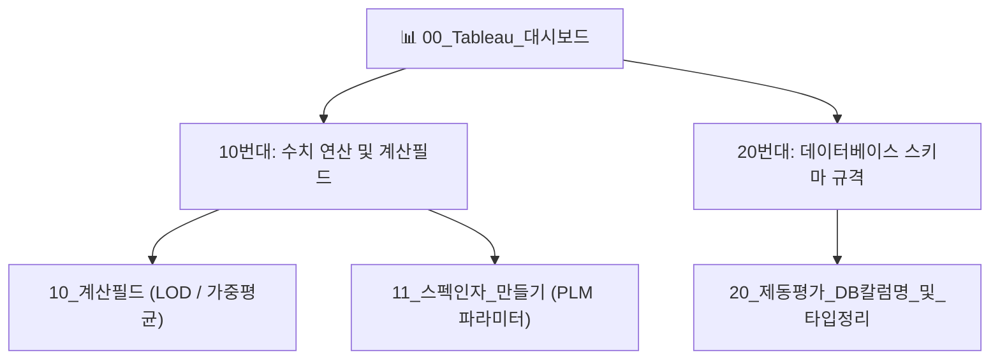

# 📊 00_Tableau 실차 제동 BI 시각화 프로젝트 대시보드

> ⚡ **Quick Jump**: [🏛️ 1. 모듈 구조](#️-1-프로젝트-모듈-구조-10단위-클러스터) · [📂 2. 세부 문서 목록](#-2-세부-문서-목록) · [🔗 3. 상위 프로젝트](#-3-상위-프로젝트-및-연계-리소스)

> [!ABSTRACT] 🎯 프로젝트 개요
> 본 프로젝트는 사내 실차 제동(Dry, Wet, Snow) 계측 평가 데이터베이스와 PLM 타이어 스펙을 결합하여, 엔지니어 및 의사결정권자가 1초 만에 성능 편차와 트렌드를 파악할 수 있는 **표준 Tableau BI 대시보드**를 구축하는 프로젝트입니다.

---

## 🏛️ 1. 프로젝트 모듈 구조 (10단위 클러스터)

---

## 📂 2. 세부 문서 목록

> [!NOTE]- 📐 10번대: 태블로 계산식 및 파라미터 설계 [클릭하여 펼치기]
> | 모듈 / 문서명 | 핵심 기능 및 내용 | 바로가기 |
> | :--- | :--- | :---: |
> | **10_계산필드** | FIXED / INCLUDE / EXCLUDE LOD 표현식, 드라이버별 평가 편차 보정 가중치 수식 | [[10_계산필드|문서 보기]] |
> | **11_스펙인자_만들기** | PLM 타이어 사양(규격, 패턴, 컴파운드, 하중지수) 매핑 및 필터 파라미터 설계 | [[11_스펙인자_만들기|문서 보기]] |

> [!NOTE]- 🗄️ 20번대: 데이터베이스 연동 스키마 [클릭하여 펼치기]
> | 모듈 / 문서명 | 핵심 기능 및 내용 | 바로가기 |
> | :--- | :--- | :---: |
> | **20_제동평가_DB칼럼명_및_타입정리** | 제동거리, 감속도, 노면온도, 외기온도, 풍속 등 3대 노면 평가 필드 명세 | [[20_제동평가_DB칼럼명_및_타입정리|문서 보기]] |

---

## 🔗 3. 상위 프로젝트 및 연계 리소스

* 🎯 **[[00_프로젝트_통합_대시보드|02_Projects 마스터 대시보드]]**
* 🚗 **[[10_실차_평가_데이터_프레임|실차 평가 데이터 프레임 규격서 (04_Resources)]]**
