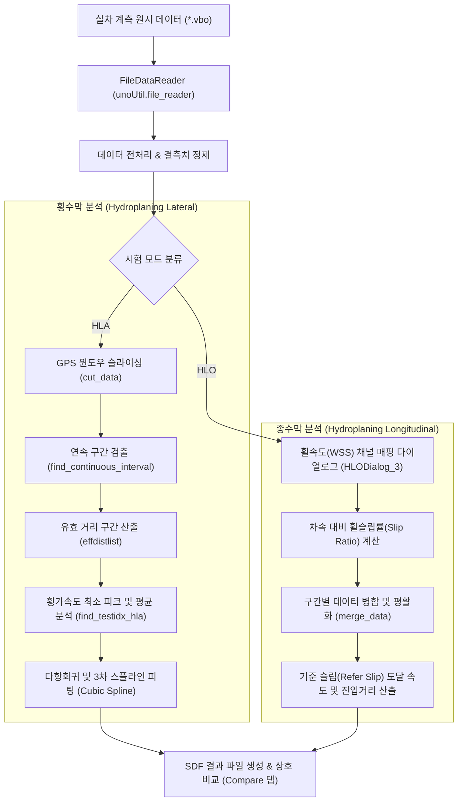

# 🌊 실차 수막현상(Hydroplaning) 시험 데이터 분석 플랫폼 개발 프로젝트 (Master MOC)

> ⚡ **Quick Jump**: [📅 1. 체인지로그](#-1-프로젝트-주요-버전-이력-changelog-타임테이블) · [🏛️ 2. 시스템 아키텍처](#️-2-수막현상-시험-및-시스템-아키텍처) · [🔄 3. unoUtil v2.0 마이그레이션](#-3-unoutil-차세대-표준v20-마이그레이션-매핑) · [📈 4. 핵심 데이터 파이프라인](#-4-핵심-분석-알고리즘-및-데이터-파이프라인) · [✅ 5. 향후 로드맵](#-5-향후-로드맵-및-액션-아이템-action-items)

> [!ABSTRACT] 🚀 수막현상(Hydroplaning) 전문 분석 플랫폼
> 본 프로젝트는 실차 수막현상 시험 데이터(VBOX 계측기 `*.vbo` 원시 데이터 및 `*.sdf` 가공 데이터)를 기반으로 **횡수막(HLA: Hydroplaning Lateral)**과 **종수막(HLO: Hydroplaning Longitudinal)** 거동을 정밀 분석하고, 사내 표준 프레임워크인 **`unoUtil v2.0+`** 12대 공식 도메인과 완벽히 연동되는 PyQt5 기반 통합 GUI 분석 도구입니다.

---

## 📅 1. 프로젝트 주요 버전 이력 (Changelog 타임테이블)

| 버전 | 날짜 | 작업자 | 핵심 수정 및 개발 내역 (Changelog) | 상태 |
| :--- | :---: | :---: | :--- | :---: |
| **v2.0** | 2026-11-12 | uno &<br/>Gemini | 🔄 **사내 최신 표준 프레임워크 `unoUtil v2.0` (12대 공식 도메인) 전면 마이그레이션 상세 기술 전면 전환 및 VBO 비정상 시간 헤더 방어 패치 완결**<br/>• **레거시 의존성 전수 진단 및 신규 API 1:1 매핑 확립**: 구형 함수형 다중파일 로더(`unoUtil.readDataFile.ReadDataFile`)를 차세대 객체지향 `unoUtil.file_reader.FileDataReader`로 전환하고, 구형 신호처리 함수(`unoUtil.unoPostProcessing.SP_*`) 3종을 최신 `unoUtil.signal_process.post_process`(`moving_average`, `merge_data`, `find_continuous_interval`) 공식 표준 API로 1:1 전면 치환하는 마이그레이션 사양 완비<br/>• **`VBOParser` 비정상 시간 헤더(`@ 45:52`) 파싱 크래시 원인 규명**: `hylat/C1.VBO` 계측 파일 헤더의 유효하지 않은 시간 포맷으로 인해 유발되던 `ValueError: hour must be in 0..23` 예외를 규명하고, `datetime.time` 변환 시 안전한 폴백(`try ... except ValueError`)을 적용하는 프레임워크 보강안 도출<br/>• **`Hydroplaning_func.py` 및 `HydroplaningProgram_GUI.py` 4단계 전환 파이프라인 수립**: HLA(Tab 1) 및 HLO(Tab 3)의 계측 파일 배치 로딩 구조 개편 및 9개소 `SP_Merge` 전수 치환 검증 계획 확립 | ✅ 완료 |
| **v1.0** | 2024-12-18 | uno | 🚀 **HydroplaningProgram PyQt5 기반 초기 GUI 분석 도구 구축**<br/>• 횡수막(HLA) 및 종수막(HLO) 시험 데이터 시각화 및 유효 구간 슬라이싱 기능 구현<br/>• SDF 파일 포맷 생성 및 결과 비교(Compare) 탭 탑재 | ✅ 완료 |

---

## 🏛️ 2. 수막현상 시험 및 시스템 아키텍처



### 1. 횡수막 시험 (HLA: Hydroplaning Lateral Acceleration)
* **목적**: 젖은 원선회 노면(수심 5~10mm) 진입 시 원심력과 수막현상으로 인한 횡가속도($G_y$) 저하 및 그립 한계 차속 평가.
* **주요 측정 지표**: 진입 속도($V$), 최대 횡가속도($G_{\text{max}}$), 수막 발생 속도($V_1, V_2$), 포락 면적(Area).

### 2. 종수막 시험 (HLO: Hydroplaning Longitudinal)
* **목적**: 직선 수막 트랙에서 직진 가속 중 구동륜의 수막 부상으로 인한 슬립률 급증($\text{Slip} \ge 10\% \sim 15\%$) 시작 속도 측정.
* **주요 측정 지표**: 기준 슬립률 도달 속도($V_{\text{slip}}$), 4륜 휠스피드 거동, 유효 주행 거리.

---

## 🔄 3. unoUtil 차세대 표준(v2.0) 마이그레이션 매핑

| 구분 | 레거시 구문 (Old unoUtil) | 최신 표준 구문 (unoUtil v2.0) | 세부 변경 내역 |
| :--- | :--- | :--- | :--- |
| **파일 로더** | `from unoUtil.readDataFile import ReadDataFile` | `from unoUtil.file_reader import FileDataReader` | 함수형 튜플 리스트 반환 방식에서 객체지향 `FileDataReader` 인스턴스 배열 방식으로 전환 (`reader.file_name`, `reader.data` 직접 참조) |
| **이동평균** | `from unoUtil.unoPostProcessing import SP_MovingAverage` | `from unoUtil.signal_process.post_process import moving_average` | `moving_average(data, window=..., plot=False)`로 표준화 (Zero-phase filtfilt 기반) |
| **연속구간** | `from unoUtil.unoPostProcessing import SP_FindContinue` | `from unoUtil.signal_process.post_process import find_continuous_interval` | `find_continuous_interval(cutdata, clv=1, clen=100)`으로 함수명 표준화 (시리즈 리스트 반환 동일) |
| **데이터병합** | `from unoUtil.unoPostProcessing import SP_Merge` | `from unoUtil.signal_process.post_process import merge_data` | `merge_data(select_df, window=20, plot=False)`로 함수명 표준화 (2차원 데이터 양방향 이동평균) |

---

## 📈 4. 핵심 분석 알고리즘 및 데이터 파이프라인

### 1. FileDataReader 배치 로딩 패턴
기존 `ReadDataFile`의 `[[file_name, df], ...]` 튜플 의존성을 `FileDataReader` 인스턴스 순회 구조로 현대화합니다:
```python
readers = [
    FileDataReader(
        p,
        chname=True,
        date=True,
        unit=False,
        delch=True,
        headendline=300,
        reftime={'Time': 9},
        verbose=False
    )
    for p in self.fpath
]
for reader in readers:
    file_name = reader.file_name
    df = reader.data.copy()
    # 전처리 및 슬라이싱 파이프라인 수행
```

### 2. VBOParser 비정상 시간 헤더 방어 조치
* **취약점**: VBOX 계측 파일 헤더에 비정상적인 시간(`@ 45:52`)이 적혀있을 때 `datetime.time`에서 `ValueError: hour must be in 0..23`가 발생하여 로드가 실패하던 문제.
* **해결책**: `unoUtil/file_reader/parsers/vbo_parser.py` 내부 `_extract_save_date` 메서드에서 시간 변환을 `try ... except ValueError`로 감싸 파싱 실패 시 `datetime.time(0, 0)`으로 안전하게 폴백되도록 방어 로직 강화.

---

## ✅ 5. 향후 로드맵 및 액션 아이템 (Action Items)

- [x] **[마이그레이션]** `Hydroplaning_func.py` 내 `SP_MovingAverage` ➔ `moving_average` 치환
- [x] **[마이그레이션]** `HydroplaningProgram_GUI.py` 내 상단 import 및 `ReadDataFile` ➔ `FileDataReader` 배치 로더 전면 전환
- [x] **[마이그레이션]** GUI 내부 9개소 `SP_Merge` ➔ `merge_data` 표준 치환
- [x] **[안정성 보강]** `unoUtil.file_reader.parsers.vbo_parser` 비정상 시간 헤더 방어 패치 적용
- [x] **[통합 검증]** `Long/*.VBO` 및 `hylat/*.VBO` 실측 데이터를 활용한 GUI 전 기능(HLA, HLO, Compare) 통합 테스트
