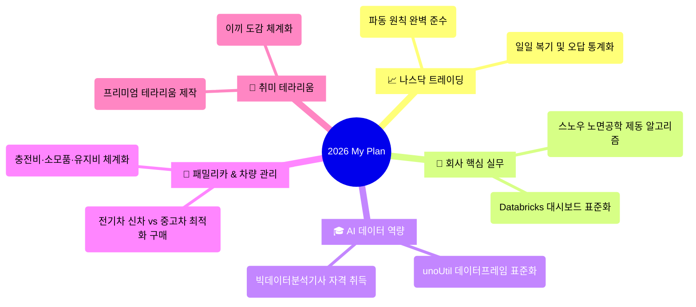

# 🎯 2026 연간 목표 & 성장 마스터플랜 (My Plan)

> [!ABSTRACT] 🌌 Be self-disciplined (스스로를 통제하는 삶)
> 본 마스터플랜은 **나스닥 트레이딩, 회사 핵심 실무, AI/데이터 역량 강화, 차량 관리 및 힐링 취미(테라리움)**를 아우르는 **2026년 삶의 성장 및 자산 관리 통합 로드맵**입니다.  
> 단순한 소망 기록을 넘어 실제 볼트 내 프로젝트(`02_Projects`) 및 지속 관리 영역(`03_Areas`)과 유기적으로 연동되어 작동합니다.

---

## 📅 2026년 인생 성장의 5대 핵심 축 (Five Pillars)

---

## 📈 1. 나스닥 트레이딩 (Nasdaq Futures Trading)
* **비전**: 시장의 변칙 무빙 속에서도 흔들리지 않는 **심리 제어와 손익비 중심의 원칙 매매 체화**.
* **핵심 이정표 (Milestones)**:
  * [x] **1분기**: 나스닥 과거 차트 15선 전수 분석 및 데이터베이스 구축 완료.
  * [ ] **2분기**: [[04_Resources/40_엘리어트_파동/00_엘리어트_파동_통합_색인|엘리어트 파동 이론]] 하위 1m/5m 세부 카운팅 훈련 및 승률 70% 이상 주무기 셋업 3종 확립.
  * [ ] **상시**: 일일 100% 매매 기록 및 원칙 위반 시 **[[11_파동_매매원칙_오답노트|파동 매매원칙 및 오답노트]]**에 오류 유형 기록 통계화.
* **실시간 연계 허브 (Dashboard)**:
  * 📊 **[[03_Areas/트레이딩/00_트레이딩_통계_대시보드|트레이딩 실시간 누적 통계 대시보드]]**

---

## 💼 2. 회사 핵심 실무 및 프로젝트 (Career & Snow Engineering)
* **비전**: 실차 평가 데이터 처리 표준화와 노면 공학 제동 모델 고도화로 **팀 내 독보적인 데이터 분석 전문가 입지 선점**.
* **핵심 이정표 (Milestones)**:
  * [x] **1분기**: 전사 3대 제동 시험 통합 스키마 Databricks DB 테이블 수립 및 컬럼 표준 가이드라인 정비.
  * [ ] **2분기**: **[[00_2025_Snow_기반기술_대시보드|2025 Snow 기반기술]]** 연교차 노면 정량화 알고리즘 검증 및 학회 논문 리서치 완성.
  * [ ] **3분기**: **[[00_2026_Snow_Surface_Characteristics_대시보드|2026 Snow Surface Characteristics]]** 실시간 센서 수집 인프라 구축 및 가속/제동 데이터 전처리 모듈 자동화.
* **실시간 연계 허브 (Dashboard)**:
  * ❄️ **[[02_Projects/00_프로젝트_통합_대시보드|회사 업무 & 프로젝트 통합 대시보드]]**

---

## 🎓 3. AI 데이터 분석 자격증 및 역량 (Self-Development & AI)
* **비전**: 현업 빅데이터 분석 능력의 공인 증명과 **Python 모듈화 설계 역량의 극대화**.
* **핵심 이정표 (Milestones)**:
  * [x] **1분기**: 빅데이터분석기사 필기 4개 과목 총 44개 핵심 이론 노트를 영구 위키로 이관 완료.
  * [ ] **2분기**: **[[03_Areas/자기개발/10_AI_데이터분석_역량강화/00_빅데이터분석기사_자격취득_대시보드|빅데이터분석기사 필기 시험 합격]]** 및 실기(Python 모델링) 기출문제 전수 실습 개시.
  * [ ] **3분기**: 공용 라이브러리인 `unoUtil` 모듈화 설계 고도화 (메모리 사용량 50% 절감 목표).
* **실시간 연계 허브 (Dashboard)**:
  * 🎓 **[[03_Areas/자기개발/00_자기개발_대시보드|자기개발 및 역량강화 통합 대시보드]]**
  * 📚 **[[03_Areas/자기개발/10_AI_데이터분석_역량강화/00_빅데이터분석기사_자격취득_대시보드|빅데이터분석기사 자격취득 관리 대시보드]]**

---

## 🚗 4. 패밀리카 & 차량 관리 (Mobility & Family Car)
* **비전**: 3자녀 다자녀 가구 및 내연차 전환 혜택을 극대화하여 **가장 합리적이고 경제적인 전기 패밀리카 선택 및 라이프사이클 관리**.
* **핵심 이정표 (Milestones)**:
  * [x] **분석 완료**: EV3, EV5, EV9, Model Y L 인기 옵션 기준 신차 vs 중고차 실구매가 정밀 비교 분석 완료.
  * [ ] **구매 결정**: 예산 및 다자녀 실내 공간(6인승 독립시트 vs 5인승 가성비)에 따른 최적 모델 계약 및 출고.
  * [ ] **차계부 체계화**: 전기차 충전비, 지자체/다자녀 혜택 정산, 소모품 교체 주기 트래킹.
* **실시간 연계 허브 (Dashboard)**:
  * 🚗 **[[03_Areas/차량_관리/00_차량관리_통합_대시보드|차량관리 통합 대시보드]]**
  * 📊 **[[03_Areas/차량_관리/10_전기차_신차_vs_중고차_가격비교_분석|전기차 신차 vs 중고차 가격비교 및 구매의사결정 분석]]**

---

## 🌿 5. 힐링 및 취미 생활 (Hobbies & Terrarium)
* **비전**: 복잡한 모니터 화면(HTS, 코딩)에서 벗어나 **자연의 프랙탈 생태를 가꾸며 뇌에 온전한 휴식을 선물**.
* **핵심 이정표 (Milestones)**:
  * [x] **1분기**: 이끼 도감 9종의 생태 특성 및 수분/광량 육성 노하우 DB 구축 완료.
  * [ ] **2분기**: 비단이끼, 깃털이끼, 제주애기모람을 활용한 고난도 프리미엄 레이아웃 테라리움 2구 제작 및 장기 배양 테스트.
* **실시간 연계 허브 (Dashboard)**:
  * 🪴 **[[10_이끼_도감_및_관리_가이드|이끼 도감 및 테라리움 관리 마스터 가이드]]**

---

## 🗓️ 월간 핵심 일정 캘린더 (Embedded Simple Calendar)
> *자기 통제와 일관성 있는 삶의 기록을 실시간으로 유지합니다.*

<iframe src="https://widgetbox.app/embed/calendar/simple/MUuBuZbFaEJy4JJEEKZZnY?flag=true" width="100%" height="420" frameborder="0" style="border:0; border-radius: 8px; background: transparent;"></iframe>
