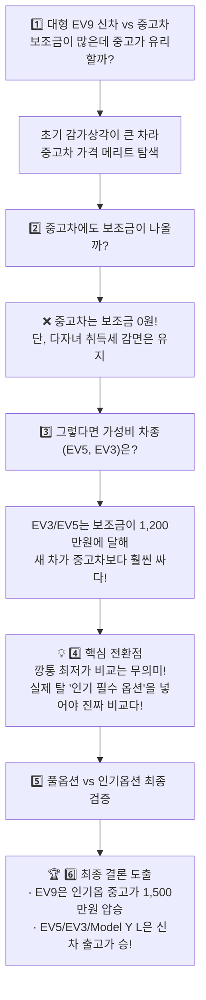

# 🚗 전기차 신차 vs 중고차 가격비교 및 구매 의사결정 분석

> ⚡ **Quick Jump**: [🎯 1. 구매 전제 조건](#-1-나의-구매-전제-조건-충남-태안군-기준) · [🧠 2. 고민과 생각의 흐름](#-2-나의-고민과-생각의-흐름-decision-journey) · [📊 3. 인기옵션 종합비교표](#-3-인기-옵션-반영-신차-vs-중고차-종합-비교표) · [🔍 4. 차종별 정밀 분석](#-4-차종별-정밀-분석-및-최종-판정) · [🏆 5. 최종 의사결정 로드맵](#-5-최종-의사결정-가이드-및-추천-시나리오) · [📋 6. 액션 플랜](#-6-향후-실행-액션-플랜-action-items)

> [!ABSTRACT] 💡 핵심 요약 (Executive Summary)
> 충남 태안군 거주, **3자녀 다자녀 가구(+200만 원)**, **3년 이상 보유 내연기관차 전환(+100만 원)**이라는 강력한 수혜 조건을 바탕으로 기아 EV 시리즈(EV3, EV5, EV9)와 테슬라 Model Y L(6인승)의 **'실제 선호/인기 필수 옵션'** 기준 신차 실구매가와 중고차 시세를 정밀 비교하였습니다.  
> * **EV3 / EV5**: 출고가 대비 보조금(-1,100만~1,200만 원) 비중이 워낙 커 **신차가 중고차보다 200만~550만 원 더 저렴 (신차 압승)**
> * **EV9**: 신차 출고가가 높아 초기 프리미엄 감가(1,500만~2,000만 원)가 보조금 할인(850만 원)을 압도하므로 **상태 좋은 중고차(1~2만km)가 1,300만~1,700만 원 저렴 (중고차 압승)**
> * **Model Y L**: 단일 트림 특성상 **신차 실구매가(6,719만 원)가 중고 시세와 비등 (신차 추천)**

---

## 🎯 1. 나의 구매 전제 조건 (충남 태안군 기준)

| 구분 | 적용 조건 및 상세 내용 | 지원 및 감면 금액 |
| :--- | :--- | :---: |
| **거주지** | 충청남도 태안군 (지자체 보조금 혜택) | 국비 + 지자체 기본 보조금 차등 지급 |
| **다자녀 혜택** | 3자녀 이상 다자녀 가구 전기차 추가 지원금 | **+200만 원 (현금성 지원)** |
| **내연차 전환** | 3년 이상 보유 내연기관차 폐차/매각 후 전기차 전환 | **+100만 원 (현금성 지원)** |
| **취득세 감면** | 6인승 이상 승용차: 최대 200만 원 한도 감면 (초과 시 85% 감면)<br>5인승 이하 승용차: 최대 140만 원 감면 | 신차 및 중고차 등록 시 **동일 적용** |

> [!WARNING] ⚠️ 중고차 구매 시 보조금 주의사항
> * **구매 보조금(국비 + 지자체 + 다자녀 200만 + 내연차 전환 100만)**은 **오직 신차 최초 등록 시에만 지급**되며, 중고차 구매 시에는 **0원(전액 미지급)**입니다.
> * 단, **취득세 다자녀 감면**은 중고차 과세표준 기준 등록 시에도 동일하게 적용받을 수 있습니다.

---

## 🧠 2. 나의 고민과 생각의 흐름 (Decision Journey)

내가 어떤 단계로 생각을 발전시켜 왔고, 각 단계에서 무엇을 깨달았는지에 대한 사고 과정입니다:



### ① 첫 번째 질문: "EV9 신차와 중고차를 비교하면?"
* **나의 생각**: 3자녀 혜택(+200만)과 내연차 전환(+100만)까지 합쳐 850만 원 가까이 깎아주는데, 신차를 사는 게 무조건 남는 장사 아닐까?
* **발견한 점**: EV9은 출시 초기 8,000만 원에 육박했던 대형 플래그십이라 중고차 시장에서 감가가 1,500만~2,000만 원 이상 크게 떨어져 있었습니다. 보조금을 받는 신차보다 감가된 중고차가 더 쌀 수도 있다는 가능성을 포착했습니다.

### ② 두 번째 질문: "중고차 구매 시에도 보조금 혜택이 있을까?"
* **나의 생각**: 혹시 중고차를 사더라도 다자녀 200만 원이나 전환 지원금 100만 원을 챙길 수 있을까?
* **팩트 확인**: **중고차 구매 시 보조금은 일체 0원**입니다. 다자녀 200만 원과 전환 100만 원도 신차 등록 시에만 주어지는 현금성 혜택입니다. 따라서 중고차를 사면 300만 원의 추가 현금 할인을 포기해야 합니다. (단, 취득세 감면은 중고차도 적용됨)

### ③ 세 번째 질문: "차급을 낮춰 EV5나 EV3는 어떨까?"
* **나의 생각**: 굳이 7~8천만 원대 EV9이 아니라 실속 있는 EV5나 EV3로 가면 어떨까?
* **발견한 점**: EV3와 EV5는 보조금 우대 구간이라 **총 혜택이 무려 1,100만~1,200만 원**에 달했습니다. 이 경우 신차 실구매가가 2,800만~3,400만 원대로 떨어지며, **중고차 시세(3,500만~4,200만 원)보다 신차가 400만~700만 원 더 저렴해지는 기현상**이 발생함을 확인했습니다.

### ④ 네 번째 질문: "깡통 최저가 비교는 현실성이 없다! 옵션을 반영해야지" (핵심 전환점 💡)
* **나의 날카로운 지적**: 카탈로그의 최저 시작가(깡통 트림)로 비교하는 건 아무 의미가 없습니다. 실제 다자녀 패밀리카로 운행하려면 주행 보조(드라이브 와이즈), HUD, 편의 시트 등 필수 옵션이 들어가야 합니다.
* **재분석 결과**:
  * 옵션을 넣으면 신차 출고가가 올라가지만,
  * **EV9**은 옵션이 많을수록 중고차 감가 폭이 훨씬 더 커져서 **중고차의 가격 우위가 1,300만~1,700만 원으로 더 극대화**되었습니다!
  * 반면 **EV5/EV3**는 인기 옵션을 넣어도 보조금 상쇄액이 워낙 커서 **여전히 신차가 중고보다 저렴**했습니다.

---

## 📊 3. 인기 옵션 반영 신차 vs 중고차 종합 비교표

> *국내 시장에서 가장 선호도가 높은 **인기 트림 + 필수 패키지(드라이브 와이즈 / HUD / 빌트인캠 등)** 적용 기준*  
> *(충남 태안군 / 3자녀 +200만 원 / 내연차 전환 +100만 원 일괄 적용)*

| 차종 | 승차정원 / 체급 | 실제 적용된 인기 옵션 구성 | 인기옵 신차 출고가 | 신차 혜택 합계 | 신차 최종 실구매가 | 동일 인기옵 중고 시세 | 최종 실구매가 판정 |
| :--- | :---: | :--- | :---: | :---: | :---: | :---: | :---: |
| **기아 EV9** | 6인승 / 대형 | 6인승 2WD 어스<br>+ 스타일 / 빌트인캠2 | 약 7,600만 원 | **-약 850만 원** | **약 6,750만 원** | **약 5,000만~5,400만 원** | 🏆 **중고차 압승**<br>(중고가 **1,300만~1,700만 원** 저렴) |
| **테슬라 Model Y L** | 6인승 / 준대형 | 6인승 롱바디 AWD<br>(단일 트림, 기본 사양 포함) | 7,299만 원 | **-약 580만 원** | **약 6,719만 원** | **약 6,700만~7,000만 원** | 🥇 **신차 승/비등**<br>(보조금 받아 신차 출고 유리) |
| **기아 EV5** | 5인승 / 준중형 | 롱레인지 어스<br>+ 드라이브 와이즈 / HUD | 약 5,150만 원 | **-약 1,100만 원** | **약 4,050만 원** | **약 4,000만~4,250만 원** | 🥇 **신차 승**<br>(신차가 비등하거나 **100~200만 원** 저렴) |
| **기아 EV3** | 5인승 / 소형 | 롱레인지 어스<br>+ 드라이브 와이즈 / HUD | 약 4,600만 원 | **-약 1,200만 원** | **약 3,400만 원** | **약 3,700만~3,950만 원** | 🥇 **신차 압승**<br>(신차가 **300만~550만 원** 저렴) |

---

## 🔍 4. 차종별 정밀 분석 및 최종 판정

### 1) 기아 EV9 (6인승 어스): 🏆 중고차 압도적 유리
* **가격 분석**:
  * 신차 출고가(약 7,600만 원)에서 보조금 850만 원을 챙겨도 실구매가는 **6,750만 원**입니다. (4WD 사륜 선택 시 7,450만 원까지 상승)
  * 하지만 중고차 시장에서는 1~2년 차/2만km 내외 무사고 매물이 **5,000만~5,400만 원**(4WD 풀옵션도 5,800만~6,300만 원)에 형성되어 있습니다.
* **중고차 추천 이유**:
  * **감가액(2,000만 원 이상)이 내가 포기하는 보조금(850만 원)보다 2배 이상 큽니다.**
  * 출시된 지 얼마 되지 않아 기아 배터리 보증(10년/20만km), 차체 보증(5년/10만km)이 3~4년 이상 넉넉하게 잔여 승계됩니다.
  * 중고차 등록 시에도 **다자녀 취득세 감면(최대 200만 원 한도)**을 신차와 똑같이 받습니다.

### 2) 테슬라 Model Y L (6인승 롱바디 AWD): 🥇 신차 구매 추천
* **가격 분석**:
  * 복잡한 옵션 트림 없이 7,299만 원 단일 트림으로 구성되어 신차 실구매가는 **6,719만 원**입니다.
  * 중고차 시세 역시 6,700만~7,000만 원 선으로 방어되고 있어 신차와 중고 가격 차이가 거의 없습니다.
* **판정**: 남이 타던 중고차를 살 이유가 전혀 없으며, 보조금을 받아 완전히 새로운 배터리 상태로 출고하는 것이 최선입니다.

### 3) 기아 EV5 (5인승 롱레인지 어스): 🥇 신차 구매 추천
* **가격 분석**:
  * 드라이브 와이즈와 HUD를 포함한 인기 출고가 약 5,150만 원에서 **보조금/다자녀/전환 혜택(-1,100만 원)**이 빠져 실구매가는 **4,050만 원**입니다.
  * 동급 최신 인증 중고차 매물 시세는 4,000만~4,250만 원 선입니다.
* **판정**: 신차가 중고차보다 오히려 100만~200만 원가량 더 싸므로 무조건 신차 출고가 이득입니다. 3,000만 원대 후반~4,000만 원 극초반에 준중형 순수 패밀리 전기 SUV를 탈 수 있는 최고의 가성비입니다.

### 4) 기아 EV3 (5인승 롱레인지 어스): 🥇 신차 압승 (단, 패밀리카 크기 검토 필요)
* **가격 분석**:
  * 인기 옵션을 모두 채워 넣어도 신차 실구매가는 **3,400만 원** 수준입니다. (중고차는 3,700만~3,950만 원)
  * 신차가 중고보다 무려 300만~550만 원 더 저렴합니다.
* **패밀리카 관점 유의점**: 1회 충전 주행거리 501km와 극강의 가격 메리트를 갖췄지만, **소형 SUV 체급 특성상 3자녀(특히 초등학생 이상 또는 카시트 3개 동시 설치)를 태우기에는 2열 좌우 공간이 타이트**할 수 있습니다.

---

## 🏆 5. 최종 의사결정 가이드 및 추천 시나리오

내 상황(충남 태안, 3자녀, 내연차 전환)에서 가장 만족도가 높을 3가지 선택지입니다:

```text
┌────────────────────────────────────────────────────────────────────────┐
│                        🏆 최종 구매 의사결정 트리                       │
└────────────────────────────────────────────────────────────────────────┘
                                 │
                 ┌───────────────┴───────────────┐
                 ▼                               ▼
       [공간 & 다자녀 쾌적성 최우선]              [합리적 예산 & 가성비 최우선]
                 │                               │
        ┌────────┴────────┐                      │
        ▼                 ▼                      ▼
  [EV9 인기옵 중고]   [Model Y L 신차]       [EV5 롱레인지 신차]
  · 실구매: 5,000만원대 · 실구매: 6,719만원      · 실구매: 4,050만원
  · 6인승 캡틴 독립시트 · 테슬라 FSD/SW        · 실내 완전 평탄화
  · 1,500만원 감가 혜택 · 신차 출고 메리트       · 보조금 1,100만원 극대화
```

### 🥇 시나리오 A: 공간 및 다자녀 쾌적성 중심 ➡️ **기아 EV9 (6인승 어스 중고)** ⭐ 강력 추천
* **추천 사양**: 6인승 2WD 또는 4WD 어스 (드라이브 와이즈, 스타일, 빌트인캠2 장착 매물)
* **소요 예산**: **약 5,000만~5,600만 원**
* **결정적 이유**:
  * 3자녀가 2열(독립 캡틴 시트)과 3열로 나뉘어 타므로 카시트 간섭 없이 최고의 장거리 승차감을 제공합니다.
  * 신차로 사려면 7,000만 원 중후반을 줘야 하지만, **상태 좋은 1~2만km 중고를 5,000만 원 초중반에 구입하여 1,500만 원 이상의 현금을 아끼는 것**이 경제적으로 가장 지혜로운 선택입니다.

### 🥈 시나리오 B: 합리적 예산 중심 ➡️ **기아 EV5 롱레인지 (신차)** ⭐ 가성비 1순위
* **추천 사양**: 롱레인지 어스 (드라이브 와이즈, HUD 패키지)
* **소요 예산**: **약 3,900만~4,100만 원**
* **결정적 이유**:
  * 4,000만 원 안팎의 예산으로 최신 E-GMP 플랫폼 전기 SUV 신차를 완벽하게 소유할 수 있습니다.
  * 2열 다이브 완전 평탄화 시트로 실내 공간감이 매우 우수하며, 중고차보다 신차가 명확히 저렴합니다.

### 🥉 시나리오 C: 테슬라 소프트웨어 & 감성 ➡️ **테슬라 Model Y L 6인승 (신차)**
* **소요 예산**: **약 6,719만 원**
* **결정적 이유**:
  * 테슬라의 6인승 롱바디 독립시트와 독보적인 오토파일럿/OTA 편의성을 선호할 때 최고의 선택지입니다.

---

## 📋 6. 향후 실행 액션 플랜 (Action Items)

- [ ] **[지자체 확인]** 충남 태안군 환경과 전기차 보조금(다자녀/전환 지원금 포함) 잔여 대수 및 하반기 추경 예산 확인
- [ ] **[중고차 탐색]** 헤이딜러 / 엔카 / 기아 인증중고차에서 **'EV9 6인승 어스 (무사고, 2만km 미만, 5,000만~5,400만 원)'** 키워드 알림 등록
- [ ] **[공간 실측]** 기아 대리점에 방문하여 EV5 2열과 EV9 2열/3열에 3자녀 카시트 배치 실물 확인
- [ ] **[내연차 서류 준비]** 기존 3년 이상 보유 내연기관 차량 등록원부 및 말소/매각 지원 요건 사전 점검
- [ ] **[최종 계약]** 예산 및 공간 체감 후 EV9 중고 매물 선별 또는 EV5 신차 계약 진행
