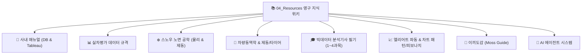

# 📚 04_Resources 지식 위키 통합 색인 (MOC)

> [!ABSTRACT] 🏛️ 영구 지식 저장소 (Permanent Knowledge Base)
> 본 저장소는 사내 연구 매뉴얼, 차량동역학 및 타이어 공학, 스노우 노면 물리, 트레이딩 이론, 빅데이터 분석기사 이론, 이끼도감 등을 체계적으로 영구 보존하는 올인원 지식 위키 허브입니다.  
> *(참고: 사내 프로젝트는 [[02_Projects/00_프로젝트_통합_대시보드|02_Projects]], 지속 관리 영역은 [[03_Areas/|03_Areas]]에서 관리됩니다.)*

---

## 🏢 1. 사내 매뉴얼 & 데이터베이스 포털
* 📘 **[[10_회사_DB_사용_매뉴얼|회사 DB 사용 관련 매뉴얼 (마스터 포털)]]**
  * 사내 Insight Portal, Tableau Desktop, Databricks 및 PLM 데이터 연동 마스터 가이드
* 📊 **[[20_회사_Tableau_사용_매뉴얼|Tableau 연동 및 데이터베이스 접근 가이드 (스크린샷 수록)]]**
* 💼 **관련 업무 프로젝트**:
  * [[20_제동평가_DB칼럼명_및_타입정리|제동평가(Dry, Wet, Snow) DB 칼럼명 및 타입 정리]]
  * [[10_계산필드|Tableau 고급 계산필드 (LOD, 드라이버 가중치)]]
  * [[11_스펙인자_만들기|스펙인자 생성 PLM 조인 SQL 쿼리]]

---

## 📊 2. 실차평가 데이터 규격 및 스키마
* 💼 **[[10_실차_평가_데이터_프레임|실차 평가 데이터 프레임 마스터 규격]]**
  * [[04_Resources/11_회사_실차평가_데이터프레임/10_실차_평가_데이터_프레임#Test Item 코드표|1) TestItem 코드표 (dab, wab, hys 등 21종 코드 정의)]]
  * [[04_Resources/11_회사_실차평가_데이터프레임/10_실차_평가_데이터_프레임#개별 평가결과에 대한 DataFrame Columns|2) 개별 평가아이템 결과 프레임 (속도, 정지거리, 온도, 풍속 등 11개 컬럼)]]
  * [[04_Resources/11_회사_실차평가_데이터프레임/10_실차_평가_데이터_프레임#최종적인 평가결과에 대한 DataFrame Columns|3) 전체 평가결과 통합 프레임 (THint 연동 스펙)]]
* 🛰️ **[[20_VBOX_계측_데이터_규격_및_GPS좌표계|VBOX 계측 데이터 규격 및 GPS 좌표계 공학 지식]]**
  * VBO(텍스트, 음수 경도) vs VBB(바이너리, 정규 부호) 구조 및 1샘플 헤더 지연 정합
  * 절대값(`abs()`) 취득 방어 및 미국 서경/남반구 남위 스마트 사분면 자동 판별식
  * GPS 원자시계 vs UTC 윤초(-18초) 물리 규격 및 VBOX 펌웨어 오프셋 보정 규격
  * 스마트 거울상 사분면(Mirror Longitude Safe Fallback) 2단계 타임존 안전 식별 알고리즘
  * WGS84 타원체 측지학 벡터화 엔진 (Haversine 대비 5배 고속 및 2.24m 정밀 보정)
* 💾 **[[21_바이너리_파일_IO_및_VBB_데이터_포맷_구조|실차 계측 바이너리 파일 I/O 아키텍처 및 VBB 포맷 심층 분석]]**
  * 텍스트 대비 바이너리 스트리밍 우위 (용량 60% 절감, DMA Zero-Copy, CPU 부하 제거)
  * 컴퓨터 구조 엔디안(Big-Endian vs Little-Endian)과 바이트 패킹/스케일 팩터 연산
  * Racelogic VBB 자가 서술형 레코드 아키텍처(0x05~0x09) 및 샘플 패킷 슬라이스 해부
  * 실차 전원 급차단(Power-cut) 방어적 I/O 설계 및 NumPy 벡터 슬라이싱 초고속 파싱
* 🌐 **[[22_GPS_좌표_기반_타임존_자동_판별_및_시계열_합성_이론|GPS 좌표 기반 타임존 자동 판별 및 시계열 합성 이론]]**
  * GPS UTC 시간과 실차 평가 현장 로컬 타임(Local Time) 격차 자동 극복
  * 글로벌 주요 시험장(한국 테크노링/남양, 핀란드 이발로, 스페인 IDIADA, 독일 ATP) 바운딩 박스
  * Python `zoneinfo` 기반 기준 일자별 동적 서머타임(DST) 오프셋 자동 연산
  * 일자/시각 2단계 분리 판정(2-Stage Resolution) 및 Pandas C-엔진 고속 시계열 생성 (10만 행 3.03ms)
  * `FileDataReader` 1줄 황금 기본값 (`chname=True, date='auto', verbose=True/print=True`) 완전 무인화 체계
* 🛰️ **[[23_이종_계측_데이터_통합_파이프라인_및_대규모_마이그레이션_엔지니어링|이종 계측 데이터 통합 파이프라인 및 대규모 마이그레이션 엔지니어링]]**
  * VBO, VBB, Dewesoft(D7D), TXT/CSV 이종 포맷 물리적 정합 및 `merge_asof` 비동기 결합
  * 전략 패턴(Strategy Pattern) 및 플루언트 API(Fluent API) 기반 차세대 `FileDataReader`
  * `to_legacy_tuple()` 어댑터 패턴 기반 0-Downtime 무손실 하위 호환성 보장
  * 전사 24개 모듈(코어, 2025_Autobuild, Snow, MakeBRKResult) 전면 전환 및 패키지 물리 분리
* 🧭 **[[24_파이썬_로깅_엔진_원리와_실시간_성능_프로파일링_설계|파이썬 로깅 엔진 원리와 실시간 성능 프로파일링 설계]]**
  * 대용량 차량 시험 데이터 분석을 위한 단순 `print` 탈피 및 `LogRecord` 라이프사이클 해부
  * `record.created` 기반 시간차(`delta`, `elapsed`) 실시간 프로파일링 및 `measure()` 컨텍스트 매니저
  * Logger vs Handler 2단계 게이트 필터링 원리 및 `self.format(record)` 포매터 위임 체인
  * Windows 콘솔(`cp949`) 4바이트 유니코드 이모지 출력 시 `UnicodeEncodeError` 원천 방어 (`errors='replace'`)
  * `VT_ACCBRK` 및 `Snow_braking_relate_condition` 패키지 계층형 로거 네임스페이스(`root_name`) 표준화

---

## ❄️ 3. 스노우 노면 공학 (Snow Surface Engineering)
> 🧭 **전용 MOC**: **[[04_Resources/30_스노우_노면_공학/00_스노우_노면_공학_통합_색인|스노우 노면 공학 지식 통합 색인]]**

* 📐 **[[30_Snow_제동성능보정_알고리즘|Snow 제동성능보정 알고리즘]]**: 온도/습도/설질 기반 제동거리($D_{corr}$) 보정 수식
* ❄️ **[[31_스노우_노면_디지털트윈_및_제동성능_보정_위키|스노우 노면 디지털 트윈 및 제동 성능 환경 보정 종합 위키]]**: 1-Run 집계, 시공간 2단계 보간 및 차분 ML 노면 Decoupling
* 🔬 **[[11_설질변화_유형_및_변형기작|설질변화 유형 및 변형기작]]**: 신설/건설/습설/빙판 상전이 및 점성 소성 전단 파괴
* ❄️ **[[10_눈_결정_형성과정_및_물리특성|눈 결정 형성과정 및 물리특성]]**: 나카야 우키치로 다이어그램 및 소결(Sintering) 현상
* ⚖️ **[[20_눈_밀도_추정_방법론|눈 밀도 추정 방법론]]**: 원통형 코어 샘플링 및 Rammsonde 관입 저항 분석
* 📚 **[[90_스노우_선행연구_논문_리뷰|스노우 선행연구 논문 리뷰]]**: Klein-Paste, Mellor 등 결빙 노면 제동 메커니즘
* 💼 **실무 프로젝트 연계**: [[00_2025_Snow_기반기술_대시보드|2025 Snow 기반기술]] | [[00_2026_Snow_Surface_Characteristics_대시보드|2026 Snow Surface Characteristics]]

---

## 🚗 4. 차량동역학 (Vehicle Dynamics) & 제동 / 타이어
* 📐 **[[10_차량동역학_측정점_기준점_운동역학_변환|차량동역학 (측정점 → 기준점 운동역학 변환)]]**: 회전 운동역학 및 차체-수평축 좌표 변환
* 🛑 **[[04_Resources/21_제동/00_제동_기술_통합_색인|차량 제동(Braking) 기술 위키 통합 색인]]**
  * [[10_차량_제동_동역학_시뮬레이션|01. 차량 제동 동역학 시뮬레이션 (동적 하중 이동 및 EBD)]]
  * [[11_노면_온도와_타이어_제동_상관관계|02. 노면 온도와 타이어 제동 상관관계 (U-Curve 및 점탄성)]]
  * [[12_차량_시스템_제동성능과_마찰계수_상관관계|03. 차량 시스템 관점 제동성능과 마찰계수(μ) 상관관계]]
  * [[20_ABS_로직_및_3단계_유압제어_분석|04. ABS 로직 및 3단계 유압 제어 단계별 분석]]
* 🛞 **[[10_Tire_Shear_Force|타이어 접지력(Grip) 메커니즘 및 트레드 블록 전단 변형(Shear Force)]]**

---

## 🎓 5. 빅데이터 분석기사 필기 이론 위키
> 🧭 **전용 MOC**: **[[04_Resources/50_빅데이터분석기사_필기/00_빅데이터분석기사_필기_통합_색인|빅데이터 분석기사 필기 통합 지식 색인]]**  
> 🔗 **실시간 관리 대시보드 (Area)**: [[03_Areas/자기개발/20_AI_데이터분석_역량강화/00_빅데이터분석기사_자격취득_대시보드|빅데이터분석기사 자격취득 관리 대시보드]]

* 🏛️ **1과목**: 빅데이터 분석 기획 (하둡 에코시스템, 비식별 조치 5대 기법, 분석 거버넌스)
* 🔍 **2과목**: 빅데이터 탐색 (데이터 전처리, 기술통계, 다변량 상관분석, 통계적 가설검정, EDA)
* 🤖 **3과목**: 빅데이터 모델링 (머신러닝 지도/비지도 학습, 앙상블, 딥러닝 아키텍처)
* 📈 **4과목**: 빅데이터 결과 해석 (혼동행렬 평가 지표, 과적합 방지, 모델 모니터링)

---

## 📈 6. 엘리어트 파동 이론 & 차트 패턴 / 피보나치
* 🌊 **[[04_Resources/40_엘리어트_파동/00_엘리어트_파동_통합_색인|엘리어트 파동 이론 통합 색인]]**
  * [[10_임펄스_파동|임펄스(5-3-5-3-5)]] | [[11_리딩_다이아고날|리딩 다이아고날]] | [[12_엔딩_다이아고날|엔딩 다이아고날]]
  * [[20_지그재그_조정|지그재그(5-3-5)]] | [[21_플랫_조정|플랫(3-3-5)]] | [[22_삼각수렴_파동|삼각수렴 파동(3-3-3-3-3)]] | [[23_복합_조정|복합조정(W-X-Y)]]
* 📐 **[[04_Resources/41_차트_패턴/00_차트_패턴_통합_색인|차트 패턴 및 피보나치 분석 통합 색인]]**
  * 하모닉 패턴(박쥐, 가틀리, 나비, 크랩), 일반 차트 패턴, 피보나치 비율 및 불규칙 무빙
* 📸 **[[04_Resources/40_엘리어트_파동/나스닥_실전_파동_사례/00_나스닥_실전_파동_사례_색인|나스닥 실전 파동 카운팅 사례집 (22장 차트 수록)]]**
* 🔄 **실전 매매 연계 (Area)**: [[03_Areas/트레이딩/00_트레이딩_통계_대시보드|트레이딩 대시보드]] | [[11_파동_매매원칙_오답노트|파동 매매원칙 및 오답노트]] | [[03_Areas/트레이딩/10_매매_원칙_및_루틴/00_매매_원칙_및_루틴_색인|매매 원칙 및 루틴]]

---

## 🌿 7. 이끼도감 (Moss Guide)
* 🪴 **[[10_이끼_도감_및_관리_가이드|이끼 도감 및 관리 가이드 (9종 사진 수록)]]**
  * 비단이끼, 깃털이끼, 솔이끼, 봉황이끼, 하이포이끼, 불이끼, 쥐꼬리이끼, 꼬리이끼, 은이끼 생태 및 육성법
  * 첨부파일: `_attachments/40_이끼도감/` 보관

---

## 🤖 8. AI 에이전트 시스템 & 위키 동기화
* 🧠 **[[30_Antigravity_CLI_옵시디언_위키_동기화_매뉴얼|Antigravity CLI 옵시디언 위키 동기화 시스템 매뉴얼]]**
* 🧭 **[[10_AI_에이전트_명령어_및_스킬_가이드|AI 에이전트 명령어 및 전역 스킬 운용 가이드]]**
* 🐙 **[[40_Obsidian_Git_자동동기화_및_원격백업_가이드|Obsidian Git 원격 동기화 및 백업 운용 가이드]]**
* 📊 **[[50_Matplotlib_시각화_무중단_개발_표준|Matplotlib 시각화 무중단(Non-blocking) 엔지니어링 표준 (plt.show 금지)]]**