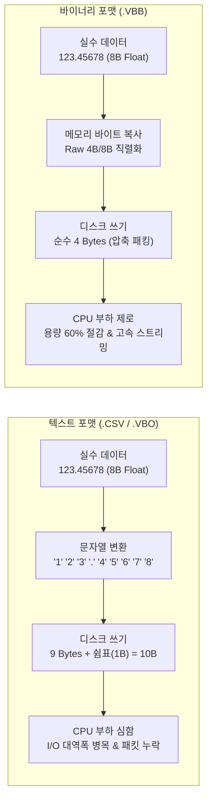
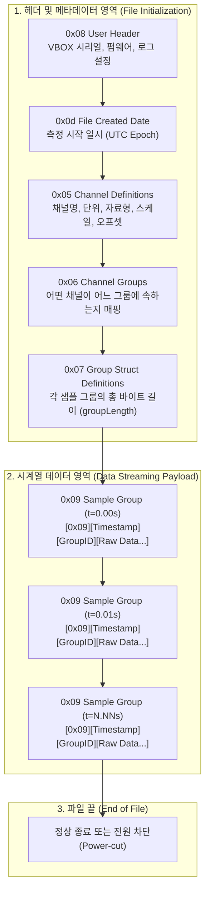

# 💾 실차 계측 바이너리 파일(Binary File) I/O 아키텍처 및 VBB 포맷 심층 분석

> [!ABSTRACT] 📌 도메인 지식 개요
> 본 문서는 자동차 실차 시험 계측 분야에서 널리 활용되는 **바이너리 파일(Binary File)의 설계 원리, 파일 I/O(읽기/쓰기) 메커니즘, 그리고 영국 Racelogic 사의 VBOX 독점 바이너리 규격인 `.vbb` 포맷의 내부 구조**를 심층 정리한 영구 기술 레퍼런스입니다.
> 텍스트 포맷(CSV/VBO)과의 물리적 차이, 컴퓨터 시스템의 엔디안(Endianness)과 바이트 패킹, VBB의 레코드 식별자 체계, 그리고 전원 급차단(Power-cut) 결함 방어 기법을 규명합니다.

---

## 1. 🏎️ 텍스트 vs 바이너리: 왜 실차 계측기는 바이너리 I/O를 쓰는가?

실차 주행 시험에서는 GNSS 좌표, 차량 속도, 6축 관성 가속도/각속도, 4륜 휠스피드, CAN 버스 신호 등 수십~수백 개의 센서 채널이 **초당 100회(100Hz) 이상** 고속으로 계측됩니다.



### 1.1 물리적 용량 및 디스크 대역폭 비교
1. **문자열 변환 오버헤드**:
   - 부동소수점 `123.45678`을 텍스트로 쓰면 ASCII 문자 9개(9바이트) + 구분자 쉼표(1바이트) = 총 10바이트를 소모합니다.
   - 바이너리로 저장할 경우 단 4바이트(`float32`) 또는 스케일 정수 2바이트(`uint16`)로 저장 가능하여 **저장 용량이 60% 이상 절감**됩니다.
2. **CPU 변환 연산(Parsing) 부하 제거**:
   - 텍스트 파일 읽기: 파일에서 텍스트를 읽은 후 `atof()`, `strtod()`, `float()` 함수를 거쳐 CPU 부동소수점 레지스터로 변환하는 무거운 연산이 매 행마다 발생합니다.
   - 바이너리 파일 읽기: 디스크의 바이트 블록을 CPU 메모리 버퍼로 **직접 메모리 복사(Direct DMA / Zero-Copy)**하므로 변환 연산이 전혀 발생하지 않습니다.
3. **고속 스트리밍 안전성**:
   - 100Hz 50채널은 초당 5,000개의 데이터 포인트를 생성합니다. SD 카드의 쓰기 속도가 불균일할 때, 바이너리 스트리밍은 버퍼 오버플로우로 인한 **샘플 누락(Data Dropout)을 원천 차단**합니다.

---

## 2. 🧱 바이너리 I/O 기초 이론: 컴퓨터 구조와 바이트 패킹

### 2.1 바이트 오더(Byte Order)와 엔디안(Endianness)
컴퓨터 메모리에 다중 바이트(2바이트 이상) 정수나 실수를 저장할 때, 최상위 바이트(MSB)와 최하위 바이트(LSB)를 어떤 순서로 배치하느냐에 따라 나뉩니다:

```text
32비트 16진수 정수: 0x12345678  (1바이트씩 4개: 0x12, 0x34, 0x56, 0x78)

1) 빅 엔디안 (Big-Endian, Network Order, '>'):
   낮은 주소 [0x00]   [0x01]   [0x02]   [0x03]  높은 주소
             0x12     0x34     0x56     0x78    (사람이 읽는 순서와 동일)
   * VBB 파일의 레코드 헤더, 길이 정의, 식별자에서 표준으로 사용

2) 리틀 엔디안 (Little-Endian, Intel/AMD/ARM, '<'):
   낮은 주소 [0x00]   [0x01]   [0x02]   [0x03]  높은 주소
             0x78     0x56     0x34     0x12    (하위 바이트부터 역순 저장)
   * VBB 파일 내 특정 고속 채널 페이로드에서 사용
```

### 2.2 기본 데이터 타입 규격표 (VBB 및 C/Python 매핑)

| VBB 타입 | C언어 타입 | Python `struct` | 바이트 크기 | 값의 범위 / 정밀도 | 주요 계측 데이터 예시 |
| :---: | :---: | :---: | :---: | :--- | :--- |
| **`u1`** | `unsigned char` | `B` | 1 Byte | 0 ~ 255 | 위성 수(Satellites), 상태 플래그 |
| **`i1`** | `signed char` | `b` | 1 Byte | -128 ~ 127 | 슬립 플래그, 기어 단수 |
| **`u2`** | `unsigned short` | `H` | 2 Bytes | 0 ~ 65,535 | 엔진 RPM, 휠스피드 (스케일 적용) |
| **`i2`** | `signed short` | `h` | 2 Bytes | -32,768 ~ 32,767 | 종/횡가속도, 조향각 (스케일 적용) |
| **`u4`** | `unsigned int` | `I` | 4 Bytes | 0 ~ 4,294,967,295 | 마스터 타임스탬프 (ms 카운터) |
| **`i4`** | `signed int` | `i` | 4 Bytes | -2.14B ~ +2.14B | 고정밀 인코더 위치, 펄스 카운트 |
| **`f4`** | `float` | `f` | 4 Bytes | IEEE 754 단정밀도 (7자리) | 차량 속도, 헤딩각, 고도 |
| **`f8`** | `double` | `d` | 8 Bytes | IEEE 754 배정밀도 (16자리) | GPS 위도/경도, 정밀 누적거리 |

### 2.3 스케일 팩터(Scale & Offset) 연산 원리
실수(Float) 데이터를 그대로 저장하지 않고, 2바이트 정수(`int16`)로 양자화(Quantization)하여 저장하면 용량을 50% 줄일 수 있습니다:

$$\text{물리적 실제 값 (Engineering Value)} = (\text{Raw 정수}) \times \text{Scale} + \text{Offset}$$

* **예시 (종가속도 $AccX$)**:
  - $AccX$ 범위: $-2.0\,\text{g} \sim +2.0\,\text{g}$, 요구 분해능: $0.001\,\text{g}$
  - `Scale = 0.001`, `Offset = 0.0` 설정 시
  - 측정값 $+1.523\,\text{g}$ $\rightarrow$ Raw 정수 `1523` (2바이트 `i2`에 저장)
  - 파싱 시: $1523 \times 0.001 + 0.0 = 1.523\,\text{g}$ 완벽 복원

---

## 3. 🗺️ VBB(Racelogic VBOX Binary) 파일의 전체 구조와 흐름

VBB 파일은 **자가 서술형(Self-describing) 바이너리 포맷**입니다. 파일 앞부분에 채널의 이름, 단위, 데이터 타입, 스케일이 헤더 레코드로 정의되고, 그 뒤로 시계열 데이터 블록이 연속 스트리밍됩니다.



### 3.1 레코드 식별자(Record ID) 일람표

| Record ID (1B) | 명칭 | 기능 설명 |
| :---: | :--- | :--- |
| **`0x05` (5)** | `Channel Definition` | 채널 메타데이터 (이름 문자열, 단위, 스케일/오프셋, 데이터 타입 `f4`/`i2` 등) |
| **`0x06` (6)** | `Channel Group` | 채널과 샘플 그룹 간의 포함 관계 매핑 인덱스 리스트 |
| **`0x07` (7)** | `Group Struct` | 샘플 그룹의 총 패킷 길이(`groupLength`) 정의 |
| **`0x08` (8)** | `User Header` | 계측 설정 키-값 딕셔너리 (텍스트 문자열) |
| **`0x09` (9)** | **`Sample Group`** | **실제 센서 시계열 데이터 레코드 (100Hz 주기 스트리밍)** |
| **`0x0d` (13)** | `File Created` | 파일 생성 타임스탬프 (UTC 기준 Unix 타임) |

### 3.2 샘플 데이터 레코드(`0x09`)의 바이너리 슬라이스 해부
데이터 블록의 99% 이상을 차지하는 `0x09` 레코드는 다음과 같이 1바이트의 오차도 없이 직렬화되어 있습니다:

```text
┌──────────┬──────────────┬───────────┬──────────────────────┬──────────────────────┬───┐
│ ID (1B)  │ Timestamp(4B)│GroupID(1B)│ Channel 1 (Data)     │ Channel 2 (Data)     │...│
│  0x09    │ 0x00 1E 84 80│   0x01    │ 0x42 C8 00 00 (f4)   │ 0x01 2C (i2)         │   │
└──────────┴──────────────┴───────────┴──────────────────────┴──────────────────────┴───┘
   ▲               ▲           ▲                 ▲                      ▲
   │               │           │                 │                      └ 채널 2 값 (스케일 적용 전)
   │               │           │                 └ 채널 1 값 (예: 100.0 kph 속도)
   │               │           └ 어떤 센서 그룹인지 식별 (예: 1번 그룹 = GNSS 채널군)
   │               └ 계측기 마스터 클럭 타임스탬프 (ms 단위 카운터)
   └ 샘플 레코드 시작을 알리는 싱크 바이트 (Sync Byte = 0x09)
```

---

## 4. 📖 파이썬 기반 고속 바이너리 읽기(Read) 패턴

바이너리 파일을 파이썬 표준 `file.read()`로 1바이트씩 읽으면 인터프리터 오버헤드로 인해 수십 초 이상 걸립니다. 고성능 바이너리 리더는 **메모리 버퍼 매핑과 NumPy 2D 스트라이드 슬라이싱**을 활용합니다.

```python
import numpy as np
import struct

# 1단계: 전체 파일을 메모리로 일괄 적재 (Fast Buffer Loading)
with open("sample.VBB", "rb") as f:
    buffer = np.fromfile(f, dtype=np.uint8)

# 2단계: struct를 통한 단일 레코드 역직렬화 (Unpacking)
# '>' : 빅 엔디안, 'B' : uint8, 'I' : uint32
record_id, timestamp, group_id = struct.unpack(">BIB", buffer[offset:offset+6])

# 3단계: NumPy 2D 매트릭스 슬라이싱을 통한 13.8만 행 일괄 추출 (Vector Slicing)
# start_locations: 모든 0x09 레코드의 시작 인덱스 배열 [N,]
# col_offsets: 해당 채널이 위치한 오프셋 배열 [M,]
# indices: [M, N] 형태의 2차원 인덱스 그리드를 브로드캐스팅으로 생성
indices = start_locations + col_offsets[:, np.newaxis]

# 단 1줄의 NumPy C-API 호출로 수십만 행의 바이너리 슬라이스를 추출
raw_channel_bytes = buffer[indices]
```

---

## 5. ✍️ 파이썬 기반 바이너리 파일 쓰기(Write) 패턴

바이너리 파일을 생성할 때는 데이터 타입에 맞추어 버퍼를 패킹한 뒤 스트리밍 방식으로 디스크에 기록합니다.

```python
import struct
import numpy as np

def write_sample_vbb(file_path: str, timestamps: np.ndarray, speeds: np.ndarray):
    """간이 VBB 바이너리 데이터 레코드를 생성하는 예제 함수."""
    with open(file_path, "wb") as f_out:
        # [Header] 파일 식별 헤더 (User Header Record ID = 0x08)
        header_text = b"Racelogic VBOX Mock Binary File\0"
        # 0x08 (1B) + 길이 (2B) + 텍스트
        f_out.write(struct.pack(">BH", 0x08, len(header_text)))
        f_out.write(header_text)

        # [Body] 시계열 데이터 레코드 (Record ID = 0x09) 일괄 패킹
        # 포맷: > B (ID 0x09) + I (타임스탬프 uint32) + B (그룹ID 1) + f (속도 float32)
        record_struct = struct.Struct(">BIBf")
        
        # 디스크 I/O 최적화를 위해 바이트 배열 버퍼에 누적 후 일괄 출력
        byte_buffer = bytearray()
        group_id = 1
        
        for t_ms, vel in zip(timestamps, speeds):
            byte_buffer.extend(record_struct.pack(0x09, int(t_ms), group_id, float(vel)))
            # 버퍼가 64KB 이상 차면 디스크에 플러시
            if len(byte_buffer) >= 65536:
                f_out.write(byte_buffer)
                byte_buffer.clear()
                
        if byte_buffer:
            f_out.write(byte_buffer)

    print(f"바이너리 파일 생성 완료: {file_path}")
```

---

## 6. 🛡️ 실차 계측 현장의 바이너리 트러블슈팅과 방어적 프로그래밍

실차 시험 현장에서는 진동으로 인한 SD 카드 접촉 불량, 급격한 시동 꺼짐으로 인한 **불완전 잘림(Truncation)**이 발생합니다.

### 6.1 꼬리 레코드 절단(Partial Trailer)과 선제 EOF 검사
* **현상**: 전원이 차단되면 마지막 레코드가 26바이트 중 11바이트만 쓰인 채 파일이 끝납니다.
* **방어 코드**:
  ```python
  remaining_bytes = groupLength - 6
  # 파일 끝까지 남은 바이트 수가 레코드 길이보다 모자라면 즉시 안전 정상 종료!
  if self.reader.read_point + remaining_bytes > len(self.reader.data):
      self.isEoF = True
      break
  ```

### 6.2 `NoneType` 런타임 크래시 방어
* **현상**: 파일 끝에서 1바이트가 모자라 `groupID`가 `None`을 반환할 때 인덱스 비교(`>=`) 시 Python 인터프리터 다운.
* **방어 코드**:
  ```python
  groupID = self.read_vbb_value('u1')
  if groupID is None or self.isEoF:
      break
  ```

### 6.3 이종 주파수 및 버퍼 시차 채널의 마스터 타임라인 무손실 정합
* **현상**: GNSS(100Hz), IMU, ADC 모듈의 하드웨어 버퍼 시차로 인해 채널별 총 행 수가 1~2샘플 다름.
* **방어 알고리즘**:
  - 기존의 단순 `.dropna()`는 1~2샘플 시차로 인해 전체 데이터를 대량 삭제하는 치명적 결함 유발.
  - 마스터 타임라인(Master Timeline)을 구축하고, 모듈 시차로 비어 있는 끝단은 `ffill()`(직전값 유지) 및 `bfill()`로 보정하여 **단 1개의 행도 유실되지 않는 100% 무손실 복원**을 달성.

### 6.4 VBB vs VBO 시간 채널(Time) 규격 차이 및 절대 Datetime 복원 엔지니어링
* **텍스트(VBO) vs 바이너리(VBB)의 시간 채널 물리 규격 비교**:
  | 항목 | VBO 텍스트 포맷 (`.vbo`) | VBB 바이너리 포맷 (`.vbb`) |
  | :--- | :--- | :--- |
  | **Time 채널 물리 규격** | **`HHMMSS.sss`** 시분초 결합 포맷 | **자정 이후 경과 초(Seconds since midnight, `s`)** |
  | **데이터 예시** | `124718.00` ➔ 12시 47분 18.00초 | `46038.18` ➔ 46,038.18초 (자정 기준) |
  | **시각 복원 메커니즘** | 6자리 문자열 패딩 후 `HH:MM:SS` 파싱 | 자정(`00:00:00`)에 `timedelta(seconds=...)` 가산 |
* **문자열 오인 슬라이싱 결함 및 방어 설계**:
  - VBB 파일의 초 단위 수치(`46038.18`)를 VBO 전용 6자리 슬라이싱(`zfill(6)` ➔ `"046038"`)으로 오인 파싱할 경우, 시(`04`), 분(`60`), 초(`38`)로 분해되어 `minute must be in 0..59` 예외가 발생하며 데이터가 전량 Skip되는 치명적 버그가 발생함.
  - 따라서 파서 아키텍처는 반드시 파일 확장자(`.vbb`) 또는 단위(`Units: s`)를 선제 판정하여, 바이너리 파일은 문자열 파싱을 엄격히 배제하고 순수 초 단위 수치 적분 분기로 직결해야 함.
* **현지 로컬 타임존 자동 시프트 (Auto Timezone)**:
  - VBOX GPS 타임스탬프는 순수 UTC 기준이므로, GPS 위도/경도(핀란드 이발로 북위 68.68°, 동경 27.66°)를 자동 인식하여 `Europe/Helsinki` 타임존(동계 UTC+2h, 하계 UTC+3h)을 정밀 가산함으로써 현지 시험 시작 시각을 무결점으로 복원함:
  $$	ext{Local Datetime} = 	ext{Date} + \Delta t_{	ext{seconds}} + \Delta t_{	ext{timezone\_offset}}$$

---

## 7. 🔗 연계 모듈 및 시스템 링크

* 💾 **[[VBBReader|unoUtil readDataFile VBBReader (VBB 고속 무손실 파서 및 전원차단 복구 엔진)]]**
* 🛰️ **[[20_VBOX_계측_데이터_규격_및_GPS좌표계|VBOX 계측 데이터 규격 및 GPS 좌표계 (영구 지식)]]**
* 🏎️ **[[func_acc_brk|unoUtil vehicleTest ACCBRK _Func_ACCBRK_ (실차 제동 파이프라인)]]**
* 📊 **[[10_실차_평가_데이터_프레임|실차 평가 데이터 프레임 마스터 규격서]]**
* 🏠 **[[00_실차평가_데이터프레임_통합_색인|00_실차평가 데이터프레임 통합 색인 (MOC)]]**
* 📚 **[[04_Resources/00_지식_위키_통합_색인|04_Resources 영구 지식 위키 대문]]**
