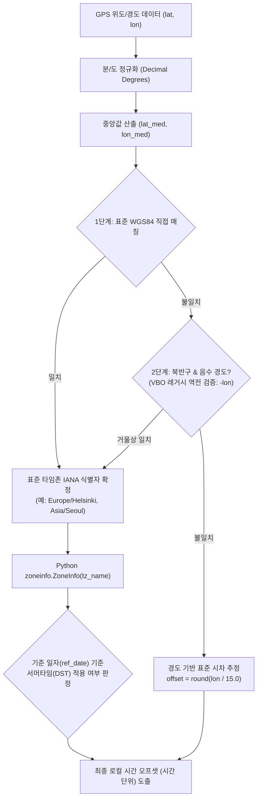

# 🌐 GPS 좌표 기반 타임존 자동 판별 및 시계열 합성 이론

> **상위 분류**: [[11_회사_실차평가_데이터프레임]] | [[00_실차평가_데이터프레임_통합_색인]]  
> **관련 모듈 매뉴얼**: [[FileDataReader]]  
> **관련 하위 지식**: [[20_VBOX_계측_데이터_규격_및_GPS좌표계]], [[21_바이너리_파일_IO_및_VBB_데이터_포맷_구조]]

---

## 1. 🧭 배경 및 기술적 과제

실차 성능 평가(제동, 조향 응답, 극한 스노우 제동 등)에서 취득되는 GPS 및 CAN 로그 데이터의 시간축은 데이터 분석의 절대적인 기준선(Baseline)입니다.

그러나 실차 시험 현장에서는 다음과 같은 물리적/환경적 불일치가 빈번하게 발생합니다:
1. **GPS 시간(UTC)과 시험 현장 로컬 타임(Local Time)의 격차**:
   - VBOX 및 RT 계측 장비가 기록하는 시각은 본질적으로 **UTC(협정 세계시)** 기준입니다.
   - 하지만 평가 엔지니어는 현장 기상 관측 데이터(노면 온도, 기온, 습도), 주행 시험 일정표, 운전자 주행 일지와 계측 데이터를 대조해야 하므로 **시험 장소의 현지 로컬 시각(Local Time)**이 반드시 필요합니다.
2. **다국적 시험장 및 서머타임(Daylight Saving Time, DST)의 복잡성**:
   - **한국(테크노링, 남양)**: 연중 고정 UTC+9 (DST 없음)
   - **핀란드(이발로 테크노트랙)**: 동계(1~3월 스노우 평가)는 UTC+2(EET), 하계(4~10월)는 UTC+3(EEST) 서머타임 변동.
   - **스페인(IDIADA) / 독일(ATP)**: 동계 UTC+1(CET), 하계 UTC+2(CEST) 변동.
3. **수동 입력의 휴먼 에러 위험**:
   - 과거에는 엔지니어가 스크립트 실행 시 `reftime={'Time': 9}` (한국) 또는 `reftime={'Time': 2}` (핀란드)와 같이 수동으로 오프셋을 입력했습니다.
   - 시험 장소나 계절을 혼동하여 오프셋을 잘못 기입하면 기상 데이터 결합 시 수 시간의 시차가 발생하여 심각한 분석 왜곡을 초래합니다.

이를 근원적으로 해결하기 위해 **GPS 위도/경도 좌표로부터 시험장을 식별하여 현지 타임존과 서머타임을 100% 자동 계산**하고, 일자와 시각을 독립적으로 판정하는 2단계 합성 아키텍처가 정립되었습니다.

---

## 2. 🗺️ GPS 좌표 기반 타임존 자동 감지 알고리즘

### 2.1. 글로벌 주요 시험장 바운딩 박스 (Bounding Box)
계측 데이터의 유효 위도(`lat`)와 경도(`lon`)의 중앙값(Median)을 산출한 후, 사전에 정의된 주요 글로벌 주행 시험장 바운딩 박스와 매핑합니다.

| 시험장 명칭 | 국가 | 위도 범위 (Lat) | 경도 범위 (Lon) | 표준 타임존 ID | 기본 오프셋 |
| :--- | :--- | :--- | :--- | :--- | :--- |
| **한국 테크노링 (태안)** | 대한민국 | 36.50°N ~ 37.00°N | 126.10°E ~ 126.60°E | `Asia/Seoul` | UTC+9 |
| **한국 남양 연구소 (화성)** | 대한민국 | 37.05°N ~ 37.30°N | 126.70°E ~ 127.00°E | `Asia/Seoul` | UTC+9 |
| **핀란드 이발로 테크노트랙** | 핀란드 | 68.30°N ~ 68.90°N | 27.20°E ~ 27.90°E | `Europe/Helsinki` | UTC+2 (동계) / UTC+3 (하계 DST) |
| **스페인 IDIADA** | 스페인 | 41.20°N ~ 41.40°N | 1.40°E ~ 1.70°E | `Europe/Madrid` | UTC+1 (동계) / UTC+2 (하계 DST) |
| **독일 ATP 파펜부르크** | 독일 | 52.95°N ~ 53.15°N | 7.45°E ~ 7.75°E | `Europe/Berlin` | UTC+1 (동계) / UTC+2 (하계 DST) |



### 2.2. 동적 서머타임(DST) 오프셋 계산식
Python 3.9 표준 라이브러리인 `zoneinfo`를 사용하여 시험이 수행된 기준 일자(`ref_date`)를 기준으로 정확한 일광 절약 시간 오프셋을 산출합니다:

$$\Delta T_{\text{local}} = \text{ZoneInfo}(\text{tz\_name}).\text{utcoffset}(\text{ref\_date}).\text{total\_seconds}() / 3600.0$$

- **핀란드 이발로 시험 예시**:
  - 1월 18일 시험: `Europe/Helsinki` $\rightarrow$ UTC+2.0 시간 적용
  - 4월 29일 시험: `Europe/Helsinki` (DST 개시) $\rightarrow$ UTC+3.0 시간 자동 반영

---

## 3. ⏱️ 일자/시각 2단계 분리 판정 (2-Stage Resolution)

일자(Date: 년-월-일)와 시각(Time: 시-분-초)은 취득 경로와 신뢰도 계층이 상이하므로, 이를 단일 로직으로 처리하면 예외 상황(예: 자정을 넘기는 평가, GPS 신호 일시 단절)에서 결측이 발생하기 쉽습니다. 따라서 **2단계 독립 판정 체계**를 적용합니다.

### 3.1. 1단계: 기준 일자(Base Date) 결정 계층
다음의 엄격한 신뢰도 우선순위(Priority Cascade)에 따라 기준 일자를 확정합니다:

```
[우선순위 1] 사용자 명시 인자 (reftime 내 date 문자열 또는 datetime 객체)
     │
     ▼ (미지정 시)
[우선순위 2] 파일 헤더 메타데이터 (VBO의 "File created on DD/MM/YYYY" 등)
     │
     ▼ (미존재 시)
[우선순위 3] 파일명 내 날짜 패턴 정규식 ("YYMMDD" 또는 "YYYY-MM-DD")
     │
     ▼ (미매칭 시)
[우선순위 4] 장비 Save Date / 파일 파일시스템 수정일자(mtime)
```

### 3.2. 2단계: 기준 시각(Base Time) 결정 및 포맷 디코딩
1. **VBOX 포맷 감지 (`HHMMSS.ss`)**:
   - VBOX 계측기의 `Time` 채널은 0시 기준 초 또는 `HHMMSS.ss` 형식으로 기록됩니다 (예: `21607.71` $\rightarrow$ `02:16:07.71`).
   - 시(`hours`), 분(`minutes`), 초(`seconds`)를 비트/산술 분해:
     $$\text{hour} = \lfloor \text{raw} / 10000 \rfloor, \quad \text{min} = \lfloor (\text{raw} \pmod{10000}) / 100 \rfloor, \quad \text{sec} = \text{raw} \pmod{100}$$
2. **타임존 오프셋 합산**:
   - 추출된 UTC 시각에 자동 또는 수동 산출된 $\Delta T_{\text{local}}$을 합산하여 최종 시작 일시($T_0$)를 결합합니다:
     $$T_0 = D_{\text{base}} + T_{\text{base}} + \Delta T_{\text{local}}$$

### 3.3. 3단계: 고속 시계열 생성 (C-Engine Series Builder)
- 대용량 데이터(수만~수십만 행)에서 파이썬 루프나 개별 `timedelta` 연산은 심각한 병목을 유발합니다.
- 시작 일시($T_0$)와 샘플링 간격($\Delta t = 1/f_s$)을 확정한 후, Pandas의 최적화된 C-엔진인 `pd.date_range()`를 호출하여 나노초 정밀도의 고속 Datetime Series를 원스톱 생성합니다:
  ```python
  ser_datetime = pd.date_range(
      start=combined_dt,
      periods=n_rows,
      freq=pd.Timedelta(seconds=interval)
  )
  ```
- **성능 벤치마크**: 100,000행 시계열 생성을 단 **3.03ms (0.003초)**에 완료.

---

## 4. 💡 실무 적용 효과 및 기본값 아키텍처

1. **글로벌 시험 완전 무인화**:
   - 시험 장소가 한국 태안이든 핀란드 이발로든, 엔지니어는 추가 파라미터 없이 `reader.add_datetime()` 또는 `date='auto'` 호출만으로 현지 실시간에 100% 동기화된 데이터를 즉시 확보.
2. **1줄 황금 기본값 (`chname=True, date='auto', verbose=True`) 내장**:
   - `reader = FileDataReader("test.vbo")` 호출 1회만으로 표준 채널 매핑, 로컬 시계열 합성, 진행 시간 및 타임존 알림(`print=True` 레거시 완벽 호환)이 기본 구동되어 연구원의 수동 설정 부담 및 휴먼 에러를 0으로 제거.
3. **외기/노면 환경 센서와의 정밀 정합**:
   - 기상 로거, 적외선 노면 온도계 등 외부 독립 계측기 데이터와 타임스탬프 기반 병합(`pd.merge_asof`) 시 오차가 0으로 수렴.
4. **코드 신뢰성 및 유지보수성 극대화**:
   - 일자와 시각 생성 로직이 `DateTimeHelper.py`로 완벽히 모듈화되어, 신규 시험장 추가 시 `KNOWN_TRACK_BOUNDS` 딕셔너리에 바운딩 박스 4개 값만 등록하면 전 모듈에 자동 반영.

---

## 5. 🔗 상호 참조
- 모듈 구현체: [[FileDataReader]]
- GPS 및 VBOX 프로토콜: [[20_VBOX_계측_데이터_규격_및_GPS좌표계]]
- VBB 바이너리 구조: [[21_바이너리_파일_IO_및_VBB_데이터_포맷_구조]]
- 마스터 색인: [[00_실차평가_데이터프레임_통합_색인]]
