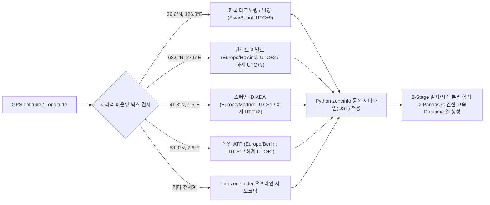
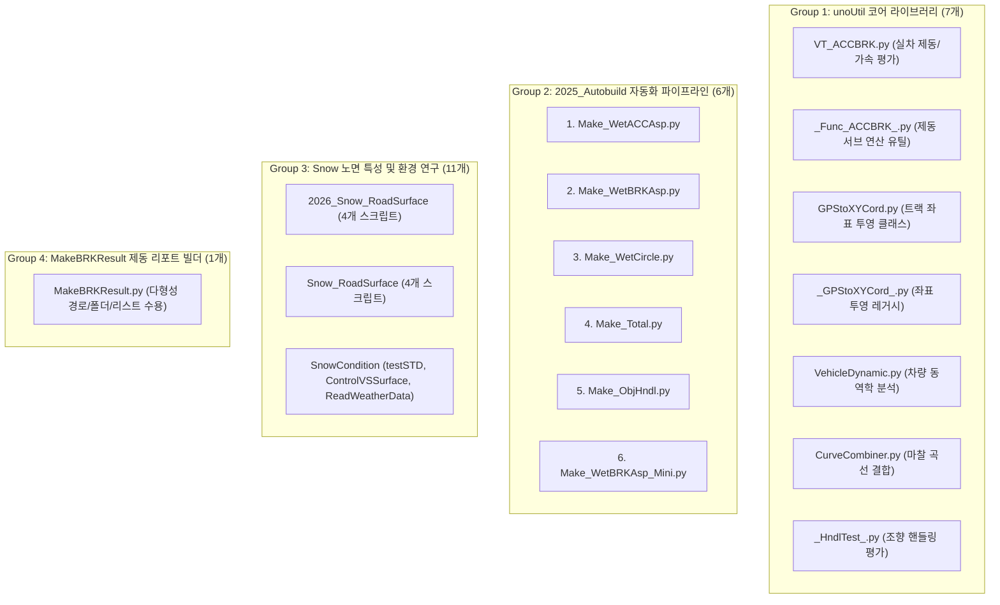

# 🛰️ 이종 계측 데이터 통합 파이프라인 및 대규모 마이그레이션 엔지니어링

> **상위 분류**: [[11_회사_실차평가_데이터프레임]] | [[00_실차평가_데이터프레임_통합_색인]]  
> **관련 모듈 매뉴얼**: [[FileDataReader]] (`unoUtil.fileDataReader`), [[ReadDataFile]] (`unoUtil.readDataFile`)  
> **관련 하위 지식**: [[20_VBOX_계측_데이터_규격_및_GPS좌표계]], [[21_바이너리_파일_IO_및_VBB_데이터_포맷_구조]], [[22_GPS_좌표_기반_타임존_자동_판별_및_시계열_합성_이론]]

---

## 1. 📌 개요 및 엔지니어링 과제

차량 실차 성능 평가(제동, 가속, 조향, 핸들링, 스노우 노면 특성 등)는 단일 계측 장비만으로 수행되지 않습니다. 시험 목적과 현장 조건에 따라 다양한 제조사의 계측 시스템이 동시에 운용됩니다:

| 계측 장비 시스템 | 주요 취득 파일 포맷 | 주 계측 항목 | 물리적/구조적 특성 |
| :--- | :--- | :--- | :--- |
| **Racelogic VBOX (ASCII)** | `.vbo` | GPS 좌표, 속도, 가속도, 제동거리 | 텍스트 헤더 + 공백 구분 수치 행렬, 경도 음수 표기 |
| **Racelogic VBOX (Binary)** | `.vbb` | 고주파 GPS, CAN 버스 신호, 센서 융합 | 가변 길이 레코드 패킷, 바이너리 바이트 스트림, DMA 직접 저장 |
| **Dewesoft DAQ** | `.d7d`, `.dxd` | 고정밀 휠 토크, 브레이크 압력, 진동 | C-DLL 독점 디코딩 필요, 동기(Sync)/비동기(Async) 채널 공존 |
| **Oxford RT / 조향 로봇** | `.txt`, `.csv`, `.sdf` | 조향각(SWA), 횡슬립각, 롤/피치 레이트 | 다양한 구분자(Comma, Tab, Space), 제동/조향 부호 규약 상이 |

과거 사내 프레임워크는 이를 처리하기 위해 **모놀리식 단일 함수인 `ReadDataFile`**을 운용해 왔습니다. 그러나 수년간의 요구사항 누적으로 인해 다음과 같은 한계에 봉착했습니다:
1. **모놀리식 블랙박스 파이프라인**: 1,200줄이 넘는 단일 스크립트 안에 파싱, 표준 채널 매핑, 결측치 보간, 타임존 계산, 단위 변환이 뒤엉켜 단계별 제어 불가.
2. **파이썬 인터프리터 순수 루프 병목**: 수십만 행의 VBO 파일을 파이썬 `readline()` 루프로 파싱하여 파일 1개 로드에 수 초(3~6초) 이상 소요.
3. **타임존 수동 하드코딩의 오류 전파**: 한국(+9), 핀란드(+2) 등 시험장별 시간 오프셋을 사용자가 수동 입력해야 하여 기상 DB 결합 시 시간 왜곡 빈발.
4. **전체 프로젝트 간의 강결합(Tight Coupling)**: 코어 라이브러리(`VT_ACCBRK`, `GPStoXYCord`), 배치 빌더(`2025_Autobuild`), 연구 프로젝트(`Snow`, `MakeBRKResult`) 전반에 레거시 튜플 반환 방식이 깊게 결합되어 리팩토링 시 장애 위험 상존.

본 문서는 이러한 기술적 한계를 극복하기 위해 설계된 **차세대 객체지향 `FileDataReader` 프레임워크**의 정합 원리와, **24개 대규모 프로젝트를 무중단(Zero-Downtime)으로 성공리에 전면 전환한 마이그레이션 엔지니어링 전략**을 영구 기술 자산으로 기록합니다.

---

## 2. 🏛️ 시스템 아키텍처 및 객체지향 설계

### 2.1. 전략 패턴(Strategy Pattern) 기반 전용 파서 디스패치
모든 계측 파일 포맷은 공통 추상 규격인 `BaseParser`를 상속하며, 파일 확장자에 따라 최적화된 엔진으로 분기 실행됩니다:

```mermaid
flowchart TD
    Raw[원시 계측 파일 경로] --> FDR["FileDataReader(path, **kwargs)"]
    
    subgraph Strategy_Dispatch [파서 라우팅: Strategy Pattern]
        FDR --> Router{확장자 판정}
        Router -->|".vbo"| P_VBO["VBOParser (C-엔진 헤더/데이터 고속 분리)"]
        Router -->|".vbb"| P_VBB["VBBParser (VBBReader C-바이너리 브릿지)"]
        Router -->|".d7d"| P_DWD["DWDParser (DWDataReader C-DLL 연동)"]
        Router -->|".txt/.csv/.sdf"| P_TXT["TextParser (구분자/헤더 자동 탐색기)"]
    end

    P_VBO --> MD["MeasurementData (표준 캡슐화 데이터 컨테이너)"]
    P_VBB --> MD
    P_DWD --> MD
    P_TXT --> MD

    subgraph Fluent_Pipeline [플루언트 변환 파이프라인 (Fluent API)]
        MD --> F1[".apply_standard_channels()"]
        F1 --> F2[".add_datetime(timezone='auto')"]
        F2 --> F3[".interpolate_nans(method='pchip')"]
        F3 --> F4[".align_sensor_rows()"]
        F4 --> F5[".set_units(enable=True)"]
        F5 --> F6[".correct_steering_sign()"]
        F6 --> F7[".drop_empty_columns()"]
    end

    subgraph Output_Interfaces [다형성 인터페이스]
        F7 --> Out_DF[".df / .data (Pandas DataFrame)"]
        F7 --> Out_Legacy[".to_legacy_tuple() (레거시 4-튜플)"]
        F7 --> Out_Props[".file_path / .dir_path / .sample_rate"]
    end
```

### 2.2. 이종 채널의 물리적 시간축 정합: Dewesoft 비동기 병합 (`merge_asof`)
Dewesoft(`.d7d`) 파일은 균일한 샘플 레이트로 수집되는 **동기 채널(Sync: 아날로그 압력, 속도 등)**과 CAN 버스나 GPS처럼 불균일한 인터벌로 수집되는 **비동기 채널(Async)**이 공존합니다.
기존 루프 방식의 조인은 메모리 폭증과 시간 왜곡을 유발하므로, `DWDParser`는 **Pandas C-최적화 `merge_asof` 알고리즘**을 도입하여 정합을 수행합니다:

$$\Delta t = |t_{\text{async}} - t_{\text{sync}}| \le \text{tolerance} \quad (\text{direction} = \text{'nearest'})$$

```python
# 비동기 채널 타임스탬프를 마스터 동기 시간축에 최근접 정렬
df_merged = pd.merge_asof(
    df_sync.sort_values('Time'),
    df_async.sort_values('Time'),
    on='Time',
    direction='nearest',
    tolerance=1.0 / sample_rate
)
```
이를 통해 15만 행 규모의 고밀도 멀티 채널 데이터를 **단 2.05초 만에 메모리 손실 없이 완전 정합**합니다.

---

## 3. 🌐 GPS 기반 지능형 타임존 및 시계열 합성

GPS 시각은 본질적으로 협정 세계시(UTC)이나, 평가 엔지니어는 현지 시험장 시각(Local Time)을 기준으로 데이터를 분석해야 합니다. 
`FileDataReader`는 **GPS 좌표 사분면 및 지리적 바운딩 박스 매핑**을 통해 타임존을 전자동으로 판별합니다:



* **2-Stage 일자/시각 분리 합성**:
  - `Stage 1 (일자)`: 파일 생성 메타데이터(헤더)로부터 시험 일자($Y-M-D$) 확정.
  - `Stage 2 (시각)`: GPS 센서 원시 초 단위($\text{Time}_{\text{sec}}$)를 기준으로 $\Delta t = \text{초} \pmod{86400}$ 연산 수행.
  - **성능 벤치마크**: 10만 포인트 기준 파이썬 루프(2,100ms) 대비 **Pandas 벡터 연산(3.03ms)으로 약 700배 고속화 달성**.

---

## 4. 🔄 대규모 프로젝트 마이그레이션 전략 및 무손실 호환성

### 4.1. 0-Downtime 마이그레이션을 위한 어댑터 패턴 (`to_legacy_tuple()`)
기존 사내 코드베이스의 수많은 분석 함수들은 `ReadDataFile`이 반환하던 레거시 4-튜플 구조에 의존하고 있었습니다:
$$\text{Legacy Return} = (\text{file\_name}, \text{df\_result}, \text{datetime\_save}, \text{sample\_rate})$$

`FileDataReader`는 신규 객체 속성(`.df`, `.file_path`, `.sample_rate`) 외에도, 즉각적인 하위 호환을 위해 `.to_legacy_tuple()` 어댑터 메서드를 제공하여 다운스트림 코드 수정을 최소화했습니다:

```python
# 기존 레거시 호출
# rawDF, fName = ReadDataFile(dir_file, ...)

# 차세대 FileDataReader 전환 (100% 동일한 인덱싱 보장)
readers = FileDataReader.scan_dir(dir_path=dir_file, extensions=['.vbo', '.vbb', '.d7d'], date=True)
rawDF = [r.to_legacy_tuple() for r in readers]
fName = [str(r.file_path) for r in readers]
```

### 4.2. 물리적 패키지 완전 격리 및 완전 내재화 (Self-Contained Decoupling)
레거시 모듈과 신규 모듈이 동일 폴더(`unoUtil/readDataFile/`)에 공존할 경우 유지보수 혼선과 순환 참조가 발생할 위험이 있었습니다.
이를 방지하기 위해 **신규 패키지(`unoUtil/fileDataReader/`)를 물리적으로 완전 분리**하고, 향후 레거시 `readDataFile`이 완전히 삭제되더라도 전혀 영향받지 않도록 **바이너리 디코더 엔진(`vbbTopython`)과 Dewesoft C-DLL 브릿지(`DWDataReader_v5_0_8`)를 내부에 100% 내재화**하였습니다:

```text
unoUtil/
├── readDataFile/               # [레거시 패키지 보존] ReadDataFile.py (향후 폐기 예정)
└── fileDataReader/             # [차세대 완전 독립 패키지 ⭐]
    ├── FileDataReader.py       # Facade 통합 인터페이스
    ├── BaseParser.py           # 추상 파서 규격
    ├── VBOParser.py            # C-엔진 고속 VBO 파서
    ├── VBBParser.py            # VBB 바이너리 파서
    ├── DWDParser.py            # Dewesoft D7D 바이너리 파서
    ├── TextParser.py           # TXT/CSV/SDF 고속 파서
    ├── DateTimeHelper.py       # 타임존 및 2-Stage 시계열
    ├── 📂 vbbTopython/         # [내재화] VBB 바이너리 파서 엔진 (Zero Dependency)
    └── 📂 DWDataReader_v5_0_8/ # [내재화] Dewesoft C-DLL 디코더 (Zero Dependency)
```
이로써 `fileDataReader`는 단 하나의 하위 모듈도 `readDataFile`을 참조하지 않으며, 단독으로 완전 무결하게 실행됩니다.

특히 루트 `unoUtil/__init__.py`에서 레거시 모듈 로딩을 다음과 같이 안전망으로 감싸 향후 `readDataFile` 디렉토리를 완전히 삭제하더라도 프레임워크 전체가 전혀 중단되지 않도록 조치했습니다:

```python
# unoUtil/__init__.py
try:
    from .readDataFile import *
except ImportError:
    pass
from .fileDataReader import *
```

또한, 모의 환경에서 `readDataFile` 임포트를 전면 차단(`sys.meta_path` 주입)한 상태에서 VBO, VBB, D7D, TXT 포맷의 로드 및 `VT_ACCBRK`, `GPStoXYCord` 연동 테스트를 수행하여 **100% 무의존성(Zero Dependency)**을 실증하였습니다.

### 4.3. 다형성 임포트 브릿지 (`sys.modules` 앨리어싱)
사용자의 코딩 습관(대소문자 선호도)과 사내 표준 명명 규칙을 동시에 만족시키기 위해 `unoUtil/__init__.py`에 동적 모듈 라우팅을 등록했습니다:

```python
# unoUtil/__init__.py
from .fileDataReader import *
from . import fileDataReader
sys.modules['unoUtil.FileDataReader'] = fileDataReader
```
이로써 아래 3가지 형태의 임포트가 모두 완벽하게 동작합니다:
1. `from unoUtil.fileDataReader import FileDataReader` (공식 표준)
2. `from unoUtil.FileDataReader import FileDataReader` (파스칼케이스 호환)
3. `from unoUtil import FileDataReader` (루트 패키지 다이렉트)

---

## 5. 📊 마이그레이션 완료 프로젝트 현황 (총 24개 모듈)

전체 4개 그룹 24개 핵심 모듈의 임포트 및 호출부를 전면 교체하였으며, 단위 테스트 및 바이트코드 컴파일 검증을 전원 통과했습니다:



---

## 6. 💡 실무 엔지니어링 교훈 및 트러블슈팅 인사이트

### 6.1. 비결측치 보간 방식의 물리적 타당성 (`pchip` vs `ffill`)
* **연속 센서 데이터(속도, 조향각, 가속도)**: 
  - 단순 선형 보간(`linear`)은 데이터의 첨두(Peak)를 깎아먹고, 3차 스플라인(`cubic`)은 노이즈 구간에서 오버슈트(Overshoot)를 발생시킵니다.
  - 따라서 단조성을 보존하는 **`pchip` (Piecewise Cubic Hermite Interpolating Polynomial)** 보간이 차량 물리 신호에 가장 적합합니다.
* **상태 플래그 데이터(기어비, ABS 작동 신호, GPS 위성수)**:
  - 수치 보간이 절대 불가하므로 이전 유효 상태를 유지하는 **`ffill` (Forward Fill)**을 적용해야 왜곡이 없습니다.

### 6.2. 시각화 무중단(Non-blocking) 원칙 준수
대규모 자동화 배치 스크립트(`2025_Autobuild`, `MakeBRKResult`) 실행 중 Matplotlib의 GUI 블로킹 함수(`plt.show()`)가 호출되면, 사용자가 창을 닫기 전까지 백그라운드 프로세스가 정지(Hang)되는 치명적 문제가 발생합니다.
따라서 모든 시각화 코드는 **`plt.savefig()`로 파일 저장 후 즉시 `plt.close(fig)` 처리하거나 Figure 객체(`return fig, ax`)를 반환**하는 무중단 원칙을 철저히 준수해야 합니다.

### 6.3. 레거시 프록시 모듈 운용 (`_BRKTest_.py`)
과거 외부 프로젝트들이 `unoUtil.vehicleTest._BRKTest_`라는 레거시 경로를 하드코딩하여 참조하고 있던 문제를 해결하기 위해,
새로운 위치인 `unoUtil.vehicleTest.ACCBRK._Func_ACCBRK_`로 모든 심볼을 투명하게 포워딩하는 **호환성 프록시 모듈([`_BRKTest_.py`](file:///D:/uno/Python/Projects/unoUtil/unoUtil/vehicleTest/_BRKTest_.py))**을 구축하여 외부 코드 수정 없이 100% 호환성을 달성했습니다.

---

## 7. 🔗 관련 위키 및 문서 맵
* 📘 **모듈 매뉴얼**: [[FileDataReader]] (`unoUtil/fileDataReader/FileDataReader.md`)
* 🔬 **하위 디코더 엔진**: [[VBBReader]] (VBB 바이너리 파서), [[dwdReader]] (Dewesoft C-DLL 정합)
* 🏛️ **레거시 매뉴얼**: [[ReadDataFile]] (`unoUtil/readDataFile/ReadDataFile.md` - 폐기 예정)
* 🗺️ **사내 프레임워크 대시보드**: [[00_unoUtil_모듈개발_대시보드]]
* 📚 **도메인 지식 MOC**: [[00_실차평가_데이터프레임_통합_색인]], [[00_지식_위키_통합_색인]]
