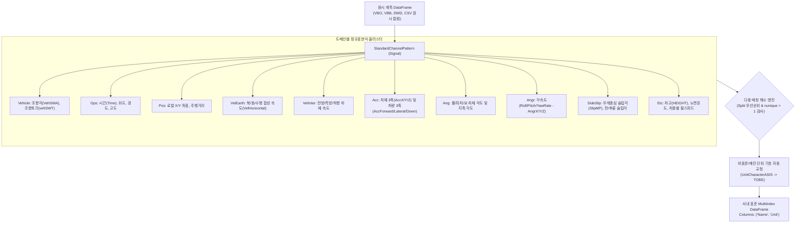

# 🏷️ 24_유노유틸 파일리더 표준 채널명 규격 및 변환 엔진

> **상위 분류**: [[11_회사_실차평가_데이터프레임]] | [[00_실차평가_데이터프레임_통합_색인]]  
> **관련 모듈 매뉴얼**: [[standard_channel_pattern]] (`unoUtil.file_reader.standard_channel_pattern`), [[file_data_reader]] (`unoUtil.file_reader.file_data_reader`)  
> **관련 상위 지식**: [[20_VBOX_계측_데이터_규격_및_GPS좌표계]], [[23_이종_계측_데이터_통합_파이프라인_및_대규모_마이그레이션_엔지니어링]]

---

## 1. 📌 개요 및 엔지니어링 배경

차량 실차 성능 평가(제동, 가속, 조향 응답성, 핸들링, 스노우 노면 시험 등)에서는 **Racelogic VBOX, Dewesoft DAQ, Oxford RT, 조향 로봇, CAN 통신 로거** 등 다양한 이종 계측 장비가 혼용됩니다.

동일한 물리적 거동을 계측하더라도 장비 제조사, 펌웨어 버전, 계측 템플릿, 그리고 제어기 CAN DB 명명 규칙에 따라 채널 이름과 표기 단위가 극심하게 분산됩니다:

| 물리량 | 이종 계측 장비 및 CAN 원시 채널명 (ASIS) | 발생 문제점 | 사내 표준 채널명 (TOBE) |
| :--- | :--- | :--- | :--- |
| **차량 주행 속도** | `velocity`, `Velocity`, `V_Veh`, `GPS_Speed`, `Speed_ms`, `Wheel_Speed_FL` 등 | 알고리즘별 컬럼 하드코딩 오류 | **`VelHorizontal`** |
| **조향각 (SWA)** | `swa`, `Steering_Angle`, `MDPS_EstSt`, `StrAng`, `SAS_Angle` 등 | 조향 입력 채널 탐색 실패 | **`VehSWA`** |
| **횡가속도 (Ay)** | `lat_accel`, `LatAcc`, `ground_acc_lat`, `Acc_Y`, `Y_acc` 등 | 좌표계 부호 및 축 혼선 | **`AccLateral`** |
| **요 레이트 (YawRate)** | `YawRate`, `yaw_rate`, `AngRateZ`, `imu_yaw_rate` 등 | 레이트 센서 다중 매칭 충돌 | **`AngrZ`** |
| **휠 스피드** | `WHL_SpdFLV`, `FL_ws`, `rpm_fl`, `fl_bmw`, `fl_golf`, `fl_IONIQ` 등 | 차종/CAN 프로토콜별 파편화 | **`WheelSpeedFL`** |
| **계측 단위 표기** | `¡Æ` (deg), `¡Æ/s` (deg/s), `m/sec©÷` (m/s²), `?=Z€TEdit` 등 | 윈도우 인코딩(CP949/Latin-1) 깨짐 | **`deg`, `deg/s`, `m/ss`** |

이러한 비표준 채널 구조는 다운스트림 분석 파이프라인(`VT_ACCBRK`, `MakeBRKResult`, `Snow` 등)에서 컬럼 존재 여부를 매번 조건문으로 분기해야 하는 유지보수 병목을 유발합니다.

이를 근본적으로 해결하기 위해 **`unoUtil.file_reader`** 패키지에는 정규표현식(Regex) 기반 지능형 매핑 엔진인 **`StandardChannelPattern` (`Signal`)**이 구축되어 있으며, 수백 가지 비표준 채널을 단일 규격으로 정규화하고 깨진 단위를 보정하여 **`pd.MultiIndex('Name', 'Unit')`** 형태로 구조화합니다.

---

## 2. 🏛️ 시스템 아키텍처 및 변환 프로세스

`StandardChannelPattern`은 다중 상속 기반의 물리 도메인별 클래스(`Vehicle`, `Gps`, `Pos`, `VelEarth`, `VelInter`, `Acc`, `Ang`, `Angr`, `SideSlip`, `Etc`)를 통합(`Signal`)하여 단일 인터페이스로 제공합니다.



---

## 3. 📋 카테고리별 표준 채널명 및 정규표현식 매핑 명세

### 3.1. 차량 조향/구동 기본 신호 (`Vehicle`)

| 표준 채널명 (`TOBE`) | 물리적 정의 | 주요 매칭 원시 채널 패턴 (Regex) | 대표 원시 채널명 예시 |
| :--- | :--- | :--- | :--- |
| **`VehSWA`** | 스티어링 휠 각도 (Steering Wheel Angle) | `.*?swa.*?\|.*?steering.*?angle.*?\|MDPS_EstSt.*?` | `swa`, `Steering_Angle`, `MDPS_EstSt` |
| **`vehSWT`** | 스티어링 휠 토크 (Steering Wheel Torque) | `.*?swt.*?\|.*?steering.*?torque.*?` | `swt`, `Steering_Torque`, `StrTrq` |

### 3.2. GPS 항법 및 시계열 신호 (`Gps`)

| 표준 채널명 (`TOBE`) | 물리적 정의 | 주요 매칭 원시 채널 패턴 (Regex) | 대표 원시 채널명 예시 |
| :--- | :--- | :--- | :--- |
| **`Time`** | 연속 경과 시간 (Time Base) | `time$` | `time`, `Time` |
| **`GpsLatitude`** | GPS WGS84 위도 (Latitude) | `latitude\|^lat$\|.*?pos.*?lat.*?` | `latitude`, `lat`, `pos_lat` |
| **`GpsLongitude`** | GPS WGS84 경도 (Longitude) | `longitude\|^lon$\|^long$\|.*?pos.*?lon.*?` | `longitude`, `lon`, `long`, `pos_lon` |
| **`GpsAltitude`** | GPS 타원체/해수면 고도 (Altitude) | `.*?altitude.*?\|.*?pos.*?alt.*?` | `altitude`, `pos_alt`, `GPS_Alt` |

### 3.3. 위치 및 주행 거리 (`Pos`)

| 표준 채널명 (`TOBE`) | 물리적 정의 | 주요 매칭 원시 채널 패턴 (Regex) | 대표 원시 채널명 예시 |
| :--- | :--- | :--- | :--- |
| **`PosX`** | 로컬 지축 X 위치 (Local X) | `.*?signal.*?pos.*?local.*?x\|.*?signal.*?pos.*?x` | `signal_pos_local_x`, `pos_x` |
| **`PosY`** | 로컬 지축 Y 위치 (Local Y) | `.*?signal.*?pos.*?local.*?y\|.*?signal.*?pos.*?y` | `signal_pos_local_y`, `pos_y` |
| **`PosDistance`** | 누적 이동 거리 (Distance) | `.*?distance.*?` | `distance`, `TripDistance`, `Pos_Distance` |

### 3.4. 지축 기준 속도 성분 (`VelEarth`)

| 표준 채널명 (`TOBE`) | 물리적 정의 | 주요 매칭 원시 채널 패턴 (Regex) | 대표 원시 채널명 예시 |
| :--- | :--- | :--- | :--- |
| **`VelNorth`** | 지축 진북 방향 속도 (North Velocity) | `.*?vel.*?north.*?` | `vel_north`, `VelNorth`, `VelocityNorth` |
| **`VelEast`** | 지축 진동 방향 속도 (East Velocity) | `.*?vel.*?east.*?` | `vel_east`, `VelEast`, `VelocityEast` |
| **`VelHorizontal`** | 수평면 합성 주행 속도 (Ground Speed) | `.*?vel.*?hor.*?\|^(?<!wind.)(?<!wheel.)speed.*?\|^velocity.*(?!for.*)(?!lat.*)(?!down.*)\|^velocity$` | `velocity`, `Velocity`, `speed`, `VelHor`, `GPS_Speed` |

> ⚠️ **주의**: 풍속(`wind.speed`)이나 차륜속도(`wheel.speed`)는 `VelHorizontal`에 매칭되지 않도록 전방 부정 탐색(`(?<!...)`)이 적용되어 있습니다.

### 3.5. 차체 좌표계 기준 속도 성분 (`VelInter`)

| 표준 채널명 (`TOBE`) | 물리적 정의 | 주요 매칭 원시 채널 패턴 (Regex) | 대표 원시 채널명 예시 |
| :--- | :--- | :--- | :--- |
| **`VelForward`** | 차체 종방향 전방 속도 (Forward Velocity) | `.*?vel.*?for.*?\|.*?lng.*?vel.*?\|.*?long.*?vel.*?\|.*?longitudinal.*?velocity.*?ms.*?` | `vel_for`, `long_vel`, `VelocityForward` |
| **`VelLateral`** | 차체 횡방향 측방 속도 (Lateral Velocity) | `.*?vel.*?lat.*?\|.*?lat.*?vel.*?\|.*?lateral.*?velocity.*?ms.*?` | `vel_lat`, `lat_vel`, `VelocityLateral` |
| **`VelDown`** | 차체 수직 하향 속도 (Down Velocity) | `.*?vel.*?down.*?\|.*?vertical.*?velocity.*?ms.*?` | `vel_down`, `vert_vel`, `VelocityDown` |

### 3.6. 차체 및 지축 가속도 성분 (`Acc`)

#### (1) 차체 센서 IMU 3축 가속도 (`AccBody`)
| 표준 채널명 (`TOBE`) | 물리적 정의 | 주요 매칭 원시 채널 패턴 (Regex) | 대표 원시 채널명 예시 |
| :--- | :--- | :--- | :--- |
| **`AccX`** | 차체 X축 센서 가속도 | `.*?acc.*?X.*?\|.*?X.*?acc.*?` | `acc_x`, `AccX`, `X_acc` |
| **`AccY`** | 차체 Y축 센서 가속도 | `.*?acc.*?Y.*?\|.*?Y.*?acc.*?` | `acc_y`, `AccY`, `Y_acc` |
| **`AccZ`** | 차체 Z축 센서 가속도 | `.*?acc.*?Z.*?\|.*?Z.*?acc.*?` | `acc_z`, `AccZ`, `Z_acc` |

#### (2) 차량 기준 지축 보정 가속도 (`AccInter`)
| 표준 채널명 (`TOBE`) | 물리적 정의 | 주요 매칭 원시 채널 패턴 (Regex) | 대표 원시 채널명 예시 |
| :--- | :--- | :--- | :--- |
| **`AccForward`** | 차량 전방 종가속도 (Longitudinal Acc) | `.*ground.*?acc.*?for.*?\|^acc.*?for.*?\|.*?longacc.*?\|^(?!.*exp).*?long.*?accel.*?\|.*?long.*?accel.*?` | `ground_acc_for`, `long_accel`, `LongAcc` |
| **`AccLateral`** | 차량 측방 횡가속도 (Lateral Acc) | `.*ground.*?acc.*?lat.*?\|^acc.*?lat.*?\|.*?latacc.*?\|^(?!.*exp).*?lat.*?accel.*?\|.*?lat.*?accel.*?` | `ground_acc_lat`, `lat_accel`, `LatAcc` |
| **`AccDown`** | 차량 수직 하향 가속도 (Vertical Acc) | `.*ground.*?acc.*?dow.*?\|^acc.*?dow.*?` | `ground_acc_down`, `acc_down` |

### 3.7. 차체 및 지축 자세 각도 (`Ang`)

| 구분 | 표준 채널명 (`TOBE`) | 물리적 정의 | 주요 매칭 원시 채널 패턴 (Regex) |
| :--- | :--- | :--- | :--- |
| **차체 (`AngBody`)** | **`AngRoll`** | 롤 각도 (Roll Angle) | `.*?roll.*?ang.*?\|.*?ang.*?roll.*?\|.*?roll.*?imu.*?` |
| | **`AngPitch`** | 피치 각도 (Pitch Angle) | `.*?pitch.*?ang.*?\|.*?ang.*?pitch.*?\|.*?pitch.*?imu.*?` |
| | **`AngHeading`** | 슬립 헤딩각 (Heading Angle) | `.*?sliphead.*?\|.*?head.*?imu2.*?\|.*?head.*?imu.*?` |
| **지축 (`AngInter`)** | **`AngForward`** | 전방 경사각 | `.*?forward.*?ang.*?\|.*?ang.*?forward.*?` |
| | **`AngLateral`** | 측방 경사각 | `.*?lateral.*?ang.*?\|.*?ang.*?lateral.*?` |
| | **`AngDown`** | 지축 진북 헤딩 | `heading` |

### 3.8. 각속도 / 레이트 신호 (`Angr`)

실차 제어 및 핸들링 평가에서 가장 핵심적인 IMU 레이트 신호입니다:

| 구분 | 표준 채널명 (`TOBE`) | 물리적 정의 | 주요 매칭 원시 채널 패턴 (Regex) | 대표 매칭 채널 예시 |
| :--- | :--- | :--- | :--- | :--- |
| **차체 (`AngrBody`)** | **`AngrX`** | 롤 레이트 (Roll Rate) | `.*?ang.*?rate.*?X.*?\|RollRate` | `RollRate`, `ang_rate_x` |
| | **`AngrY`** | 피치 레이트 (Pitch Rate) | `.*?ang.*?rate.*?Y.*?\|PitchRate` | `PitchRate`, `ang_rate_y` |
| | **`AngrZ`** | **요 레이트 (Yaw Rate)** ⭐ | `.*?ang.*?rate.*?Z.*?\|.*?YawRate.*?\|.*?Yaw.*?Rate.*?` | `YawRate`, `yaw_rate`, `AngRateZ` |
| **지축 (`AngrInter`)** | **`AngrForward`** | 전방 각속도 | `.*?for.*?ang.*?rate.*?\|.*?ang.*?rate.*?for.*?` | `for_ang_rate` |
| | **`AngrLateral`** | 측방 각속도 | `.*?lat.*?ang.*?rate.*?\|.*?ang.*?rate.*?lat.*?` | `lat_ang_rate` |
| | **`AngrDown`** | 수직 각속도 | `.*?down.*?ang.*?rate.*?\|.*?ang.*?rate.*?down.*?\|.*?ver.*?ang.*?rate.*?\|.*?ang.*?rate.*?ver.*?` | `down_ang_rate`, `ver_ang_rate` |

### 3.9. 사이드 슬립각 (`SideSlip`)

| 표준 채널명 (`TOBE`) | 물리적 정의 | 주요 매칭 원시 채널 패턴 (Regex) | 대표 매칭 채널 예시 |
| :--- | :--- | :--- | :--- |
| **`SlipMP`** | 무게중심(COG) 바디 슬립각 ($\beta$) | `.*?sideslip.(?!fa\|ra).*?\|SlipCOG\|.*?ang.*?slip$\|.*?slip.*?ang$\|.*?slip.*?angle$\|.*?slip.*?IMU$` | `SlipCOG`, `sideslip`, `slip_angle`, `slip_IMU` |
| **`SlipFront`** | 전륜 차륜 슬립각 ($\alpha_f$) | `.*?sideslip.*?fa.*?\|.*?ang.*?slip.*?1$\|.*?ang.*?slip.*?fa.*?\|.*?slip.*?ang.*?front.*?\|.*?ang.*?slip.*?front.*?\|slip.*?fl` | `sideslip_fa`, `slip_ang_1`, `slip_fl` |
| **`SlipRear`** | 후륜 차륜 슬립각 ($\alpha_r$) | `.*?sideslip.*?ra.*?\|.*?ang.*?slip.*?2$\|.*?ang.*?slip.*?ra.*?\|.*?slip.*?ang.*?rear.*?\|.*?ang.*?slip.*?rear.*?\|slip.*?rl` | `sideslip_ra`, `slip_ang_2`, `slip_rl` |

### 3.10. 차고, 온도, 휠스피드 신호 (`Etc`)

#### (1) 차고 계측 신호 (Ride Height)
- `HEIGHT_FL`, `HEIGHT_FR`, `HEIGHT_RL`, `HEIGHT_RR`: 4륜 개별 차고 센서 (`.*?height.*?fl\W.*?` 등)
- `HEIGHT_Front`, `HEIGHT_Ref_Front`: 전륜 차고 및 기준 차고
- `HEIGHT_Rear`, `HEIGHT_Ref_Rear`: 후륜 차고 및 기준 차고

#### (2) 노면 및 타이어 온도 (Temperature)
- `ROAD_Temp`: 적외선 센서 측정 노면 온도 (`.*?road.*?temp.*?`)
- `TEMP_Front`, `TEMP_Ref_Front`: 전륜 타이어 트레드 온도 및 기준 온도
- `TEMP_Rear`, `TEMP_Ref_Rear`: 후륜 타이어 트레드 온도 및 기준 온도

#### (3) 4륜 개별 휠스피드 (Wheel Speed) ⭐
다양한 완성차 차종(현대/기아 HMC, 제네시스, BMW, 폭스바겐 Golf, K8, IONIQ, 전기차 EV 등) 및 CAN 통신 프로토콜에 대응하기 위해 광범위한 복합 패턴이 내장되어 있습니다:

```python
# 휠스피드 FL 매칭 패턴
WheelSpeedFL = (
    r'.*?fl.*?rpm.*?|.*?rpm.*?fl.*?|.*?fl.*?ws.*?|.*?ws.*?fl.*?|'
    r'.*?fl.*?vw.*?|.*?fl.*?golf.*?|.*?fl.*?hmc.*?|.*?fl.*?bmw.*?|'
    r'.*?bmw.*?fl.*?|.*?fl.*?K8.*?|.*?fl.*?IONIQ.*?|.*?wheelspeedfl.*?|'
    r'WHL_SpdFLV.*?|.*?fl.*?EV.*?'
)
```
- **`WheelSpeedFL`**: 전좌륜 휠스피드 (FL Wheel Speed / RPM)
- **`WheelSpeedFR`**: 전우륜 휠스피드 (FR Wheel Speed / RPM)
- **`WheelSpeedRL`**: 후좌륜 휠스피드 (RL Wheel Speed / RPM)
- **`WheelSpeedRR`**: 후우륜 휠스피드 (RR Wheel Speed / RPM)

### 3.11. 차량 제원 및 센서 장착 위치 메타정보

`InforVehicle` 및 `InforSensorPosition` 클래스는 VBO 헤더나 설정 파일에서 차량 파라미터를 파싱할 때 사용됩니다:
- **차량 중량 분배**: `VEHICLE_WEIGHT_FL`, `FR`, `RL`, `RR`
- **치수 및 동역학 제원**: `VEHICLE_HEIGHT_OVERALL` (전고), `VEHICLE_HEIGHT_CG` (무게중심고), `VEHICLE_WHELLBASE` (축거), `VEHICLE_GEAR_RATIO` (조향 기어비), `VEHICLE_INERTIA_ZZ` ($I_{zz}$ 요 관성 모멘트)
- **센서 위치 오프셋**: `SENSOR_POSITION_X`, `Y`, `Z` (IMU 센서 장착 좌표)

---

## 4. ⚙️ 핵심 알고리즘 및 지능형 매칭 메커니즘

### 4.1. 다중 매칭 해소 및 유효 동적 신호 우선 선택 (`nunique > 1`)
하나의 표준 채널명 패턴에 여러 개의 원시 채널이 동시에 매칭되는 현상(예: VBO에 `lat_accel`과 `ground_acc_lat`가 동시에 존재하거나, CAN 로거에 더미 0값 채널이 함께 기록된 경우)이 빈번합니다.

`StandardChannelPattern`은 2단계 해소 알고리즘을 수행합니다:

```python
# 1단계: 정규식 세부 패턴(|) 순서대로 우선순위 배열 구성
array_chname = np.array([])
for pattern_detail in pattern.split('|'):
    if indexName["Name"].str.match(pattern_detail, flags=re.I).any():
        tmp_chname = indexName[indexName["Name"].str.match(pattern_detail, flags=re.I)].to_numpy().ravel()
        array_chname = np.concatenate([array_chname, tmp_chname])

# 2단계: 실제 변동값(nunique > 1)을 가지는 동적 센서 신호 우선 채택
tmpdf = df[array_chname]
try:
    # 값이 고정(상수 0 또는 결측치)되지 않고 동적으로 변하는 채널을 표준 채널로 채택
    indexName.replace(tmpdf.columns[tmpdf.apply(pd.Series.nunique) > 1][0], name, inplace=True)
except Exception:
    # 모든 채널이 고정값이면 첫 번째 매칭 채널 선택
    indexName.replace(tmpdf.columns[0], name, inplace=True)
```

이 로직을 통해 **장비 전원만 켜지고 센서가 연결되지 않아 `0.0`만 출력되는 더미 채널을 자동으로 걸러내고, 실제 주행 거동이 계측된 유효 채널을 표준 채널로 선택**합니다.

---

### 4.2. 비표준/깨진 단위(Unit) 자동 교정 테이블

계측 장비(특히 유럽산 VBOX, Dewesoft)의 CSV/VBO 파일은 한글 윈도우 환경(CP949)에서 특수문자 인코딩이 깨져 단위가 왜곡됩니다. 이를 사내 표준 단위 문자열로 전수 치환합니다:

| 원시 단위 문자열 (`ASIS`) | 교정된 표준 단위 (`TOBE`) | 대상 물리량 및 원인 |
| :---: | :---: | :--- |
| `''` (빈 문자열) | `-` | 무차원 또는 단위 미지정 |
| `' '` (공백) | `-` | 텍스트 공백 단위 |
| `¡Æ` | `deg` | 도(Degree) 각도 기호 깨짐 (`°`) |
| `¡Æ/s` | `deg/s` | 각속도 기호 깨짐 (`°/s`) |
| `¡Æ/sec©÷` | `deg/ss` | 각가속도 기호 깨짐 (`°/s²`) |
| `m/sec©÷` | `m/ss` | 가속도 기호 깨짐 (`m/s²`) |
| `?` | `deg` | 1바이트 물음표로 치환된 각도 기호 |
| `m/s?` | `m/ss` | 가속도 제곱 지수 깨짐 (`m/s²`) |
| `m/s^2` | `m/ss` | LaTeX/일반 가속도 표기 통일 |
| `?s` | `deg/s` | 각속도 기호 깨짐 |
| `?s?` | `deg/ss` | 각가속도 기호 깨짐 |
| `?=Z€TEdit` | `deg` | 조향 로봇 컨트롤러 GUI 메모리 덤프 깨짐 |

---

## 5. 💻 파이썬 API 사용법 및 통합 가이드

### 5.1. 독립 모듈 사용법 (`to_standard_channels`, `get_channel_mapping`)

```python
import pandas as pd
from unoUtil.file_reader import StandardChannelPattern

# 1. 비표준 원시 데이터프레임 준비
df_raw = pd.DataFrame({
    "time": [0.0, 0.01, 0.02],
    "velocity": [100.2, 99.8, 99.1],
    "lat_accel": [0.05, 0.12, 0.25],
    "MDPS_EstSt": [0.0, 15.2, 30.5],
    "YawRate": [0.1, 0.8, 1.5]
})

# 2. 표준 패턴 엔진 인스턴스 생성
engine = StandardChannelPattern()

# 3. 표준 채널명 및 MultiIndex 단위 변환
df_std = engine.to_standard_channels(df_raw)

print(df_std.columns)
# MultiIndex([('Time', nan), ('VelHorizontal', nan), ('AccLateral', nan),
#             ('VehSWA', nan), ('AngrZ', nan)], names=['Name', 'Unit'])

# 4. 채널 매핑 관계 딕셔너리 확인
mapping = engine.get_channel_mapping(df_raw)
print(mapping)
# {
#   'time': 'Time',
#   'velocity': 'VelHorizontal',
#   'lat_accel': 'AccLateral',
#   'MDPS_EstSt': 'VehSWA',
#   'YawRate': 'AngrZ'
# }

# 5. 역방향 매핑 (표준 채널명 -> 원시 채널명 역추적)
rev_mapping = engine.get_channel_mapping(df_raw, reverse=True)
print(rev_mapping.get("VehSWA"))  # 'MDPS_EstSt'
```

---

### 5.2. `FileDataReader` 통합 파이프라인 연계

`FileDataReader` 프레임워크와 결합하면 파일 로딩부터 표준 채널명 치환까지 단 한 줄의 메서드 체이닝으로 완료됩니다:

```python
from unoUtil.file_reader import FileDataReader

# VBO, VBB, Dewesoft 등 이종 계측 파일 자동 로드 및 표준화
reader = (
    FileDataReader("D:/Test_Data/Brake_Test_01.vbo")
    .load()
    .apply_standard_channels(del_non_std=False)  # 표준 채널명 및 단위 자동 변환
    .interpolate_nans()                          # 결측치 보간
)

df = reader.df

# 표준 채널명으로 안전하게 데이터 접근
speed = df["VelHorizontal"]   # 차량 속도
steer = df["VehSWA"]          # 조향각
yaw = df["AngrZ"]             # 요 레이트
acc_y = df["AccLateral"]      # 횡가속도
```

---

## 6. 🔗 연계 시스템 및 참조 문서

- 📑 **상위 통합 색인**: [[00_실차평가_데이터프레임_통합_색인]]
- 🛰️ **VBOX 계측 규격 및 GPS 좌표계**: [[20_VBOX_계측_데이터_규격_및_GPS좌표계]]
- 🏗️ **이종 계측 통합 파이프라인**: [[23_이종_계측_데이터_통합_파이프라인_및_대규모_마이그레이션_엔지니어링]]
- 🐍 **소스 코드 모듈**: `unoUtil/file_reader/standard_channel_pattern.py`
- 📖 **1:1 코드 기술 매뉴얼**: `unoUtil/file_reader/standard_channel_pattern.md`
