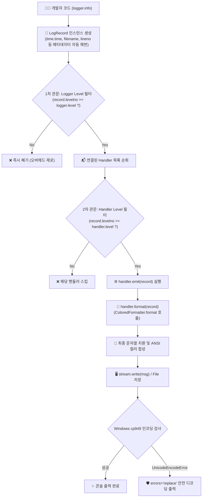

# 🧭 24_파이썬 로깅 엔진 원리와 실시간 성능 프로파일링 설계 (Python Logging Engine & Performance Profiling Architecture)

> [!ABSTRACT] 🏛️ 영구 엔지니어링 지식 개요
> 대용량 실차 계측 데이터(VBOX, Dewesoft) 파싱, 기상-노면 4D 시공간 디지털 트윈 보간, 차분 머신러닝 보정 파이프라인에서 **단순 `print` 문은 입출력 병목, 포맷 제어 불가, 시간차 측정 부재, 멀티스레드 충돌**이라는 치명적 한계를 가집니다.
> 본 문서는 파이썬 표준 라이브러리 `logging`의 내부 렌더링 파이프라인(`LogRecord` $\to$ `Handler` $\to$ `Formatter`), 시간차(`delta`, `elapsed`) 측정 메커니즘, 2계층 레벨 필터링 원리, Windows 콘솔(`cp949`) 인코딩 방어 전략, 그리고 계층형 로거 네임스페이스 설계 패턴을 체계적으로 정리한 영구 기술 자산입니다.



---

## 1. ⏱️ 시간차(Delta) 및 누적 시간(Elapsed) 내부 계산 원리

### 1.1 `print`와 `time.time()`의 한계
수백 개 파일 처리나 복잡한 알고리즘에서 소요 시간을 측정하려면 전통적으로 코드 곳곳에 `t0 = time.time()`을 선언하고 `print(f"걸린시간: {time.time() - t0}")`를 수동 작성해야 했습니다. 이는 비즈니스 로직을 오염시키고 유지보수를 극도로 저해합니다.

### 1.2 `LogRecord.created`와 상태 머신 기반 시간차 산출
파이썬 로깅 시스템에서 `logger.info(...)`가 호출되는 순간, 파이썬 인터프리터는 현재 시각을 초 단위 부동소수점(`time.time()`)으로 캡처하여 `record.created` 속성에 기록합니다.

`ColoredFormatter`는 내부 상태 변수(`_start_time`, `_last_time`)를 유지하며 다음과 같이 시간차를 계산합니다:

```python
# ColoredFormatter 내부 연산 메커니즘
class ColoredFormatter(logging.Formatter):
    def __init__(self, ...):
        self._start_time = time.time()  # 최초 로거 생성 시점
        self._last_time = None          # 직전 로그 발행 시점

    def format(self, record: logging.LogRecord) -> str:
        current_time = record.created   # 로그 레코드가 생성된 절대 시각

        # 1. 누적 경과 시간 (Elapsed Time)
        total_elapsed = current_time - self._start_time

        # 2. 직전 로그 대비 소요 시간 (Delta Time)
        if self._last_time is None:
            delta_time = 0.0
        else:
            delta_time = current_time - self._last_time
        
        # 다음 로그를 위해 상태 갱신
        self._last_time = current_time

        # 포맷 문자열 조합: [+0.125s] 등
        delta_str = f"[+{delta_time:6.3f}s]"
        ...
```

* **장점**: 개발자가 별도의 시간 변수를 관리하지 않아도, 로그가 찍히는 간격(연산 지연 시간)이 자동으로 콘솔에 실시간 프로파일링됩니다.

### 1.3 `with logger.measure("태스크명"):` 컨텍스트 매니저 원리
특정 블록의 시작/종료 소요 시간을 보장하기 위해 Python의 컨텍스트 매니저(`__enter__`, `__exit__`)를 활용합니다:

```python
@contextmanager
def measure(self, task_name: str):
    start = time.perf_counter() # 초정밀 모노토닉 타이머 사용
    self.info(f"▶ {task_name} 시작...")
    try:
        yield
        elapsed = time.perf_counter() - start
        self.info(f"✔ {task_name} 완료 ({elapsed:.3f}s)")
    except Exception as e:
        elapsed = time.perf_counter() - start
        self.error(f"✘ {task_name} 실패 ({elapsed:.3f}s) - {e}")
        raise # 예외는 그대로 상위로 전파
```
* `time.time()`(시스템 시계 변경 시 왜곡 가능) 대신 **`time.perf_counter()`**(CPU 클럭 기반 단조 증가 타이머)를 사용하여 나노초 단위의 정밀한 소요 시간을 측정합니다.

---

## 2. 🏗️ 파이썬 로깅 라이프사이클과 `format(record)` 파이프라인

### 2.1 "무엇이 로그 문자열을 만드는가?"
많은 개발자들이 `logger.info("메시지")`를 호출하면 로거가 직접 출력하는 것으로 오해합니다. 실제 파이썬 로깅은 **책임 분리(Separation of Concerns)** 원칙에 따라 정교하게 분업화되어 있습니다:

| 계층 | 주체 | 핵심 역할 |
| :--- | :--- | :--- |
| **발행자 (Issuer)** | `Logger` | 로그 요청 접수, 레벨 판정, `LogRecord` 객체 생성, 등록된 핸들러로 전달 |
| **전달자 (Emitter)** | `Handler` | 콘솔(`StreamHandler`), 파일(`FileHandler`), 네트워크 등으로 실제 바이트/텍스트를 방출 |
| **연출가 (Formatter)** | `Formatter` | `LogRecord` 메타데이터(시각, 레벨, 파일명, 메시지)를 최종 문자열로 조립 |

### 2.2 `self.format(record)`의 실행 흐름
핸들러(`ColoredConsoleHandler.emit`) 내부의 `msg = self.format(record)`는 다음과 같이 단계별로 동작합니다:

1. **`handler.format(record)` 호출**:
   핸들러는 자신에게 할당된 포매터 객체(`self.formatter`)가 있는지 확인하고 `self.formatter.format(record)`를 위임 호출합니다.
2. **`ColoredFormatter.format(record)` 진입**:
   - `record.levelname`에 따라 ANSI 색상 코드(초록, 노랑, 빨강 등)와 레벨 이모지(`ℹ️`, `✔`, `⚠️`, `❌`)를 매핑합니다.
   - 시간차(`delta_time`), 누적시간(`total_elapsed`)을 계산하여 레코드의 동적 필드(`record.custom_time`)에 주입합니다.
3. **부모 클래스 `logging.Formatter.format(record)` 호출 (`super().format(record)`)**:
   - 파이썬 표준 라이브러리의 `Formatter`는 사용자 지정 포맷 템플릿(예: `%(asctime)s [%(levelname)s] [%(name)s] %(message)s`)의 치환 키들을 `record.__dict__` 값으로 대입합니다.
   - `record.getMessage()`를 호출하여 `logger.info("값: %d", 10)`과 같은 가변 인자를 최종 포맷팅합니다.
4. **최종 완성된 컬러 문자열 반환**:
   `"17:11:30 [INFO   ] [SnowBraking.Master] 파이프라인 완료"` 형태의 완전한 1줄 문자열이 핸들러로 반환됩니다.

---

## 3. ⚖️ 2계층 로깅 레벨 필터링 원리

### 3.1 로깅 레벨 정수 매핑 체계
파이썬 내부에서 로깅 레벨은 단순 문자열이 아니라 **비교 가능한 정수(Integer)**로 관리됩니다:

```text
CRITICAL (50)
   ▲
 ERROR   (40)
   ▲
WARNING  (30)
   ▲
SUCCESS  (25)  <-- unoUtil 전용 확장 레벨
   ▲
  INFO   (20)
   ▲
 DEBUG   (10)
   ▲
 NOTSET  (0)
```

### 3.2 2단계 관문 구조 (Dual-Gate Filtering)
로깅 시스템은 성능 최적화를 위해 **2단계 필터링 관문**을 거칩니다:

```python
# 1차 관문: Logger 인스턴스 레벨 체크
if record.levelno < logger.level:
    return  # 핸들러로 전달조차 하지 않고 즉시 버림 (CPU 절약)

# 2차 관문: 각 Handler 인스턴스 레벨 체크
for handler in logger.handlers:
    if record.levelno >= handler.level:
        handler.handle(record) # 통과된 핸들러만 출력 실행
```

* **실무적 활용**:
  - `Logger` 레벨을 `DEBUG(10)`으로 열어두고,
  - `ConsoleHandler`는 `INFO(20)`으로 설정하여 화면에는 요약만 출력하고,
  - `FileHandler`는 `DEBUG(10)`으로 설정하여 파일에는 모든 상세 디버깅 파라미터를 빠짐없이 기록하는 이원화 구성이 가능합니다.

---

## 4. 🛡️ Windows 콘솔(cp949) 인코딩 에러 원천 방어

### 4.1 문제 발생 메커니즘
한국어 Windows 환경의 기본 터미널(cmd, 일부 PowerShell 환경)은 레거시 완성형 한글 인코딩인 **`cp949`**(또는 `euc-kr`)를 사용합니다.  
최신 로거에서 시인성을 위해 눈꽃(❄️, `\u2744`), 로켓(🚀, `\U0001F680`) 등의 4바이트 UTF-8 유니코드 이모지를 `sys.stdout.write(msg)`로 출력하려고 시도하면 다음과 같은 치명적 예외가 발생합니다:

```text
UnicodeEncodeError: 'cp949' codec can't encode character '\u2744' in position 103: illegal multibyte sequence
```
이로 인해 `logging` 시스템의 기본 `handleError()`가 작동하며 화면에 불필요한 트레이스백이 쏟아지거나 프로세스가 교착될 수 있습니다.

### 4.2 완전 무결한 방어 알고리즘 (`errors='replace'`)
`ColoredConsoleHandler.emit`에서 콘솔 출력 시 인코딩 예외를 안전하게 포획하여 스트림의 실제 인코딩에 맞게 변환합니다:

```python
def emit(self, record: logging.LogRecord):
    try:
        msg = self.format(record)
        stream = self.stream
        try:
            stream.write(msg + self.terminator)
        except UnicodeEncodeError:
            # 터미널의 현재 인코딩(cp949 등) 획득
            enc = getattr(stream, 'encoding', 'utf-8') or 'utf-8'
            # 인코딩 불가능한 유니코드 문자를 물음표(?) 등의 안전한 문자로 치환
            safe_msg = msg.encode(enc, errors='replace').decode(enc)
            stream.write(safe_msg + self.terminator)
        self.flush()
    except Exception:
        self.handleError(record)
```
* **결과**: `cp949` 터미널에서는 이모지가 안전하게 대체 문자로 치환되어 예외 없이 정상 출력되고, UTF-8 터미널(VS Code, Windows Terminal 등)에서는 선명한 원본 이모지가 그대로 출력됩니다.

---

## 5. 🌲 엔지니어링 패키지를 위한 계층형 로거 트리 패턴

### 5.1 네임스페이스 점(Dot) 표기법과 로거 전파(Propagation)
복잡한 엔지니어링 시스템에서는 단일 로거 대신 패키지 구조와 일치하는 계층형 네임스페이스를 구축해야 모듈별 필터링이 가능합니다:

```python
# 최상위 루트 로거
root_logger = logging.getLogger("SnowBraking")

# 하위 자식 로거 (자동으로 SnowBraking의 자식으로 편입)
master_logger = logging.getLogger("SnowBraking.Master")
twin_logger   = logging.getLogger("SnowBraking.Twin")
engine_logger = logging.getLogger("SnowBraking.Engine")
```

### 5.2 unoUtil `LOGGER(name, root_name)` 편의 설계
`unoUtil.convenienceFunction.logger.LOGGER`는 복잡한 `logging.getLogger` 호출을 단 1줄로 단축합니다:

```python
from unoUtil.convenienceFunction.logger import LOGGER

# SnowBraking 네임스페이스 트리의 자식 로거로 자동 결속
logger = LOGGER("Engine", root_name="SnowBraking")
# 내부 로거 식별자: 'SnowBraking.Engine'
```

* **파급 효과**:
  - `root_name="SnowBraking"`의 전역 레벨을 `logging.WARNING`으로 올리면, `Master`, `Twin`, `Engine` 등 모든 하위 모듈의 `DEBUG` 및 `INFO` 출력이 단 한 번의 설정으로 일괄 음소거(Mute)됩니다.
  - 모듈별로 서로 다른 로그 포맷이나 파일 핸들러를 독립적으로 부여할 수도 있습니다.

---

## 6. 🎨 프로그레스 바(Progress Bar) 터미널 UI/UX 렌더링 무결화 표준 (2026-09-21 업데이트)

대규모 분석 루프나 파일 파싱 중 진행률을 시각적으로 모니터링하기 위해 사용되는 실시간 프로그레스 바(`ProgressBar`)는, 터미널 가로폭 제한과 한글/유니코드 전각 문자의 너비 차이, 그리고 로깅 시스템 간의 충돌로 인해 수많은 display 버그가 발생할 수 있습니다. 
본 섹션은 이러한 디스플레이 결함을 전격적으로 해결하고 무결점의 엔터프라이즈급 UI/UX를 달성하기 위해 적용된 4대 핵심 렌더링 최적화 표준입니다.

### 6.1 `print()` 누출 패치와 핸들러 연계 (`ProgressBarAwareStreamHandler`)
루프 내에서 디버그용으로 `print()`를 직접 사용해 텍스트를 터미널로 흘려보내면, 그려져 있던 프로그레스 바 게이지 라인이 지워지지 않고 다음 줄로 계속 밀려 내려가서 잔상이 축적되는 치명적인 버그가 발생합니다.
* **표준안**: `print()`를 모두 전수 제거하고 사내 표준 로거인 `LOGGER`로 일원화합니다.
* **원리**: 로깅 시스템의 핸들러를 ProgressBar 전용 래퍼 핸들러(`ProgressBarAwareStreamHandler`)에 바인딩하여, 새로운 로그가 들어올 때 현재 출력 중인 프로그레스 바를 화면에서 일시적으로 지우고 로그를 안전하게 찍은 뒤, 다시 프로그레스 바 게이지를 하단에 즉시 재복원하는 스마트 렌더링 라이브러리 아키텍처를 가동합니다.

### 6.2 핵심 정량 정보(진행률 수치)의 좌측 대이동 표준 (Left-Align Layout)
터미널 가로폭(80열 내외)의 제한으로 속도, 시간, 경로 텍스트가 우측으로 너무 길어져 트렁케이션(잘림)이 일어날 때, 가장 중요한 데이터 정량 카운트 정보(`1/6` 등)가 우측 끝에 배치되어 있으면 함께 잘려 나가 진행 상태를 아예 인지할 수 없게 됩니다.
* **표준안**: `count_info`를 퍼센티지 오른쪽 옆인 좌측 영역으로 이동시켜 그룹화 배치합니다.
  * **기본 포맷**: `16.7% (1/6) |████░░░░░░░░░░░░░| 00:01 ( 1.2s/it)`
* **효과**: 우측 가로폭 초과로 텍스트 잘림이 발생하더라도, 핵심 정량 지표인 진행율과 현재 인덱스 카운트만큼은 절대 손상되지 않고 언제나 100% 생존하여 가독성이 완벽히 유지됩니다.

### 6.3 VT100 하드웨어 자동 개행 제어 (`DECAWM` 제어 프로토콜)
터미널의 기본 성질 중 하나인 자동 개행(Auto Wrap, DECAWM) 기능은 문자열 길이가 가로폭을 초과할 때 강제로 다음 줄로 줄 바꿈을 수행합니다. 이 상태에서 프로그레스 바가 캐리지 리턴(`\r`)으로 제자리 업데이트를 수행하면, 두 줄로 개행된 잔상들이 지워지지 않고 누적되면서 터미널 화면을 도배하는 심각한 레이아웃 버그가 발생합니다.
* **표준안**: 프로그레스 바를 렌더링하기 직전 자동 개행을 차단하고, 렌더링 완료 후 이를 다시 복구하는 ANSI 제어 프로토콜을 탑재합니다:
  - **개행 일시 금지 (`\033[?7l`)**: 바 인쇄 전 터미널에 송신하여 문자열이 아무리 길어져도 억지로 한 줄에 머물게 합니다.
  - **개행 다시 복구 (`\033[?7h`)**: 바 인쇄 완료 후 복원 명령을 송신하여 타 모듈 및 기본 터미널의 정상적인 개행 작동을 보증합니다.
* **효과**: 파이썬이 문자열을 강제로 자르는 가위질을 배제하고 터미널의 내장 렌더링을 허용하여, 80칸을 초과하는 극단적인 가로폭 환경에서도 잔상 오동작을 0% 원천 방어합니다.

### 6.4 복원 코드 (`STR_CLR_END`) 트렁케이션 방어
문자열이 트렁케이션 처리될 때, ANSI 색상을 복원해주는 특수 코드(`\033[0m`, `STR_CLR_END`)까지 함께 잘려 나가 유실되는 현상이 생기면, 이후에 찍히는 모든 일반 텍스트들까지 이전에 적용되었던 색상(초록색 등)에 오염되어 깜빡이는 플리커 버그가 발생합니다.
* **표준안**: 문자열 잘림 처리가 감지되거나 슬라이싱을 수행할 때는 **반드시 결과 문자열의 맨 끝에 복원 코드 `STR_CLR_END`를 강제로 덧붙이도록** 문자열 후처리 로직을 무결화합니다.
* **효과**: ANSI 컬러 누출 및 깜빡임 현상을 원천 방어하여, 터미널 색상이 언제나 예측 가능하게 표준 백색과 보조 색상 간 정합성을 완벽하게 유지합니다.

---

## 🔗 연관 문서 및 통합 색인

* 🧭 **[[02_Projects/회사_업무/20_unoUtil_모듈개발/convenienceFunction/logger/Logger|unoUtil 통합 로깅 및 콘솔 모니터링 모듈 매뉴얼 (LOGGER.md)]]**
* 📘 **[[vt_acc_brk|VT_ACCBRK 실차 가감속 평가 패키지 매뉴얼]]**
* ❄️ **[[20_SnowBrakingPerformance_통합모듈_매뉴얼|SnowBrakingPerformance 통합 모듈 매뉴얼]]**
* 📚 **[[04_Resources/00_지식_위키_통합_색인|04_Resources 지식 위키 통합 색인 (MOC)]]**
