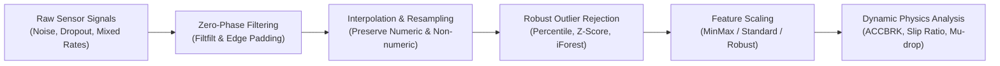
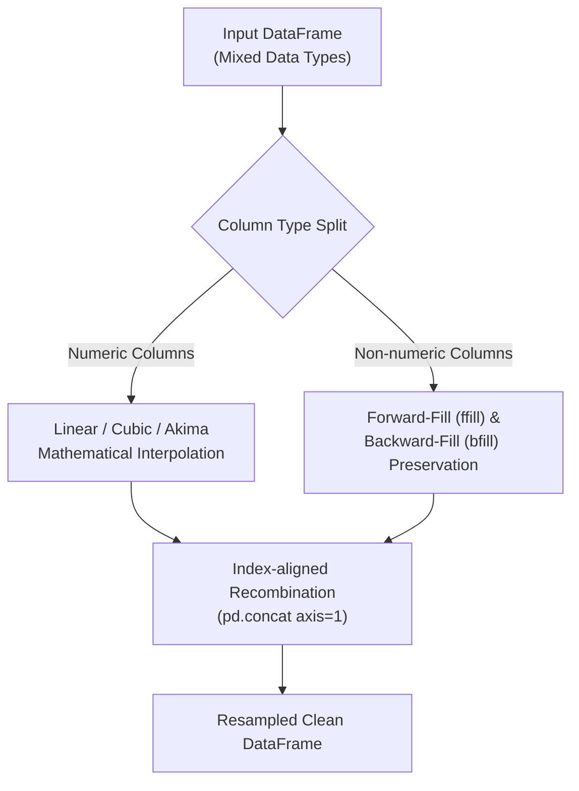

# 📡 실차 신호처리 및 시계열 데이터 정제 공학 (Signal Processing & Data Cleansing)

> [!ABSTRACT] 🏛️ 개요 및 엔지니어링 배경
> 실차 주행 시험(제동거리 측정, 슬립율 산출, 휠 속도 거동 등)에서 취득되는 CAN 버스, VBOX GPS, 휠 속도 센서 신호는 **엔진 진동, 노면 요철 충격, 센서 드롭아웃(Dropout), 다중 장비 간 샘플링 레이트 불일치(100Hz vs 20Hz)** 등 복합적인 노이즈를 내포하고 있습니다.  
> 본 문서는 원시 계측 신호의 물리적 의미를 훼손하지 않으면서 분석 신뢰도를 극대화하기 위해 규명된 **위상 지연 없는 필터링(Zero-Phase Filter), 비수치 보존 리샘플링(Non-numeric Preserving Resample), 다중 이상치 탐지(Multi-method Outliers)**의 수학적/공학적 이론 및 표준 파이프라인을 정립합니다.



---

## 1. 🌊 필터링 공학: 위상 지연(Phase Lag) 극복과 Zero-Phase 필터

### 1.1. 단순 이동평균(Simple Moving Average)의 치명적 결함: 위상 지연
실차 제동 시험에서 브레이크 페달을 밟는 순간($t_{brk}$)과 최대 감속도($G_{peak}$) 발생 시점은 밀리초(ms) 단위의 정밀도를 요구합니다.
일반적인 인과적(Causal) 단방향 이동평균 필터는 다음과 같이 정의됩니다:

$$y[n] = \frac{1}{M} \sum_{k=0}^{M-1} x[n-k]$$

이 필터는 윈도우 크기 $M$에 비례하여 반드시 **$\tau = \frac{M-1}{2}$ 샘플의 위상 지연(Phase Lag)**을 발생시킵니다.  
예를 들어 100Hz 계측 환경에서 $M=21$ 윈도우를 적용하면 10샘플(0.1초 = 100ms)의 시간 지연이 발생하며, 이는 100km/h 주행 시 약 **2.78m의 제동거리 오차**로 직결됩니다.

### 1.2. 양방향 영위상 필터링 (Zero-Phase Filtering: `filtfilt`)
`unoUtil.signal_process.post_process.filters`는 Scipy의 `signal.filtfilt` 원리를 활용하여 순방향 필터링 후 시간 축을 반전(Time-reversal)하여 역방향 필터링을 수행합니다:

$$x_1[n] = x[n] * h[n] \quad \xrightarrow{\text{Time-reversal}} \quad x_2[n] = x_1[-n]$$
$$y_1[n] = x_2[n] * h[n] \quad \xrightarrow{\text{Time-reversal}} \quad y[n] = y_1[-n]$$

이 과정에서 주파수 응답은 $|H(e^{j\omega})|^2$이 되어 위상 왜곡 $\angle H(e^{j\omega}) = 0$이 완벽하게 보장됩니다.

```text
[입력 신호] ──────> [ H(z) 순방향 ] ──> [ 시간 반전 ] ──> [ H(z) 역방향 ] ──> [ 시간 반전 ] ──────> [ 영위상 출력 ]
                     (위상 지연 +θ)                                (위상 지연 -θ)                 (순수 위상 왜곡 = 0)
```

### 1.3. 경계 왜곡(Edge Effect) 방어를 위한 반사 패딩(Symmetric Padding)
`filtfilt`는 신호의 시작점과 끝점에서 과도 응답(Transient Response)으로 인한 튕김 현상이 발생할 수 있습니다.  
`unoUtil`은 신호 양 끝단에 경계값 반사 패딩(`padlen = 3 * window_size`)을 자동 적용하여, 제동 시작 및 정지 직전의 신호 왜곡을 원천 차단합니다.

### 1.4. 고속 연산을 위한 SOS (Second-Order Sections) 구현
고차 필터 적용 시 계수의 수치적 불안정성(Numerical Instability)을 방지하기 위해 2차 섹션(`sosfiltfilt`)을 옵션(`moving_average_fast`)으로 제공하여, 10만 행 이상의 고속 데이터에서도 부동소수점 오차 없이 3~5배 빠른 연산 속도를 달성합니다.

---

## 2. ⏱️ 리샘플링 및 보간 공학: 이종 데이터 비동기 정합

### 2.1. 불균일 시간축과 이종 계측 주기
실차 평가에서는 다음과 같은 이종 센서가 동시 작동합니다:
- **VBOX 100Hz**: GPS 속도, 종/횡가속도, 요레이트 (고정 주기)
- **차량 CAN 10~50Hz**: 스티어링 각도, 휠 속도, 가속 페달 개도율 (비동기 주기)
- **온도/기상 센서 1Hz / 0.2Hz**: 노면 온도, 기온, 습도 (저속 주기)

이를 하나의 통합 데이터프레임으로 정렬하기 위해서는 기준 샘플링 주기($\Delta t = 1/f_s$)로의 고정밀 리샘플링이 필수적입니다.

### 2.2. 수치형 vs 비수치형 분리 보간 아키텍처
단순 `DataFrame.interpolate()` 호출 시 문자열(타이어 코드 `t_01`, 노면 상태 `Wet`, 시험 회차 `R1`) 컬럼이 누락되거나 오류를 유발합니다.  
`unoUtil.signal_process.post_process.resample`은 다음과 같은 **2단계 분리 정합 알고리즘**을 표준화하였습니다:



1. **수치형 컬럼**: 선형(Linear), 3차 스플라인(Cubic), 또는 Akima 보간을 적용하여 물리적 연속성 보장.
2. **범주형/문자열 컬럼**: Forward Fill (`ffill`) 후 Backward Fill (`bfill`)을 수행하여 센서 메타데이터 상태 무손실 전파.

---

## 3. 🛡️ 이상치(Outlier) 색출 및 유효 연속 구간 판별 공학

### 3.1. 이상치의 발생 원인과 유형
1. **GPS 터널/음영지역 멀티패스**: 순간적인 속도 점프(Spike) 또는 0으로의 수직 낙하.
2. **휠 락(Wheel Lock) 및 슬립 시 센서 버스트**: 비현실적인 순간 가속도($> 3G$).
3. **통신 패킷 결측**: NaN 또는 이전 값 동결.

### 3.2. 4대 이상치 정제 전략 비교

| 방법론 | 원리 및 수식 | 적합한 실차 도메인 | 장단점 |
| :--- | :--- | :--- | :--- |
| **백분위수 (Percentile)** | 상/하위 $\alpha\%$ 초과/미만 제거 ($P_{low} \le x \le P_{high}$) | 노면 온도, 환경 기상 데이터 | 분포 가정 없음, 극단치 제거에 가장 직관적 |
| **Z-Score (표준점수)** | $|z| = \left\|\frac{x - \mu}{\sigma}\right\| > \kappa$ (보통 $\kappa=3.0$) | 정상 상태(Steady-state) 정속 주행 속도 | 정규분포 가정 필수, 극심한 이상치에 $\mu, \sigma$ 왜곡 위험 |
| **격리 숲 (Isolation Forest)** | 랜덤 트리 분할 시 얕은 깊이(Path Length)로 고립되는 점 색출 | 다변량(가속도 + 요레이트 + 조향각) 복합 이상치 | 비모수적(Non-parametric), 복합 거동 탐지 우수 |
| **확장 격리 숲 (Extended IF)** | 초평면(Hyperplane)을 임의 경사로 분할하여 축 편향성 제거 | 고차원 주행 궤적 및 자세각 이상치 | 계산 비용 높음, 복합 궤적 탐지 최상 |

### 3.3. 유효 연속 구간 탐색 (`find_continuous_interval`)
실차 제동 시험에서 유효한 제동 구간은 "감속도가 $-0.2G$ 이하로 최소 1.5초(150샘플) 이상 지속되는 구간"과 같은 시간적 연속성을 충족해야 합니다.  
`unoUtil`은 부울 마스크(Boolean Mask)의 차분(`np.diff`)을 이용해 연속된 유효 블록의 `[start_idx, end_idx, duration]`을 $O(N)$의 선형 시간 내에 정확히 추출합니다.

---

## 4. 🔗 상호 참조 및 위키링크

* 💼 **실행 매뉴얼**: [[02_Projects/회사_업무/20_unoUtil_모듈개발/signal_process/post_process/filters|filters 상세 매뉴얼]] | [[02_Projects/회사_업무/20_unoUtil_모듈개발/signal_process/post_process/outliers|outliers 상세 매뉴얼]]
* 🚗 **연계 분석 엔진**: [[04_Resources/21_제동/00_제동_기술_통합_색인|차량 제동 기술 통합 색인]] | [[20_VBOX_계측_데이터_규격_및_GPS좌표계|VBOX 계측 데이터 규격]]
* 🧭 **통합 색인**: [[00_지식_위키_통합_색인|04_Resources 지식 위키 통합 색인 (MOC)]]
