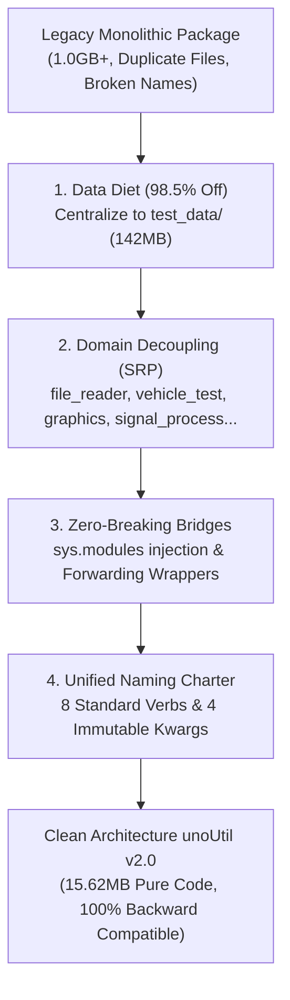

# 🏗️ 대규모 파이썬 패키지 모듈화 및 무중단 하위호환 아키텍처 (Python Architecture & 0-Downtime Migration)

> [!ABSTRACT] 🏛️ 개요 및 엔지니어링 배경
> 사내 데이터 분석 라이브러리는 수년간 다양한 연구원과 프로젝트를 거치며 성장하는 과정에서 **단일 파일 모놀리스(1,000줄 이상), 대용량 바이너리 데이터(1GB 이상) 무분별 분산, 네이밍 불일치, 하위 호환성 단절 공포**라는 기술 부채(Technical Debt)에 직면하게 됩니다.  
> 본 문서는 `unoUtil` v2.0 프로젝트를 통해 규명된 **패키지 98.5% 다이어트 기법**, **단일 책임 원칙(SRP) 기반 서브모듈화**, **`sys.modules` 동적 가로채기 기반 0-Downtime 무중단 하위 호환성 패턴**, 그리고 **사내 공통 네이밍 헌장**의 엔지니어링 표준을 정리합니다.



---

## 1. 📦 대용량 계측 데이터 격리 및 패키지 98.5% 다이어트

### 1.1. 패키지 내 테스트 데이터 분산의 폐해
파이썬 패키지 내부에 실차 계측 파일(VBO, SDF, D7D 등 수백 MB~GB 단위)이 모듈별로 산재할 경우:
1. `git clone` 및 소스코드 인덱싱 속도 저하.
2. `pip install` 배포 시 네트워크 대역폭 및 디스크 용량 낭비.
3. 동일한 테스트 데이터가 여러 폴더에 중복 보관되어 데이터 일관성 상실.

### 1.2. 중앙 단일 테스트 데이터 저장소(`test_data/`) 전략
`unoUtil`은 패키지 루트의 `test_data/` 하위 5대 도메인으로 최소 필수 대표 샘플 13개(142MB)를 단일화하고, 패키지 내부의 모든 example 데이터를 제거하였습니다:
- `test_data/raw_readers/`: VBO, VBB, D7D, DWD, CSV 원시 계측기 샘플 (78MB)
- `test_data/acc_brk/single_run/`: 단일 제동 평가 런 데이터 (6.8MB)
- `test_data/acc_brk/pjt_bmw320_mock/`: 6개 휠 종합 프로젝트 데이터 (15.5MB)
- `test_data/handling/`: 조종안정성 요레이트/조향각 데이터 (3.1MB)
- `test_data/signal_process/`: 노이즈 합성 및 필터링 검증 데이터 (1.2MB)

이로써 패키지 순수 코드 용량은 **1.0GB+ $\rightarrow$ 15.62MB (98.5% 절감)**를 달성하였습니다.

---

## 2. 🛡️ 무중단 하위 호환성 (Zero Breaking Change) 아키텍처

사내에서 이미 수십 명의 연구원이 수백 개의 주피터 노트북과 자동화 스크립트에서 기존 경로를 임포트하고 있을 때, 단순히 파일명을 바꾸거나 이동하면 전사적 업무 마비가 발생합니다.  
`unoUtil`은 **2단계 하위 호환 브릿지**를 구축하여 기존 코드가 단 1줄의 수정 없이 그대로 구동되도록 보장합니다.

### 2.1. 1단계: `sys.modules` 동적 가로채기 (Dynamic Module Injection)
파이썬의 모듈 임포트 메커니즘은 `sys.modules` 딕셔너리를 먼저 탐색합니다. 최상위 `unoUtil/__init__.py`에서 신규 경로를 구버전 모듈 경로에 사전 등록합니다:

```python
# [unoUtil/__init__.py]
import sys
from . import signal_process
from .signal_process import post_process

# 구버전 경로를 신규 객체로 즉각 매핑
sys.modules['unoUtil.unoPostProcessing'] = post_process
sys.modules['unoUtil.unoPostProcessing._UnoPP_'] = post_process._UnoPP_
```

이렇게 하면 사용자가 `import unoUtil.unoPostProcessing`을 실행하는 순간, 파이썬 인터프리터는 파일 시스템을 찾지 않고 `sys.modules`에 등록된 신규 모듈을 즉시 반환합니다.

### 2.2. 2단계: 1줄 포워딩 래퍼 (Forwarding Wrapper Files)
직접 파일 경로를 탐색하는 IDE(VSCode, PyCharm)의 코드 완성(IntelliSense)과 정적 분석기를 위해, 기존 파일 위치에 1줄짜리 re-export 래퍼를 유지합니다:

```python
# [unoUtil/graphicTools/_Plotter_.py]
from unoUtil.graphics.plotters.plotter import *
```

### 2.3. 클래스 및 함수 별칭 (Aliases)
PEP 8 표준 대문자 카멜케이스(CapWords)와 기존 축약어/스네이크케이스를 동시에 노출합니다:
- `VTAccBrk = VT_ACCBRK`
- `BaseMemory = AN_MEMORY`
- `Plotter = _Plotter_`
- `set_cursor_mode = SetCursorMode`
- `get_statistics_df = get_statics_df` (철자 교정 및 구버전 오타 호환)

---

## 3. 🔤 표준 네이밍 헌장 (Naming Charter)

### 3.1. 8대 표준 동사 접두사 (API Functions)

```text
[디스크 I/O] ──> load_ (전체 DB/프로젝트 로드)  /  save_ (결과 파일/리포트 디스크 저장)
[스트림]     ──> read_ (원시 파일 파싱)
[수학/물리]  ──> calc_ (제동거리, 슬립율 등 결정론적 수치 연산)
[상태/통계]  ──> get_  (객체 내부 속성, 요약 통계량 추출)
[조건 검색]  ──> find_ (유효 제동 구간, 임계치 초과 인덱스 색출)
[시각화]     ──> plot_ (차트 렌더링)
[환경 제어]  ──> set_  (글로벌 폰트, 커서 모드, 로그 레벨 설정)
```

### 3.2. 4대 불변 보존 키워드 인자 (Immutable Keyword Arguments)
사내 연구원들의 타이핑 습관과 가독성을 위해 아래 4개 인자는 전 모듈에서 철저히 고정:
1. `print: bool`: 콘솔 텍스트 요약 출력 여부
2. `plot: bool`: 차트 시각화 수행 여부
3. `save: Optional[str, Path]`: 저장 경로 지정
4. `close: bool = True`: 시각화 생성 직후 figure 메모리 해제 여부 (무중단 원칙)

---

## 4. 🚫 시각화 무중단(Non-blocking) 엔지니어링 표준

### 4.1. `plt.show()`의 문제점
`plt.show()`는 내부적으로 GUI 이벤트 루프를 실행하며, **사용자가 창을 마우스로 닫기 전까지 다음 라인의 코드가 실행되지 않고 프로세스가 완전히 블로킹(Hang)**됩니다.  
이는 배치 처리, 대규모 루프 평가, 서버 환경에서 치명적인 장애를 유발합니다.

### 4.2. 무중단 표준 구현 패턴
`unoUtil`의 모든 시각화 함수는 아래의 패턴을 엄격히 준수합니다:
```python
def plot_data(data, save=None, close=True):
    fig, ax = plt.subplots(...)
    ax.plot(...)
    
    if save:
        fig.savefig(save, bbox_inches='tight', dpi=300)
    
    if close:
        plt.close(fig)  # GUI 블로킹 차단 및 메모리 누수 방지
    
    return fig, ax
```

---

## 5. 🔗 상호 참조 및 위키링크

* 💼 **실행 매뉴얼**: [[00_unoUtil_모듈개발_대시보드|unoUtil 사내 통합 프레임워크 개발 프로젝트 대시보드]]
* 📡 **연계 공학 지식**: [[25_실차_신호처리_및_시계열_데이터_정제_공학|실차 신호처리 및 시계열 데이터 정제 공학]] | [[23_이종_계측_데이터_통합_파이프라인_및_대규모_마이그레이션_엔지니어링|이종 계측 데이터 통합 파이프라인]]
* 🧭 **통합 색인**: [[00_지식_위키_통합_색인|04_Resources 지식 위키 통합 색인 (MOC)]]
