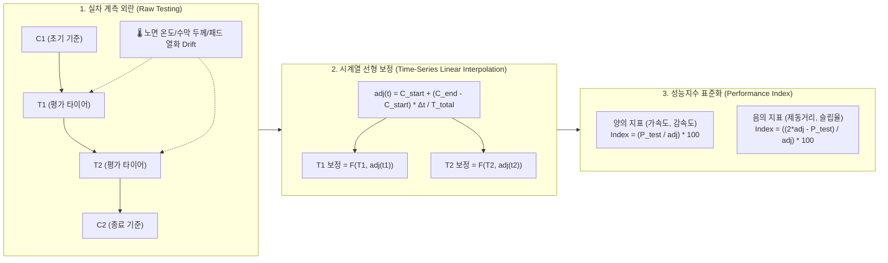

# 🚗 실차 제동·가감속 성능지수 수학적 모델 및 시계열 선형 보정 이론 (Vehicle Acc/Brk Performance Index & Time-Series Linear Correction)

> [!ABSTRACT] 🏛️ 개요 및 엔지니어링 배경
> 실외 프루빙 그라운드(Proving Ground) 및 실차 시험 환경에서 계측되는 타이어의 제동거리(Braking Distance)와 가속도(Acceleration)는 **노면 온도(Road Surface Temp), 대기 온습도, 수막 두께(Water Depth), 노면 마찰계수(Mu Drift), 브레이크 패드 페이드(Brake Fade)** 등 시시각각 변하는 외란(Environmental Disturbance)의 영향을 직접적으로 받습니다.  
> 본 문서는 이러한 외란을 제거하기 위한 **컨트롤 타이어(Reference Tire, Control Tire) 기반 조각 선형 보간(Piecewise Linear Interpolation) 수학적 모델**, **지표 방향성(Polarity, Positive vs Negative)에 따른 성능지수(Performance Index) 산출식**, 그리고 이를 고성능 파이프라인으로 구현한 **표준 네이밍 헌장과 무중단 시각화 아키텍처**를 규명합니다.



---

## 1. 🎯 컨트롤 타이어(Reference Tire)와 환경 외란 제거의 필요성

### 1.1. 실차 평가 환경의 외란 요인
실차 평가에서는 동일한 스펙의 타이어라도 오전 9시(노면 온도 15℃)와 오후 2시(노면 온도 38℃)에 측정된 제동거리가 2~4m 이상 차이가 날 수 있습니다:
1. **노면 온도(Track Surface Temp)**: 고무 블록의 점탄성(Viscoelasticity) 및 유리전이온도($T_g$) 거동 변화.
2. **수막 두께 및 배수 상태 (Wet Braking)**: 트랙 살수 시스템의 압력 변동 및 노면 기울기 차이.
3. **노면 마찰계수 연마/폴리싱(Polishing Effect)**: 시험 차량의 연속적인 풀 브레이킹(ABS 작동)으로 인한 아스팔트 미세 텍스처(Micro-texture) 변화.
4. **차량 시스템 열화**: 브레이크 로터/패드 온도 상승에 따른 브레이크 페이드(Brake Fade) 현상.

### 1.2. 컨트롤 타이어 시퀀스 배치 규칙
이를 통제하기 위해 시험 시퀀스 앞뒤에 기준이 되는 **컨트롤 타이어(Control Tire, $C$)**를 배치합니다:
- **기본 배치**: $[C_1 \rightarrow T_1 \rightarrow T_2 \rightarrow T_3 \rightarrow C_2]$
- **확장 배치 (중간 점검)**: $[C_1 \rightarrow T_1 \rightarrow T_2 \rightarrow C_2 \rightarrow T_3 \rightarrow T_4 \rightarrow C_3]$

---

## 2. 📐 시계열 선형 보간(Linear Interpolation) 수학적 모델

`unoUtil.vehicle.ACCBRK.cal_control` 및 `unoUtil.vehicle.analysis_test_data`는 각 평가 타이어가 주행한 정확한 시점의 가상 기준값($\text{adj}$)을 조각별 선형 보간으로 추정합니다.

### 2.1. 단일 구간 보정식 (Single Interval)
시작 컨트롤 타이어 측정 시점 $t_{\text{start}}$와 값 $C_{\text{start}}$, 종료 시점 $t_{\text{end}}$와 값 $C_{\text{end}}$가 주어졌을 때, 임의의 시험 시점 $t$ ($t_{\text{start}} \le t \le t_{\text{end}}$)에서의 보정 기준값 $\text{adj}(t)$는 다음과 같습니다:

$$\text{adj}(t) = C_{\text{start}} + \left( C_{\text{end}} - C_{\text{start}} \right) \times \frac{t - t_{\text{start}}}{t_{\text{end}} - t_{\text{start}}}$$

* 여기서 $t$는 시험 일시(`Datetime`)의 절대 초(timestamp) 또는 연속 시험 순번(Test Sequence Index)을 사용할 수 있습니다.

### 2.2. 다중 컨트롤 타이어 조각 선형 보간 (Piecewise Linear)
컨트롤 타이어가 $n$회 계측된 경우 ($C_1, C_2, \dots, C_n$), 시험 시점 $t$가 속한 구간 $[t_k, t_{k+1}]$을 탐색하여 독립 보간합니다:

$$\text{adj}(t) = C_k + \frac{C_{k+1} - C_k}{t_{k+1} - t_k} (t - t_k) \quad \text{for } t \in [t_k, t_{k+1}]$$

* **구간 외삽 방어(Boundary Fallback)**:
  - $t < t_1$인 경우: $\text{adj}(t) = C_1$ (직전 컨트롤 타이어 값으로 클램핑)
  - $t > t_n$인 경우: $\text{adj}(t) = C_n$ (직후 컨트롤 타이어 값으로 클램핑)
  - 컨트롤 타이어가 1개만 존재하는 경우: $\forall t, \text{adj}(t) = C_1$

---

## 3. ⚖️ 지표 방향성(Polarity)에 따른 성능지수(Performance Index) 수식

타이어 성능 지표는 **값이 클수록 우수한 양의 지표(Positive Metric)**와 **값이 작을수록 우수한 음의 지표(Negative Metric)**로 명확히 분기됩니다.

### 3.1. 양의 지표 (Positive Metrics: 가속도, 감속도 등)
가속도시험의 종가속도($A_x$), 횡가속도($A_y$), 평균 감속도(Mean Deceleration) 등은 클수록 성능이 우수합니다.

#### 1) 성능 지수 (Performance Index, 기준 = 100%)
$$\text{Index}_{\text{pos}} = \frac{P_{\text{test}}}{\text{adj}(t)} \times 100 \quad [\%]$$

#### 2) 환경 오차가 보정된 성능값 (Corrected Value)
초기 기준 컨트롤 타이어 성능 $C_{\text{base}} = C_1$을 기준으로 정규화합니다:
$$\text{corr\_Value} = P_{\text{test}} \times \frac{C_{\text{base}}}{\text{adj}(t)}$$

---

### 3.2. 음의 지표 (Negative Metrics: 제동거리, 제동시간 등)
제동거리($\text{Dist}$)와 정지 시간($t_{\text{stop}}$)은 짧을수록 성능이 우수합니다.

#### 1) 선형 감산 성능 지수 (Linear Subtractive Index)
사내 실차평가에서 가장 널리 사용되는 공식으로, 기준 대비 $x\%$ 단축 시 지수가 $100 + x\%$가 되도록 설계된 선형 대칭 식입니다:

$$\text{Index}_{\text{neg}} = \frac{2 \times \text{adj}(t) - P_{\text{test}}}{\text{adj}(t)} \times 100 = \left( 2 - \frac{P_{\text{test}}}{\text{adj}(t)} \right) \times 100 \quad [\%]$$

> **예시**:
> - 보정 기준 거리 $\text{adj} = 40.0\text{m}$, 평가 타이어 $P_{\text{test}} = 38.0\text{m}$ (5% 단축, 우수)
>   $$\text{Index} = \left(2 - \frac{38.0}{40.0}\right) \times 100 = (2 - 0.95) \times 100 = 105.0\%$$
> - 평가 타이어 $P_{\text{test}} = 42.0\text{m}$ (5% 연장, 열세)
>   $$\text{Index} = \left(2 - \frac{42.0}{40.0}\right) \times 100 = (2 - 1.05) \times 100 = 95.0\%$$

#### 2) 음의 지표 보정 제동거리 (Corrected Braking Distance)
$$\text{corr\_Dist} = P_{\text{test}} \times \frac{C_{\text{base}}}{\text{adj}(t)}$$
노면이 미끄러워져 전체적으로 기준 거리가 길어졌다면($\text{adj} > C_{\text{base}}$), 평가 타이어의 측정 거리($P_{\text{test}}$)를 낮추어 기준 노면 상태에서의 실제 능력치로 복원합니다.

---

## 4. 💻 소프트웨어 구현 및 PEP 8 표준 아키텍처

`unoUtil` v2.0에서는 본 수학적 모델을 모든 실차 평가 모듈에 PEP 8 표준과 무중단 하위 호환 구조로 완벽히 정립하였습니다.

### 4.1. 공통 파라미터 시그니처 표준화
헝가리안 표기법(`df_input`, `str_result_col`, `flag_print`)을 전면 제거하고 명료한 단어형 인자를 채택하였습니다:

```python
from unoUtil.vehicle.ACCBRK import calc_reference_corrected
from unoUtil.vehicle import calc_performance

# 1. 시계열 선형 보정 및 성능지수 계산 표준 호출
res_df, summary_df = calc_reference_corrected(
    data=df_test,
    col_target_negative=['Dist'],    # 음의 지표 (제동거리)
    col_target_positive=['Ax'],      # 양의 지표 (감속도)
    col_test_set='TestTireSet',      # 타이어 세트 식별 컬럼
    col_datetime='Datetime',         # 시험 일시
    refer_kwd='c',                   # 컨트롤 타이어 식별 키워드 ('c1', 'c2' 등)
    print=False,                     # 로깅 제어
    plot=False,                      # 시각화 제어
    save=False                       # 결과 파일 저장 여부
)
```

### 4.2. 하위 호환 매핑 (`**kwargs` Absorption)
기존 사내 레거시 스크립트가 `flag_print=False`나 `df_input=df`로 인자를 전달해도 투명하게 구동됩니다:

```python
def calc_reference_corrected(
    data: Optional[pd.DataFrame] = None,
    print: bool = True,
    **kwargs
) -> Tuple[pd.DataFrame, pd.DataFrame]:
    # 1. data 인자 호환
    if data is None and "df_input" in kwargs:
        data = kwargs["df_input"]
    
    # 2. print 인자 호환
    print_flag = kwargs.get("flag_print", kwargs.get("print", print))
    ...
```

---

## 5. 🚫 시각화 무중단(Non-blocking) 원칙

배치(Batch) 자동화 시스템 및 대규모 실차 데이터 가공 시 Matplotlib의 `plt.show()` 호출은 치명적인 결함을 유발합니다:
- **문제점**: 피규어 창(GUI Window)이 팝업되면서 이벤트 루프가 메인 스레드를 점유(Block)하여 창을 마우스로 닫기 전까지 다음 시험 데이터 분석이 진행되지 않고 프로세스가 정지(Hang)됨.
- **표준 가이드라인**:
  1. `plt.show()` 호출 **전면 금지**.
  2. 그래프 저장은 `plt.savefig()`를 수행한 후 반드시 `plt.close(fig)`로 메모리를 즉시 해제.
  3. 시각화 함수는 항상 `return fig, ax` 형태로 Figure 객체를 반환하여 상위 함수가 배치 저장할 수 있도록 설계.

---

## 6. 🔗 상호 위키 백링크 (Knowledge Network)

* 🏛️ **지식 통합 색인**:
  * [[00_지식_위키_통합_색인|04_Resources 영구 지식 위키 마스터 MOC]]
  * [[00_실차평가_데이터프레임_통합_색인|실차평가 데이터프레임 통합 색인]]
* 🏗️ **엔지니어링 아키텍처**:
  * [[26_대규모_파이썬_패키지_모듈화_및_무중단_하위호환_아키텍처|대규모 파이썬 패키지 모듈화 및 무중단 하위호환 아키텍처]]
  * [[10_실차_평가_데이터_프레임|실차 평가 데이터 프레임 마스터 규격]]
* 💻 **프로젝트 실행 매뉴얼**:
  * [[00_unoUtil_모듈개발_대시보드#3-개발-및-코딩-표준-헌장-pep-8--clean-code|unoUtil PEP 8 & Clean Code 코딩 표준 헌장]]
  * [[cal_control|컨트롤 타이어 보정 연산 모듈 (cal_control.md)]]
  * [[analysis_test_data|실차 시험 데이터 분석 모듈 (analysis_test_data.md)]]
  * [[vt_acc_brk|가감속/제동 종합 분석 프레임워크 (vt_acc_brk.md)]]
