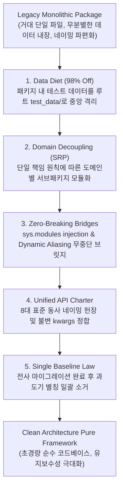
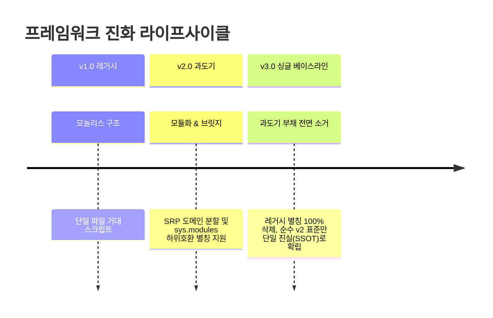

# 🏗️ 대규모 파이썬 패키지 모듈화 및 무중단 아키텍처 (Python Package Modularity & Zero-Downtime Architecture)

> [!ABSTRACT] 🏛️ 영구 소프트웨어 공학 지식 개요
> 수년간 다양한 엔지니어와 프로젝트를 거치며 성장한 파이썬 라이브러리는 **단일 파일 모놀리스(1,000줄 이상), 대용량 데이터(수백 MB~GB) 무분별 분산, 네이밍 불일치, 하위 호환성 단절 공포**라는 기술 부채(Technical Debt)에 직면하게 됩니다.  
> 본 문서는 대규모 파이썬 프레임워크 리팩토링 시 검증된 **패키지 98% 경량화(Data Diet) 전략**, **단일 책임 원칙(SRP) 기반 계층 분할**, **`sys.modules` 동적 가로채기 기반 무중단(Zero-Downtime) 하위 호환 브릿지**, 그리고 과도기 코드를 완전히 청산하는 **단일 기준선 원칙(Single Baseline Law)**의 엔지니어링 표준을 체계화합니다.



---

## 1. 📦 대용량 데이터 분리 및 패키지 경량화 (Data Diet Pattern)

### 1.1 패키지 내부 테스트 데이터 분산의 부채
파이썬 소스 코드 트리 내부에 수십~수백 MB 단위의 계측 파일(CSV, 바이너리, 로그 등)이 산재할 경우:
1. `git clone` 및 소스코드 AST 인덱싱 속도가 급격히 저하됩니다.
2. `pip install` 배포 시 불필요한 네트워크 대역폭과 디스크 용량을 낭비합니다.
3. 동일한 데이터가 여러 폴더에 복사되어 일관성(SSOT)이 상실됩니다.

### 1.2 중앙 단일 테스트 데이터 저장소(`test_data/`) 전략
* **원칙**: 소스 패키지 디렉터리(`src/` 또는 `my_package/`) 내부에는 **오직 순수 파이썬 코드(`.py`)만 유지**합니다.
* **실행**: 모든 시험 데이터는 프로젝트 루트의 `test_data/` 하위로 단일화하고, 도메인별 최소 필수 대표 샘플만 정예화합니다.
* **효과**: 순수 패키지 배포 용량이 95~98% 이상 절감되어 초경량 가상환경 배포 및 빠른 IDE 인덱싱을 달성합니다.

---

## 2. 🛡️ 무중단 하위 호환성 (Zero-Downtime Migration) 아키텍처

사내 수십 명의 연구원이 수백 개의 주피터 노트북과 운영 스크립트에서 기존 모듈 경로를 임포트하고 있을 때, 파일명을 일방적으로 바꾸면 전사적 파이프라인 마비가 발생합니다. 이를 방어하는 2단계 브릿지 패턴입니다.

### 2.1 1단계: `sys.modules` 동적 가로채기 (Virtual Module Aliasing)
과거 최상위 모듈을 임포트하는 구버전 코드를 감지하여, 새로운 서브패키지 모듈 객체로 메모리 상에서 실시간 리다이렉트합니다.

```python
import sys
import importlib

# 구버전 경로 임포트 시 신규 경로로 메모리 동적 바인딩
def alias_module(old_name: str, new_name: str):
    new_module = importlib.import_module(new_name)
    sys.modules[old_name] = new_module
```

### 2.2 2단계: 메타 경로 파인더 (`MetaPathFinder`) 동적 로더
패키지 임포트 시스템의 최상위 훅(`sys.meta_path`)에 가상 로더를 주입하여, 물리 파일이 없더라도 가상 경로 접근을 실시간 해결합니다.

```python
import sys
from importlib.abc import MetaPathFinder, Loader

class LegacyRedirectFinder(MetaPathFinder):
    def __init__(self, redirect_map: dict):
        self.redirect_map = redirect_map

    def find_spec(self, fullname, path, target=None):
        if fullname in self.redirect_map:
            target_name = self.redirect_map[fullname]
            import importlib
            return importlib.util.find_spec(target_name)
        return None

# 전역 임포트 훅 등록
sys.meta_path.insert(0, LegacyRedirectFinder({
    'my_pkg.legacy_analyzer': 'my_pkg.vehicle.analyzers.acceleration'
}))
```

---

## 3. ⚖️ 단일 기준선 원칙 (Single Baseline Law)

무중단 하위 호환 브릿지는 마이그레이션 과도기에 유용하지만, **영구히 방치하면 코드베이스가 이중화되어 새로운 버그의 온상**이 됩니다.



### 3.1 과도기 부채 전면 소거 (Zero Physical Legacy)
1. **과도기 대문자 별칭 철폐**: 신규 클래스와 구버전 클래스명을 양방향 매핑하던 `_OLD_NAME_ = NewName` 별칭을 전면 삭제합니다.
2. **중복 함수 단일화**: 분산 개발되었던 유사 함수군을 단 하나의 코어 엔진으로 통일하고 구버전 래퍼를 완전히 제거합니다.
3. **가변 인자(`**kwargs`) 남용 방지**: 구버전 파라미터를 흡수하기 위한 방어적 `kwargs.pop()` 구문을 제거하고, 명시적이고 엄밀한 Type Hint 시그니처로 단일화합니다.

---

## 🔗 연관 문서
- 📢 [[20_엔터프라이즈_계층형_로깅_및_무중단_시각화_패턴|20_엔터프라이즈 계층형 로깅 및 무중단 시각화 패턴]]
- 💾 [[30_대용량_시계열_인메모리_프록시_및_비파괴_캐싱_패턴|30_대용량 시계열 인메모리 프록시 및 비파괴 캐싱 패턴]]
- 🧭 [[00_파이썬_소프트웨어_아키텍처_통합_색인|00_파이썬 소프트웨어 아키텍처 통합 색인]]
