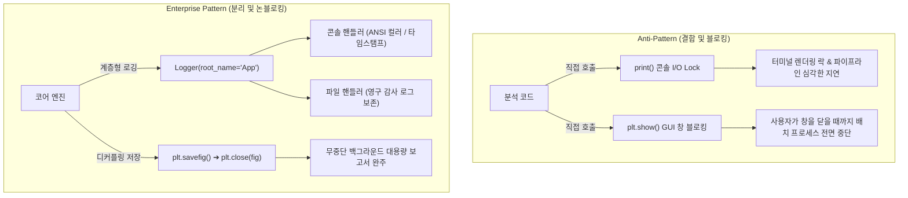

# 📢 엔터프라이즈 계층형 로깅 및 무중단 시각화 패턴 (Enterprise Hierarchical Logging & Non-Blocking Visualization)

> [!ABSTRACT] 🏛️ 영구 소프트웨어 공학 지식 개요
> 대규모 시계열 데이터 파이프라인과 자동화 배치 분석 환경에서 **단순 `print()` 문과 차단형 GUI 창(`plt.show()`)은 콘솔 I/O 병목, 로그 레벨 통제 불가, 무한 멈춤(Hang), 멀티프로세스 크래시**라는 치명적 결함을 유발합니다.  
> 본 문서는 대규모 엔지니어링 소프트웨어 구축 시 필수적인 **계층형 로거 네임스페이스 설계 패턴**, **Windows 콘솔(CP949) 인코딩 방어 전략**, 그리고 대용량 차트 일괄 생성 시 프로세스 멈춤과 메모리 누수를 원천 차단하는 **무중단(Non-blocking) 시각화 라이프사이클**을 규명합니다.



---

## 1. 🚫 표준 `print()` 사용의 공학적 결함과 I/O 병목

### 1.1 표준 출력 스트림 I/O 락 (Kernel Context Switching)
* Python의 `print()`는 기본적으로 운영체제의 표준 출력(`sys.stdout`) 버퍼를 동기식으로 호출합니다.
* 터미널 창에 수만 줄의 로그를 렌더링할 때 발생하는 커널 컨텍스트 스위칭 비용은 순수 수치 연산 시간보다 수 배~수십 배 길어져 심각한 I/O 병목을 만듭니다.

### 1.2 중요도 레벨(Level) 부재로 인한 진단 실패
* `print()`는 정보의 성격(`DEBUG`, `INFO`, `WARNING`, `ERROR`)을 분기할 수 없습니다.
* 운영 환경에서 수백 줄의 단순 진행 메시지에 파묻혀 치명적인 센서 결측 경고나 수학적 발산 예외를 조기에 포착하지 못합니다.

---

## 2. 🌲 계층형 로거 트리 (Logger Tree Hierarchy) 패턴

### 2.1 네임스페이스 계층 구조
모든 서브패키지는 최상위 프로젝트명을 루트(Root)로 두고 온점(`.`) 표기법으로 계층 트리를 구성합니다.

```text
CoreFramework (Root Logger)
├── CoreFramework.DataReader (데이터 리더 계층)
├── CoreFramework.Signal (신호처리 계층)
├── CoreFramework.Physics (동역학 연산 계층)
└── CoreFramework.Plotter (시각화 플로터 계층)
```

이 패턴을 적용하면, 최상위 실행 스크립트에서 단 한 줄의 설정으로 전체 하위 모듈의 로그 수위를 일괄 제어할 수 있습니다:
```python
import logging
# 전체 프레임워크의 상세 로그를 차단하고 경고 이상만 표출
logging.getLogger("CoreFramework").setLevel(logging.WARNING)
```

### 2.2 Windows 콘솔 (`CP949`) 인코딩 크래시 방어
* Windows 기본 콘솔은 `cp949` 또는 `euc-kr` 인코딩을 사용하여, 4바이트 유니코드 이모지(예: `✅`, `✨`, `🚀`) 출력 시 `UnicodeEncodeError`로 전체 프로세스가 크래시됩니다.
* **표준 방어 패턴**: 콘솔 로거 포맷터에서는 유니코드 이모지를 배제하고, 표준화된 ASCII 토큰(`[V]`, `[SUCCESS]`, `[WARN]`, `[ERROR]`) 또는 ANSI 컬러 코드를 사용하여 플랫폼 독립적인 안전성을 보장합니다.

---

## 3. 🎨 무중단(Non-blocking) 시각화 아키텍처

수십~수백 개의 분석 차트를 일괄 생성하여 엑셀이나 폴더에 저장할 때, GUI 팝업 창은 파이프라인의 가장 큰 적입니다.

### 3.1 `plt.show()` 원천 배제 및 백엔드 고정
배치 분석 스크립트에서는 GUI 툴킷을 띄우지 않는 비대화형 백엔드(Agg)를 사용하거나 `show()` 호출을 원천 금지합니다.
```python
import matplotlib
matplotlib.use('Agg')  # GUI 없는 고속 순수 래스터화 백엔드
import matplotlib.pyplot as plt
```

### 3.2 `savefig()` 후 필수 명시적 `close(fig)` 메모리 해제
Matplotlib의 Figure 객체는 전역 Gcf(Global Current Figure) 매니저에 강하게 참조되어, 파이썬 가비지 컬렉터(GC)가 자동으로 수거하지 못합니다.
* **메모리 누수**: `plt.close(fig)` 없이 루프를 돌면 수백 MB의 RAM 누수가 누적됩니다.
* **표준 패턴**:
```python
def export_chart(fig, save_path):
    try:
        fig.savefig(save_path, dpi=300, bbox_inches='tight')
    finally:
        plt.close(fig)  # 반드시 명시적으로 닫아 RAM 즉시 반환
```

---

## 🔗 연관 문서
- 🏗️ [[10_대규모_파이썬_패키지_모듈화_및_무중단_아키텍처|10_대규모 파이썬 패키지 모듈화 및 무중단 아키텍처]]
- 💾 [[30_대용량_시계열_인메모리_프록시_및_비파괴_캐싱_패턴|30_대용량 시계열 인메모리 프록시 및 비파괴 캐싱 패턴]]
- 🧭 [[00_파이썬_소프트웨어_아키텍처_통합_색인|00_파이썬 소프트웨어 아키텍처 통합 색인]]
