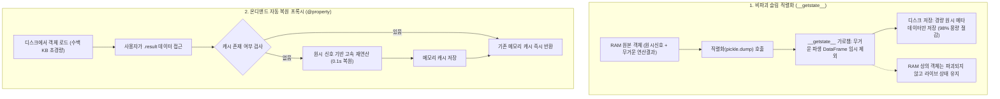
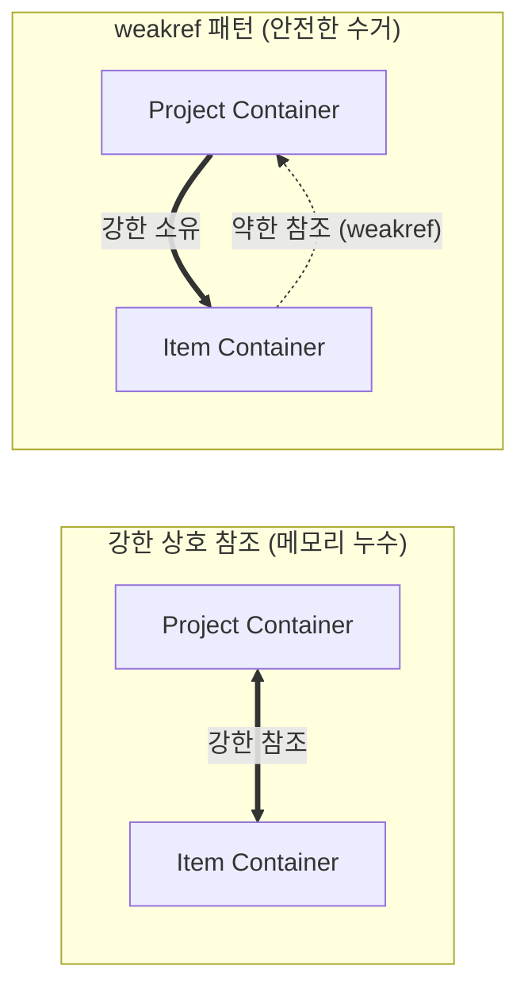

# 💾 대용량 시계열 인메모리 프록시 및 비파괴 캐싱 패턴 (In-Memory Proxy & Non-Destructive Caching Pattern)

> [!ABSTRACT] 🏛️ 영구 소프트웨어 공학 지식 개요
> 수백만 행에 달하는 고주파(100Hz~1000Hz) 계측 센서 데이터를 파이썬 객체로 다룰 때, **무분별한 객체 직렬화는 수 GB의 디스크 용량 낭비와 OOM(Out-Of-Memory) 크래시, 그리고 상호 참조로 인한 순환 가비지 누수**를 유발합니다.  
> 본 문서는 대규모 실차 시계열 분석 엔진에서 검증된 **비파괴 슬림 피클링(`__getstate__`)을 통한 98% 용량 절감 기법**, **온디맨드 자동 복원 프록시(`@property`)**, 그리고 **`weakref`를 활용한 순환 누수 원천 차단 아키텍처**를 규명합니다.



---

## 1. 🗜️ 비파괴 슬림 피클링 (Non-Destructive Slim Pickling)

### 1.1 대용량 시계열 객체 직렬화의 병목
* 시계열 데이터프레임과 분석 결과(FFT, 슬립률 분포, 구간 속도 등)를 그대로 `pickle.dump()`하면 파일 하나당 수십~수백 MB로 부풀어 오릅니다.
* 디스크 용량을 줄이겠다고 객체 내부의 캐시를 `del obj.result`로 지워버리면, 이후 해당 객체를 참조하는 후속 분석 파이프라인에서 `AttributeError`가 발생하여 메모리 상태가 파괴됩니다.

### 1.2 `__getstate__` 훅을 이용한 비파괴 분리 패턴
객체가 직렬화될 때 호출되는 파이썬 표준 매직 메서드 `__getstate__`를 재정의하여, **디스크로 보낼 복사본 딕셔너리에서만 무거운 결과를 제외**하고 원본 메모리는 온전히 보존합니다.

```python
class TimeSeriesContainer:
    def __init__(self, raw_df):
        self.raw_df = raw_df
        self._cached_result = None

    def __getstate__(self):
        # 얕은 복사본을 만들어 직렬화 대상만 선별
        state = self.__dict__.copy()
        # 무거운 파생 계산 캐시는 디스크 저장 대상에서 안전 제외
        state['_cached_result'] = None
        return state

    def __setstate__(self, state):
        self.__dict__.update(state)
```

이 패턴을 적용하면 디스크 저장 파일은 원시 데이터와 메타데이터만 압축되어 **수십 MB $\to$ 수백 KB(98% 이상 절감)**로 줄어들며, 저장 직후에도 메모리 상에서는 아무런 지연 없이 실시간 데이터 조회가 가능합니다.

---

## 2. ⚡ 온디맨드 자동 복원 프록시 (`@property` Lazy Evaluation)

경량화되어 저장된 객체를 나중에 로드했을 때, 사용자가 결과를 필요로 하는 시점에 자동으로 복원해 주는 지능형 프록시 패턴입니다.

```python
class TimeSeriesContainer:
    @property
    def result(self):
        # 캐시가 소거되어 None인 경우에만 1회 고속 연산 수행
        if self._cached_result is None:
            self._cached_result = self._execute_analysis()
        return self._cached_result

    def clear_cache(self):
        """대규모 배치 루프에서 명시적으로 RAM을 비울 때 호출"""
        self._cached_result = None
```

* 사용자는 이 객체가 디스크에서 갓 불러온 상태인지, 메모리에 이미 계산되어 있던 상태인지 신경 쓸 필요 없이 일관되게 `obj.result`로 접근할 수 있습니다.

---

## 3. 🔗 약한 참조(`weakref`)를 통한 순환 참조 메모리 누수 방지

상위 프로젝트 컨테이너(Project)와 하위 단위 컨테이너(Item) 간에 양방향 참조가 발생할 때, 일반적인 강한 참조는 파이썬 가비지 컬렉터의 순환 참조 수거 지연(Cyclic Garbage)을 유발합니다.



```python
import weakref

class ItemContainer:
    def __init__(self, project):
        # 상위 컨테이너는 weakref로 바인딩하여 순환 참조 연결고리 해제
        self._project_ref = weakref.ref(project)

    @property
    def project(self):
        return self._project_ref()
```

* 상위 프로젝트가 메모리에서 해제되는 즉시 모든 하위 아이템 객체들도 즉각 GC에 의해 회수되어 장시간 배치 가동 시 OOM(Out-Of-Memory)을 원천 방어합니다.

---

## 4. 🛡️ 센서 결측 및 축퇴 방어 (Auto-Pruning Pattern)

다채널 센서 계측 시 특정 센서가 단선되거나 전행 0값(분산 0)일 때, 전체 분석 파이프라인이 크래시되는 것을 방지하는 방어적 프로그래밍 패턴입니다.
* **유효 채널 자동 선별**: 분석 루프 진입 전 `np.ptp(signal) < 1e-4` 검사를 통해 신호 변화가 없는 결측 채널을 자동으로 건너뜁니다.
* **수치적 축퇴 방어**: SciPy `griddata`의 2D 삼각분할이나 KDE 적분 시 차원 축퇴(`QhullError`)가 발생하는 채널은 `try...except`로 격리하여, 나머지 정상 채널의 분석을 끝까지 완주합니다.

---

## 🔗 연관 문서
- 🏗️ [[10_대규모_파이썬_패키지_모듈화_및_무중단_아키텍처|10_대규모 파이썬 패키지 모듈화 및 무중단 아키텍처]]
- 📢 [[20_엔터프라이즈_계층형_로깅_및_무중단_시각화_패턴|20_엔터프라이즈 계층형 로깅 및 무중단 시각화 패턴]]
- 🧭 [[00_파이썬_소프트웨어_아키텍처_통합_색인|00_파이썬 소프트웨어 아키텍처 통합 색인]]
