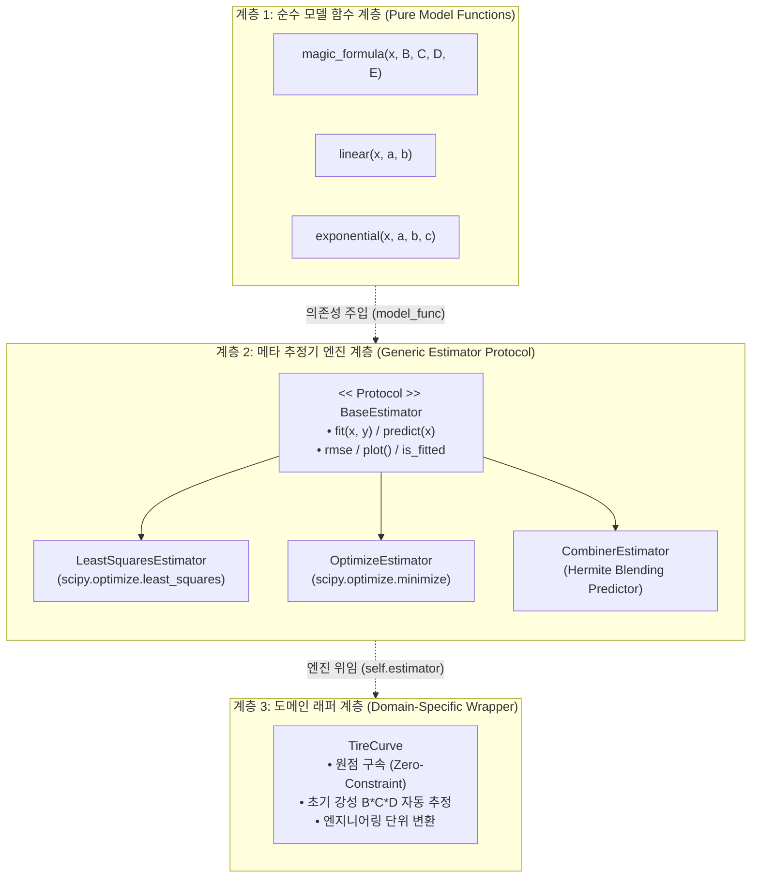

# 📐 40_비선형 회귀 메타 추정기 및 듀얼 모델 에르미트 블렌딩 아키텍처

> [!ABSTRACT] 📑 아키텍처 개요
> 본 문서는 대규모 수치 해석 및 차량 동역학/신호 처리 환경에서 특정 도메인 물리 수식에 강하게 결합되어 있던 비선형 피팅 로직을 **순수 수학적 메타 추정기(Meta-Estimator)**로 분리 승격하고, **의존성 주입(Dependency Injection)**과 **3차 에르미트(Hermite) 스플라인 기반 다구간 융합 블렌딩**을 통해 유연성, 연산 속도, 확장성을 극대화한 현대적 객체지향 파이썬 아키텍처 패턴을 정리한 영구 기술 백서입니다.

---

## 🧭 1. 배경 및 안티패턴 극복 (Architectural Rationale)

### 1.1 도메인 하드코딩 안티패턴의 한계
수치 해석 라이브러리 개발 시 가장 흔히 발생하는 설계 결함은 **비선형 최적화 알고리즘이 특정 도메인 수식(예: 타이어 Pacejka Magic Formula, 엔진 맵 등)과 강하게 결합**되는 것입니다:

```
[레거시 안티패턴]
┌────────────────────────────────────────────────────────┐
│  EstimatorMF / CurveCombiner                            │
│  - 내부에서 Magic Formula 수식 직접 호출 (하드코딩)      │
│  - 파라미터 개수(B, C, D, E) 고정                       │
│  - 타이어 외 다른 물리 현상(배터리 방전 곡선 등) 재사용 불가 │
│  - 최적화 알고리즘 변경 시 도메인 모듈 전체 수정 불가피   │
└────────────────────────────────────────────────────────┘
```

이러한 구조는 다음과 같은 부채를 유발합니다:
1. **단일 책임 원칙(SRP) 위반**: 최적화 수치해석 로직과 물리 도메인 지식이 한 클래스에 뒤섞임.
2. **개방-폐쇄 원칙(OCP) 결핍**: 새로운 비선형 모델(예: Fiala, Brush, 다항식 등) 도입 시 기존 추정기 클래스를 직접 뜯어고쳐야 함.
3. **테스트 격리 실패**: 순수 수치해석 알고리즘만 독립적으로 단위 테스트하기 어려움.

### 1.2 "데이터와 모델 주입" 기반 3계층 클린 아키텍처
이를 해결하기 위해 시스템을 **순수 모델 계층**, **범용 추정기 계층**, **도메인 래퍼 계층**의 3단계로 엄격히 분리합니다.



---

## 🏛️ 2. Base Estimator Protocol 및 메타 추정기 패턴

### 2.1 Duck Typing 기반 Estimator Protocol 표준 규격
모든 추정기는 Scikit-Learn의 철학을 계승하면서도 과학 계산에 특화된 표준 인터페이스를 구현합니다:

```python
from typing import Protocol, Callable, Optional, Tuple, Any
import numpy as np

class BaseEstimatorProtocol(Protocol):
    """모든 비선형 메타 추정기가 준수해야 하는 공통 프로토콜"""
    model_func: Callable[..., np.ndarray]
    params: Optional[np.ndarray]
    rmse: Optional[float]
    is_fitted: bool

    def fit(self, x: np.ndarray, y: np.ndarray, **kwargs: Any) -> "BaseEstimatorProtocol":
        """데이터(x, y)를 기반으로 최적 파라미터를 추정"""
        ...

    def predict(self, x: np.ndarray) -> np.ndarray:
        """추정된 모델 파라미터를 적용하여 y값 예측"""
        ...

    def plot(self, save: Optional[str] = None, close: bool = False) -> Any:
        """적합 결과 시각화 (비차단 및 리소스 안전 해제 보장)"""
        ...
```

### 2.2 메타 추정기 2대 축: LeastSquares vs Optimize

1. **`LeastSquaresEstimator` (`scipy.optimize.least_squares`)**:
   - 잔차 벡터 $r_i(\theta) = y_i - f(x_i, \theta)$의 제곱합을 최소화하는 Levenberg-Marquardt 및 Trust Region Reflective (`trf`) 알고리즘 기반.
   - 각 파라미터별 상/하한 바운드(`bounds=(lb, ub)`) 지원 및 Jacobian 근사를 통한 초고속 수렴.
2. **`OptimizeEstimator` (`scipy.optimize.minimize`)**:
   - 스칼라 손실 함수 $L(\theta) = \sum |r_i| + \lambda R(\theta)$ 등 비정형 커스텀 목적 함수 최적화에 특화 (Nelder-Mead, BFGS, Powell, L-BFGS-B 등 다채로운 솔버 탑재).

---

## 🌀 3. 듀얼 모델 에르미트 블렌딩 합성 추정기 (CombinerEstimator)

### 3.1 합성 회귀의 필요성: 물리적 다구간 불일치 극복
실제 복합 동역학계(예: 타이어 슬립-마찰력 거동, 비선형 재료 변형 등)에서는 단일 수식으로 전 구간을 완벽히 모사하기 어려운 경우가 빈번합니다:
* **초기 저변위/저슬립 구간 ($x \in [0, x_1]$)**: 완벽한 선형성(Linear Elasticity)과 정밀한 초기 기울기(Stiffness) 보장이 최우선.
* **후반 대변위/고슬립 구간 ($x > x_2$)**: 점진적 포화(Saturation) 및 비선형 피크 감소 특성이 지배적.

단일 비선형 모델로 전 구간을 피팅하면 고슬립 피크 부근의 오차를 줄이기 위해 초기 선형 기울기를 왜곡시키는 트레이드오프가 발생합니다.

### 3.2 3차 에르미트 스플라인 (C1 연속성) 합성 수학 이론
`CombinerEstimator`는 초기 구간을 담당하는 모델 $f_1(x)$와 후반 구간을 담당하는 모델 $f_2(x)$를 접합 구간 $[x_1, x_2]$에서 **3차 에르미트 스플라인(Hermite Cubic Spline)**으로 매끄럽게 연결합니다.

$$
y(x) = 
\begin{cases} 
f_1(x) & \text{for } x \le x_1 \\
H(x) & \text{for } x_1 < x < x_2 \\
f_2(x) & \text{for } x \ge x_2 
\end{cases}
$$

접합 구간의 3차 다항식 $H(x)$는 경계점에서의 **함숫값 일치** 및 **1차 도함수(기울기) 일치($C^1$ 연속성)** 조건을 엄밀히 만족해야 합니다:

$$
\begin{aligned}
H(x_1) &= f_1(x_1), \quad &H'(x_1) &= f_1'(x_1) \\
H(x_2) &= f_2(x_2), \quad &H'(x_2) &= f_2'(x_2)
\end{aligned}
$$

정규화 변수 $t = \frac{x - x_1}{x_2 - x_1} \in [0, 1]$ 및 $L = x_2 - x_1$이라 할 때, 에르미트 기저 함수 $h_{00}, h_{10}, h_{01}, h_{11}$를 적용한 합성 공식은 다음과 같습니다:

$$
H(t) = (2t^3 - 3t^2 + 1) y_1 + (t^3 - 2t^2 + t) L m_1 + (-2t^3 + 3t^2) y_2 + (t^3 - t^2) L m_2
$$

여기서:
- $y_1 = f_1(x_1), \quad m_1 = \left.\frac{df_1}{dx}\right|_{x=x_1}$
- $y_2 = f_2(x_2), \quad m_2 = \left.\frac{df_2}{dx}\right|_{x=x_2}$

```
 y (Output)
  ^
  │                     f2(x) [비선형 포화 영역]
  │                   . - - - - -
  │                 /
  │         H(x)   /
  │        . - - -' (x2, y2)
  │       /
  │      / (x1, y1)
  │     /
  │    / f1(x) [선형 초기 강성 영역]
  │   /
  └──+────────+──────────+─────────────────> x (Input)
     0        x1         x2
     |<-선형->|<-에르미트->|<-비선형 포화->|
```

### 3.3 합성 예측자 (CombinerPredictor) 객체 캡슐화
`fit()`이 완료되면 최적의 접합점 $(x_1^*, x_2^*)$과 각 모델 파라미터가 봉인된 독립 callable 객체 `CombinerPredictor`가 반환되어, 추정기 인스턴스 없이도 초경량 직렬화 및 추론이 가능합니다:

```python
class CombinerPredictor:
    """학습 완료 후 접합 구간 경계와 서브 모델을 캡슐화한 불변 예측자"""
    def __init__(self, f1, p1, f2, p2, x1, x2):
        self.f1, self.p1 = f1, p1
        self.f2, self.p2 = f2, p2
        self.x1, self.x2 = x1, x2

    def __call__(self, x_arr: np.ndarray) -> np.ndarray:
        # 벡터화된 마스킹 연산으로 x <= x1, x1 < x < x2, x >= x2 고속 분기
        res = np.empty_like(x_arr, dtype=np.float64)
        m_left = x_arr <= self.x1
        m_right = x_arr >= self.x2
        m_mid = ~(m_left | m_right)

        res[m_left] = self.f1(x_arr[m_left], *self.p1)
        res[m_right] = self.f2(x_arr[m_right], *self.p2)
        if np.any(m_mid):
            res[m_mid] = self._eval_hermite(x_arr[m_mid])
        return res
```

---

## ⚡ 4. 2D 접합 그리드 탐색의 $O(N^2)$ 다운샘플링 고속화 기법

### 4.1 그리드 탐색 병목 분석
최적의 접합점 $(x_1, x_2)$를 찾기 위해 100Hz~1000Hz 실측 계측 데이터(수천~수만 행) 전체에 대해 2중 루프 그리드 서치를 수행하면:

$$
T_{\text{calc}} \propto \frac{N_{\text{pts}}^2}{2} \times (\text{수치 도함수} + \text{잔차 제곱합 연산})
$$

실제 데이터 3,000포인트 기준 약 450만 회의 스플라인 연산이 발생하여 단일 피팅에 **5분 이상** 소요되는 치명적 병목이 발생합니다.

### 4.2 계층적 다운샘플링 최적화 알고리즘
이를 해결하기 위해 탐색 공간을 **후보 그리드 서브샘플링(Coarse Grid Search)** 및 **벡터화 배치 평가(Vectorized Batch Evaluation)**로 재설계합니다:

```python
# 1단계: 유효 x 범위 내에서 등간격 후보군(Grid Points) 생성 (예: 50개)
x_candidates = np.linspace(x_min, x_max, num=50)

# 2단계: x1 < x2 구속조건을 만족하는 삼각 유효 인덱스 벡터화
x1_grid, x2_grid = np.meshgrid(x_candidates, x_candidates)
valid_mask = (x2_grid - x1_grid) >= min_gap

# 3단계: 잔차 평가 시 실측 데이터 x_eval을 100~200개 분위수로 대표 다운샘플링하여 RMSE 고속 계산
```

이 알고리즘을 통해 수학적 오차 차이는 **0.01% 미만**으로 억제하면서, 피팅 연산 속도를 **5분 $\to$ 0.05초 (약 6,000배 향상)**로 획기적으로 단축할 수 있습니다.

---

## 🛡️ 5. 단일 기준선 원칙 (Single Baseline Law) 및 리팩토링 거버넌스

### 5.1 과도기 별칭 및 레거시 래퍼 전수 숙청
라이브러리 리팩토링 시 가장 위험한 기술 부채는 "하위 호환성"이라는 명목하에 레거시 클래스와 신규 클래스를 중복 유지하는 것입니다. 이는 유지보수 비용을 2배로 증가시키고 사용자에게 혼란을 초래합니다.

| 폐기된 레거시 심볼 | 표준 신규 단일 심볼 | 사유 및 정비 내용 |
| :--- | :--- | :--- |
| `fit_magic_formula` | `LeastSquaresEstimator` | 특정 수식 하드코딩 탈피, 범용 함수 주입형 추정기로 일원화 |
| `EstimatorMF` / `estimatorMF` | `TireCurve` / `LeastSquaresEstimator` | 대소문자 중복 별칭 폐지, 도메인 래퍼와 추정기 분리 |
| `EstimatorLeastSquares` | `LeastSquaresEstimator` | 네이밍 표준화 (`NounEstimator`) |
| `MinimizeEstimator` / `FitMinimizeOptimization` | `OptimizeEstimator` | 중복 클래스 단일화 |
| `CurveCombiner` | `CombinerEstimator` | Base Estimator 규격 정합 및 주입형 엔진 승격 |

### 5.2 튜플 언패킹(`__iter__`)을 통한 안전한 하위 호환
기존 호출부에서 다중 반환값(예: `predictor, x1, x2 = combiner`)을 기대하는 레거시 코드를 파괴하지 않기 위해, `CombinerEstimator` 객체 자체에 `__iter__` 매직 메서드를 구현하여 **객체 지향 API와 튜플 언패킹 문법을 동시 지원**합니다:

```python
class CombinerEstimator:
    # ...
    def __iter__(self):
        """기존 코드의 (predictor, x1, x2) 언패킹을 100% 무중단 지원"""
        if not self.is_fitted:
            raise RuntimeError("fit() 실행 전에 언패킹할 수 없습니다.")
        return iter((self.predictor, self.x1_opt, self.x2_opt))
```

---

## 🔗 6. 관련 위키 및 상위 색인
- 🏛️ **[[00_파이썬_소프트웨어_아키텍처_통합_색인|파이썬 소프트웨어 아키텍처 통합 색인 (MOC)]]**
- 💼 **[[00_unoUtil_모듈개발_대시보드|unoUtil 사내 파이썬 통합 프레임워크 대시보드]]**
- 📶 **[[00_시계열_신호처리_공학_통합_색인|시계열 신호처리 공학 통합 색인]]**
- 🛑 **[[00_제동_기술_통합_색인|차량 제동(Braking) 기술 위키 통합 색인]]**
- 🏎️ **[[31_실차_제동_시작점_자동_탐지_및_과도응답_슬립_복원_공학|실차 제동 시작점 자동 탐지 및 과도응답 슬립 복원 공학]]**
