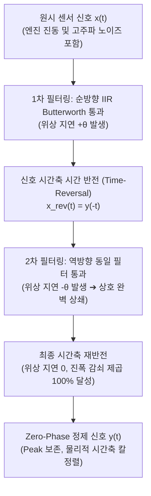

# 🌊 10_Zero-Phase 필터링 및 위상지연 극복 공학 (Zero-Phase Filtering & Phase Lag Elimination)

> [!ABSTRACT] 🏛️ 영구 신호처리 공학 지식 개요
> 실차 동역학 센서(가속도, 요레이트, 압력 등) 신호에서 고주파 노이즈를 제거하기 위해 **단순 이동평균(Moving Average) 필터를 적용하면 필터 윈도우 크기에 비례하는 위상 지연(Phase Lag)이 발생하고, 급제동/급가속 개시 순간의 피크(Peak) 값이 심각하게 깎여 나가는 왜곡**이 발생합니다.  
> 본 문서는 위상 왜곡을 수학적으로 0으로 상쇄시키는 **양방향 순역방향 필터링(Forward-Backward Filtering, `filtfilt`)**, **IIR Butterworth 저역통과 필터 설계**, 그리고 **경계 과도 응답(Transients)을 억제하는 패딩(Padding) 공학**을 규명합니다.

---

## 1. ⚠️ 이동 평균(FIR) 필터의 위상 지연과 피크 깎임 메커니즘

### 1.1 위상 지연(Phase Lag)의 수학적 유도
길이 $W$, 샘플링 주파수 $f_s$인 이동평균 필터의 시간 지연 $\tau$는 다음과 같습니다:

$$\tau = \frac{W - 1}{2 f_s} \quad [\text{sec}]$$

* 예: $100\text{Hz}$ 계측 신호에 $W=21$개 윈도우 이동평균을 적용하면 $\tau = \frac{20}{2 \times 100} = 0.1\text{초}(100\text{ms})$의 시간 지연이 발생합니다.
* 차량이 $100\text{km/h}(27.8\text{m/s})$로 주행 중일 때 $0.1\text{초}$의 지연은 **제동 시작 위치가 $2.78\text{m}$ 뒤로 밀리는 치명적 평가 왜곡**을 초래합니다.

### 1.2 피크 감속도(Peak G) 깎임 왜곡
이동평균은 국소 극값(Local Extremum) 주변의 데이터를 선형 평균하므로, 급격한 브레이크 답력 인가 시 발생하는 스파이크성 피크 감속도($-1.2g$)를 뭉개뜨려 타이어의 진정한 한계 그립 성능을 과소평가하게 만듭니다.

---

## 2. 🛡️ 양방향 필터링 (`filtfilt`)의 수학적 무왜곡 증명

### 2.1 위상 왜곡 상쇄 원리
필터의 주파수 응답이 $H(e^{j\omega}) = |H(e^{j\omega})| e^{j \theta(\omega)}$일 때:
1. **순방향 통과**: $Y_1(\omega) = X(\omega) |H(e^{j\omega})| e^{j \theta(\omega)}$
2. **시간 반전 후 역방향 통과**: 주파수 영역에서 복소 공액(Complex Conjugate)이 곱해집니다:
   $$Y(\omega) = Y_1(\omega) H^*(e^{j\omega}) = X(\omega) |H(e^{j\omega})|^2 e^{j (\theta(\omega) - \theta(\omega))} = X(\omega) |H(e^{j\omega})|^2$$
3. 허수부 위상각 $\theta(\omega) - \theta(\omega) = 0$이 되어 **모든 주파수 대역에서 위상 지연이 정확히 0**이 됩니다.

---

## 3. ⚙️ 경계 패딩 (Edge Padding) 과도 응답 방어

필터 시작점과 끝점에서 초기 상태값 불일치로 인해 신호가 튀는 현상(Transients)을 막기 위해 **홀수 반사 패딩(Odd Reflection Padding)**을 적용합니다.

$$\tilde{x}(-k) = 2x(0) - x(k)$$

이 패딩을 적용하면 신호 양 끝단의 도함수 연속성이 보존되어, 제동 개시 직전의 미소 가속도 신호가 왜곡 없이 매끄럽게 보존됩니다.

---

## 🔗 연관 문서
- 📈 [[20_1D_웨이블렛_변환_디노이징_및_피크_보존_수학|20_1D 웨이블렛 변환 디노이징 및 피크 보존 수학]]
- 📊 [[30_적응형_커널_밀도_추정_KDE_및_초고속_알고리즘|30_적응형 커널 밀도 추정 KDE 및 초고속 알고리즘]]
- 🧭 [[00_시계열_신호처리_공학_통합_색인|00_시계열 신호처리 공학 통합 색인]]
