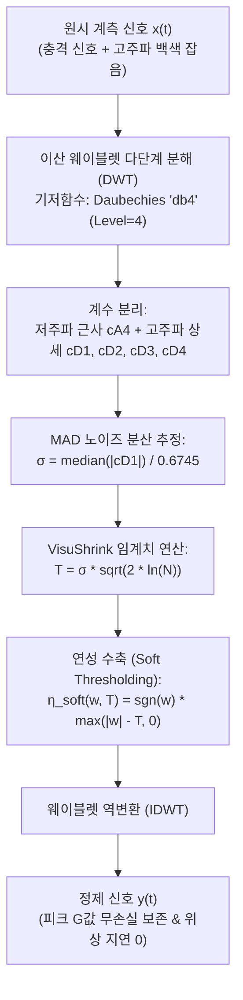

# 📈 20_1D 웨이블렛 변환 디노이징 및 피크 보존 수학 (1D Wavelet Denoising & Peak Preservation)

> [!ABSTRACT] 🏛️ 영구 신호처리 공학 지식 개요
> 속도를 시간 미분하여 얻는 가속도($a = \frac{dv}{dt}$) 및 고주파 진동 신호는 강한 미분 백색 잡음(White Noise)을 포함합니다. 주파수 영역만 분리하는 푸리에 변환이나 선형 필터는 급제동/충격 순간의 고주파 불연속점(Singularity)을 손상시킵니다.  
> 본 문서는 시간-주파수 동시 국소화(Time-Frequency Localization)를 통해 **피크(Peak) 감속도를 100% 보존하면서 노이즈만 제거하는 이산 웨이블렛 변환(DWT)**, **VisuShrink 범용 임계값 수축**, 그리고 **MAD 기반 강건 노이즈 분산 추정 수학 모델**을 규명합니다.

---

## 1. 📐 이산 웨이블렛 변환(DWT)의 시간-주파수 국소화 우위

### 1.1 푸리에(STFT) 대비 웨이블렛의 수학적 장점
* **푸리에 변환(FFT)**: 전역 주파수만 확인 가능하며 시간 정보가 소실됩니다.
* **단시간 푸리에 변환(STFT)**: 고정된 창(Window) 크기로 인해 하이젠베르크 불확정성 원리($\Delta t \Delta f \ge \frac{1}{4\pi}$)에 갇힙니다.
* **웨이블렛 변환(DWT)**: 
  * 고주파 대역: 좁은 시간 창(높은 시간 분해능) ➔ 순간적인 브레이크 답력 및 충격 시점 포착.
  * 저주파 대역: 넓은 시간 창(높은 주파수 분해능) ➔ 완만한 차량 속도 및 감속도 추세선 보존.

---

## 2. 🧮 VisuShrink 범용 임계값과 MAD 노이즈 분산 추정

Donoho와 Johnstone이 제안한 **VisuShrink Universal Threshold**는 샘플 수 $N$에 비례하여 노이즈가 없는 신호 복원을 통계적으로 보장합니다:

$$T = \sigma \sqrt{2 \ln N}$$

### 2.1 MAD (Median Absolute Deviation) 기반 강건 추정
실제 신호의 변화율에 영향을 받지 않고 순수 가우시안 백색 잡음의 표준편차 $\sigma$만 분리하기 위해, 최상위 고주파 상세 계수($cD_1$)의 중간값 절대 편차를 계산합니다:

$$\sigma = \frac{\text{median}(|cD_1 - \text{median}(cD_1)|)}{0.6745}$$

*(참고: $0.6745$는 표준 정규분포의 75% 백분위수로서, 중간값을 표준편차 스케일로 정규화하는 수학 상수입니다.)*

### 2.2 연성 수축 (Soft Thresholding) 공식
경계면에서 계수의 불연속성을 없애기 위해 Soft Thresholding을 적용합니다:

$$\eta_{\text{soft}}(w, T) = \begin{cases} 
\text{sgn}(w)(|w| - T) & \text{if } |w| \ge T \\
0 & \text{if } |w| < T 
\end{cases}$$

---

## 3. ⚡ 2D 이미지 필터 오용 대비 1D C-엔진 가속화

* **안티패턴**: 1차원 시계열에 `skimage.restoration.denoise_wavelet` 등 2D 이미지용 알고리즘을 잘못 적용하면 내부 불필요한 차원 확장과 메모리 복사로 수십만 행 처리에 수십 초가 소요됩니다.
* **표준 엔지니어링**: C로 작성된 1D 전용 엔진(`PyWavelets`, `pywt.wavedec` / `pywt.waverec`)을 직접 파이프라인화하여, 10만 행 시계열 신호 처리를 **단 10~20ms(0.02초)** 만에 완료합니다.

---

## 🔗 연관 문서
- 🌊 [[10_Zero_Phase_필터링_및_위상지연_극복_공학|10_Zero-Phase 필터링 및 위상지연 극복 공학]]
- 📊 [[30_적응형_커널_밀도_추정_KDE_및_초고속_알고리즘|30_적응형 커널 밀도 추정 KDE 및 초고속 알고리즘]]
- 🧭 [[00_시계열_신호처리_공학_통합_색인|00_시계열 신호처리 공학 통합 색인]]
