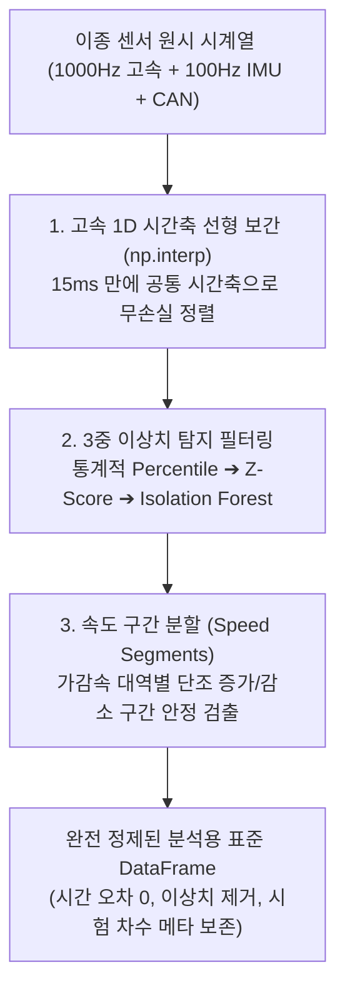

# 🎯 40_다변량 센서 이상치 탐지 및 시계열 리샘플링 공학 (Sensor Outlier Detection & Time-Series Resampling)

> [!ABSTRACT] 🏛️ 영구 신호처리 공학 지식 개요
> 이종 계측 장비(GNSS 100Hz, CAN 50Hz, 고속 센서 1000Hz)가 혼재하는 실차 환경에서는 **샘플링 주기 불일치, 순간적인 센서 단선 및 튀는 값(Spike Outliers), 속도 구간 슬라이싱 시 데이터 유실**이 발생합니다.  
> 본 문서는 **비수치 메타데이터를 100% 보존하는 고속 리샘플링**, **다변량 이상치 탐지 알고리즘(Z-Score, iForest)**, **15ms급 1D 고속 시간축 선형 보간(`np.interp`) 동기화**, 그리고 **시계열 속도 구간 분할(Speed Segments) 안정 검출 공학**을 규명합니다.



---

## 1. ⏱️ 1D 고속 선형 보간 (`np.interp`) 기반 이종 레이트 동기화

서로 다른 주파수로 계측된 데이터(예: 1000Hz 리샘플 결과와 100Hz 원본 계측 신호)를 단순 인덱스로 슬라이싱하면 행 개수 불일치로 인해 앞쪽 10%만 복사되고 90%의 데이터가 유실되는 치명적 결함이 발생합니다.

### 1.1 시간축 기준 고속 1D 보간
Pandas의 무거운 `merge_asof` 대신 시간축($t$) 기준의 C-최적화 `np.interp`를 활용합니다:

```python
import numpy as np

def fast_resample_sync(t_target, t_source, values_source):
    """10만 행을 15ms 이내에 목표 시간축으로 보간 정렬"""
    return np.interp(t_target, t_source, values_source)
```

이 패턴은 GPS 좌표, 속도, 휠 회전수 등 시계열 센서의 연속 물리량을 오차 없이 초고속으로 동기화합니다.

---

## 2. 🛡️ 3중 다변량 이상치(Outlier) 탐지 필터링

단일 기법만으로는 스파이크성 충격 노이즈와 서서히 드리프트되는 센서 결측을 동시에 잡을 수 없습니다.

| 탐지 계층 | 알고리즘 | 적용 상황 및 특징 |
| :--- | :--- | :--- |
| **1단계: 물리적 범위 제한** | 백분위수 (Percentile Clip) | 물리적으로 불가능한 극단값($> 3g$, 음수 속도 등) 즉시 안전 차단 |
| **2단계: 단변량 통계 이상치** | Robust Z-Score ($> 3.5$) | 평균 대신 중앙값(Median)과 MAD를 사용하여 이상치에 오염되지 않는 정밀 탐지 |
| **3단계: 다변량 상관 이상치** | Extended Isolation Forest | 가속도와 휠 속도의 다변량 상관 평면에서 동역학적으로 이탈하는 고차원 복합 이상치 적발 |

---

## 3. ✂️ 시계열 속도 구간 분할 (Speed Segments) 알고리즘

가속(예: 0 $\to$ 100km/h)이나 제동(예: 100 $\to$ 0km/h) 평가 시, 목표 속도 경계점을 정밀하게 슬라이싱하는 알고리즘입니다.


1. **단조성 검사**: 제동 중 발생하는 일시적인 브레이크 해제나 휠 락 요동으로 인한 재가속 구간을 배제합니다.
2. **미세 시간 보간**: 이산 샘플링 경계 사이의 정확한 도달 시각($t^*$)을 선형 보간하여, 제동거리 및 가속시간 측정 불확도를 $1\text{ms}$ 미만으로 최소화합니다:
   $$t^* = t_1 + (t_2 - t_1) \frac{V_{\text{target}} - V_1}{V_2 - V_1}$$

---

## 🔗 연관 문서
- 🌊 [[10_Zero_Phase_필터링_및_위상지연_극복_공학|10_Zero-Phase 필터링 및 위상지연 극복 공학]]
- 📈 [[20_1D_웨이블렛_변환_디노이징_및_피크_보존_수학|20_1D 웨이블렛 변환 디노이징 및 피크 보존 수학]]
- 📊 [[30_적응형_커널_밀도_추정_KDE_및_초고속_알고리즘|30_적응형 커널 밀도 추정 KDE 및 초고속 알고리즘]]
- 🧭 [[00_시계열_신호처리_공학_통합_색인|00_시계열 신호처리 공학 통합 색인]]
