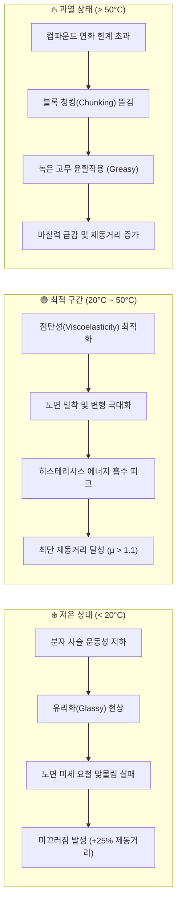

---
id: "tech_road_temperature_tire_braking"
title: "노면 온도와 타이어 제동 상관관계 (타이어 컴파운드 관점)"
type: resource
category_main: 제동
category_sub: 제동물리
topic: 노면온도와타이어마찰
date: 2026-09-10
status: 완료
tags:
  - 제동
  - 타이어컴파운드
  - 노면온도
  - 점탄성
  - 히스테리시스
  - U자형곡선
aliases:
  - "11_노면_온도와_타이어_제동_상관관계"
  - "11_노면_온도와_타이어_제동_상관관계"
---

# 🌡️ 노면 온도와 타이어 제동 상관관계 (타이어 컴파운드 관점)

> [!ABSTRACT] 📌 개요
> 타이어 트레드 고무의 점탄성(Viscoelasticity) 특성에 기인하여, 노면 및 외기 온도가 타이어 접지 마찰계수($\mu$)와 제동거리($100 \to 0\text{ km/h}$)에 미치는 비선형적 상호작용 메커니즘을 상세히 다룹니다.

---

## 1. 인터랙티브 인포그래픽

* 🔗 **인터랙티브 인포그래픽 실행**: [CodePen - 타이어 제동거리와 노면 온도의 상관관계 분석](https://codepen.io/uikqxpfb-the-lessful/pen/YPGQepx)

> [!NOTE] 🔬 핵심 물리 개념: 점탄성(Viscoelastic) 폴리머
> 타이어는 단순한 탄성 고무가 아닌 **점탄성(Viscoelastic) 폴리머**입니다. 노면과 기온의 변화는 고무 컴파운드의 분자 사슬 운동성을 근본적으로 변화시키며, 이는 제동 거리를 결정하는 가장 핵심적인 인자입니다.

---

## 2. 3대 핵심 온도 지표 (KPIs)

| 구분 | 수치/대역 | 현상 및 물리 메커니즘 |
| :---: | :---: | :--- |
| **최적 그립 온도 구간** | **$20^\circ\text{C} \sim 50^\circ\text{C}$** | 트레드 고무의 히스테리시스(Hysteresis) 손실과 응착 마찰(Adhesion)이 극대화되는 황금 구간 |
| **저온 제동거리 증가** | **+25% 이상** | $0^\circ\text{C}$ 이하 환경에서 고무가 유리전이($T_g$) 상태로 접근하여 노면 요철과의 기계적 맞물림 저하 |
| **고온 그립 상실** | **15% 저하** | $60^\circ\text{C}$ 초과 노면에서 컴파운드 과열 연화, 블록 뜯김(Chunking) 및 액화 윤활 작용(Greasy) 발생 |

---

## 3. 온도별 제동거리 변화 추이 ($100\text{ km/h} \to 0$)

타이어 제동거리는 선형적으로 비례하지 않고, 최적 온도 대역($20 \sim 50^\circ\text{C}$)에서 최저점을 찍는 **U자형(포물선) 곡선**을 형성합니다:

| 노면/타이어 온도 | 상태 구분 | 제동거리 ($100 \to 0\text{ km/h}$) | 평균 마찰계수 ($\mu$) |
| :---: | :---: | :---: | :---: |
| **$-10^\circ\text{C}$** | Extreme Cold | $49.5\text{ m}$ | $\approx 0.70$ |
| **$0^\circ\text{C}$** | Cold | $44.2\text{ m}$ | $\approx 0.75$ |
| **$10^\circ\text{C}$** | Cool | $39.8\text{ m}$ | $\approx 0.85$ |
| **$20^\circ\text{C}$** | Optimal Start | $36.5\text{ m}$ | $\approx 1.10$ |
| **$30^\circ\text{C}$** | Peak Grip | **$35.0\text{ m}$ (최단)** | **$\approx 1.20$ (최대)** |
| **$40^\circ\text{C}$** | Optimal | $35.2\text{ m}$ | $\approx 1.15$ |
| **$50^\circ\text{C}$** | Optimal End | $36.8\text{ m}$ | $\approx 1.10$ |
| **$60^\circ\text{C}$** | Overheating | $41.5\text{ m}$ | $\approx 0.85$ |
| **$70^\circ\text{C}$** | Degradation | $47.0\text{ m}$ | $\approx 0.78$ |

---

## 4. 온도 구간별 고무 컴파운드의 물리적 거동

---

## 🔗 연관 제동 및 타이어 문서

* 🌐 **[[10_차량_제동_동역학_시뮬레이션|01. 차량 제동 동역학 시뮬레이션]]**
* 📊 **[[12_차량_시스템_제동성능과_마찰계수_상관관계|03. 차량 시스템 관점 제동성능과 마찰계수(μ) 상관관계]]**
* ⚙️ **[[20_ABS_로직_및_3단계_유압제어_분석|04. ABS 로직 및 3단계 유압 제어 단계별 분석]]**
* 🛞 *[[10_Tire_Shear_Force|타이어 접지력(Grip) 메커니즘 및 전단 변형(Shear Force)]]]**