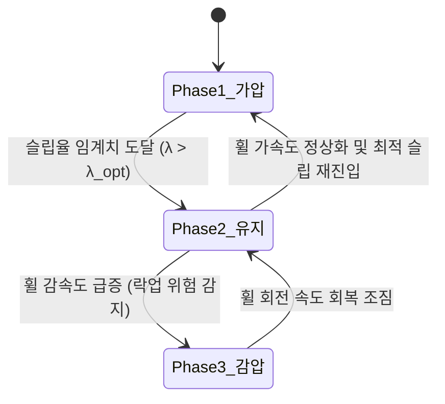

---
id: "tech_abs_logic_3phase_hydraulic_control"
title: "ABS 로직 및 3단계 유압 제어 단계별 제동 성능 분석 (ABS 제어 심화 관점)"
type: resource
category_main: 제동
category_sub: ABS제어
topic: ABS유압제어로직
date: 2026-09-10
status: 완료
tags:
  - 제동
  - ABS
  - 슬립율
  - 유압제어
  - 3단계사이클
  - 브레이크액점도
aliases:
  - "20_ABS_로직_및_3단계_유압제어_분석"
  - "20_ABS_로직_및_3단계_유압제어_분석"
---

# ⚙️ ABS 로직 및 3단계 유압 제어 단계별 제동 성능 분석 (ABS 제어 심화 관점)

> [!ABSTRACT] 📌 개요
> ABS(Anti-lock Braking System)의 핵심 제어 원리인 **슬립율($\lambda$) 추종 제어**, 온도에 따른 **브레이크액 점도($\eta$) 변화 및 유압 전달 시간 지연($\tau$)**, 그리고 $15 \sim 20\text{ Hz}$ 고속 주기로 순환하는 **3단계 유압 제어 사이클(가압-유지-감압)**의 물리 메커니즘을 심화 분석합니다.

---

## 1. 인터랙티브 ABS 제어 분석 리포트

* 🔗 **인터랙티브 리포트 실행**: [CodePen - ABS 로직 및 유압 제어 단계별 제동 성능 통합 분석](https://codepen.io/uikqxpfb-the-lessful/pen/JoRJpqr)

---

## 2. 슬립율($\lambda$) 감도 및 최적 슬립 추종

### ① 슬립율(Slip Ratio) 수학적 정의
$$\lambda = \frac{V_{car} - \omega \cdot R}{V_{car}}$$

* $V_{car}$: 차량 실제 주행 속도 (차체 속도)
* $\omega$: 바퀴 회전 각속도 (Wheel angular speed)
* $R$: 타이어 동반경 (Effective dynamic rolling radius)

### ② $\mu - \lambda$ 특성 곡선과 ABS 제어 목표
* **최적 슬립율 구간 ($\lambda_{opt} \approx 0.15 \sim 0.20$)**:
  * 타이어와 노면 사이의 마찰계수($\mu$)가 최대 피크를 이루는 영역입니다.
  * ABS ECU의 궁극적 목표는 급제동 시 슬립율이 이 피크 밴드($15\% \sim 20\%$)를 벗어나지 않도록 유지하는 것입니다.
* **온도 하강 시 거동**:
  * 고무 경화로 인해 피크 대역 폭이 매우 좁아져, 작은 유압 변화에도 슬립율이 락업 영역($\lambda \to 1.0$)으로 급격히 발산합니다.

---

## 3. 브레이크액 점도($\eta$)와 유압 전달 시간 지연($\tau$)

브레이크 오일(DOT4 등)의 동점도는 온도 하강 시 지수함수적으로 급증합니다.

### 하겐-푸아죄유(Hagen-Poiseuille) 유압 전달 시상수:
$$\tau(T) \approx \frac{8 \cdot \eta(T) \cdot L}{\pi \cdot r^4}$$

* $\eta(T)$: 온도별 브레이크액 점도
* $L$: 마스터 실린더부터 캘리퍼까지의 유압 배관 길이
* $r$: 브레이크 유압 라인의 내부 반경

> [!WARNING] 저온 유압 지연(Time Lag)의 위험성
> 저온 시 유동 저항 급증으로 ABS 솔레노이드 밸브가 개폐되더라도 실제 캘리퍼 피스톤 압력으로 전달되기까지 **물리적 시차(Time Lag $\tau$)**가 발생합니다. 이로 인해 유압 제어의 오버슈트(Overshoot)와 언더슈트(Undershoot)가 심화됩니다.

---

## 4. ABS 3단계 유압 제어 사이클 (3-Phase Cycle)

ABS는 휠 가속도 센서와 차륜 속도 신호를 모니터링하여 아래 3개 페이즈를 **초당 $15 \sim 20$회 ($15 \sim 20\text{ Hz}$)** 반복 순환합니다:

1. **Phase 1: 가압 (Pressure Increase)**
   * 휠 속도가 차체 속도를 안정적으로 추종할 때 유압을 선형 증가시켜 제동력을 극대화합니다.
2. **Phase 2: 유지 (Pressure Hold)**
   * 휠 슬립율이 $\lambda_{opt}$에 도달하면 솔레노이드 밸브를 차단하여 압력을 유지, 타이어 피크 그립을 유지합니다.
3. **Phase 3: 감압 (Pressure Decrease)**
   * 휠 감속도가 임계치를 초과하여 바퀴가 굳어질 위험(Lock-up)이 감지되면 유압을 리턴 펌프로 급속 배출합니다.

---

## 5. 결론: 온도 상태별 실차 제동 메커니즘 종합 비교

| 온도 상태 | 타이어 및 유압 상태 | ABS 제어 거동 | 최종 실차 결과 |
| :---: | :--- | :--- | :--- |
| **저온 상태** ($T < 10^\circ\text{C}$) | • 고무 유리전이로 강성 증가 • 브레이크액 점도 급상승 | • 유압 전달 시상수($\tau$) 지연 • 슬립 예측 오차로 저더(Juddering) 발생 | • **제동거리 15~25% 증가** • 조향 안정성 저하 |
| **최적 상태** ($20 \sim 50^\circ\text{C}$) | • 타이어 점탄성/히스테리시스 극대화 • 브레이크액 설계 점도 일치 | • $15 \sim 20\text{ Hz}$ 고속 제어 완벽 추종 • 피크 마찰계수($\mu \ge 1.1$) 유지 | • **설계상 최단 제동거리 달성** • 안정적인 차체 거동 |
| **고온/과열 상태** ($T > 60 \sim 100^\circ\text{C}$) | • 트레드 블록 연화 및 청킹 • 패드 마찰재 가스 페이드(Fade) | • 마찰계수 급락으로 제동압 증가 요구 • 베이퍼 록 발생 위험 증가 | • **제동거리 급격히 증가** • 페달 답력 상실 및 페이드 |

---

## 🔗 연관 제동 및 타이어 문서

* 🌐 **[[10_차량_제동_동역학_시뮬레이션|01. 차량 제동 동역학 시뮬레이션]]**
* 🌡️ **[[11_노면_온도와_타이어_제동_상관관계|02. 노면 온도와 타이어 제동 상관관계 (컴파운드 관점)]]**
* 📊 **[[12_차량_시스템_제동성능과_마찰계수_상관관계|03. 차량 시스템 관점 제동성능과 마찰계수(μ) 상관관계]]**
* 🛞 *[[10_Tire_Shear_Force|타이어 접지력(Grip) 메커니즘 및 전단 변형(Shear Force)]]]**