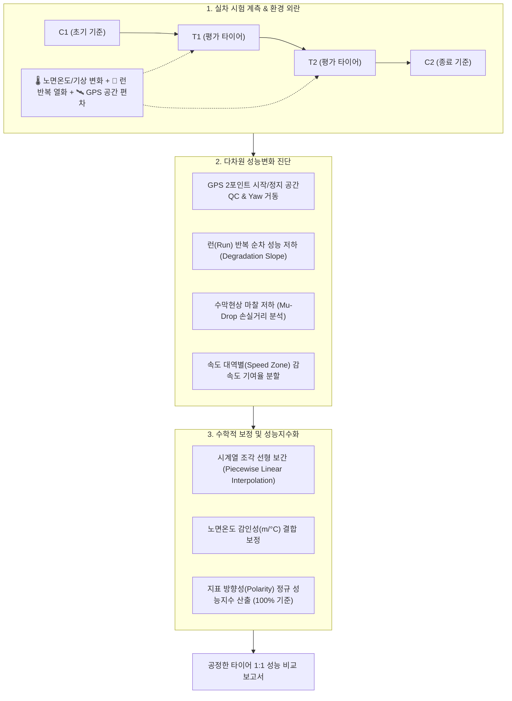

# 🏎️ 30_실차 가감속 성능변화 분석 및 보정 시스템 (Vehicle Acceleration & Braking Performance Variation Analysis & Correction System)

> [!ABSTRACT] 🏛️ 영구 차량공학 지식 개요
> 실외 프루빙 그라운드(Proving Ground) 및 실차 시험 환경에서 계측되는 타이어의 제동거리(Braking Distance)와 가속 성능(Acceleration)은 **시험 중 변화하는 노면 온도, 대기 온습도, 수막 두께, 노면 마찰계수 드리프트, 반복 주행에 따른 타이어 열화(Degradation), 그리고 GPS 시작/정지 공간 편차** 등 복합적인 환경 외란(Environmental Disturbance)의 영향을 직접적으로 받습니다.  
> 본 문서는 이러한 외란을 과학적으로 상쇄하기 위한 **콘트롤 타이어(Control Tire) 시계열 선형 보간 수학 모델**, **지표 방향성(Polarity)에 따른 상대 성능지수(Index) 정규화**, **노면온도 감인성(m/℃)**, **GPS 공간 품질(QC)**, **마찰 저하(Mu-Drop) 손실거리 분석**, 그리고 **물리 가속도 부호 체계(Signed Acceleration Law)**를 총괄 정립한 영구 기술 백서입니다.

---

## 1. 📈 콘트롤 타이어 시계열 선형 보간 수학 모델 (Time-Series Linear Correction)

### 1.1 조각 선형 보간 (Piecewise Linear Interpolation)
시험 세션 동안 노면 컨디션과 외란이 시간에 따라 선형적으로 변화한다고 가정할 때, 임의의 평가 타이어 $T$의 계측 시각 $t_T$에서 가상 콘트롤 타이어의 기준값 $C_{\text{adj}}(t_T)$는 다음과 같이 산출됩니다:

$$C_{\text{adj}}(t_T) = C_{\text{start}} + (C_{\text{end}} - C_{\text{start}}) \times \frac{t_T - t_{\text{start}}}{t_{\text{end}} - t_{\text{start}}}$$

* $t_{\text{start}}, t_{\text{end}}$: 시작 콘트롤($C_{\text{start}}$) 및 종료 콘트롤($C_{\text{end}}$) 시험 평균 타임스탬프
* $t_T$: 평가 대상 타이어 시험 평균 타임스탬프

---

## 2. 🎯 상대 성능지수 (Performance Index) 정규화

타이어 평가에서 기준 타이어(Control Tire)는 $100.0\%$의 베이스라인을 가집니다. 지표의 물리적 특성(수치가 클수록 우수한가, 작을수록 우수한가)에 따라 수식이 분기됩니다.

### 2.1 정비례 지표 (Higher is Better: 가속도, 제동 감속도, 횡가속도 등)
성능 수치가 기준 과녁보다 클수록 우수한 지표:

$$\text{Index} = \left( \frac{P_{\text{test}}}{C_{\text{adj}}} \right) \times 100$$

### 2.2 역비례 지표 (Lower is Better: 제동거리, 가속 소요 시간 등)
수치가 작을수록 우수한 지표 (기준보다 거리가 짧아야 $100\%$를 초과):

$$\text{Index} = \left( \frac{2 \cdot C_{\text{adj}} - P_{\text{test}}}{C_{\text{adj}}} \right) \times 100$$

---

## 3. 🌡️ 노면온도 감인성 (Road Temperature Sensitivity) 결합 보정

단순 '대기 기온'은 고무와 아스팔트 간의 마찰 물성을 대변하기에 불완전합니다. 마른 노면(Dry)과 젖은 노면(Wet)의 열용량과 기화 작용을 반영한 **노면 전용 온도**를 결합합니다.

### 3.1 노면별 감인성 기울기 ($m = \Delta \text{Dist} / \Delta T$)
타이어 고무의 점탄성(Viscoelasticity)과 히스테리시스 손실에 따라 온도 변화 시 제동거리는 다음과 같은 거동을 보입니다:

$$\text{Dist}_{\text{corr}} = \text{Dist}_{\text{raw}} - m \cdot (T_{\text{road}} - T_{\text{ref}})$$

| 노면 조건 | 감인성 기울기 ($m$) | 물리 판정 및 보정 방향 |
| :--- | :---: | :--- |
| **Wet 고마찰** | $+0.147 \text{ m/°C}$ | 정상 물리 거동 (수막 윤활 저하 ➔ 고온 주행 시 가산점 보정) |
| **Wet 저마찰** | $+0.105 \text{ m/°C}$ | 정상 물리 거동 (히스테리시스 저하 ➔ 고온 주행 시 가산점 보정) |
| **Dry 아스팔트** | $+0.106 \text{ m/°C}$ | 정상 물리 거동 (골재 텍스처 접지 마찰 변동) |

---

## 4. 🛰️ GPS 공간 품질 관리 (Spatial QC) 및 런 열화(Degradation) 분석

### 4.1 GPS 2포인트 시작/정지 공간 QC
* **시작점 산포 관리**: 드라이버가 브레이크를 밟는 종방향 위치($X$)와 횡방향 이탈($Y$)의 표준편차를 관리하여, 트랙 내 불균일 마찰 구역 진입 오차를 방지합니다.
* **정지 자세 및 요(Yaw) 거동**: 제동 정지 순간 차량의 헤딩각(Heading Angle) 변화량을 추적하여 제동 안정성을 동역학적으로 검증합니다.

### 4.2 런(Run) 반복 순차 성능 저하 (Degradation Analysis)
* 동일 타이어로 8회 연속 주행 시, 타이어 표면 열화 및 트랙 표면 고무 도포로 인한 성능 추세선 기울기(Degradation Slope)를 도출하여 타이어 내구성 및 시험 재현성을 정량 평가합니다.

---

## 5. 🌊 노면 마찰 저하 (Mu-Drop) 및 속도 구간(Speed Zone) 분석

### 5.1 수막현상 Mu-Drop 손실거리 분석
* 제동 초기(고속) 대비 중후반(저속) ABS 작동 영역에서 마찰계수가 급감하는 Mu-Drop 발생 지점을 클러스터링하고, 이로 인해 연장된 제동 손실거리를 분리 정량화합니다.

> [!TIP] 💡 unoUtil Mu-Drop 강건 분석 알고리즘 실측 검증 보고서
> 피칭 다이브/리바운드 앵커링, 속도 축 등간격 빈 영위상 추세선($\angle H = 0$), 차륜 가속도 RMS 기반 듀얼 오실레이션 포락선($Z_{\text{osc}}$) 및 3D 스무딩 클러스터링의 수학적 상세와 실측 데이터(`25RD120004EF`) 검증은 **[[10_MuDrop_강건_분석_알고리즘_고도화_및_실측검증보고서|Mu-Drop 강건 분석 알고리즘 고도화 및 실측 검증 보고서]]**를 참조하십시오.

### 5.2 속도 대역별(Speed Zone) 감속도 기여율
* 고속 제동 구간(예: 100 $\to$ 60km/h)과 저속 제동 구간(예: 60 $\to$ 10km/h)으로 분할하여, 타이어 패턴과 컴파운드가 어느 속도 대역에서 제동력에 기여했는지를 100% 누적 가로막대로 대조 분석합니다.

---

## 6. ⚖️ 물리 부호 일원화 (Signed Acceleration Law) 및 구동축 유효 슬립률 원리

### 6.1 물리 가속도 및 슬립률 부호 체계
가속과 제동을 단일 가감속 프레임워크로 처리하기 위해 ISO 국제표준 부호 체계를 집행합니다:
* **종방향 가속도**: 감속(제동)은 음수($-0.8g$), 가속은 양수($+0.5g$)로 센서 원시 부호 보존.
* **슬립률(Slip Ratio) 정의**:
  * 제동 슬립률(Wheel Lock): $S_{\text{brk}} = \frac{V - V_w}{V} \times 100 \ge 0$ (무차원 정규화 시 $\kappa_{\text{brk}} \in [0, 1.0]$)
  * 가속 슬립률(Wheel Spin): $S_{\text{acc}} = \frac{V_w - V}{V} \times 100 \ge 0$ (무차원 정규화 시 $\kappa_{\text{acc}} \in [0, 1.0]$)

### 6.2 시험 모드 및 차량 구동방식(Drivetrain Layout) 기반 유효 슬립 축 선택 법칙
슬립-마찰계수($\kappa$-$\mu$) 곡선 복원 시 비구동륜(자유 회전륜, $\kappa \approx 0$)이 평균에 포함되면 슬립률이 절반으로 왜곡되므로, 하중 이동과 구동 토크 전달 경로에 따라 유효 슬립 계측 축을 결정합니다:
* **제동 시험 (`Braking`)**: 4륜 모두에 제동 유압이 인가되며 피치 운동에 의한 동적 하중 이동($\Delta F_z = \frac{m \cdot a_x \cdot h_{\text{CG}}}{L}$)이 전륜에 집중되므로 **전륜축(Front Axle: FL/FR 중 유효 계측 채널 평균)** 을 표준 기준축으로 사용합니다.
* **가속 시험 (`Acceleration`)**: 구동 토크가 인가되어 실제 트랙션 슬립이 발생하는 **구동축(Driven Axle)** 만을 선택해야 합니다:
  * **전륜구동 (`FWD`)**: 전륜축 (`FL` / `FR`)
  * **후륜구동 (`RWD`)**: 후륜축 (`RL` / `RR`)
  * **사륜구동 (`AWD` / `4WD`)**: 4륜 전체 유효 채널 평균 (`FL` / `FR` / `RL` / `RR`)

---

## 7. 🎯 비선형 마찰 곡선(Magic Formula)의 콘트롤 게인 스케일링 동형성 법칙 (Control Gain Scaling Isomorphism)

### 7.1 마찰 곡선 진폭 스케일링과 재피팅(Re-fitting)의 수학적 동치성
개별 타이어 시편 $i$에서 피팅된 Pacejka Magic Formula 곡선을 다음과 같이 정의합니다 ($S_v = 0$ 원점 구속 기준):

$$\mu_i(\kappa) = D_i \sin\Big( C_i \arctan\big\{ B_i \kappa - E_i \big( B_i \kappa - \arctan(B_i \kappa) \big) \big\} \Big)$$

콘트롤 타이어 시계열 조각 선형 보간으로 도출된 시점 $t_i$의 기준값 $\hat{\mu}_{\text{ctrl}}(t_i)$와 전체 콘트롤 평균 $\bar{\mu}_{\text{ctrl}}$로부터 무차원 콘트롤 보정 게인(Control Gain) $G_i$가 결정됩니다:

$$G_i = \frac{\bar{\mu}_{\text{ctrl}}}{\hat{\mu}_{\text{ctrl}}(t_i)}$$

이때 원시 가속도 산점도 데이터 $\{( \kappa_k, a_{x,k} )\}$에 보정 게인 $G_i$를 곱한 뒤 비선형 최적화를 다시 수행하는 것($\text{Re-fit}(G_i \cdot a_x)$)은, 비선형 최소자승 목적함수 $\sum_k \big( G_i a_{x,k} - \tilde{\mu}_i(\kappa_k) \big)^2 = G_i^2 \sum_k \big( a_{x,k} - \mu_i(\kappa_k) \big)^2$의 스케일 불변성에 의해 **기존 피팅 곡선과 외곽 진폭 계수에 $G_i$를 선형 곱셈하는 것과 수학적으로 100% 동형(Isomorphic)** 입니다:

$$\tilde{\mu}_i(\kappa) = G_i \cdot \mu_i(\kappa) = (G_i D_i) \sin\Big( C_i \arctan\big\{ B_i \kappa - E_i \big( B_i \kappa - \arctan(B_i \kappa) \big) \big\} \Big)$$

### 7.2 보정 전·후 Magic Formula 파라미터 변환 불변량 및 스케일링 관계
따라서 보정된 데이터에 대해 불필요한 비선형 반복 최적화를 재수행할 필요 없이, 각 파라미터는 다음의 해석적 변환 법칙을 따릅니다:

| 물리 파라미터 / 지표 | 기호 | 콘트롤 게인($G_i$) 보정 변환식 | 물리적 의미 및 불변성 |
| :--- | :---: | :---: | :--- |
| **피크 마찰 진폭 계수** | $D_{\text{corr}}$ | $D_{\text{corr}} = G_i \cdot D$ | 노면 마찰 드리프트만큼 수직 진폭 스케일링 |
| **최대 마찰계수 (Peak $\mu$)** | $\mu_{\text{peak,corr}}$ | $\mu_{\text{peak,corr}} = G_i \cdot \mu_{\text{peak}}$ | 최대 제동력/구동력 한계치 선형 보정 |
| **초기 종방향 슬립 강성** | $K_{x0,\text{corr}}$ | $K_{x0,\text{corr}} = \left.\frac{d\tilde{\mu}}{d\kappa}\right|_{\kappa=0} = B \cdot C \cdot D_{\text{corr}} = G_i \cdot K_{x0}$ | 원점 접선 기울기($B C D$)는 $D$에 비례하여 동일 게인으로 스케일링 |
| **피크 발생 슬립률** | $\kappa_{\text{peak,corr}}$ | $\kappa_{\text{peak,corr}} = \kappa_{\text{peak}}$ (**불변**) | $\frac{d\tilde{\mu}}{d\kappa} = G_i \frac{d\mu}{d\kappa} = 0$의 해는 $G_i > 0$과 무관하게 불변 |
| **형상·강성·곡률 인자** | $B, C, E$ | $B_{\text{corr}} = B,\; C_{\text{corr}} = C,\; E_{\text{corr}} = E$ (**불변**) | 곡선의 무차원 정규화 형상(Shape/Curvature) 보존 |

---

## 🔗 연관 문서
- 🛑 [[00_제동_기술_통합_색인|00_제동 기술 통합 색인]]
- 🏎️ [[10_차량_제동_동역학_시뮬레이션|10_차량 제동 동역학 시뮬레이션]]
- 🎯 [[40_비선형_회귀_메타_추정기_및_에르미트_블렌딩_아키텍처|40_비선형 회귀 메타 추정기 및 에르미트 블렌딩 아키텍처]]
- 📶 [[00_시계열_신호처리_공학_통합_색인|13_시계열 신호처리 공학 통합 색인]]
- 🏛️ [[00_파이썬_소프트웨어_아키텍처_통합_색인|12_파이썬 소프트웨어 아키텍처 통합 색인]]
