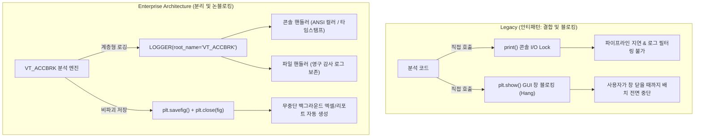

# 📢 실차 평가 시스템 엔터프라이즈 로깅 및 모니터링 아키텍처

> [!ABSTRACT] 🏛️ 영구 공학 지식 레퍼런스 (Permanent Domain Engineering Reference)
> 본 문서는 대규모 실차 계측 데이터(100Hz 시계열 센서)의 전처리, 동역학 분석, 성능 보정 및 리포트 자동화 파이프라인에서 **표준 `print()` 함수를 원천 배제하고 계층형 로거(`unoUtil.logger.LOGGER`)와 무중단(Non-blocking) 시각화 아키텍처를 구축해야 하는 전산 공학적 이유와 설계 표준**을 규명한 영구 기술 레퍼런스입니다.
> 
> * **연계 모듈**: [[10_VT_ACCBRK]], [[11_VT_ACCBRK_TIRE]], [[12_VT_ACCBRK_PROJECT]], [[30_PLOTTER_TIRE]], [[31_PLOTTER_PROJECT]], [[Cal_Control]]
> * **상위 색인**: [[00_제동_기술_통합_색인]], [[00_지식_위키_통합_색인]]



---

## 1. 배경 및 표준 `print()` 사용의 공학적 결함

실차 평가 데이터 분석은 단일 세션에 수십만 행, 다중 세션 배치 분석 시 수백만 행 이상의 대규모 시계열 데이터를 처리합니다. 이러한 환경에서 소스 코드 내부에 무분별하게 삽입된 `print()` 문은 다음과 같은 심각한 시스템적 결함을 유발합니다:

### 1.1 표준 출력 스트림의 I/O 블로킹(Blocking)과 성능 저하
* Python의 `print()` 함수는 기본적으로 OS의 표준 출력(`sys.stdout`) 버퍼에 쓰기 작업을 수행합니다.
* 윈도우 콘솔 및 터미널 환경에서 대량의 텍스트 출력은 **커널 컨텍스트 스위칭(Context Switching)**과 터미널 렌더링 락(Lock)을 발생시켜, 순수 수치 연산 시간보다 화면에 글자를 뿌리는 시간이 더 길어지는 심각한 I/O 병목을 초래합니다.

### 1.2 로그 레벨 부재로 인한 진단 실패
* `print()` 문은 정보의 중요도(`DEBUG`, `INFO`, `WARNING`, `ERROR`, `CRITICAL`)를 구분할 수 없습니다.
* 시험 데이터에서 특정 휠 센서 신호가 누락되거나 보정 인자가 누락되었을 때, 수백 줄의 단순 진행 메시지에 파묻혀 치명적인 계산 오차 원인을 적시에 포착하지 못합니다.

### 1.3 GUI 애플리케이션 및 백그라운드 배치 프로세스 충돌
* `unoUtil`은 향후 PyQt GUI 인터페이스나 백그라운드 스케줄러로 구동될 수 있습니다.
* 표준 출력이 리다이렉트되거나 없는 환경(`pythonw.exe` 등)에서 `print()`는 무시되거나 예외(`BrokenPipeError`, `IOError`)를 일으켜 프로세스를 비정상 종료시킵니다.

---

## 2. 계층형 로거 (`unoUtil.logger.LOGGER`) 아키텍처

`VT_ACCBRK` 시스템은 Python 내장 `logging` 프레임워크를 고도화한 `unoUtil.convenienceFunction.logger.LOGGER`를 표준으로 일원화하였습니다.

### 2.1 네임스페이스 계층 구조 (Logger Tree Hierarchy)

모든 로거는 시스템의 최상위 네임스페이스인 `VT_ACCBRK`를 루트(Root)로 두고, 서브 모듈별로 명확한 계층 트리를 구성합니다:

```text
VT_ACCBRK (Root Engine)
├── VT_ACCBRK.Tire (단일 타이어 동역학 분석)
├── VT_ACCBRK.Project (통합 취합 및 환경 보정)
├── VT_ACCBRK.SubAnalyzers (7대 전문 서브 분석기)
├── VT_ACCBRK.PlotterTire (단일 타이어 시각화)
├── VT_ACCBRK.PlotterProject (프로젝트 비교 시각화)
├── VT_ACCBRK.CalControl (레거시 콘트롤 타이어 보정)
└── VT_ACCBRK.YamlTest (YAML 배치 자동화 드라이버)
```

이러한 계층 구조를 통해 최상위 파이프라인에서 단 한 줄의 설정으로 전체 하위 모듈의 로그 출력 레벨을 일괄 제어(예: 운영 환경에서는 `WARNING` 이상만 출력, 개발/진단 환경에서는 `DEBUG` 전체 출력)할 수 있습니다.

### 2.2 표준 인스턴스화 패턴

```python
import logging
from unoUtil.logger import LOGGER

# 서브모듈명과 root_name을 명시하여 계층 트리 등록
logger = LOGGER("PlotterProject", root_name="VT_ACCBRK", level=logging.DEBUG)
```

### 2.3 로그 레벨별 표준 사용 가이드

| 레벨 | 메서드 | 사용 목적 및 시나리오 | 출력 예시 |
| :--- | :--- | :--- | :--- |
| **`DEBUG`** | `logger.debug()` | 내부 계산 행렬, 상세 인덱스 매핑, 통계 요약 덤프 | `[DEBUG] [Tire] 유효 구간 인덱스: [1200, 3450]` |
| **`INFO`** | `logger.info()` | 파이프라인 구간 탐색 시작, 필터링 완료, 진행 상태 | `[INFO] [Project] 콘트롤 타이어 선형 보간 시작 (4 Sets)` |
| **`SUCCESS`**| `logger.success()` | 시험 세션 분석 완수, 파일 저장 성공, 자가 검증 통과 | `[SUCCESS] [Plotter] 70개 전 차트 이미지 생성 완료` |
| **`WARNING`**| `logger.warning()` | 콘트롤 타이어 패턴 미매칭, 기본값(Fallback) 강제 적용 | `[WARNING] [CalControl] 'c' 패턴 미존재, 첫 타이어 기준 적용` |
| **`ERROR`** | `logger.error()` | 입력 데이터 부재, 센서 채널 누락, 계산 불능 예외 | `[ERROR] [Tire] 휠속도 채널 'WFR' 부재로 슬립 분석 중단` |

---

## 3. 시각화 무중단(Non-blocking) 원칙

### 3.1 `plt.show()`의 치명적 위험성
* `matplotlib.pyplot.show()`는 GUI 윈도우 이벤트 루프를 실행하며, **사용자가 창을 마우스로 닫을 때까지 메인 실행 스레드를 완전히 정지(Block/Hang)**시킵니다.
* 수십 대의 차량과 타이어 데이터를 야간이나 백그라운드에서 일괄 분석하는 대규모 배치 작업에서 `plt.show()`가 1회라도 호출되면 전체 자동화 파이프라인이 영구 대기 상태에 빠집니다.

### 3.2 비파괴 분리 저장 표준 패턴 (`Save & Close Decoupling`)

시각화 플로터 모듈(`PLOTTER_TIRE`, `PLOTTER_PROJECT`)은 피규어 생성, 저장, 메모리 해제를 완벽히 분리하여 무중단성을 확보합니다:

```python
def plot_feature(..., save: Optional[str] = None, close: bool = False):
    fig, axes = plt.subplots(...)
    # ... 그래프 렌더링 로직 ...
    
    # 1. 파일 저장이 요청된 경우 이미지 파일로 저장
    if save is not None:
        save_path = Path(save)
        fig.savefig(save_path, dpi=300, bbox_inches='tight')
        logger.info(f"차트 저장 완료: {save_path.name}")
        
    # 2. close 플래그에 따른 메모리 해제 제어
    if close:
        plt.close(fig)
        
    # 3. 객체를 반환하여 상위에서 일괄 확인 또는 추가 조작 가능
    return fig, axes
```

* **대량 배치 처리 시**: `close=True`를 전달하여 수천 개의 Figure 객체가 RAM에 누적되는 메모리 누수(Memory Leak)를 차단.
* **대화형 환경(Jupyter 등) 시**: `close=False`로 반환받은 Figure 객체를 인라인으로 자유롭게 검토.

---

## 4. API 하위 호환성 복원력 (API Resilience)

기존 레거시 코드나 외부 호출자가 함수에 넘기던 출력 제어 플래그(`flag_print: bool = True` 또는 `print: bool = False`)를 삭제할 경우 호출부에서 `TypeError: unexpected keyword argument`가 발생할 수 있습니다.

`unoUtil`은 이러한 키워드 인자를 절대 삭제하지 않고 **로거의 출력 레벨 필터링과 내부적으로 연동**하여 완벽한 하위 호환성을 유지합니다:

```python
def cal_reference_corrected(
    df_input: pd.DataFrame,
    flag_print: bool = True,  # 키워드 인자 보존
    **kwargs: Any
):
    if not flag_print:
        # flag_print가 False이면 해당 호출 동안 로거 출력을 WARNING 이상으로 일시 격상
        current_level = logger.level
        logger.setLevel(logging.WARNING)
        try:
            return _execute_calculation(...)
        finally:
            logger.setLevel(current_level)
    return _execute_calculation(...)
```

---

## 5. 실무 품질 감사 체크리스트 (Code Audit Checklist)

모든 `unoUtil` 모듈을 신규 개발하거나 리팩토링할 때 다음 5대 품질 수칙을 전수 검증합니다:

- [x] **Print 제로화**: 소스 코드 내에 `print(` 함수 호출이 단 1건도 존재하지 않는가?
- [x] **표준 로거 탑재**: `LOGGER("<ModuleName>", root_name="VT_ACCBRK")` 표준 패턴을 준수하는가?
- [x] **시각화 무중단**: `plt.show()`가 완전히 제거되고 `plt.savefig()` + `plt.close(fig)` 패턴으로 구현되었는가?
- [x] **자가 구동 예제**: 파일 하단 `if __name__ == "__main__":` 블록에서 외부 데이터 의존 없이 모의 데이터로 100% 자가 검증이 가능한가?
- [x] **이중 동기화**: 소스 코드 수정 내역이 로컬 매뉴얼과 옵시디언 볼트(`D:\00_obsidian`) 양쪽에 동일하게 반영되었는가?

---

## 🔗 관련 문서 및 옵시디언 백링크
* 📊 **마스터 대시보드**: [[00_VT_ACCBRK_대시보드]]
* 🏎️ **단일 타이어 분석기**: [[11_VT_ACCBRK_TIRE]]
* 🏛️ **프로젝트 통합 클래스**: [[12_VT_ACCBRK_PROJECT]]
* ⚡ **고속 동역학 신호처리 아키텍처**: [[41_실차_제동_시계열_신호처리_및_고속_동역학_최적화_아키텍처]]
* 📐 **레거시 보정 모듈**: [[Cal_Control]]
* 🗺️ **제동 기술 마스터 색인**: [[00_제동_기술_통합_색인]]
