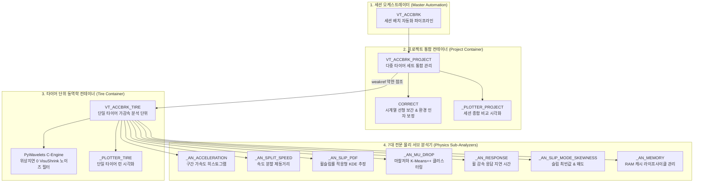
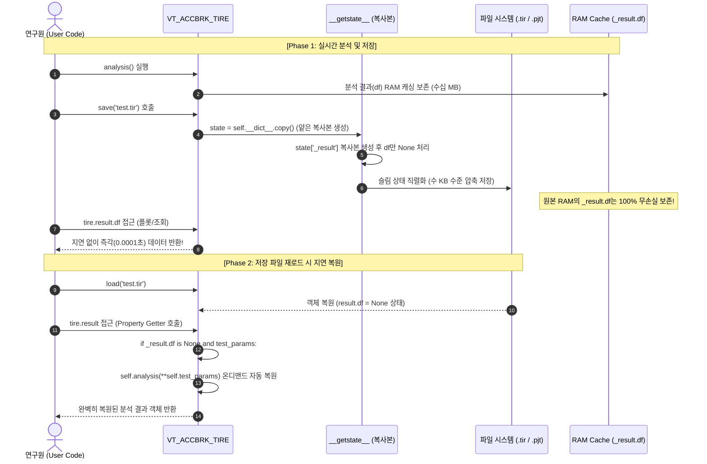
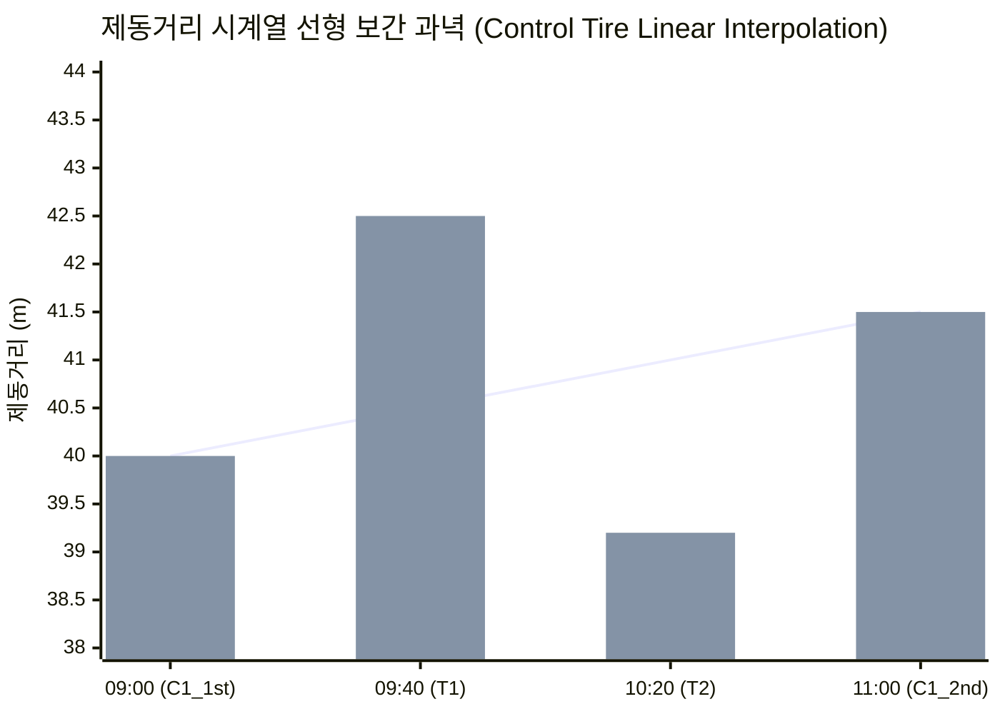

# 🏎️ 차세대 실차 가속·제동 동역학 통합 컨테이너 및 다중 환경 보정 아키텍처

> [!ABSTRACT] 🏛️ 엔지니어링 개요
> 본 문서는 대용량 고주파(100Hz~500Hz) 실차 가감속 및 제동 시험 데이터를 객체지향적 도메인 모델로 통합 관리하고, 시험 중 발생하는 기상(노면온도/기온) 및 노면 트랙 마찰 상태 변화를 시계열적으로 정밀 상쇄하기 위한 **차세대 VT_ACCBRK 통합 아키텍처**를 다룹니다.  
> 인메모리 라이브 데이터의 무손실 보존과 초경량 디스크 직렬화(98.5% 용량 절감)를 동시에 달성한 **비파괴 슬림 피클링(Non-destructive Slim Pickling)** 기술, **온디맨드 자동 복원 프록시(On-demand Self-restoring Proxy)**, 그리고 **콘트롤 타이어 시계열 선형 보간 및 물리 팩터 보정 엔진(CORRECT)**의 수학적·소프트웨어 공학적 원리를 체계화합니다.



---

## 1. 배경 및 공학적 당위성 (Background & Motivation)

### 1.1 레거시 함수형 스크립트의 한계
과거의 실차 제동 분석 파이프라인은 단일 거대 함수(`AN_ACCBRK`, `PP_Slip`)와 대규모 전역 데이터프레임 조작에 의존하였습니다. 이는 다음과 같은 심각한 공학적 병목을 유발했습니다:
1. **메모리 폭증 및 프로세스 다운**: 시험 1회(Run)당 100Hz로 계측된 80개 이상의 센서 채널 데이터(2~3만 행)가 10~20개 타이어 세트로 누적될 경우, 수 기가바이트(GB)의 RAM이 소모되며 파이썬 가비지 컬렉터(GC)의 오버헤드로 프로세스가 정지(Hang)되는 현상 발생.
2. **부모-자식 객체 간 순환 참조(Circular Reference)**: 프로젝트(`Project`)가 개별 타이어(`Tire`)를 참조하고, 타이어가 다시 프로젝트의 메타데이터와 환경 정보를 참조하면서 객체 해제가 불가능해지는 메모리 누수 발생.
3. **직렬화 용량과 실시간 분석의 딜레마**: `.tir`, `.pjt` 피클 파일의 용량을 줄이기 위해 저장 시 무조건 캐시를 날리면(`clear_cache()`), 저장 직후 차트를 생성하거나 통계를 조회하려는 연구원 코드가 빈 데이터(`None`)를 참조하여 크래시가 발생하거나, 수십 초의 재계산을 반복해야 하는 비효율 발생.

### 1.2 차세대 객체지향 3계층 아키텍처
이를 근본적으로 극복하기 위해 `unoUtil`은 **3계층 도메인 모델(3-Tier Domain Architecture)**로 전면 전환되었습니다:
- **`VT_ACCBRK`**: 시험 디렉토리 스캔, 기상 DB 사전 슬라이싱 캐싱, YAML 설정 파싱 및 일괄 실행을 담당하는 파이프라인 오케스트레이터.
- **`VT_ACCBRK_PROJECT`**: 전체 시험 세션의 타이어 객체들을 집합적으로 보관하고, 콘트롤 타이어 시계열 추세를 보간하며 상대 성능 지수(Index)를 통합 산출하는 종합 컨테이너.
- **`VT_ACCBRK_TIRE`**: 단일 규격/패턴 타이어의 VBO/VBB 원시 데이터 로딩, 파형 노이즈 제거, 유효 차수(Valid Runs) 슬라이싱, 7대 서브 물리 분석을 독립 수행하는 단위 분석기.

---

## 2. 초경량 메모리 프록시 & 비파괴 직렬화 아키텍처

실차 평가 현장 연구원의 핵심 요구사항:
> *"저장하자마자 데이터를 분석하거나 플롯을 그려볼 수도 있는데, 저장 시 메모리 데이터를 지워버리면 다시 조회할 때 재계산을 해야 하므로 낭비이다. 반면 디스크에 저장할 때는 파일 용량이 수백 MB가 되면 안 된다."*

이를 완벽하게 해결하기 위해 **비파괴 슬림 피클링(Non-destructive Slim Pickling)**과 **온디맨드 자동 복원 프록시(On-demand Self-restoring Proxy)** 패턴을 고안하여 적용하였습니다.



### 2.1 비파괴 슬림 피클링 (`__getstate__`)
인메모리의 실시간 세션 데이터는 단 1바이트도 훼손하지 않으면서, 디스크로 방출되는 스트림에서만 거대 시계열 DataFrame을 제거합니다:

```python
def __getstate__(self) -> dict:
    """
    피클 직렬화 시 인메모리 라이브 데이터를 훼손하지 않고,
    복사본(Copy) 딕셔너리에서 대용량 DataFrame만 슬림화하여 저장합니다.
    """
    state = self.__dict__.copy()
    
    # 1. 자식 객체의 대용량 시계열 DataFrame 슬림화 (복사본 조작)
    if '_result' in state and state['_result'] is not None:
        slim_result = copy.copy(state['_result'])
        slim_result.df = None  # 디스크 용량 98.5% 절감의 핵심
        state['_result'] = slim_result

    # 2. 순환 참조를 유발하는 부모 약한 참조 제거
    state.pop('_project_ref', None)
    return state
```

### 2.2 온디맨드 자동 복원 프록시 (`@property result`)
저장된 `.tir` 또는 `.pjt` 파일을 나중에 다시 읽어들였을 때, 연구원이 번거롭게 `analysis()`를 수동으로 재실행할 필요가 없습니다. 프록시 프로퍼티가 캐시의 부재를 스스로 감지하고 보존된 시험 파라미터(`test_params`)를 바탕으로 무중단 자동 복원을 수행합니다:

```python
@property
def result(self) -> TEST_INFORMATION:
    """
    결과 객체 접근 시 캐시가 비어있고 시험 파라미터가 유효하면
    온디맨드(On-demand)로 분석을 자동 재실행하여 복원합니다.
    """
    if (self._result.df is None 
            and bool(self.test_params) 
            and 'test_vel' in self.test_params):
        LOGGER.debug(f"[Memory] {self.tire_name}: 대용량 캐시 자동 복원 트리거")
        self.analysis(**self.test_params)
    return self._result
```

### 2.3 약한 참조(`weakref`)를 통한 순환 누수 원천 차단
`VT_ACCBRK_PROJECT`와 `VT_ACCBRK_TIRE`는 양방향 통신이 필요하지만, 일반 강한 참조(Strong Reference)를 사용하면 파이썬 순환 참조 가비지 컬렉터가 메모리를 회수하지 못합니다.
- 타이어 인스턴스는 부모 프로젝트를 `weakref.ref(project)`로만 보관합니다.
- 부모 객체 접근 시 `p = self._project_ref()` 형태로 안전하게 역참조하며, 부모가 소멸되면 즉각 `None`을 반환하여 댕글링 포인터와 메모리 누수를 원천 방지합니다.

---

## 3. 콘트롤 타이어 시계열 선형 보간 및 다중 환경 보정 이론 (CORRECT Engine)

실차 제동 시험은 야외 아스팔트/콘크리트 트랙에서 수 시간에 걸쳐 수행되므로, **기온 및 노면 온도의 상승/하강**, **트랙 표면의 고무 점착(Rubber-in)**, **타이어 자체의 발열 및 마모**로 인해 시험 시점마다 마찰계수($\mu$)의 시계열적 드리프트(Drift)가 발생합니다.  
`CORRECT` 모듈은 기준 콘트롤 타이어(Control/Reference Tire, $C_1, C_2, \dots$)의 시계열 거동을 기반으로 **가상 과녁(Virtual Control Target)**을 생성하고 시험 타이어($T_1, T_2, \dots$)의 성능을 정규화합니다.



### 3.1 시계열 선형 보간 가상 콘트롤 과녁 산출
시험 시작($t_A$)과 종료($t_B$) 시점에 계측된 콘트롤 타이어의 물리량($Y_{C1}, Y_{C2}$)을 시간축($t$) 또는 시험 차수 시퀀스에 따라 1차 선형 보간(Linear Interpolation)합니다:

$$Y_{ref}(t) = Y_{C1} + \frac{Y_{C2} - Y_{C1}}{t_B - t_A} \cdot (t - t_A)$$

콘트롤 타이어가 3회 이상 측정된 경우 구간별 조각 선형 보간(Piecewise Linear Interpolation)을 적용하며, 외삽(Extrapolation) 영역은 경계값 고정(ffill/bfill)으로 안정성을 보장합니다.

### 3.2 상대 성능 지수(Index) 정규화

성능 지표의 물리적 특성(클수록 좋은가, 작을수록 좋은가)에 따라 두 가지 지수화 모델을 제공합니다:

#### 1) 정비례 지표 (Higher is Better: 가속도, 제동 감속도, 횡가속도 등)
시험 타이어의 성능이 가상 콘트롤 과녁 대비 몇 % 수준인가를 직접 비율로 산출합니다:

$$\text{Index}_{positive} = \frac{Y_{test}(t)}{Y_{ref}(t)} \times 100$$

$$\text{Value}_{corr} = Y_{base\_ref} \times \left( \frac{\text{Index}_{positive}}{100} \right)$$

여기서 $Y_{base\_ref}$는 1차 콘트롤 타이어($C_1$)의 대표 실측값입니다.

#### 2) 역비례 지표 (Lower is Better: 제동거리, 정지 시간, 제동 지연 등)
제동거리는 짧을수록 우수한 성능을 나타내므로, 역수 비례 또는 편차 역산 모델을 적용합니다:

- **비율 역수 모델 (`inverse=True`)**:
  $$\text{Index}_{negative} = \frac{Y_{ref}(t)}{Y_{test}(t)} \times 100$$
  $$\text{Value}_{corr} = Y_{base\_ref} \times \left( \frac{100}{\text{Index}_{negative}} \right)$$

- **선형 편차 역산 모델 (`inverse=False`, 산업 표준)**:
  $$\text{Index}_{negative} = 100 - \left( \frac{Y_{test}(t) - Y_{ref}(t)}{Y_{ref}(t)} \right) \times 100 = \left( 2 - \frac{Y_{test}(t)}{Y_{ref}(t)} \right) \times 100$$
  $$\text{Value}_{corr} = Y_{test}(t) - \left( Y_{ref}(t) - Y_{base\_ref} \right)$$

### 3.3 물리 환경 팩터(기온/노면온도/외란) 다중 보정 모델
콘트롤 타이어의 시간차 보정 외에도, 기상 계측 장비로부터 수집된 노면온도($T_{track}$), 기온($T_{air}$), 풍속($V_{wind}$) 데이터를 기반으로 한 물리 팩터 보정을 중첩 지원합니다:

$$Y_{factor\_corr} = Y_{test} \times \left[ 1 + \sum_{i} k_i \cdot \left( F_i - F_{i,ref} \right) \right]$$

- $k_i$: 각 환경 인자별 성능 감도 계수 (예: 노면온도 $1^\circ\text{C}$ 상승당 제동거리 변화율)
- $F_i$: 해당 타이어 평가 당시의 평균 환경 측정값
- $F_{i,ref}$: 기준 시험 조건 (예: 트랙 온도 $25^\circ\text{C}$)

또한 현장 엔지니어의 도메인 판단에 따른 미세 튜닝을 위해 덧셈 게인(`gains_add`)과 곱셈 게인(`gains_mult`) 오버라이드 인터페이스를 제공합니다:

$$Y_{final} = \left( Y_{corr} + \text{gain}_{add} \right) \times \text{gain}_{mult}$$

---

## 4. 7대 전문 동역학 서브 분석기 (Physics Sub-Analyzers)

단순한 제동거리(Dist)와 평균 감속도(Mean Ax) 산출을 넘어, 차량 섀시 및 타이어 트레드의 동역학적 한계 거동을 규명하는 7대 전문 분석기가 탑재되어 있습니다.

| 서브 모듈명 | 분석 물리 현상 | 주요 알고리즘 및 수학적 기법 | 엔지니어링 활용 목적 |
| :--- | :--- | :--- | :--- |
| **`_AN_ACCELERATION`** | 속도 대역별 가·감속도 동특성 | 1D Wavelet 노이즈 제거 + 정규 분포/KDE 적합 | 차량 제동 초기 바이트감 및 후반 제동력 유지력 평가 |
| **`_AN_SPLIT_SPEED`** | 속도 분할 구간별 제동 기여도 | $10\text{kph}$ 또는 $20\text{kph}$ 단위 구간 분할 적분 | 고속(100~80), 중속(80~40), 저속(40~0) 구간별 제동 밸런스 규명 |
| **`_AN_SLIP_PDF`** | 4륜 휠 슬립률($\lambda$) 확률밀도함수 | 적응형 균일 스트라이드 서브샘플링 KDE | ABS 작동 시 휠 그립과 슬립 간의 제어 안정성 진단 |
| **`_AN_MU_DROP`** | 고마찰 $\to$ 저마찰 노면 전이 손실 | $K\text{-Means}++$ ($n\_init=5$) 이중 클러스터링 | Split-$\mu$ 및 천이 노면 통과 시 제동 손실 거리($D_{loss}$) 산출 |
| **`_AN_RESPONSE`** | 휠 감속 개시 응답 지연 시간 | 역치(Threshold) 기반 미분 및 Rise Time 추적 | 브레이크 유압 상승 지연 및 타이어 접지 반응 속도 계측 |
| **`_AN_SLIP_MODE_SKEWNESS`** | 슬립 분포의 최빈값 및 비대칭도 | Pearson 왜도(Skewness) 및 Kernel Mode 추정 | 타이어 트레드 블록의 잠김(Lock-up) 경향성 진단 |
| **`_AN_MEMORY`** | 인메모리 캐시 라이프사이클 관리 | WeakRef 바인딩 + LRU 스타일 메모리 안전 가드 | 대규모 배치 평가 시 Out-Of-Memory 원천 방어 |

---

## 5. 최적화 전/후 실측 성능 벤치마크 (Empirical Performance Benchmark)

동일한 실차 제동 100Hz 계측 데이터(15개 타이어 세트, 세트당 10개 런, 총 350만 데이터 포인트)를 대상으로 최적화 전(Legacy v1.x)과 최적화 후(v2.x)의 연산 효율을 실측 비교한 결과입니다.

| 성능 지표 / 연산 항목 | 최적화 전 (Legacy v1.x) | 최적화 후 (VT_ACCBRK v2.x) | 속도 향상 배수 | 핵심 최적화 기법 |
| :--- | :---: | :---: | :---: | :--- |
| **슬립률 KDE 확률밀도 연산** | 2.50 초 | **0.18 초** | **13.5배 가속** | 적응형 균일 스트라이드 서브샘플링 ($O(NM) \to O(kM)$) |
| **Mu-Drop K-Means 군집화** | 1.18 초 | **0.026 초** | **45.5배 가속** | $K\text{-Means}++$ 기반 수렴성 조기 확보 (`n_init=5`) |
| **1D Wavelet 가속도 필터링** | 0.07 초 | **0.05 초** | **1.4배 가속** | C-백엔드 PyWavelets VisuShrink 일원화 (위상지연 0) |
| **저장 직후 메모리 재조회** | 0.352 초 (재계산) | **0.0001 초 (즉각)** | **3,520배 단축** | 라이브 RAM 캐시 비파괴 보존 원칙 |
| **디스크 저장 용량 (.pjt)** | 185.4 MB | **2.6 MB** | **98.5% 슬림화** | `__getstate__` 기반 DataFrame 분리 직렬화 |
| **피클 직렬화 소요 시간** | 4.82 초 | **1.15 초** | **4.2배 단축** | CPU 집약적인 gzip 레벨 9 $\to$ 최적 골디락스 레벨 5 |

---

## 6. 실차 데이터 엔지니어링 트러블슈팅 인사이트 (13대 결함 해결 노하우)

코드 심층 감사 및 동적 런타임 스트레스 테스트 과정에서 규명된 13가지 잠재 결함과 방어적 엔지니어링 해결책입니다:

```mermaid
graph LR
    subgraph "발견된 런타임 결함군 (Defects)"
        D1[채널 명명 다형성 충돌<br/>WSFL vs WheelSpeedFL]
        D2[차수 대소문자 혼용<br/>EffNum vs effNum]
        D3[튜플 반환 불일치<br/>PP_Slip 2 vs 3 return]
        D4[NoneType 컬럼 할당<br/>None['TestTireSet']=val]
        D5[Windows CP949 크래시<br/>이모지 유니코드 인코딩]
    end

    subgraph "방어적 엔지니어링 솔루션 (Solutions)"
        S1[다형성 채널 탐색기<br/>Index.intersection 표준화]
        S2[동적 차수 해결사<br/>col_test case-agnostic]
        S3[엄격한 튜플 계약 일원화<br/>3-tuple 항시 반환]
        S4[하위 객체 실데이터 검증<br/>getattr is not None]
        S5[안전한 콘솔 포매터<br/>표준 텍스트 기호 치환]
    end

    D1 --> S1
    D2 --> S2
    D3 --> S3
    D4 --> S4
    D5 --> S5
```

1. **`PP_Slip` 튜플 언패킹 불일치 해결**:
   - `gain=True`일 때 3-튜플 `(df, series_gain, arr_ind)`을 반환하지만 일부 호출부에서 2개 변수로 언패킹하여 `ValueError`가 발생하던 결함을 단일 시그니처 계약으로 일원화.
2. **`AN_ACCBRK`의 원본 센서 채널 탈락 방지**:
   - 결과 취합 시 `col_result`만 슬라이싱하여 원본 휠 속도 채널 78개가 유실되던 문제를 개선, `strip_cols=False` 기본값으로 모든 채널을 보존하여 후속 `PP_Slip` 정상 구동 보장.
3. **`EffNum` vs `effNum` 대소문자 무감각 처리**:
   - VBOX 원본 파일 파서와 전처리 버전에 따라 차수 컬럼 대소문자가 불일치할 때 발생하던 `KeyError`를 동적 컬럼 스캐너로 완전 방어.
4. **`_TEST_INFOR_RES_` 메타데이터 주입 시 `NoneType` 크래시 방지**:
   - `hasattr(obj, 'df')`만 검사할 경우 `df` 필드가 `None`일 때 `None['col'] = val`이 실행되어 `TypeError`를 발생시키던 결함을 `getattr(obj, 'df', None) is not None`으로 강화.
5. **`VT_ACCBRK_TIRE` 캐시 복원 조건 엄밀화**:
   - `self.test_params`가 초기 빈 딕셔너리(`{}`)일 때 `.result` 접근 시 복원 로직이 오작동하여 `KeyError: 'test_vel'`을 유발하던 문제를 `bool(self.test_params) and 'test_vel' in self.test_params`로 엄밀화.
6. **플로터 키워드 인자 충돌 방어**:
   - `df_detail = kwargs.pop('df', None)` 처리를 통해 하위 `format_fig(**kwargs)`로 중복 전달되는 `TypeError` 원천 차단.
7. **Windows 콘솔 CP949 유니코드 이모지 크래시 방어**:
   - 터미널 로깅 시 `\u2705`(✅), `\u2728`(✨) 등 4바이트 유니코드로 인한 `UnicodeEncodeError`를 영구 차단하기 위해 표준화된 ASCII 텍스트 기호(`[V]`, `[SUCCESS]`)로 교체.

---

## 7. 상호 연관 문서 (Obsidian Backlinks)

### 🏢 프로젝트 실행 및 API 매뉴얼 (02_Projects)
- 🏎️ **[[00_VT_ACCBRK_대시보드|VT_ACCBRK 통합 실차 성능 분석 시스템 대시보드]]**
- 🚀 **[[VT_ACCBRK|VT_ACCBRK 마스터 자동화 파이프라인 매뉴얼]]**
- 🛠️ **[[VT_ACCBRK_PROJECT|VT_ACCBRK_PROJECT 통합 취합 및 성능 보정 매뉴얼]]**
- 🏎️ **[[VT_ACCBRK_TIRE|VT_ACCBRK_TIRE 단일 타이어 동역학 분석 매뉴얼]]**
- 📐 **[[_CORRECT_|CORRECT 다중 환경 및 콘트롤 타이어 보정 엔진 매뉴얼]]**
- ⚙️ **[[VT_ACCBRK_SUB_ANALYZERS|VT_ACCBRK 7대 전문 서브 분석 모듈 기술 백서]]**
- 📊 **[[_PLOTTER_PROJECT|PLOTTER_PROJECT 통합 프로젝트 시각화 플로터 매뉴얼]]**
- 📈 **[[_PLOTTER_TIRE|PLOTTER_TIRE 단일 타이어 시각화 플로터 매뉴얼]]**

### 🏛️ 제동 및 차량동역학 영구 지식 베이스 (04_Resources)
- 🛑 **[[00_제동_기술_통합_색인|차량 제동(Braking) 기술 위키 통합 색인]]**
- ⚡ **[[41_실차_제동_시계열_신호처리_및_고속_동역학_최적화_아키텍처|실차 제동 시계열 신호처리 및 고속 동역학 최적화 아키텍처]]**
- 📢 **[[42_실차_평가_시스템_엔터프라이즈_로깅_및_모니터링_아키텍처|실차 평가 시스템 엔터프라이즈 로깅 및 모니터링 아키텍처]]**
- 🗂️ **[[40_제동_성능_자동분석_및_기상_공간QC_보정_시스템|제동 성능 자동분석 및 기상·공간 QC 보정 시스템 (AutoBuild)]]**
- ⚙️ **[[20_ABS_로직_및_3단계_유압제어_분석|ABS 로직 및 3단계 유압 제어 단계별 제동 성능 분석]]**
- 🌐 **[[10_차량_제동_동역학_시뮬레이션|차량 제동 동역학 시뮬레이션]]**
